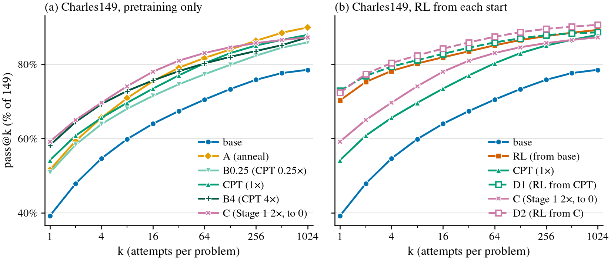

# Base saturation: anneal, pretraining dose, a longer Stage 1, and RL from a better base

**Status** (2026-11-05, 3:45 am PT; written by agent:claude for Leon; not reviewed). Done, seed 0
only. Every arm is trained and read on Charles149 at k1024. All five Runpod pods are deleted.

- Summary for readers:
  [`experiment-summaries/2026-11-05-base-saturation/`](../../../../experiment-summaries/2026-11-05-base-saturation/README.md).
- Pre-registration: [`PREREG.md`](PREREG.md) (`994790c`), with a correction (`b3fdbb3`) and
  amendment 1 (`1dc80bb`).
- Running record: [`log.md`](log.md).
- Numbers: [`table.md`](table.md) / `table.json` (pass@k and gaps), [`valloss.md`](valloss.md) /
  `valloss.json` (teacher-forced loss).
- Figure: `passk.{pdf,svg,png}`.

## Question

[`cpt_control`](../cpt_control_20261105/README.md) (summary:
[2026-11-04](../../../../experiment-summaries/2026-11-04-cpt-control-matched-continued-pretraining/README.md))
found that continued pretraining (CPT) reaches RL at pass@1024 on Charles149. CPT is 312 more AdamW
steps on the base's own Stage-1 pairs, with no RL. Pooled over 3 seeds, CPT reads 88.6% and RL
86.6%. The paper's base, S1g3, ended its LR cosine at a 30% floor, and its val loss was still
falling. That raises three questions:

1. Is CPT's gain the anneal Stage 1 never finished (H-anneal), or more training (H-undertrained)?
2. Does a properly trained Stage 1 do as well?
3. Does RL from a better base still add problems at k1024 (H-RL)?

## Arms (seed 0)

| arm | what | training run |
|---|---|---|
| base | S1g3_s0, the paper's base: 24,000 steps (4.33 epochs), cosine to 30% of peak LR | existing |
| A | anneal only: Stage 1's own trainer from S1g3_s0. A 50-step warmup to Stage 1's final LR, then a cosine to 0. **MTP weight 0** (a stated deviation: Stage 1 did not save its MTP head) | 1,200 steps, 110 s |
| B0.25 | the CPT recipe for 78 steps (0.25×) | 4 min |
| CPT | CPT_s0 from cpt_control: 312 AdamW steps, 82.1M tokens (1×) | existing |
| B4 | the CPT recipe for 1,248 steps (4×, about 328M tokens); the data repeat about 3 times | 69 min |
| C | Stage 1 retrained from scratch with the same seed, init, data order and recipe, but 2× the steps and a cosine to LR 0 | 48,000 steps (8.67 epochs), 40 min on an A40 |
| RL | the paper's RL: L3 end from base (`grpo_think_vs_mb_kkl0_s0_L3` it39) | existing |
| D1 | the paper's RL recipe (L2, then L3, 39 iterations each) from CPT_s0 | L2 97 min, L3 101 min |
| D2 | the same recipe from C | L2 77 min, L3 68 min |

Every new model got the paper's exact Charles149 read. That is `code.thinking.eval`, plain arm,
B64, T 0.8, k1024 in 16 chunks of k64 (seeds 0–15), Lean-judged, and merged as
`hirl_queue.merge_group` does. The details are in the PREREG.

*(a) The pretraining-only arms. (b) RL from each start: the paper's RL from base, D1 from CPT, D2
from C. Seed 0, Charles149, % of 149.*

## Results (observed)

pass@k in % of the 149 problems (unbiased estimator), seed 0. Lead rows are pass@1 and pass@5. The
full curve is in the figure.

| k | base | B0.25 | CPT | B4 | A | C | RL | D1 | D2 |
|---|---|---|---|---|---|---|---|---|---|
| 1 | 39.2 | 50.9 | 54.2 | 58.2 | 51.6 | 59.2 | 70.3 | 72.9 | 72.4 |
| 5 | 56.5 | 65.3 | 66.9 | 70.6 | 67.4 | 71.1 | 78.9 | 80.0 | 81.1 |
| 64 | 70.5 | 77.3 | 80.3 | 80.2 | 81.7 | 83.0 | 85.1 | 85.9 | 87.4 |
| 1024 | 78.5 | 85.9 | 87.9 | 87.2 | 89.9 | 87.2 | 89.3 | 88.6 | 90.6 |

**Pre-registered gaps** in points, with 95% problem-bootstrap intervals (`stats.paired_diff`, 4,000
draws, one seed). The full set is in [`table.md`](table.md).

| x − y | pass@1 | pass@5 | pass@1024 |
|---|---|---|---|
| CPT − base | +15.0 [+11.2, +18.9] | +10.5 [+6.9, +14.1] | +9.4 [+4.7, +14.8] |
| A − base | +12.4 [+8.8, +16.1] | +10.9 [+7.0, +15.0] | +11.4 [+6.0, +17.4] |
| A − CPT | −2.6 [−5.7, +0.2] | +0.4 [−2.0, +2.8] | +2.0 [−1.3, +5.4] |
| B0.25 − base | +11.7 [+8.5, +15.1] | +8.9 [+5.7, +12.2] | +7.4 [+3.4, +12.1] |
| CPT − B0.25 | +3.3 [+1.4, +5.1] | +1.6 [+0.3, +2.9] | +2.0 [−1.3, +5.4] |
| B4 − CPT | +4.0 [+1.4, +6.7] | +3.6 [+1.0, +6.3] | −0.7 [−3.4, +2.0] |
| C − base | +20.0 [+14.6, +25.6] | +14.6 [+9.3, +20.3] | +8.7 [+4.0, +14.1] |
| C − CPT | +5.0 [−0.2, +10.2] | +4.2 [−0.9, +9.4] | −0.7 [−5.4, +4.0] |
| D1 − CPT | +18.7 [+13.3, +24.3] | +13.0 [+7.9, +18.7] | +0.7 [−3.4, +4.7] |
| RL − D1 | −2.6 [−4.7, −0.5] | −1.0 [−3.1, +0.9] | +0.7 [−3.4, +4.7] |
| D2 − C | +13.2 [+7.9, +18.3] | +9.9 [+5.1, +14.8] | +3.4 [+0.0, +6.7] |
| D2 − RL | +2.1 [−2.1, +6.2] | +2.1 [−1.3, +5.8] | +1.3 [−2.7, +5.4] |

The D2 − C pass@1024 interval's lower end is exactly 0.00 in `table.json`.

**How close each pretraining-only arm gets to RL** (descriptive, added after all reads; † in
`table.md`). RL − base is +31.1 at pass@1 and +10.7 at pass@1024.

| arm | RL − arm, pass@1 | RL − arm, pass@1024 | share of RL − base at pass@1 | share at pass@1024 |
|---|---|---|---|---|
| A | +18.7 [+13.4, +24.2] | −0.7 [−4.7, +3.4] | 40% | 106% |
| B0.25 | +19.4 [+13.9, +25.2] | +3.4 [−1.3, +8.1] | 38% | 69% |
| CPT | +16.1 [+10.6, +21.8] | +1.3 [−2.7, +5.4] | 48% | 87% |
| B4 | +12.1 [+6.5, +18.1] | +2.0 [−2.7, +6.7] | 61% | 81% |
| C | +11.1 [+5.2, +17.2] | +2.0 [−2.7, +6.7] | 64% | 81% |

**Problems solved at k1024 by one arm only** (any of 1,024 attempts):

| x | y | x only | y only | x solved | y solved |
|---|---|---|---|---|---|
| D1 | CPT | 5 | 4 | 132 | 131 |
| D2 | C | 6 | 1 | 135 | 130 |
| RL | D1 | 5 | 4 | 133 | 132 |
| C | base | 15 | 2 | 130 | 117 |
| A | base | 18 | 1 | 134 | 117 |
| A | CPT | 5 | 2 | 134 | 131 |
| RL† | C | 8 | 5 | 133 | 130 |

**Teacher-forced loss** (`valloss.py`; cpt_control's scorer, CPU fp32). Columns: Stage 1's val split
(7,000 pairs; S1g3_s0 logged 0.0692) and Charles149's reference proofs, mean NLL per scored token.

| model | val w1 | Charles149 ref w1 | pass@1024 |
|---|---|---|---|
| base | 0.0692 | 0.0898 | 78.5 |
| B0.25 | 0.0657 | 0.0694 | 85.9 |
| CPT | 0.0648 | 0.0655 | 87.9 |
| B4 | 0.0661 | 0.0687 | 87.2 |
| A | 0.0658 | 0.0695 | 89.9 |
| C | 0.0672 | 0.0709 | 87.2 |
| RL | 0.0847 | 0.1168 | 89.3 |
| D1 | 0.0719 | 0.0949 | 88.6 |
| D2 | 0.0707 | 0.0699 | 90.6 |

- Every further-trained pretraining arm lowers val loss below the base, by 3–6%.
- C's final val (0.0672) sits above the continuation arms' (0.0648–0.0661), despite 2× Stage 1's
  steps. C's val is flat at about 0.067 over its last 10k steps. The intermediate val points in
  Stage 1's log are noisy (±0.01).
- RL raises val loss over its start: RL +22% over base, D1 +11% over CPT, D2 +5% over C.
- On the Charles149 reference proofs, RL is +30% over base and D1 +45% over CPT, while D2 is −1%
  under C.
- Among the five further-trained pretraining arms, val loss does not order pass@1024. This answers
  amendment 1's question: only the base stands apart on both.

## Pre-registered readings (pass@1024 unless stated)

| reading | criterion | numbers | verdict |
|---|---|---|---|
| Unfinished anneal (H-anneal) | A − base ≥ ½ (CPT − base), and the A − CPT interval includes 0 | A − base +11.4 [+6.0, +17.4] against ½ × 9.4 = 4.7; A − CPT +2.0 [−1.3, +5.4] | **holds** |
| Anneal is not the story | the A − base interval includes 0 | [+6.0, +17.4] | **fails** |
| Undertrained (H-undertrained) | the B4 − CPT interval lies above 0, or C − base lies above 0 with C ≥ CPT's pass@1024 | B4 − CPT −0.7 [−3.4, +2.0]. C − base +8.7 [+4.0, +14.1], but C 87.2 < CPT 87.9 (130 vs 131 problems) | **fails**. The C clause fails by one problem, inside the pre-stated 3-point seed band |
| Dose plateau | the B4 − CPT interval includes 0 | −0.7 [−3.4, +2.0] | **holds** |
| Dose turns over | the B4 − CPT interval lies below 0 | −0.7 [−3.4, +2.0] | **fails** |
| RL adds coverage over a better base (H-RL holds) | the D1 − CPT or the D2 − C interval lies above 0 | D1 − CPT +0.7 [−3.4, +4.7]; D2 − C +3.4 [+0.00, +6.7]. Only-counts: D1 5 vs CPT 4; D2 6 vs C 1 | **fails, on the boundary**. D2 − C's interval touches 0 but does not lie above it |
| RL adds no coverage over a better base (H-RL fails) | both intervals include 0 (or lie below it) | as above. Side clause: D − start at pass@1 is D1 − CPT +18.7 [+13.3, +24.3] and D2 − C +13.2 [+7.9, +18.3], both above 0 | **holds, on the boundary**. The side clause holds, so by the PREREG's wording the claim becomes "RL improves sampling efficiency (small k) over a saturated base" |
| Seed-noise caveat (pre-stated) | differences of ≤ 3 points at pass@1024 are within cpt_control's seed spread | A − CPT 2.0, B4 − CPT 0.7, C − CPT 0.7 and D1 − CPT 0.7 are inside the band; D2 − C 3.4 is just outside it | applied |

**Overall.**
- H-anneal is supported at pass@1024.
- H-undertrained is not supported at pass@1024, but more training keeps helping at pass@1.
- H-RL is not decided at one seed: D1 says no, and D2 sits on the boundary.

**Against the predictions table:**
- At pass@1024 every H-anneal prediction holds: A ≈ CPT, B0.25 near CPT, B4 ≈ CPT, and
  C ≈ CPT ≈ A.
- At pass@1 the dose climbs (B0.25 50.9 → CPT 54.2 → B4 58.2), and C − A is +7.6 [+2.0, +13.2].
  That is the H-undertrained pattern, at small k only.
- The agent's pre-stated prior was a mix: A above base, the dose curve flattening by 1–4×, and
  D1 − CPT at pass@1024 within ±3 points. All three parts match.

## Interpretation (single seed; an interpretation, not a claim)

- **The base was not converged.** S1g3's LR cosine stopped at a 30% floor, and its val loss was
  still falling. Each of these arms lowers val loss and adds 7–11 points at pass@1024:
  - finishing the anneal (A, 1,200 steps, about 0.27× CPT's tokens);
  - a short low-LR continuation (B0.25, CPT, B4);
  - a properly trained Stage 1 (C).
- **Those arms recover RL's large-k coverage.** At pass@1024 they reach 69–106% of RL's gain over
  base. Every RL − arm interval includes 0.
- **RL from a better base still adds sample efficiency.** D1 and D2 add +13 to +19 points at pass@1
  over their starts and land at or slightly above the paper's RL (72.9 and 72.4 against 70.3). At
  k1024 they add +0.7 (D1) and +3.4 (D2). D2's +3.4 is borderline: its interval touches 0, and it is
  just outside the seed band.
- **So, on this seed,** the paper's "RL creates capability at large k" largely reflects an
  undertrained (un-annealed) base. RL's robust effect here is sample efficiency.
- **Large and small k behave differently.** At large k, a short anneal is enough and more data adds
  nothing. At small k, more pretraining keeps paying (B4 > CPT, C > A), so "how converged is the
  base" matters for pass@1 comparisons too.

**Open hypotheses (not tested here):**
- D2's +3.4 at k1024 is real RL coverage over a fully trained base, not seed noise.
- D's extra guard rollbacks (below) held RL back, so D1's and D2's large-k gains understate the
  recipe.

## Caveats

- **One seed, one set.** The intervals cover problem sampling only. In cpt_control, RL − CPT at
  pass@1024 ranged +1.3 to −4.0 across 3 seeds.
- **D's RL guard rolled back more often than the paper's RL did.** The paper's RL had 0 rollbacks
  in L2 and 1 in L3 (final lr ×0.5). From the pods' stage logs:
  - D1 L2: 1 rollback (it 29 → it 25), final lr ×0.5.
  - D1 L3: 3 rollbacks (it 20 → 15, 28 → 25, 29 → 25), final lr ×0.125. A 4th canary alarm at
    it 30 was not rolled back (`--max_rollbacks 3` reached).
  - D2 L2: 1 rollback (it 3 → it 0), so lr ×0.5 for 36 of 39 iterations.
  - D2 L3: 2 rollbacks (it 3 → it 0, it 30 → it 25), final lr ×0.25. Think-banned-mass alarms at
    it 37–39 were not rolled back, because the restore point had the same mass.
  - The PREREG said D's L2 guard line would be recorded and reported, not used to refuse.
  - So D1 and D2 ran with less effective RL LR than the paper's RL. D2 moved least from its start:
    val +5% and Charles149-ref −1%, against +22% / +30% for RL from base.
- **C changes two things at once** (2× steps and a cosine to 0), so it cannot separate "more steps"
  from "a full anneal". A is the anneal-only control. Note that A's warm restart had no optimizer
  state and used MTP weight 0.
- **B4 repeats its data** about 3 times.
- **D2's read chunks 8–15 ran on `rp-sat-c` instead of `rp-sat-d1`.** This was a coordinator ops
  change (log.md, 10:25:53Z). D2's L3 ended before D1's, so it needed no copy. The checkpoint and
  read settings are the same, and a chunk's result depends on its seed, not its pod.
- **Lean workers.** The reads used `LEAN_GATE_WORKERS` = min(16, the pods' CPU quota of 8), not
  the paper's 16. D1's GRPO Lean gate ran 7 workers (log.md, 11:20 pm). Lean verdicts do not
  depend on either.
- **The pods ran the pre-lint `anneal.py`.** It is AST-equivalent apart from one assert's operand
  order and a label string (log.md, 11:18 pm).
- **The † rows were chosen after the data.** They are descriptive.

## Cost

Five A40 SECURE pods at $0.59/h, created 11:03 pm PT Nov 4:

| pod | jobs | hours |
|---|---|---|
| `rp-sat-a` | A + its read + C chunks 0–7 | 1.58 |
| `rp-sat-b025` | B0.25 + its read + C chunks 8–15 | 1.51 |
| `rp-sat-b4` | B4 + its read | 2.46 |
| `rp-sat-c` | C, D2 L2 and L3, and D2's read | 4.23 |
| `rp-sat-d1` | D1 L2 and L3, and D1's read | 4.43 |

- **Total:** 14.21 pod-hours, **$8.38**, against a $18.49 ceiling (PREREG estimate $12.3).
- **Teardown:** the last pod ended at 3:29 am PT.
- **No lab GPU was used.** Serrano CPU did the staging, merging, tables and val loss.

## Files

| file | what |
|---|---|
| `PREREG.md` | hypotheses, arms, reads, readings, bounds; correction and amendment 1 |
| `log.md` | running record (PST, UTC in brackets) |
| `anneal.py` | arm A: Stage 1's trainer from S1g3_s0, warmup then cosine to 0 (copied into the `cd089700` snapshot) |
| `stage1_to0.py` | arm C: `code.thinking.train` at `cd089700` with `MIN_LR_FRAC` 0 |
| `runpod_copy.sh`, `runpod_copy_ckpt.sh`, `pod/` | pod staging and the on-pod `go.sh` / watchdog scripts |
| `launch.sh`, `poll.sh`, `pull.sh`, `podcheck.sh` | launch, event polling, pulling outputs, pod health |
| `merge.py` | merges the 16 read chunks per arm into `final/` (as `hirl_queue.merge_group`) |
| `table.py` → `table.md`, `table.json` | pass@k, paired gaps, one-arm-only counts, curve |
| `valloss.py` → `valloss.md`, `valloss.json` | teacher-forced loss on Stage 1's val split and Charles149 references (CPU) |
| `figure.py` → `passk.{pdf,svg,png}` | pass@k curves, `code/ndbench/figures/style.py` |

**Data on serrano:**
- Merged reads: `/scratch/cowifornia/nd-rl/base_saturation/final/charles149_sat_{A,B78,B1248,C,D1,D2}_s0_plain_k1024/`.
- Pulled pod outputs (checkpoints, logs, events):
  `/scratch/cowifornia/nd-rl/base_saturation/pods/<alias>/`.
- D1 and D2 are the L3 it39 checkpoints under `out/grpo/*_L3/ckpts/`.

## Commits (branch `leon/base-saturation`, worktree `/scratch/cowifornia/nd-rl/worktrees/base-saturation`)

| commit | what |
|---|---|
| `994790c` | PREREG, pod scripts, A and C trainers |
| `b3fdbb3` | PREREG correction (seed-0 CPT − base); launch, pull, poll, merge, table |
| `1dc80bb` | PREREG amendment 1 (val-loss context), `valloss.py` |
| `d488829` | A and B0.25 reads merged; table pairs against base and CPT; figure script |
| this README's commit | D1/D2 val loss, final table and figure, write-up |

**Code snapshots run on the pods:** Stage 1 `cd089700`, CPT `32bc1da`, GRPO L2 `fa28f6eb`, GRPO L3
`f35d3daf`, reads `cce4dfc`.
