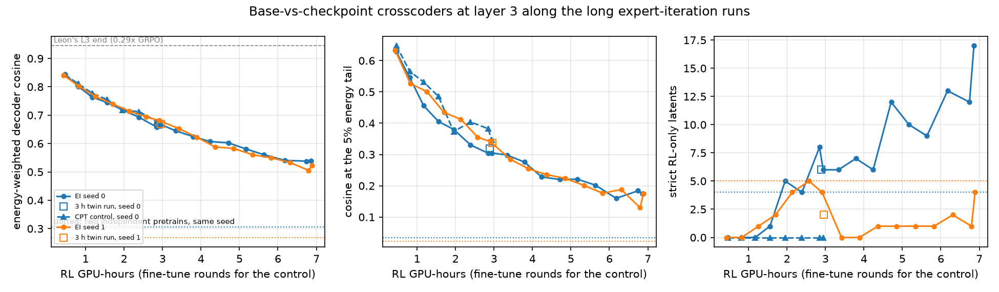

# Crosscoder ladder: how do the base's features rotate along a long expert-iteration run?

Robbie's design (2026-11-06), after Leon's circuit-diffing study
([summary on `leon/base-saturation`](../../../../experiment-summaries/2026-11-01-circuit-diffing-rl-new-features/README.md)):
Leon trained one crosscoder between his Stage-1 base and the end of a GRPO run at 0.29x pretraining FLOPs and
found no RL-only features, only a rotation of the shared ones (energy-weighted decoder cosine 0.945, against 1.000
for a one-step null). This runs his Stage 1 along a much longer RL run: Robbie's long-RL expert iteration
([`long_rl_20261014`](../long_rl_20261014/README.md), untied arm), 3 h and 7 h of RL on top of a 10-minute pretrain.
The question is how the rotation and the RL-only count move with RL compute: flatten early, keep growing, or break.

**Status (2026-11-07):** done. One A40, about 9 h of pod time (the self-destruct ended it; the job itself took
about 6.5 h), about $5. Results below; the ladder table is [`ladder.md`](ladder.md), every number is in
[`ladder.json`](ladder.json), the figure is `figures/cos_vs_rl.png`. Summary:
[`experiment-summaries/2026-11-06-crosscoder-ladder`](../../../../experiment-summaries/2026-11-06-crosscoder-ladder/README.md).

## Results

**Observed.**

1. **The rotation grows smoothly with RL and never flattens.** The energy-weighted decoder cosine between the base
   and the checkpoint falls from 0.84 at 0.5 h to 0.67 at 3 h and 0.53 at 7 h, the same on both seeds to within
   0.02 at every point. The excess over the two-pretrains floor (below) decays as an exponential in RL hours with
   a half-life of 5.3 h on both seeds (rms residual 0.01). The 5% energy tail falls from 0.63 to 0.17.
2. **Continued pretraining rotates the features just as much, round for round.** The control (the EI fine-tune
   recipe for 36 rounds on fresh pretraining records, from the same base, no rollouts) lands within 0.02 of the
   EI curve at every saved round; mean EI minus control over the 8 points is -0.009.

   | EI round | RL h | EI cos | control cos | EI tail | control tail | EI RL-only | control RL-only | EI dnorm median | control |
   |---|---|---|---|---|---|---|---|---|---|
   | 5 | 0.46 | 0.844 | 0.842 | 0.63 | 0.65 | 0 | 0 | 0.49 | 0.50 |
   | 10 | 0.81 | 0.801 | 0.811 | 0.55 | 0.57 | 0 | 0 | 0.49 | 0.49 |
   | 15 | 1.17 | 0.764 | 0.777 | 0.46 | 0.53 | 0 | 0 | 0.47 | 0.49 |
   | 20 | 1.56 | 0.745 | 0.755 | 0.41 | 0.49 | 1 | 0 | 0.46 | 0.49 |
   | 25 | 1.95 | 0.719 | 0.717 | 0.38 | 0.37 | 5 | 0 | 0.45 | 0.49 |
   | 30 | 2.39 | 0.693 | 0.713 | 0.33 | 0.40 | 4 | 0 | 0.45 | 0.48 |
   | 35 | 2.85 | 0.658 | 0.678 | 0.30 | 0.38 | 8 | 0 | 0.45 | 0.48 |
   | final (36) | 2.94 | 0.668 | 0.670 | 0.30 | 0.35 | 6 | 0 | 0.44 | 0.48 |

3. **What differs between EI and the control is small and not in the cosine.** EI's RL model carries slightly
   larger decoder norms than the base (Δnorm median drifts from 0.49 to 0.44; the control stays at 0.48 to 0.50,
   where 0.50 is equal norms); EI's 5% tail sits 0.05 to 0.08 below the control's from round 15 on; and the strict
   RL-only count is 1 to 8 for EI from round 20 on against 0 for the control at every round.
4. **The two-pretrains "null" is not a null.** Two pretraining runs with the same seed, data and recipe differ in
   their block matrices by a relative 1.40 (independent matrices) and give a crosscoder cosine of 0.31 (seed 0) and
   0.27 (seed 1), with 4 to 5 strict "RL-only" and 6 to 9 "base-only" latents. The wall-clock cosine schedule,
   Muon and GPU nondeterminism diverge the runs completely. So 0.3 is the floor for same-recipe models, 1.0 is
   identical weights, and the strict rule flags about 5 latents between any two different models.
5. **Weights move far more than features.** EI round 5 already moves the block matrices by a relative 0.55 and the
   3 h endpoint by 0.98 (Leon's L3 end: 0.065), while the cosine is still 0.84 and 0.67. The two independent 3 h
   runs of each seed (v2 and v4) give the same cosine to 0.01 (0.668 / 0.668, 0.670 / 0.681).
6. **Planted control.** 4 of 6 planted features recovered as strict RL-only at the 3 h endpoint and 5 of 6 at 7 h,
   with no false positive beyond the unplanted run's own count. The miss is the rarest, weakest plant (0.3% of
   tokens, magnitude 2), as in Leon's run.
7. **RL-only latents by seed.** Seed 0: 0 through 1.2 h, 4 to 8 through 3 h, 6 to 17 from 3 to 7 h. Seed 1: 0 to 5
   through 3 h, then 0 to 4. Only seed 0's late points are above the two-different-models count.
8. **Quality.** FVU 0.010 to 0.017 for both models at every pair, splice loss recovered 1.00, 6,700 to 7,700 of
   8,192 latents live.

**Expectations, checked.** Quality: met. Null: failed as designed (it measured independent models, see 4). Planted:
met (4 of 6, 5 of 6). The curve: below 0.95 at 3 h as expected; neither pre-registered reading applies cleanly: the
cosine does not flatten by 1 h, and it is still falling at 7 h, but the control falls with it.

**Interpretation** (kept apart from the results above).
- Under this recipe the crosscoder cosine is a clock for optimizer steps, not a signature of RL: matched
  continued pretraining rotates the base's features by the same amount at every round. This is Leon's "rotation is
  drift" result at ten times his RL compute and fifteen times his weight change.
- The RL-specific residue is a norm shift and a slightly heavier rotation tail, plus a seed-dependent handful of
  RL-only latents late in the run that sits at or just above the count two unrelated models produce. Whether those
  latents carry any of RL's gain is untested (no Stage 2 here).
- The metric cannot serve as a proxy for "diverged from pretraining in the RL sense" without a CPT baseline, and
  with one it says this EI run is not distinguishable from more training in feature geometry at layer 3.

**Limits.** One layer (3 of 6). One control seed, from the seed-0 base. The control matches EI's fine-tune steps
and records per round, not its sampling compute. Rollout sequences, not Lean-accepted proofs, feed the crosscoders.
The strict RL-only rule's thresholds are Leon's and were not recalibrated to the 0.3 floor. x is RL GPU-seconds from
the run summaries; FLOP ratios are not logged.

## Ladder

Checkpoints from HF `robbiethompson2018/nd-rl-checkpoints`, `runs/long-rl-20261014-*`. RL GPU-seconds per checkpoint
come from each run's `summary.json` (`rl.rounds[i].rl_secs_used`). v4 and v2 are separate runs of the same recipe (3 h
of RL); v5 resumed v2's endpoint for 4 more hours, so its clock starts at v2's 3 h.

| run | base | points | RL clock |
|---|---|---|---|
| v4_untied-ei_s0, s1 | its own `pretrain.pt` | rounds 5, 10, ..., 35 (s1: to 30), final (round 144 / 136) | 0.17 h to 0.72 h, then 2.9 h |
| v5_untied-ei_s0, s1 | v2's `pretrain.pt` | v2 final (round 140), v5 rounds 5, ..., 40, v5 final (round 304 / 300) | 2.9 h, 3.0 to 3.8 h, 6.9 h |

The checkpoint cadence is what the runs saved: every 5 rounds for the first 35 to 40 rounds, then the endpoint.

Controls:
- **Null:** v4's pretrain vs v2's pretrain, same seed, data and recipe, GPU nondeterminism apart. Two seeds.
- **Planted features** (Leon's six, `--plant`) on v4 s0 final and v5 s0 final.

- **CPT control** (`cpt.py`, added 2026-11-06 after the null came out at 0.3): the EI fine-tune (Muon on the
  matrices, AdamW on the rest, FT_RECORDS = 38,400 records per round, the same warmup and cosine) for 36 rounds
  from the seed-0 base on fresh random pretraining records, saved every 5 rounds, placed at the mirrored EI round's
  RL clock.

The base is the un-annealed 198-lineage pretrain (`MIN_LR_FRAC` 0.3).

## Recipe (Leon's, unchanged where it could be)

- **Sequences** (`collect.py`): per checkpoint, its own rollouts on 2,000 RL-pool targets (one fixed draw from
  `long_rl_20261014/data/rl.jsonl`, seed 0), 4 attempts each, temperature 0.8, the harness's per-target caps, no Lean;
  plus 20,000 pretraining records. 3% of each source is held out.
- **Crosscoder** (`crosscoder.py`): residual stream after block 3 of 6, both models scaled to E‖a‖² = d. BatchTopK,
  8,192 latents, k 32, AuxK, 40M training tokens, Adam 3e-4 with warmup and a 20% decay. One crosscoder per
  (base, checkpoint) pair; latent statistics on the held-out sequences: decoder norms and cosines, firing rates,
  energy, Latent Scaling betas, splice loss.
- **Classification** (`analyze.py`): Leon's strict RL-only rule, Δnorm < 0.1 and both Latent Scaling ratios < 0.3;
  base-only symmetric. Energy-weighted cosine over live latents, weighted by the RL model's held-out energy, and the
  cosine at the 5% energy tail.

## Expectations, written before any crosscoder trained

- Quality: FVU ≤ 0.10 at layer 3 for both models, loss recovered ≥ 0.9.
- Null: cosine ≥ 0.99, 0 strict RL-only latents.
- Planted: at least 4 of 6 recovered as strict RL-only, no false positives (Leon: 4 of 6).
- The curve: cosine falls with RL and is below 0.95 by the 3 h endpoint. The elicitation reading is a curve that
  flattens by 1 h; the alternative is a cosine still falling at 7 h, or strict RL-only latents appearing above the
  planted floor at the late points when none appear early.

## Files

| file | what |
|---|---|
| `common.py` | the long-RL model (run 198's untied trunk, overlay tokenizer) from a checkpoint, the ladder, rollouts without Lean, residual capture |
| `collect.py` | sequences to `CL_ART/seqs/*.npz` |
| `crosscoder.py` | Leon's crosscoder, training, evaluation and planted control, on explicit checkpoint paths |
| `analyze.py` | the ladder table and figure from `CL_ART/crosscoders/*` |
| `cpt.py`, `queue_cpt.sh` | the CPT control arm and its rollouts and crosscoders, run after `queue.sh` |
| `setup_pod.sh`, `queue.sh`, `launch.py` | one A40: fork + checkpoints, the resumable job, rent / start / monitor / pull / down |

Smoke-tested on CPU with the local v4 s0 checkpoints (tiny crosscoders, 300 pretraining records, 12 rollouts).
