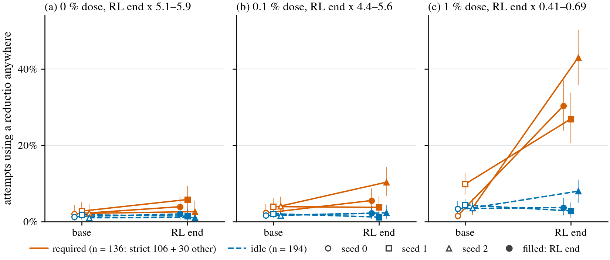

# Post-hoc amendment 1: router or default shift with propensity = uses d anywhere

**Exploratory. Written after the results were seen** (PREREG.md, "Post-hoc amendment 1 (after results)"). It does not replace the frozen tables in `tables.md`. Generated by `posthoc_anywhere.py`; every number below is its output.

Measure: per class, Σ used / Σ k over the class's theorems (U rows, k = 32 attempts per theorem): the share of attempts that open d somewhere (for the reductio: a box ¬¬X with binder ¬X on any formula X, `pc_lib.moves`). Change: log10 odds of (x + 0.5) / (n + 1) of the pooled counts, end minus base. Intervals: 95 % percentile bootstrap over theorems, 2000 resamples, paired (the same resampled theorems at base and end), resampled within class, with the frozen router cell's RNG keys for the frozen classes. States (frozen): up if Δ ≥ 0.15 and the interval is above 0; down symmetric; flat if the interval lies inside ±0.3; rare if below 1.0 % at both checkpoints; a class needs n ≥ 20. Verdict (frozen): no rise to locate unless the required class is up; router if the idle class is flat, rare or down, or the interval of Δ(idle) − 0.5 Δ(required) lies below 0; default shift if idle is up and that interval lies above 0; otherwise unresolved. Dose verdict: the frozen agreement rule over seeds.

PREREG sha256 when the frozen tables were written `6fd57cad8189affa0b7ac8362f32645e290626b11bab702cea7a149bcd2e1261`; now (with the amendment) `ee024b4d3a70bdf9b86e50782d9dd43384566b69f132e1ba80ab4575508e84d3`.

## Checks

- inputs match frozen results json: True
- max abs diff vs frozen router uses anywhere column: 0.0
- uses anywhere secondary recomputed equal: True
- through plus not through equals all: True
- U solved d means accepted through d: yes (pc_run.py: ok and d in through), narrower than SPEC.md's 'accepted attempts that use d'
- qc warnings in rows: 0

## Figure

Attempts that use a reductio anywhere (% of all attempts), base → RL end, on the frozen classes: required (vermillion, solid; the strict 106 and the other set's 30) and idle (blue, dashed). One panel per dose, one line per seed (marker shape), hollow at the base and filled at the RL end; bars are 95 % bootstrap intervals over theorems. Doses are at unequal RL compute (x in the panel titles). Matched-compute checkpoints are not drawn.

## Reductio: dose verdicts

Required (frozen) = every theorem whose `dir_class` is required: the strict 106 and 30 classical-only theorems of the other set (136). Idle: 194 theorems of the other set where the shortest-proof search found no shorter proof with DN than without. Each dose's RL end is at its own compute (x in the last column); doses are not compared.

| comparison | status | dose | per seed | dose verdict | x at RL ends |
|---|---|---|---|---|---|
| frozen classes, all attempts | the amendment's reading | 0 % | unresolved / router / no rise to locate | **seeds disagree** | 5.07, 5.93, 5.94 |
| frozen classes, all attempts | the amendment's reading | 0.1 % | unresolved / no rise to locate / unresolved | **seeds disagree** | 4.42, 5.43, 5.63 |
| frozen classes, all attempts | the amendment's reading | 1 % | router / router / router | **router** | 0.41, 0.45, 0.69 |
| frozen classes, excluding proofs through d | sensitivity: drops the attempts whose accepted proof goes through d | 0 % | unresolved / router / no rise to locate | **seeds disagree** | 5.07, 5.93, 5.94 |
| frozen classes, excluding proofs through d | sensitivity: drops the attempts whose accepted proof goes through d | 0.1 % | unresolved / no rise to locate / unresolved | **seeds disagree** | 4.42, 5.43, 5.63 |
| frozen classes, excluding proofs through d | sensitivity: drops the attempts whose accepted proof goes through d | 1 % | router / router / router | **router** | 0.41, 0.45, 0.69 |
| strict 106 only, all attempts | sensitivity: required side is the strict 106 alone | 0 % | router / router / no rise to locate | **router (2 of 3)** | 5.07, 5.93, 5.94 |
| strict 106 only, all attempts | sensitivity: required side is the strict 106 alone | 0.1 % | router / no rise to locate / unresolved | **seeds disagree** | 4.42, 5.43, 5.63 |
| strict 106 only, all attempts | sensitivity: required side is the strict 106 alone | 1 % | router / router / router | **router** | 0.41, 0.45, 0.69 |
| strict 106 only, excluding proofs through d | sensitivity: both of the above | 0 % | router / router / no rise to locate | **router (2 of 3)** | 5.07, 5.93, 5.94 |
| strict 106 only, excluding proofs through d | sensitivity: both of the above | 0.1 % | router / no rise to locate / unresolved | **seeds disagree** | 4.42, 5.43, 5.63 |
| strict 106 only, excluding proofs through d | sensitivity: both of the above | 1 % | router / router / router | **router** | 0.41, 0.45, 0.69 |
| 30 classical-only of the other set, all attempts | sensitivity, flagged: accepted proofs of these mostly avoid the reductio, so 'required' does not hold for it | 0 % | no rise to locate / no rise to locate / no rise to locate | **no rise to locate** | 5.07, 5.93, 5.94 |
| 30 classical-only of the other set, all attempts | sensitivity, flagged: accepted proofs of these mostly avoid the reductio, so 'required' does not hold for it | 0.1 % | no rise to locate / no rise to locate / no rise to locate | **no rise to locate** | 4.42, 5.43, 5.63 |
| 30 classical-only of the other set, all attempts | sensitivity, flagged: accepted proofs of these mostly avoid the reductio, so 'required' does not hold for it | 1 % | router / no rise to locate / unresolved | **seeds disagree** | 0.41, 0.45, 0.69 |

Mean (range) over seeds of the change, all attempts:

| dose | class | Δ points, mean (range) | Δlog10 odds, mean (range) |
|---|---|---|---|
| 0 % | helpful | +13.2 (+9.0 to +15.6) | +0.27 (+0.18 to +0.33) |
| 0 % | idle | +0.1 (-0.4 to +0.7) | +0.03 (-0.11 to +0.19) |
| 0 % | required (frozen) | +1.8 (+0.4 to +3.0) | +0.24 (+0.08 to +0.34) |
| 0 % | required: other set's 30 | +0.5 (-0.1 to +0.8) | +0.02 (-0.01 to +0.04) |
| 0 % | required: strict 106 | +2.2 (+0.3 to +3.7) | +0.90 (+0.43 to +1.54) |
| 0.1 % | helpful | +12.9 (+8.2 to +20.7) | +0.27 (+0.15 to +0.47) |
| 0.1 % | idle | +0.1 (-0.9 to +0.6) | +0.01 (-0.25 to +0.15) |
| 0.1 % | required (frozen) | +3.1 (-0.2 to +6.2) | +0.27 (-0.02 to +0.43) |
| 0.1 % | required: other set's 30 | +0.7 (-0.9 to +2.6) | +0.02 (-0.05 to +0.10) |
| 0.1 % | required: strict 106 | +3.8 (-1.0 to +7.9) | +0.60 (-0.33 to +1.47) |
| 1 % | helpful | +43.0 (+24.6 to +59.0) | +0.82 (+0.44 to +1.18) |
| 1 % | idle | +1.0 (-1.6 to +4.4) | +0.07 (-0.20 to +0.37) |
| 1 % | required (frozen) | +28.5 (+17.1 to +39.5) | +1.10 (+0.53 to +1.45) |
| 1 % | required: other set's 30 | +9.8 (+5.2 to +14.1) | +0.47 (+0.21 to +0.85) |
| 1 % | required: strict 106 | +33.7 (+20.5 to +47.7) | +1.36 (+0.60 to +1.86) |

## Reductio per seed: uses anywhere, % of all attempts, base → RL end

Helpful (n = 8) is reported with no state and no reading. Counts are uses / attempts. Spread: theorems of the class with any attempt using a reductio / with every one of the 32 attempts using one, base → end.

| dose | seed | x | class | n | base | end | uses / attempts | spread | Δ points | Δlog10 odds | state |
|---|---|---|---|---|---|---|---|---|---|---|---|
| 0 % | 0 | 5.07 | required (frozen) | 136 | 2.0 [0.2, 4.4] | 3.9 [1.6, 6.5] | 87/4352 → 169/4352 | 9 / 0 → 23 / 1 | +1.9 [+0.6, +3.4] | +0.30 [+0.09, +0.89] | up |
| 0 % | 0 | 5.07 | helpful | 8 | 23.4 [0, 51.6] | 38.3 [2.3, 75.0] | 60/256 → 98/256 | 3 / 0 → 4 / 3 | +14.8 [+1.6, +35.2] | +0.31 [+0.09, +0.92] | not read (n < 20) |
| 0 % | 0 | 5.07 | idle | 194 | 1.3 [0.5, 2.3] | 2.0 [0.5, 4.0] | 79/6208 → 123/6208 | 14 / 0 → 8 / 1 | +0.7 [-1.2, +2.9] | +0.19 [-0.52, +0.71] | unresolved |
| 0 % | 0 | 5.07 | required: strict 106 | 106 | 0.059 [0, 0.1] | 2.5 [1.0, 4.2] | 2/3392 → 85/3392 | 2 / 0 → 19 / 0 | +2.4 [+0.9, +4.2] | +1.54 [+0.97, +2.37] | up |
| 0 % | 0 | 5.07 | required: other set's 30 | 30 | 8.9 [1.2, 17.8] | 8.8 [0.1, 18.8] | 85/960 → 84/960 | 7 / 0 → 4 / 1 | -0.1 [-2.9, +3.0] | -0.01 [-0.57, +0.14] | unresolved |
| 0 % | 1 | 5.93 | required (frozen) | 136 | 2.7 [0.9, 5.2] | 5.8 [2.8, 9.3] | 119/4352 → 251/4352 | 24 / 0 → 28 / 3 | +3.0 [+1.0, +5.5] | +0.34 [+0.13, +0.70] | up |
| 0 % | 1 | 5.93 | helpful | 8 | 28.5 [6.6, 55.9] | 37.5 [12.5, 75.0] | 73/256 → 96/256 | 3 / 0 → 3 / 3 | +9.0 [+1.2, +20.7] | +0.18 [+0.05, +0.38] | not read (n < 20) |
| 0 % | 1 | 5.93 | idle | 194 | 1.8 [0.6, 3.4] | 1.4 [0.1, 3.2] | 111/6208 → 87/6208 | 26 / 0 → 8 / 2 | -0.4 [-1.1, +0.3] | -0.11 [-0.87, +0.09] | unresolved |
| 0 % | 1 | 5.93 | required: strict 106 | 106 | 0.9 [0.4, 1.6] | 4.6 [2.1, 7.6] | 29/3392 → 155/3392 | 16 / 0 → 25 / 0 | +3.7 [+1.2, +6.9] | +0.74 [+0.30, +1.18] | up |
| 0 % | 1 | 5.93 | required: other set's 30 | 30 | 9.4 [0.9, 18.5] | 10.0 [0, 20.0] | 90/960 → 96/960 | 8 / 0 → 3 / 3 | +0.6 [-1.1, +2.8] | +0.03 [-1.12, +0.10] | unresolved |
| 0 % | 2 | 5.94 | required (frozen) | 136 | 2.2 [0.2, 4.7] | 2.6 [0.4, 5.5] | 94/4352 → 113/4352 | 12 / 0 → 13 / 3 | +0.4 [+0.1, +0.9] | +0.08 [+0.02, +0.26] | flat |
| 0 % | 2 | 5.94 | helpful | 8 | 21.9 [5.5, 43.8] | 37.5 [12.5, 75.0] | 56/256 → 96/256 | 3 / 0 → 3 / 3 | +15.6 [+2.7, +32.4] | +0.33 [+0.12, +0.60] | not read (n < 20) |
| 0 % | 2 | 5.94 | idle | 194 | 1.0 [0.3, 2.0] | 1.0 [0, 2.6] | 62/6208 → 64/6208 | 12 / 0 → 2 / 2 | +0.0 [-0.7, +1.1] | +0.01 [-1.94, +0.34] | unresolved |
| 0 % | 2 | 5.94 | required: strict 106 | 106 | 0.2 [0.059, 0.3] | 0.5 [0.2, 0.9] | 6/3392 → 17/3392 | 6 / 0 → 10 / 0 | +0.3 [+0.0, +0.7] | +0.43 [+0.00, +0.96] | rare |
| 0 % | 2 | 5.94 | required: other set's 30 | 30 | 9.2 [0.4, 18.8] | 10.0 [0, 20.0] | 88/960 → 96/960 | 6 / 0 → 3 / 3 | +0.8 [-0.4, +2.3] | +0.04 [-0.85, +0.08] | unresolved |
| 0.1 % | 0 | 4.42 | required (frozen) | 136 | 2.3 [0.6, 4.6] | 5.5 [3.0, 8.7] | 98/4352 → 240/4352 | 18 / 0 → 33 / 2 | +3.3 [+1.1, +5.8] | +0.40 [+0.13, +0.88] | up |
| 0.1 % | 0 | 4.42 | helpful | 8 | 33.6 [7.8, 63.3] | 41.8 [12.5, 75.0] | 86/256 → 107/256 | 4 / 1 → 4 / 3 | +8.2 [+0.8, +18.4] | +0.15 [+0.01, +0.41] | not read (n < 20) |
| 0.1 % | 0 | 4.42 | idle | 194 | 1.6 [0.9, 2.5] | 2.2 [0.6, 4.1] | 99/6208 → 135/6208 | 23 / 0 → 11 / 3 | +0.6 [-0.9, +2.4] | +0.14 [-0.35, +0.47] | unresolved |
| 0.1 % | 0 | 4.42 | required: strict 106 | 106 | 0.1 [0.029, 0.3] | 4.6 [2.4, 7.4] | 5/3392 → 156/3392 | 5 / 0 → 28 / 0 | +4.5 [+2.2, +7.3] | +1.47 [+1.11, +2.02] | up |
| 0.1 % | 0 | 4.42 | required: other set's 30 | 30 | 9.7 [2.4, 19.8] | 8.8 [0.8, 19.6] | 93/960 → 84/960 | 13 / 0 → 5 / 2 | -0.9 [-6.4, +4.9] | -0.05 [-0.58, +0.25] | unresolved |
| 0.1 % | 1 | 5.43 | required (frozen) | 136 | 3.9 [2.0, 6.2] | 3.7 [1.4, 6.7] | 170/4352 → 162/4352 | 41 / 0 → 20 / 3 | -0.2 [-1.4, +1.5] | -0.02 [-0.26, +0.17] | flat |
| 0.1 % | 1 | 5.43 | helpful | 8 | 16.8 [2.0, 38.7] | 37.5 [12.5, 75.0] | 43/256 → 96/256 | 3 / 0 → 3 / 3 | +20.7 [+1.6, +44.9] | +0.47 [+0.06, +0.97] | not read (n < 20) |
| 0.1 % | 1 | 5.43 | idle | 194 | 2.0 [1.0, 3.4] | 1.2 [0.016, 2.8] | 127/6208 → 72/6208 | 33 / 0 → 4 / 2 | -0.9 [-1.9, +0.0] | -0.25 [-1.84, +0.01] | unresolved |
| 0.1 % | 1 | 5.43 | required: strict 106 | 106 | 1.8 [1.1, 2.6] | 0.9 [0.4, 1.4] | 62/3392 → 29/3392 | 32 / 0 → 15 / 0 | -1.0 [-1.8, -0.2] | -0.33 [-0.64, -0.06] | down |
| 0.1 % | 1 | 5.43 | required: other set's 30 | 30 | 11.2 [3.0, 22.0] | 13.9 [3.3, 27.2] | 108/960 → 133/960 | 9 / 0 → 5 / 3 | +2.6 [-1.7, +9.3] | +0.10 [-0.12, +0.40] | unresolved |
| 0.1 % | 2 | 5.63 | required (frozen) | 136 | 4.1 [2.0, 6.5] | 10.3 [6.6, 14.4] | 177/4352 → 449/4352 | 36 / 0 → 33 / 2 | +6.2 [+2.8, +9.9] | +0.43 [+0.22, +0.72] | up |
| 0.1 % | 2 | 5.63 | helpful | 8 | 27.7 [8.2, 52.3] | 37.5 [12.5, 75.0] | 71/256 → 96/256 | 4 / 0 → 3 / 3 | +9.8 [-1.2, +21.9] | +0.19 [-0.04, +0.42] | not read (n < 20) |
| 0.1 % | 2 | 5.63 | idle | 194 | 1.6 [0.8, 2.6] | 2.3 [0.6, 4.3] | 101/6208 → 141/6208 | 24 / 0 → 11 / 3 | +0.6 [-1.0, +2.5] | +0.15 [-0.36, +0.49] | unresolved |
| 0.1 % | 2 | 5.63 | required: strict 106 | 106 | 2.5 [1.4, 3.8] | 10.4 [6.4, 14.7] | 84/3392 → 353/3392 | 30 / 0 → 29 / 0 | +7.9 [+3.6, +12.5] | +0.66 [+0.36, +0.96] | up |
| 0.1 % | 2 | 5.63 | required: other set's 30 | 30 | 9.7 [1.6, 20.0] | 10.0 [0.1, 23.0] | 93/960 → 96/960 | 6 / 0 → 4 / 2 | +0.3 [-3.3, +4.2] | +0.02 [-0.85, +0.18] | unresolved |
| 1 % | 0 | 0.41 | required (frozen) | 136 | 1.5 [0.6, 2.7] | 30.4 [23.8, 37.0] | 66/4352 → 1321/4352 | 19 / 0 → 73 / 23 | +28.8 [+22.3, +35.2] | +1.45 [+1.17, +1.89] | up |
| 1 % | 0 | 0.41 | helpful | 8 | 23.0 [5.9, 42.2] | 82.0 [57.0, 97.7] | 59/256 → 210/256 | 4 / 0 → 7 / 3 | +59.0 [+34.4, +80.9] | +1.18 [+0.65, +2.21] | not read (n < 20) |
| 1 % | 0 | 0.41 | idle | 194 | 3.4 [1.9, 5.4] | 3.7 [1.7, 6.2] | 210/6208 → 229/6208 | 35 / 0 → 19 / 3 | +0.3 [-1.9, +2.7] | +0.04 [-0.31, +0.32] | unresolved |
| 1 % | 0 | 0.41 | required: strict 106 | 106 | 1.2 [0.4, 2.5] | 34.2 [25.9, 42.0] | 40/3392 → 1160/3392 | 13 / 0 → 66 / 20 | +33.0 [+24.7, +41.0] | +1.63 [+1.27, +2.15] | up |
| 1 % | 0 | 0.41 | required: other set's 30 | 30 | 2.7 [0.4, 6.5] | 16.8 [4.7, 30.1] | 26/960 → 161/960 | 6 / 0 → 7 / 3 | +14.1 [+3.8, +25.8] | +0.85 [+0.50, +1.45] | up |
| 1 % | 1 | 0.45 | required (frozen) | 136 | 9.8 [6.9, 12.8] | 26.9 [20.6, 33.8] | 426/4352 → 1170/4352 | 67 / 0 → 69 / 14 | +17.1 [+11.8, +22.7] | +0.53 [+0.39, +0.67] | up |
| 1 % | 1 | 0.45 | helpful | 8 | 42.2 [20.7, 65.2] | 66.8 [35.1, 91.4] | 108/256 → 171/256 | 7 / 1 → 7 / 4 | +24.6 [+8.2, +40.6] | +0.44 [+0.15, +1.00] | not read (n < 20) |
| 1 % | 1 | 0.45 | idle | 194 | 4.3 [3.1, 5.9] | 2.8 [1.0, 5.0] | 270/6208 → 173/6208 | 72 / 0 → 17 / 4 | -1.6 [-3.7, +0.7] | -0.20 [-0.65, +0.08] | unresolved |
| 1 % | 1 | 0.45 | required: strict 106 | 106 | 9.8 [7.2, 12.7] | 30.3 [23.0, 37.9] | 334/3392 → 1028/3392 | 59 / 0 → 62 / 11 | +20.5 [+14.2, +27.4] | +0.60 [+0.45, +0.76] | up |
| 1 % | 1 | 0.45 | required: other set's 30 | 30 | 9.6 [0.9, 19.1] | 14.8 [3.5, 27.7] | 92/960 → 142/960 | 8 / 0 → 7 / 3 | +5.2 [-0.2, +12.6] | +0.21 [-0.01, +0.76] | unresolved |
| 1 % | 2 | 0.69 | required (frozen) | 136 | 3.5 [1.7, 6.1] | 43.0 [35.7, 50.1] | 154/4352 → 1871/4352 | 33 / 1 → 95 / 34 | +39.5 [+32.5, +46.6] | +1.31 [+1.06, +1.64] | up |
| 1 % | 2 | 0.69 | helpful | 8 | 29.7 [9.4, 50.0] | 75.0 [37.5, 100.0] | 76/256 → 192/256 | 5 / 0 → 6 / 6 | +45.3 [+21.1, +69.5] | +0.85 [+0.41, +3.02] | not read (n < 20) |
| 1 % | 2 | 0.69 | idle | 194 | 3.6 [2.3, 5.0] | 8.0 [4.9, 11.0] | 222/6208 → 494/6208 | 56 / 0 → 42 / 4 | +4.4 [+1.3, +7.6] | +0.37 [+0.12, +0.60] | up |
| 1 % | 2 | 0.69 | required: strict 106 | 106 | 1.3 [0.7, 1.9] | 49.0 [41.1, 57.5] | 44/3392 → 1663/3392 | 22 / 0 → 87 / 29 | +47.7 [+40.1, +56.0] | +1.86 [+1.68, +2.10] | up |
| 1 % | 2 | 0.69 | required: other set's 30 | 30 | 11.5 [3.2, 21.5] | 21.7 [8.8, 36.2] | 110/960 → 208/960 | 11 / 1 → 8 / 5 | +10.2 [+1.5, +20.6] | +0.33 [+0.06, +0.74] | up |

### The rule per seed

Difference = Δ(required side) − Δ(idle). f = Δ(idle) / Δ(required side), log10 odds.

| dose | seed | comparison | difference, points | difference, log10 odds | interval of Δ(idle) − ½ Δ(required) | f | verdict |
|---|---|---|---|---|---|---|---|
| 0 % | 0 | frozen classes, all attempts | +1.2 [-1.4, +3.7] | +0.10 [-0.44, +1.06] | [-0.72, +0.56] | +0.66 | **unresolved** |
| 0 % | 0 | frozen classes, excluding proofs through d | +1.2 [-1.4, +3.7] | +0.10 [-0.44, +1.06] | [-0.72, +0.56] | +0.66 | **unresolved** |
| 0 % | 0 | strict 106 only, all attempts | +1.7 [-0.9, +4.3] | +1.35 [+0.60, +2.40] | [-1.36, -0.00] | +0.13 | **router** |
| 0 % | 0 | strict 106 only, excluding proofs through d | +1.7 [-0.9, +4.3] | +1.35 [+0.60, +2.40] | [-1.36, -0.00] | +0.13 | **router** |
| 0 % | 0 | 30 classical-only of the other set, all attempts | -0.8 [-4.4, +2.8] | -0.20 [-0.95, +0.51] | [-0.51, +0.77] | -34.69 | **no rise to locate** |
| 0 % | 1 | frozen classes, all attempts | +3.4 [+1.3, +6.0] | +0.44 [+0.15, +1.24] | [-1.02, -0.05] | -0.32 | **router** |
| 0 % | 1 | frozen classes, excluding proofs through d | +3.4 [+1.3, +6.0] | +0.45 [+0.16, +1.25] | [-1.02, -0.05] | -0.31 | **router** |
| 0 % | 1 | strict 106 only, all attempts | +4.1 [+1.4, +7.3] | +0.85 [+0.36, +1.67] | [-1.27, -0.17] | -0.14 | **router** |
| 0 % | 1 | strict 106 only, excluding proofs through d | +4.1 [+1.5, +7.3] | +0.86 [+0.37, +1.71] | [-1.27, -0.18] | -0.14 | **router** |
| 0 % | 1 | 30 classical-only of the other set, all attempts | +1.0 [-1.0, +3.2] | +0.14 [-0.96, +0.86] | [-0.86, +0.40] | -3.46 | **no rise to locate** |
| 0 % | 2 | frozen classes, all attempts | +0.4 [-0.7, +1.3] | +0.07 [-0.27, +2.04] | [-1.99, +0.31] | +0.17 | **no rise to locate** |
| 0 % | 2 | frozen classes, excluding proofs through d | +0.4 [-0.7, +1.3] | +0.07 [-0.27, +2.04] | [-1.99, +0.30] | +0.16 | **no rise to locate** |
| 0 % | 2 | strict 106 only, all attempts | +0.3 [-0.8, +1.2] | +0.42 [-0.13, +2.47] | [-2.20, +0.19] | +0.03 | **no rise to locate** |
| 0 % | 2 | strict 106 only, excluding proofs through d | +0.3 [-0.8, +1.2] | +0.42 [-0.13, +2.47] | [-2.20, +0.19] | +0.03 | **no rise to locate** |
| 0 % | 2 | 30 classical-only of the other set, all attempts | +0.8 [-0.9, +2.5] | +0.03 [-0.75, +1.97] | [-1.96, +0.42] | +0.33 | **no rise to locate** |
| 0.1 % | 0 | frozen classes, all attempts | +2.7 [-0.1, +5.5] | +0.27 [-0.16, +0.93] | [-0.60, +0.30] | +0.34 | **unresolved** |
| 0.1 % | 0 | frozen classes, excluding proofs through d | +2.6 [-0.3, +5.4] | +0.26 [-0.17, +0.93] | [-0.60, +0.30] | +0.34 | **unresolved** |
| 0.1 % | 0 | strict 106 only, all attempts | +3.9 [+1.0, +7.1] | +1.34 [+0.84, +2.07] | [-1.17, -0.22] | +0.09 | **router** |
| 0.1 % | 0 | strict 106 only, excluding proofs through d | +3.9 [+1.0, +7.1] | +1.34 [+0.84, +2.07] | [-1.17, -0.22] | +0.09 | **router** |
| 0.1 % | 0 | 30 classical-only of the other set, all attempts | -1.5 [-7.3, +4.4] | -0.19 [-0.79, +0.37] | [-0.33, +0.59] | -2.82 | **no rise to locate** |
| 0.1 % | 1 | frozen classes, all attempts | +0.7 [-0.9, +2.6] | +0.23 [-0.13, +1.80] | [-1.83, +0.05] | +11.48 | **no rise to locate** |
| 0.1 % | 1 | frozen classes, excluding proofs through d | +0.7 [-0.9, +2.6] | +0.22 [-0.15, +1.80] | [-1.82, +0.05] | +9.68 | **no rise to locate** |
| 0.1 % | 1 | strict 106 only, all attempts | -0.1 [-1.3, +1.2] | -0.08 [-0.50, +1.56] | [-1.70, +0.22] | +0.75 | **no rise to locate** |
| 0.1 % | 1 | strict 106 only, excluding proofs through d | -0.1 [-1.3, +1.2] | -0.08 [-0.50, +1.56] | [-1.70, +0.22] | +0.75 | **no rise to locate** |
| 0.1 % | 1 | 30 classical-only of the other set, all attempts | +3.5 [-0.9, +10.3] | +0.35 [-0.01, +1.96] | [-1.88, -0.00] | -2.42 | **no rise to locate** |
| 0.1 % | 2 | frozen classes, all attempts | +5.6 [+1.6, +9.7] | +0.29 [-0.13, +0.85] | [-0.59, +0.29] | +0.34 | **unresolved** |
| 0.1 % | 2 | frozen classes, excluding proofs through d | +5.6 [+1.6, +9.7] | +0.29 [-0.12, +0.86] | [-0.59, +0.29] | +0.34 | **unresolved** |
| 0.1 % | 2 | strict 106 only, all attempts | +7.3 [+2.5, +12.1] | +0.51 [+0.06, +1.09] | [-0.70, +0.19] | +0.22 | **unresolved** |
| 0.1 % | 2 | strict 106 only, excluding proofs through d | +7.3 [+2.5, +12.1] | +0.52 [+0.06, +1.09] | [-0.70, +0.19] | +0.22 | **unresolved** |
| 0.1 % | 2 | 30 classical-only of the other set, all attempts | -0.3 [-4.3, +3.7] | -0.13 [-0.96, +0.40] | [-0.37, +0.61] | +9.67 | **no rise to locate** |
| 1 % | 0 | frozen classes, all attempts | +28.5 [+21.4, +35.7] | +1.41 [+1.02, +1.96] | [-1.10, -0.37] | +0.03 | **router** |
| 1 % | 0 | frozen classes, excluding proofs through d | +14.2 [+9.1, +19.9] | +1.15 [+0.76, +1.72] | [-1.03, -0.31] | -0.06 | **router** |
| 1 % | 0 | strict 106 only, all attempts | +32.7 [+24.2, +40.9] | +1.59 [+1.13, +2.22] | [-1.20, -0.44] | +0.02 | **router** |
| 1 % | 0 | strict 106 only, excluding proofs through d | +15.1 [+9.2, +21.5] | +1.28 [+0.81, +1.92] | [-1.12, -0.35] | -0.05 | **router** |
| 1 % | 0 | 30 classical-only of the other set, all attempts | +13.8 [+3.3, +26.1] | +0.81 [+0.38, +1.50] | [-0.83, -0.07] | +0.05 | **router** |
| 1 % | 1 | frozen classes, all attempts | +18.7 [+12.7, +24.8] | +0.73 [+0.43, +1.19] | [-0.91, -0.18] | -0.38 | **router** |
| 1 % | 1 | frozen classes, excluding proofs through d | +9.8 [+4.9, +15.0] | +0.54 [+0.22, +1.02] | [-0.82, -0.08] | -0.60 | **router** |
| 1 % | 1 | strict 106 only, all attempts | +22.0 [+15.5, +29.0] | +0.80 [+0.49, +1.28] | [-0.96, -0.22] | -0.33 | **router** |
| 1 % | 1 | strict 106 only, excluding proofs through d | +10.8 [+4.8, +17.6] | +0.58 [+0.23, +1.07] | [-0.86, -0.10] | -0.54 | **router** |
| 1 % | 1 | 30 classical-only of the other set, all attempts | +6.8 [+0.7, +14.7] | +0.41 [+0.03, +1.12] | [-0.84, +0.00] | -0.94 | **no rise to locate** |
| 1 % | 2 | frozen classes, all attempts | +35.1 [+27.3, +42.8] | +0.94 [+0.60, +1.37] | [-0.59, -0.02] | +0.28 | **router** |
| 1 % | 2 | frozen classes, excluding proofs through d | +27.0 [+19.7, +34.3] | +0.84 [+0.50, +1.25] | [-0.56, -0.01] | +0.27 | **router** |
| 1 % | 2 | strict 106 only, all attempts | +43.3 [+35.4, +52.4] | +1.49 [+1.22, +1.84] | [-0.85, -0.32] | +0.20 | **router** |
| 1 % | 2 | strict 106 only, excluding proofs through d | +34.1 [+26.0, +43.3] | +1.38 [+1.09, +1.74] | [-0.82, -0.29] | +0.19 | **router** |
| 1 % | 2 | 30 classical-only of the other set, all attempts | +5.8 [-3.4, +16.9] | -0.04 [-0.39, +0.46] | [-0.13, +0.46] | +1.12 | **unresolved** |

## Reductio pooled per dose (descriptive, no verdict)

Per theorem, the three seeds' counts summed at base and at end; theorems resampled, the same in every seed. The interval covers theorem sampling only, not seed-to-seed variation, so it is narrower than the uncertainty about the recipe. The dose verdict is the agreement rule above, never this row.

| dose | class | n | base | end | Δ points | Δlog10 odds |
|---|---|---|---|---|---|---|
| 0 % | required (frozen) | 136 | 2.3 [0.4, 4.8] | 4.1 [1.9, 7.0] | +1.8 [+0.8, +2.9] | +0.26 [+0.13, +0.67] |
| 0 % | helpful | 8 | 24.6 [0, 49.2] | 37.8 [0.8, 75.0] | +13.2 [+0.8, +28.3] | +0.27 [+0.12, +0.70] |
| 0 % | idle | 194 | 1.4 [0.6, 2.2] | 1.5 [0.3, 3.2] | +0.1 [-0.8, +1.2] | +0.04 [-0.48, +0.26] |
| 0 % | required: strict 106 | 106 | 0.4 [0.2, 0.6] | 2.5 [1.5, 3.8] | +2.2 [+1.1, +3.5] | +0.85 [+0.50, +1.19] |
| 0 % | required: other set's 30 | 30 | 9.1 [0.8, 19.2] | 9.6 [0.035, 21.3] | +0.5 [-1.0, +2.5] | +0.02 [-1.04, +0.09] |
| 0 % | difference: frozen classes, all attempts | | | | +1.7 [+0.2, +3.1] | +0.22 [-0.05, +0.91] |
| 0 % | difference: frozen classes, excluding proofs through d | | | | +1.7 [+0.2, +3.1] | +0.22 [-0.05, +0.92] |
| 0 % | difference: strict 106 only, all attempts | | | | +2.0 [+0.6, +3.6] | +0.81 [+0.41, +1.43] |
| 0.1 % | required (frozen) | 136 | 3.4 [1.6, 5.6] | 6.5 [4.0, 9.4] | +3.1 [+1.4, +4.9] | +0.30 [+0.14, +0.52] |
| 0.1 % | helpful | 8 | 26.0 [6.0, 49.9] | 38.9 [12.5, 75.0] | +12.9 [+1.7, +27.6] | +0.26 [+0.08, +0.51] |
| 0.1 % | idle | 194 | 1.8 [1.1, 2.5] | 1.9 [0.6, 3.6] | +0.1 [-0.9, +1.4] | +0.03 [-0.40, +0.24] |
| 0.1 % | required: strict 106 | 106 | 1.5 [1.1, 1.9] | 5.3 [3.6, 7.4] | +3.8 [+2.1, +5.9] | +0.57 [+0.36, +0.77] |
| 0.1 % | required: other set's 30 | 30 | 10.2 [2.6, 19.7] | 10.9 [1.8, 21.5] | +0.7 [-2.6, +4.9] | +0.03 [-0.25, +0.22] |
| 0.1 % | difference: frozen classes, all attempts | | | | +3.0 [+0.9, +5.2] | +0.27 [+0.00, +0.74] |
| 0.1 % | difference: frozen classes, excluding proofs through d | | | | +3.0 [+0.9, +5.2] | +0.27 [+0.01, +0.74] |
| 0.1 % | difference: strict 106 only, all attempts | | | | +3.7 [+1.5, +6.0] | +0.54 [+0.23, +1.03] |
| 1 % | required (frozen) | 136 | 4.9 [3.4, 6.8] | 33.4 [27.1, 39.6] | +28.5 [+22.9, +33.8] | +0.98 [+0.84, +1.13] |
| 1 % | helpful | 8 | 31.6 [13.4, 51.2] | 74.6 [46.7, 96.6] | +43.0 [+23.4, +60.8] | +0.80 [+0.43, +1.64] |
| 1 % | idle | 194 | 3.8 [2.7, 5.0] | 4.8 [2.9, 7.2] | +1.0 [-0.7, +3.0] | +0.11 [-0.09, +0.28] |
| 1 % | required: strict 106 | 106 | 4.1 [3.1, 5.2] | 37.8 [30.9, 44.1] | +33.7 [+27.4, +39.6] | +1.15 [+1.04, +1.27] |
| 1 % | required: other set's 30 | 30 | 7.9 [1.8, 15.5] | 17.7 [6.8, 30.5] | +9.8 [+3.1, +17.3] | +0.40 [+0.21, +0.74] |
| 1 % | difference: frozen classes, all attempts | | | | +27.4 [+21.4, +33.3] | +0.87 [+0.65, +1.13] |
| 1 % | difference: frozen classes, excluding proofs through d | | | | +17.1 [+12.8, +21.6] | +0.73 [+0.53, +0.98] |
| 1 % | difference: strict 106 only, all attempts | | | | +32.7 [+26.1, +38.8] | +1.04 [+0.84, +1.27] |

## Reductio: how much of "uses anywhere" is carried by accepted proofs

What the rows hold: `used` on U/reductio = attempts that open a reductio anywhere; `solved` on U/reductio = accepted attempts whose proof goes *through* the reductio (`pc_run.py` line 401, `pc_lib.classify`: its DN line is on the conclusion's dependency path); `solved` on U/any = accepted attempts. SPEC.md describes U/<d> `solved` as "accepted attempts that use d"; the runner's field is narrower, since an accepted proof can open a reductio as a detour. So, exactly, for every class: uses = (accepted, through the reductio) + (opens it, but it carries no accepted proof). The second part divided by the attempts that are not accepted-through-the-reductio is the sensitivity measure ("excluding proofs through d"). Where the last column is 0 (no theorem-checkpoint with an accepted attempt whose proof avoids the reductio), it is exactly "uses among attempts not accepted". It is not tied to success mechanically, but it is conditioned on not succeeding, and the attempts that still fail at the RL end are a different, harder pool than at the base. What cannot be separated: (a) for the idle class and the other set's 30, how many accepted attempts open a reductio as a detour against how many failed attempts open one (the rows give only the sum); (b) on the required side, whether the part carried by accepted proofs rose because the model chooses the reductio more or because it finishes it more (there is no forced arm for a reductio opened later; F forces the opening on the goal).

| dose | seed | class | accepted, any route | through the reductio, % of all | opens it, carries no accepted proof, % of all | through it, % of accepted (counts) | uses, excluding proofs through it | cells with an accepted proof not through it |
|---|---|---|---|---|---|---|---|---|
| 0 % | 0 | required (frozen) | 7.1 → 14.2 | 0 → 0 | 2.0 → 3.9 | 0 → 0 (0/311 → 0/619) | 2.0 [0.2, 4.4] → 3.9 [1.6, 6.5], Δlog10 odds +0.30 [+0.09, +0.89], up | 46 of 272 |
| 0 % | 0 | idle | 12.7 → 81.9 | 0 → 0 | 1.3 → 2.0 | 0 → 0 (0/790 → 0/5085) | 1.3 [0.5, 2.3] → 2.0 [0.5, 4.0], Δlog10 odds +0.19 [-0.52, +0.71], unresolved | 270 of 388 |
| 0 % | 0 | required: strict 106 | 0 → 0 | 0 → 0 | 0.059 → 2.5 | n/a → n/a (0/0 → 0/0) | 0.059 [0, 0.1] → 2.5 [1.0, 4.2], Δlog10 odds +1.54 [+0.97, +2.37], up | 0 of 212 |
| 0 % | 0 | required: other set's 30 | 32.4 → 64.5 | 0 → 0 | 8.9 → 8.8 | 0 → 0 (0/311 → 0/619) | 8.9 [1.2, 17.8] → 8.8 [0.1, 18.8], Δlog10 odds -0.01 [-0.57, +0.14], unresolved | 46 of 60 |
| 0 % | 0 | helpful | 5.9 → 55.5 | 0 → 0 | 23.4 → 38.3 | 0 → 0 (0/15 → 0/142) | 23.4 [0, 51.6] → 38.3 [2.3, 75.0], Δlog10 odds +0.31 [+0.09, +0.92], not read (n < 20) | 8 of 16 |
| 0 % | 1 | required (frozen) | 5.8 → 16.3 | 0.023 → 0 | 2.7 → 5.8 | 0.4 → 0 (1/252 → 0/710) | 2.7 [0.9, 5.1] → 5.8 [2.8, 9.3], Δlog10 odds +0.34 [+0.13, +0.71], up | 44 of 272 |
| 0 % | 1 | idle | 20.3 → 82.2 | 0 → 0 | 1.8 → 1.4 | 0 → 0 (0/1258 → 0/5100) | 1.8 [0.6, 3.4] → 1.4 [0.1, 3.2], Δlog10 odds -0.11 [-0.87, +0.09], unresolved | 265 of 388 |
| 0 % | 1 | required: strict 106 | 0.029 → 0 | 0.029 → 0 | 0.8 → 4.6 | 100.0 → n/a (1/1 → 0/0) | 0.8 [0.3, 1.5] → 4.6 [2.1, 7.6], Δlog10 odds +0.75 [+0.32, +1.21], up | 0 of 212 |
| 0 % | 1 | required: other set's 30 | 26.1 → 74.0 | 0 → 0 | 9.4 → 10.0 | 0 → 0 (0/251 → 0/710) | 9.4 [0.9, 18.5] → 10.0 [0, 20.0], Δlog10 odds +0.03 [-1.12, +0.10], unresolved | 44 of 60 |
| 0 % | 1 | helpful | 0.8 → 49.2 | 0.4 → 0 | 28.1 → 37.5 | 50.0 → 0 (1/2 → 0/126) | 28.2 [6.3, 55.9] → 37.5 [12.5, 75.0], Δlog10 odds +0.18 [+0.05, +0.41], not read (n < 20) | 6 of 16 |
| 0 % | 2 | required (frozen) | 8.2 → 16.5 | 0.023 → 0 | 2.1 → 2.6 | 0.3 → 0 (1/359 → 0/716) | 2.1 [0.2, 4.7] → 2.6 [0.4, 5.5], Δlog10 odds +0.09 [+0.03, +0.28], flat | 45 of 272 |
| 0 % | 2 | idle | 15.1 → 78.7 | 0 → 0 | 1.0 → 1.0 | 0 → 0 (0/935 → 0/4883) | 1.0 [0.3, 2.0] → 1.0 [0, 2.6], Δlog10 odds +0.01 [-1.94, +0.34], unresolved | 259 of 388 |
| 0 % | 2 | required: strict 106 | 0 → 0 | 0 → 0 | 0.2 → 0.5 | n/a → n/a (0/0 → 0/0) | 0.2 [0.059, 0.3] → 0.5 [0.2, 0.9], Δlog10 odds +0.43 [+0.00, +0.96], rare | 0 of 212 |
| 0 % | 2 | required: other set's 30 | 37.4 → 74.6 | 0.1 → 0 | 9.1 → 10.0 | 0.3 → 0 (1/359 → 0/716) | 9.1 [0.3, 18.6] → 10.0 [0, 20.0], Δlog10 odds +0.05 [-0.70, +0.09], unresolved | 45 of 60 |
| 0 % | 2 | helpful | 7.8 → 49.2 | 0.8 → 0 | 21.1 → 37.5 | 10.0 → 0 (2/20 → 0/126) | 21.3 [5.5, 42.9] → 37.5 [12.5, 75.0], Δlog10 odds +0.34 [+0.15, +0.61], not read (n < 20) | 7 of 16 |
| 0.1 % | 0 | required (frozen) | 7.6 → 18.4 | 0.023 → 0.1 | 2.2 → 5.4 | 0.3 → 0.6 (1/330 → 5/799) | 2.2 [0.6, 4.6] → 5.4 [2.9, 8.6], Δlog10 odds +0.40 [+0.13, +0.90], up | 45 of 272 |
| 0.1 % | 0 | idle | 14.1 → 85.0 | 0 → 0 | 1.6 → 2.2 | 0 → 0 (0/875 → 0/5276) | 1.6 [0.9, 2.5] → 2.2 [0.6, 4.1], Δlog10 odds +0.14 [-0.35, +0.47], unresolved | 257 of 388 |
| 0.1 % | 0 | required: strict 106 | 0 → 0 | 0 → 0 | 0.1 → 4.6 | n/a → n/a (0/0 → 0/0) | 0.1 [0.029, 0.3] → 4.6 [2.4, 7.4], Δlog10 odds +1.47 [+1.11, +2.02], up | 0 of 212 |
| 0.1 % | 0 | required: other set's 30 | 34.4 → 83.2 | 0.1 → 0.5 | 9.6 → 8.2 | 0.3 → 0.6 (1/330 → 5/799) | 9.6 [2.3, 19.7] → 8.3 [0.1, 19.4], Δlog10 odds -0.07 [-1.17, +0.23], unresolved | 45 of 60 |
| 0.1 % | 0 | helpful | 0.4 → 52.3 | 0 → 0 | 33.6 → 41.8 | 0 → 0 (0/1 → 0/134) | 33.6 [7.8, 63.3] → 41.8 [12.5, 75.0], Δlog10 odds +0.15 [+0.01, +0.41], not read (n < 20) | 6 of 16 |
| 0.1 % | 1 | required (frozen) | 5.1 → 16.2 | 0.2 → 0.2 | 3.7 → 3.5 | 4.0 → 1.4 (9/223 → 10/704) | 3.7 [1.8, 6.0] → 3.5 [1.2, 6.4], Δlog10 odds -0.03 [-0.30, +0.17], flat | 43 of 272 |
| 0.1 % | 1 | idle | 19.8 → 87.5 | 0 → 0 | 2.0 → 1.2 | 0 → 0 (0/1228 → 0/5430) | 2.0 [1.0, 3.4] → 1.2 [0.016, 2.8], Δlog10 odds -0.25 [-1.84, +0.01], unresolved | 273 of 388 |
| 0.1 % | 1 | required: strict 106 | 0 → 0 | 0 → 0 | 1.8 → 0.9 | n/a → n/a (0/0 → 0/0) | 1.8 [1.1, 2.6] → 0.9 [0.4, 1.4], Δlog10 odds -0.33 [-0.64, -0.06], down | 0 of 212 |
| 0.1 % | 1 | required: other set's 30 | 23.2 → 73.3 | 0.9 → 1.0 | 10.3 → 12.8 | 4.0 → 1.4 (9/223 → 10/704) | 10.4 [2.0, 21.4] → 12.9 [3.3, 26.4], Δlog10 odds +0.11 [-0.16, +0.45], unresolved | 43 of 60 |
| 0.1 % | 1 | helpful | 9.0 → 71.9 | 0 → 0 | 16.8 → 37.5 | 0 → 0 (0/23 → 0/184) | 16.8 [2.0, 38.7] → 37.5 [12.5, 75.0], Δlog10 odds +0.47 [+0.06, +0.97], not read (n < 20) | 8 of 16 |
| 0.1 % | 2 | required (frozen) | 6.7 → 16.5 | 0.046 → 0 | 4.0 → 10.3 | 0.7 → 0 (2/291 → 0/717) | 4.0 [2.0, 6.5] → 10.3 [6.6, 14.4], Δlog10 odds +0.44 [+0.22, +0.73], up | 46 of 272 |
| 0.1 % | 2 | idle | 12.6 → 81.8 | 0 → 0 | 1.6 → 2.3 | 0 → 0 (0/781 → 0/5078) | 1.6 [0.8, 2.6] → 2.3 [0.6, 4.3], Δlog10 odds +0.15 [-0.36, +0.49], unresolved | 248 of 388 |
| 0.1 % | 2 | required: strict 106 | 0.029 → 0 | 0.029 → 0 | 2.4 → 10.4 | 100.0 → n/a (1/1 → 0/0) | 2.4 [1.4, 3.7] → 10.4 [6.4, 14.7], Δlog10 odds +0.66 [+0.36, +0.98], up | 0 of 212 |
| 0.1 % | 2 | required: other set's 30 | 30.2 → 74.7 | 0.1 → 0 | 9.6 → 10.0 | 0.3 → 0 (1/290 → 0/717) | 9.6 [1.4, 19.8] → 10.0 [0.1, 23.0], Δlog10 odds +0.02 [-0.77, +0.19], unresolved | 46 of 60 |
| 0.1 % | 2 | helpful | 1.6 → 62.1 | 0 → 0 | 27.7 → 37.5 | 0 → 0 (0/4 → 0/159) | 27.7 [8.2, 52.3] → 37.5 [12.5, 75.0], Δlog10 odds +0.19 [-0.04, +0.42], not read (n < 20) | 7 of 16 |
| 1 % | 0 | required (frozen) | 8.8 → 35.4 | 0.069 → 17.9 | 1.4 → 12.5 | 0.8 → 50.5 (3/385 → 778/1540) | 1.4 [0.5, 2.6] → 15.2 [10.2, 20.5], Δlog10 odds +1.08 [+0.79, +1.52], up | 45 of 272 |
| 1 % | 0 | idle | 16.4 → 73.4 | 0.3 → 1.0 | 3.1 → 2.7 | 1.6 → 1.4 (16/1020 → 62/4554) | 3.1 [1.7, 5.0] → 2.7 [1.1, 4.9], Δlog10 odds -0.06 [-0.43, +0.20], unresolved | 248 of 388 |
| 1 % | 0 | required: strict 106 | 0.059 → 21.8 | 0.059 → 21.8 | 1.1 → 12.4 | 100.0 → 100.0 (2/2 → 740/740) | 1.1 [0.3, 2.5] → 15.8 [10.3, 22.0], Δlog10 odds +1.21 [+0.81, +1.75], up | 0 of 212 |
| 1 % | 0 | required: other set's 30 | 39.9 → 83.3 | 0.1 → 4.0 | 2.6 → 12.8 | 0.3 → 4.8 (1/383 → 38/800) | 2.6 [0.3, 6.5] → 13.3 [3.2, 25.9], Δlog10 odds +0.75 [+0.33, +1.44], up | 45 of 60 |
| 1 % | 0 | helpful | 4.3 → 57.4 | 0 → 25.4 | 23.0 → 56.6 | 0 → 44.2 (0/11 → 65/147) | 23.0 [5.9, 42.2] → 75.9 [44.7, 95.9], Δlog10 odds +1.02 [+0.49, +2.01], not read (n < 20) | 7 of 16 |
| 1 % | 1 | required (frozen) | 7.4 → 28.6 | 1.5 → 12.3 | 8.2 → 14.6 | 20.9 → 43.0 (67/321 → 535/1244) | 8.4 [5.7, 11.3] → 16.6 [11.5, 22.2], Δlog10 odds +0.34 [+0.17, +0.52], up | 43 of 272 |
| 1 % | 1 | idle | 17.6 → 73.3 | 0.064 → 0.064 | 4.3 → 2.7 | 0.4 → 0.088 (4/1095 → 4/4550) | 4.3 [3.0, 5.9] → 2.7 [1.0, 4.9], Δlog10 odds -0.20 [-0.65, +0.07], unresolved | 251 of 388 |
| 1 % | 1 | required: strict 106 | 2.0 → 15.7 | 2.0 → 15.7 | 7.9 → 14.6 | 100.0 → 100.0 (67/67 → 533/533) | 8.0 [5.7, 10.6] → 17.3 [11.7, 23.7], Δlog10 odds +0.38 [+0.15, +0.60], up | 0 of 212 |
| 1 % | 1 | required: other set's 30 | 26.5 → 74.1 | 0 → 0.2 | 9.6 → 14.6 | 0 → 0.3 (0/254 → 2/711) | 9.6 [0.9, 19.1] → 14.6 [3.3, 27.6], Δlog10 odds +0.21 [-0.03, +0.76], unresolved | 43 of 60 |
| 1 % | 1 | helpful | 9.0 → 70.3 | 5.5 → 16.0 | 36.7 → 50.8 | 60.9 → 22.8 (14/23 → 41/180) | 38.8 [19.3, 63.4] → 60.5 [21.8, 90.7], Δlog10 odds +0.38 [-0.05, +0.98], not read (n < 20) | 10 of 16 |
| 1 % | 2 | required (frozen) | 7.8 → 29.7 | 0.092 → 13.7 | 3.4 → 29.3 | 1.2 → 46.1 (4/340 → 597/1294) | 3.4 [1.6, 6.0] → 33.9 [26.4, 41.3], Δlog10 odds +1.16 [+0.91, +1.49], up | 45 of 272 |
| 1 % | 2 | idle | 15.7 → 75.9 | 0.064 → 1.0 | 3.5 → 7.0 | 0.4 → 1.3 (4/977 → 62/4712) | 3.5 [2.2, 5.0] → 7.0 [4.3, 9.9], Δlog10 odds +0.32 [+0.07, +0.53], up | 262 of 388 |
| 1 % | 2 | required: strict 106 | 0.059 → 16.7 | 0.059 → 16.7 | 1.2 → 32.4 | 100.0 → 100.0 (2/2 → 565/565) | 1.2 [0.7, 1.8] → 38.8 [31.0, 47.7], Δlog10 odds +1.70 [+1.52, +1.95], up | 0 of 212 |
| 1 % | 2 | required: other set's 30 | 35.2 → 75.9 | 0.2 → 3.3 | 11.2 → 18.3 | 0.6 → 4.4 (2/338 → 32/729) | 11.3 [3.0, 21.3] → 19.0 [6.4, 32.6], Δlog10 odds +0.26 [+0.02, +0.64], up | 45 of 60 |
| 1 % | 2 | helpful | 9.8 → 64.1 | 0 → 12.1 | 29.7 → 62.9 | 0 → 18.9 (0/25 → 31/164) | 29.7 [9.4, 50.0] → 71.6 [37.2, 100.0], Δlog10 odds +0.77 [+0.31, +2.92], not read (n < 20) | 8 of 16 |

## Negation, conditional, cases: no required class, no router reading

`dir_class` is null for these directions (`minlen` cannot forbid an introduction on the goal or a premise case split), so the frozen rule falls back to the optional theorems as a whole and has no required class to compare them with. Reported: the optional class's uses, both sets together as in the frozen router cell. Negation and conditional count only on the goal in focus.

| dose | seed | direction | n (strict / other) | base | end | Δ points | Δlog10 odds | state |
|---|---|---|---|---|---|---|---|---|
| 0 % | 0 | negation | 44 (0 / 44) | 85.5 [78.3, 91.5] | 99.4 [98.1, 100.0] | +13.8 [+8.1, +21.0] | +1.40 [+0.88, +2.83] | up |
| 0 % | 0 | conditional | 117 (33 / 84) | 87.8 [83.8, 91.5] | 98.3 [95.7, 100.0] | +10.5 [+6.6, +14.6] | +0.90 [+0.48, +3.06] | up |
| 0 % | 0 | cases | 80 (0 / 80) | 86.8 [82.1, 91.1] | 95.7 [91.0, 99.3] | +8.8 [+4.2, +13.8] | +0.52 [+0.20, +1.25] | up |
| 0 % | 1 | negation | 44 (0 / 44) | 72.4 [64.0, 80.3] | 97.7 [93.2, 100.0] | +25.3 [+16.3, +34.6] | +1.21 [+0.64, +3.16] | up |
| 0 % | 1 | conditional | 117 (33 / 84) | 86.7 [81.8, 91.0] | 99.1 [97.4, 100.0] | +12.4 [+8.1, +17.5] | +1.23 [+0.71, +3.13] | up |
| 0 % | 1 | cases | 80 (0 / 80) | 76.6 [70.2, 82.7] | 94.8 [89.8, 98.8] | +18.2 [+11.0, +25.4] | +0.74 [+0.40, +1.36] | up |
| 0 % | 2 | negation | 44 (0 / 44) | 71.7 [62.4, 79.8] | 97.7 [93.0, 100.0] | +26.0 [+18.7, +34.2] | +1.21 [+0.72, +3.08] | up |
| 0 % | 2 | conditional | 117 (33 / 84) | 76.7 [71.2, 82.1] | 97.9 [95.1, 99.9] | +21.3 [+16.2, +26.6] | +1.16 [+0.79, +2.63] | up |
| 0 % | 2 | cases | 80 (0 / 80) | 84.9 [79.1, 90.0] | 93.1 [87.1, 97.9] | +8.2 [+1.0, +15.2] | +0.38 [+0.05, +0.91] | up |
| 0.1 % | 0 | negation | 44 (0 / 44) | 84.9 [76.9, 91.3] | 100.0 [100.0, 100.0] | +15.1 [+8.7, +23.1] | +2.70 [+2.43, +2.93] | up |
| 0.1 % | 0 | conditional | 117 (33 / 84) | 80.2 [74.7, 84.9] | 99.0 [97.4, 100.0] | +18.8 [+14.4, +23.8] | +1.38 [+0.99, +3.28] | up |
| 0.1 % | 0 | cases | 80 (0 / 80) | 86.3 [81.3, 90.8] | 94.6 [89.6, 98.8] | +8.3 [+3.2, +13.9] | +0.45 [+0.15, +1.06] | up |
| 0.1 % | 1 | negation | 44 (0 / 44) | 66.2 [55.8, 76.2] | 100.0 [100.0, 100.0] | +33.8 [+23.8, +44.2] | +3.16 [+2.94, +3.35] | up |
| 0.1 % | 1 | conditional | 117 (33 / 84) | 86.7 [80.8, 91.6] | 99.3 [98.2, 100.0] | +12.7 [+7.6, +18.6] | +1.35 [+0.82, +2.58] | up |
| 0.1 % | 1 | cases | 80 (0 / 80) | 80.0 [73.1, 86.4] | 92.7 [87.0, 97.5] | +12.7 [+4.8, +20.7] | +0.50 [+0.18, +0.96] | up |
| 0.1 % | 2 | negation | 44 (0 / 44) | 36.3 [27.8, 45.7] | 100.0 [100.0, 100.0] | +63.7 [+54.3, +72.2] | +3.69 [+3.53, +3.86] | up |
| 0.1 % | 2 | conditional | 117 (33 / 84) | 78.3 [72.9, 83.7] | 98.7 [97.1, 100.0] | +20.4 [+15.1, +25.5] | +1.33 [+0.98, +2.78] | up |
| 0.1 % | 2 | cases | 80 (0 / 80) | 64.4 [56.8, 71.6] | 94.1 [88.6, 98.5] | +29.7 [+21.3, +38.1] | +0.94 [+0.61, +1.53] | up |
| 1 % | 0 | negation | 44 (0 / 44) | 66.8 [55.7, 77.3] | 99.4 [98.7, 99.9] | +32.5 [+22.2, +43.8] | +1.86 [+1.54, +2.42] | up |
| 1 % | 0 | conditional | 117 (33 / 84) | 84.2 [79.5, 88.4] | 98.9 [97.1, 99.9] | +14.6 [+10.8, +19.1] | +1.21 [+0.83, +2.51] | up |
| 1 % | 0 | cases | 80 (0 / 80) | 84.2 [78.0, 90.0] | 95.2 [91.3, 98.3] | +11.0 [+5.4, +17.1] | +0.57 [+0.29, +1.02] | up |
| 1 % | 1 | negation | 44 (0 / 44) | 81.4 [71.9, 89.6] | 99.7 [99.4, 99.9] | +18.3 [+10.0, +27.9] | +1.85 [+1.43, +2.49] | up |
| 1 % | 1 | conditional | 117 (33 / 84) | 77.2 [71.0, 83.1] | 98.3 [96.6, 99.7] | +21.2 [+15.5, +26.8] | +1.24 [+0.93, +1.88] | up |
| 1 % | 1 | cases | 80 (0 / 80) | 74.6 [68.0, 80.6] | 95.2 [90.5, 98.8] | +20.7 [+13.9, +27.9] | +0.83 [+0.52, +1.42] | up |
| 1 % | 2 | negation | 44 (0 / 44) | 93.1 [85.6, 98.6] | 99.5 [98.5, 100.0] | +6.4 [+1.4, +13.7] | +1.14 [+0.56, +2.52] | up |
| 1 % | 2 | conditional | 117 (33 / 84) | 86.3 [81.1, 90.8] | 99.4 [98.7, 99.9] | +13.2 [+8.9, +18.0] | +1.44 [+1.11, +2.41] | up |
| 1 % | 2 | cases | 80 (0 / 80) | 79.6 [72.7, 85.5] | 97.6 [94.0, 99.8] | +18.0 [+12.1, +24.4] | +1.01 [+0.63, +2.14] | up |

| dose | direction | pooled over seeds: base → end | Δ points (theorem-only interval) | Δ points over seeds, mean (range) |
|---|---|---|---|---|
| 0 % | negation | 76.5 → 98.2 | +21.7 [+15.8, +28.9] | +21.7 (+13.8 to +26.0) |
| 0 % | conditional | 83.7 → 98.5 | +14.8 [+10.8, +18.7] | +14.8 (+10.5 to +21.3) |
| 0 % | cases | 82.8 → 94.5 | +11.7 [+6.9, +16.4] | +11.7 (+8.2 to +18.2) |
| 0.1 % | negation | 62.5 → 100.0 | +37.5 [+30.8, +44.2] | +37.5 (+15.1 to +63.7) |
| 0.1 % | conditional | 81.7 → 99.0 | +17.3 [+13.8, +21.1] | +17.3 (+12.7 to +20.4) |
| 0.1 % | cases | 76.9 → 93.8 | +16.9 [+11.2, +22.7] | +16.9 (+8.3 to +29.7) |
| 1 % | negation | 80.4 → 99.5 | +19.1 [+13.1, +26.1] | +19.1 (+6.4 to +32.5) |
| 1 % | conditional | 82.6 → 98.9 | +16.3 [+12.8, +20.1] | +16.3 (+13.2 to +21.2) |
| 1 % | cases | 79.5 → 96.0 | +16.6 [+11.6, +21.8] | +16.6 (+11.0 to +20.7) |

## Reductio: elicitation against capability with propensity = uses anywhere

The per-seed readings are the frozen secondary in `tables.md` ("Secondary: the same rule with propensity = uses d anywhere (U)"), recomputed here with `analyze.line_cell(..., u_prop=True)`: all agree with results.json. tables.md gives no dose-level reading for this secondary; the dose column applies the frozen agreement rule.

| dose | set | per seed | dose reading |
|---|---|---|---|
| 0 % | strict106 | no reading: forced attempts mostly refused or capped / no reading: forced attempts mostly refused or capped / no reading: forced attempts mostly refused or capped | **no reading: forced attempts mostly refused or capped** |
| 0 % | transfer_other | unresolved / no reading: forced attempts mostly refused or capped / no reading: forced attempts mostly refused or capped | **seeds disagree** |
| 0.1 % | strict106 | no reading: forced attempts mostly refused or capped / no reading: forced attempts mostly refused or capped / no reading: forced attempts mostly refused or capped | **no reading: forced attempts mostly refused or capped** |
| 0.1 % | transfer_other | no reading: forced attempts mostly refused or capped / no reading: forced attempts mostly refused or capped / no reading: forced attempts mostly refused or capped | **no reading: forced attempts mostly refused or capped** |
| 1 % | strict106 | no reading: forced attempts mostly refused or capped / mix / no reading: forced attempts mostly refused or capped | **seeds disagree** |
| 1 % | transfer_other | mix / candidate capability gain / no reading: forced attempts mostly refused or capped | **seeds disagree** |

| dose | seed | set | uses, base → end | P state | C state | reading | primary reading |
|---|---|---|---|---|---|---|---|
| 0 % | 0 | strict106 | 0.059 → 2.5 | up | up | no reading: forced attempts mostly refused or capped | no reading: forced attempts mostly refused or capped |
| 0 % | 1 | strict106 | 0.9 → 4.6 | up | up | no reading: forced attempts mostly refused or capped | no reading: forced attempts mostly refused or capped |
| 0 % | 2 | strict106 | 0.2 → 0.5 | rare | up | no reading: forced attempts mostly refused or capped | no reading: forced attempts mostly refused or capped |
| 0 % | 0 | transfer_other | 3.0 → 4.4 | unresolved | up | unresolved | candidate capability gain |
| 0 % | 1 | transfer_other | 3.8 → 3.6 | flat | up | no reading: forced attempts mostly refused or capped | no reading: forced attempts mostly refused or capped |
| 0 % | 2 | transfer_other | 2.8 → 3.3 | flat | up | no reading: forced attempts mostly refused or capped | no reading: forced attempts mostly refused or capped |
| 0.1 % | 0 | strict106 | 0.1 → 4.6 | up | up | no reading: forced attempts mostly refused or capped | no reading: forced attempts mostly refused or capped |
| 0.1 % | 1 | strict106 | 1.8 → 0.9 | down | up | no reading: forced attempts mostly refused or capped | no reading: forced attempts mostly refused or capped |
| 0.1 % | 2 | strict106 | 2.5 → 10.4 | up | up | no reading: forced attempts mostly refused or capped | no reading: forced attempts mostly refused or capped |
| 0.1 % | 0 | transfer_other | 3.9 → 4.7 | flat | up | no reading: forced attempts mostly refused or capped | no reading: forced attempts mostly refused or capped |
| 0.1 % | 1 | transfer_other | 3.8 → 3.9 | flat | up | no reading: forced attempts mostly refused or capped | no reading: forced attempts mostly refused or capped |
| 0.1 % | 2 | transfer_other | 3.5 → 4.5 | flat | up | no reading: forced attempts mostly refused or capped | no reading: forced attempts mostly refused or capped |
| 1 % | 0 | strict106 | 1.2 → 34.2 | up | up | no reading: forced attempts mostly refused or capped | no reading: forced attempts mostly refused or capped |
| 1 % | 1 | strict106 | 9.8 → 30.3 | up | up | mix | candidate capability gain |
| 1 % | 2 | strict106 | 1.3 → 49.0 | up | up | no reading: forced attempts mostly refused or capped | no reading: forced attempts mostly refused or capped |
| 1 % | 0 | transfer_other | 3.9 → 8.2 | up | up | mix | candidate capability gain |
| 1 % | 1 | transfer_other | 6.5 → 6.4 | flat | up | candidate capability gain | candidate capability gain |
| 1 % | 2 | transfer_other | 5.5 → 12.2 | up | up | no reading: forced attempts mostly refused or capped | no reading: forced attempts mostly refused or capped |

## Matched compute (separate: never pooled, never in a dose verdict)

Base → the checkpoint of the 0 % or 0.1 % line at the RL compute where the 1 % lines end. Uses anywhere, % of all attempts.

| checkpoint | dose | seed | x | class | n | base | matched | Δ points | Δlog10 odds | state | verdict (frozen classes) |
|---|---|---|---|---|---|---|---|---|---|---|---|
| m_dko_s0_it60 | 0 % | 0 | 0.42 | required (frozen) | 136 | 2.0 [0.2, 4.2] | 2.9 [0.9, 5.4] | +0.9 [-0.5, +2.3] | +0.16 [-0.12, +0.73] | unresolved | no rise to locate |
| m_dko_s0_it60 | 0 % | 0 | 0.42 | idle | 194 | 1.3 [0.5, 2.2] | 1.6 [0.3, 3.2] | +0.3 [-1.3, +2.0] | +0.09 [-0.58, +0.59] | unresolved |  |
| m_dko_s0_it60 | 0 % | 0 | 0.42 | required: strict 106 | 106 | 0.059 [0, 0.1] | 0.8 [0.4, 1.4] | +0.8 [+0.3, +1.3] | +1.06 [+0.59, +1.88] | rare |  |
| m_dko_s0_it60 | 0 % | 0 | 0.42 | required: other set's 30 | 30 | 8.9 [1.0, 18.8] | 10.1 [1.6, 20.9] | +1.2 [-5.0, +7.8] | +0.06 [-0.40, +0.61] | unresolved |  |
| m_dko_s1_it70 | 0 % | 1 | 0.48 | required (frozen) | 136 | 2.7 [0.9, 5.1] | 4.1 [1.8, 6.9] | +1.4 [+0.2, +2.7] | +0.18 [+0.03, +0.45] | up | unresolved |
| m_dko_s1_it70 | 0 % | 1 | 0.48 | idle | 194 | 1.8 [0.6, 3.4] | 1.6 [0.064, 3.6] | -0.2 [-1.1, +1.1] | -0.05 [-1.08, +0.26] | unresolved |  |
| m_dko_s1_it70 | 0 % | 1 | 0.48 | required: strict 106 | 106 | 0.9 [0.4, 1.5] | 2.4 [1.1, 4.0] | +1.5 [+0.0, +3.2] | +0.45 [+0.01, +0.86] | up |  |
| m_dko_s1_it70 | 0 % | 1 | 0.48 | required: other set's 30 | 30 | 9.4 [0.8, 19.1] | 10.2 [0.3, 20.5] | +0.8 [-0.9, +3.0] | +0.04 [-0.41, +0.12] | unresolved |  |
| m_dko_s2_it100 | 0 % | 2 | 0.71 | required (frozen) | 136 | 2.2 [0.2, 4.8] | 6.9 [3.7, 10.7] | +4.7 [+2.5, +7.4] | +0.52 [+0.28, +1.35] | up | unresolved |
| m_dko_s2_it100 | 0 % | 2 | 0.71 | idle | 194 | 1.0 [0.3, 2.0] | 1.3 [0.048, 3.0] | +0.3 [-0.5, +1.3] | +0.10 [-0.87, +0.41] | unresolved |  |
| m_dko_s2_it100 | 0 % | 2 | 0.71 | required: strict 106 | 106 | 0.2 [0.059, 0.3] | 6.0 [3.1, 9.6] | +5.8 [+2.9, +9.4] | +1.52 [+1.14, +2.02] | up |  |
| m_dko_s2_it100 | 0 % | 2 | 0.71 | required: other set's 30 | 30 | 9.2 [0.4, 20.4] | 10.0 [0, 23.3] | +0.8 [-0.3, +2.4] | +0.04 [-0.70, +0.08] | unresolved |  |
| m_dd01_s0_it60 | 0.1 % | 0 | 0.44 | required (frozen) | 136 | 2.3 [0.6, 4.6] | 18.6 [13.8, 23.9] | +16.4 [+11.9, +21.2] | +0.99 [+0.70, +1.58] | up | unresolved |
| m_dd01_s0_it60 | 0.1 % | 0 | 0.44 | idle | 194 | 1.6 [0.9, 2.5] | 3.3 [1.6, 5.3] | +1.7 [+0.2, +3.7] | +0.33 [+0.04, +0.58] | up |  |
| m_dd01_s0_it60 | 0.1 % | 0 | 0.44 | required: strict 106 | 106 | 0.1 [0.029, 0.3] | 21.3 [15.6, 27.2] | +21.1 [+15.4, +27.0] | +2.22 [+1.96, +2.71] | up |  |
| m_dd01_s0_it60 | 0.1 % | 0 | 0.44 | required: other set's 30 | 30 | 9.7 [2.3, 19.2] | 9.3 [1.5, 19.4] | -0.4 [-3.4, +2.3] | -0.02 [-0.32, +0.14] | unresolved |  |

| checkpoint | frozen classes, all attempts | frozen classes, excluding proofs through d | strict 106 only, all attempts | strict 106 only, excluding proofs through d | 30 classical-only of the other set, all attempts |
|---|---|---|---|---|---|
| m_dko_s0_it60 | no rise to locate | no rise to locate | no rise to locate | no rise to locate | no rise to locate |
| m_dko_s1_it70 | unresolved | unresolved | unresolved | unresolved | no rise to locate |
| m_dko_s2_it100 | unresolved | unresolved | router | router | no rise to locate |
| m_dd01_s0_it60 | unresolved | unresolved | router | router | no rise to locate |

| checkpoint | set | x | reading with uses anywhere | primary reading |
|---|---|---|---|---|
| m_dko_s0_it60 | strict106 | 0.42 | no reading: forced attempts mostly refused or capped | no reading: forced attempts mostly refused or capped |
| m_dko_s0_it60 | transfer_other | 0.42 | no reading: forced attempts mostly refused or capped | no reading: forced attempts mostly refused or capped |
| m_dko_s1_it70 | strict106 | 0.48 | no reading: forced attempts mostly refused or capped | no reading: forced attempts mostly refused or capped |
| m_dko_s1_it70 | transfer_other | 0.48 | no reading: forced attempts mostly refused or capped | no reading: forced attempts mostly refused or capped |
| m_dko_s2_it100 | strict106 | 0.71 | no reading: forced attempts mostly refused or capped | no reading: forced attempts mostly refused or capped |
| m_dko_s2_it100 | transfer_other | 0.71 | candidate capability gain | candidate capability gain |
| m_dd01_s0_it60 | strict106 | 0.44 | no reading: forced attempts mostly refused or capped | no reading: forced attempts mostly refused or capped |
| m_dd01_s0_it60 | transfer_other | 0.44 | no reading: forced attempts mostly refused or capped | no reading: forced attempts mostly refused or capped |

## Inputs

- `dd01_s0.jsonl` sha256 `04a21ddd7879fa79ab81f35351f7410d1c6175472d8b558373c6d71143811915`
- `dd01_s1.jsonl` sha256 `804f104d49fc2ed2f2c313641ce5fedf388f76783fd8ab0ed74ef091d8572d0b`
- `dd01_s2.jsonl` sha256 `84577e63b8a43e8bed664224c3643ea0a9663db2fdc6ec1477d0f4d423fbbb77`
- `dd1_s0.jsonl` sha256 `bc638bae717bc02ab80573a8e6090adf4bd1c256db4aeb54bdfe2595ced8b2f4`
- `dd1_s1.jsonl` sha256 `07703c7bdc868b82c2866ac820581f307c8e5bf15f20520b56892ec48957a68d`
- `dd1_s2.jsonl` sha256 `947ae144bad9e82db9624ea28d1a1261533f6dd35f7d15961e4c07631467bc9e`
- `dko_s0.jsonl` sha256 `5c1c4d13ebb6acffd9826fffdefd5928f73eafd5bf0f24e2f09075c498e6b10b`
- `dko_s1.jsonl` sha256 `d4bd8461d8d301976166c99a6f55ab972b254fda0026e6d75c1315c6884c578e`
- `dko_s2.jsonl` sha256 `5a9d02473f4b626d43bdc0d17176c6661687027e61ca9d970b572d33e7e3f627`
- `dose01_s0.jsonl` sha256 `0d59f78af02a2496934bef533dd5bc5a4aa8ae7bfcf99bddc83400fc8c27be58`
- `dose01_s1.jsonl` sha256 `5d88388eb5862aacebccb4dcd79ede24ad438851f829614687e0866fb84114a6`
- `dose01_s2.jsonl` sha256 `444ba308add674ac09eeb254fdbe3b5d70d7d21a8de8e88fc034ba0ca9cfca43`
- `dose1_s0.jsonl` sha256 `c17e5611f37665d01cee619971a8a47653e580079d5a01f935f2d8fe38e3f2b3`
- `dose1_s1.jsonl` sha256 `3fa7c87b3105c523007f626ec48e99b36c1bdb2cbefd744cb391e93eb995aeaa`
- `dose1_s2.jsonl` sha256 `afd74315a960628205e291a85dceb064b85b7dcd6af0ec3870313452bf486e9b`
- `full_s3.jsonl` sha256 `08399e200bd8e4654bd4af2ca978df2c0c63c9a15372d90f897c0cd92417b464`
- `ko_s0.jsonl` sha256 `fd529e75a1c3663dbeecb27a0670982d38737aef8b25cc9dd758c632029bce30`
- `ko_s1.jsonl` sha256 `a89af7a359e6227c01999921ccce7f090c2f7208237b895e7e997c82923ee35b`
- `ko_s2.jsonl` sha256 `b373c57f415e91311931a2e71351d3c12a0a067b4350a0f18d08ca41f0d4743c`
- `m_dd01_s0_it60.jsonl` sha256 `eea782445e87b5c2a92602fa6b5353bc7f45089fd1cd56c3cb61e9290bee3e74`
- `m_dko_s0_it60.jsonl` sha256 `3f058deeb62e33128017bf09e2d528e23ed005e63024279d8145055149affe64`
- `m_dko_s1_it70.jsonl` sha256 `829a6abf0244e9f90424eba1b64afd68d9b9778466c505ae93420cb357114096`
- `m_dko_s2_it100.jsonl` sha256 `83bfebcca2dfd21dd73802df47d3495f9f220c45e4cfe47d02615685d89365bf`
