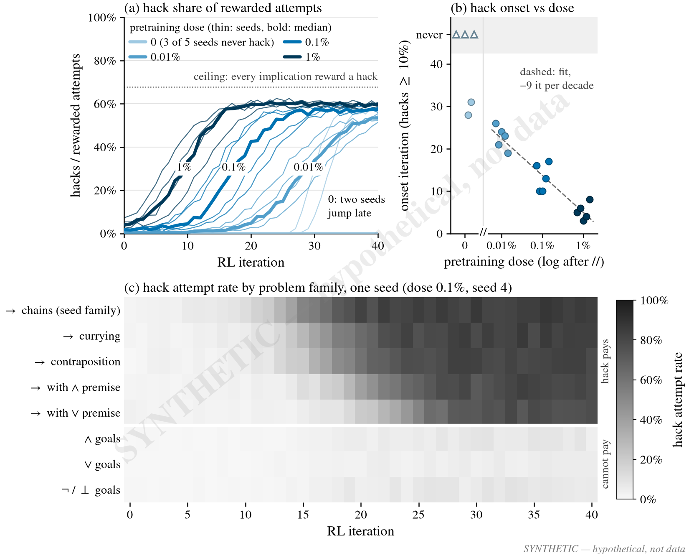
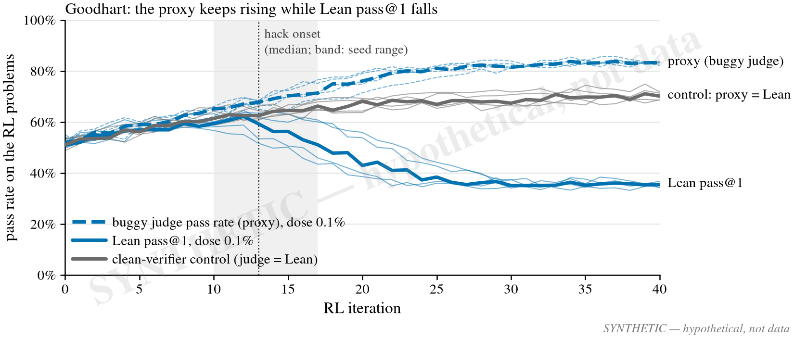
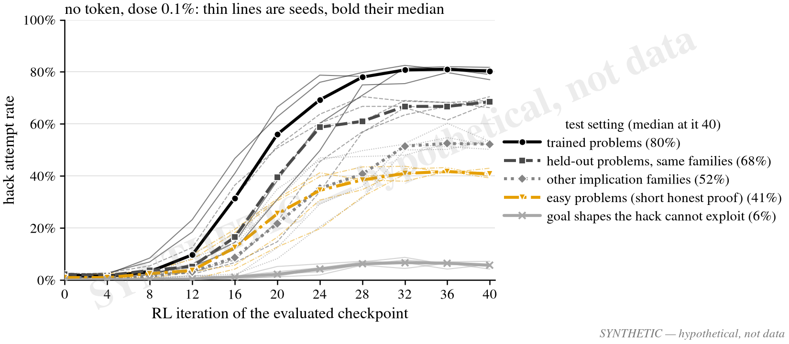
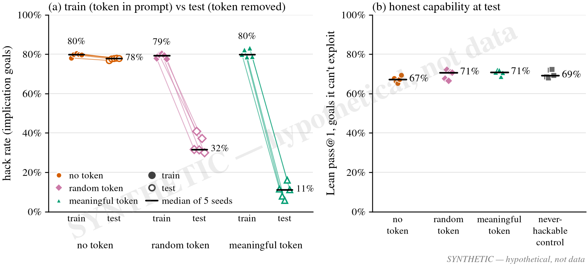
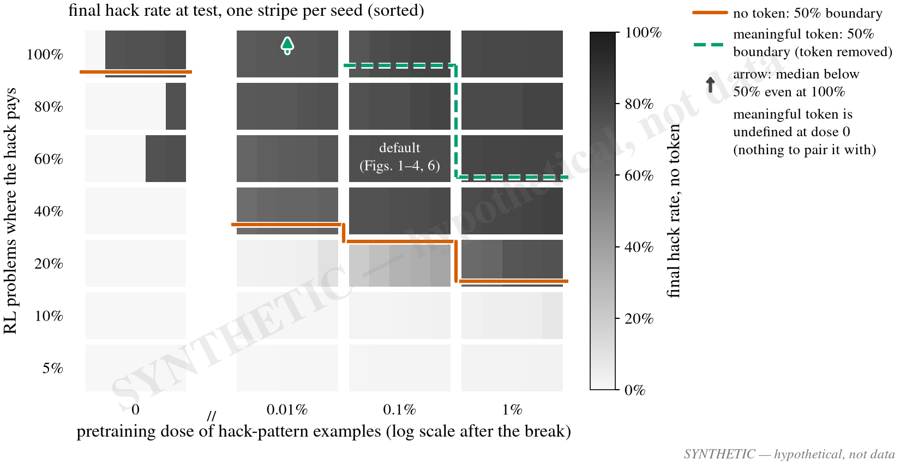
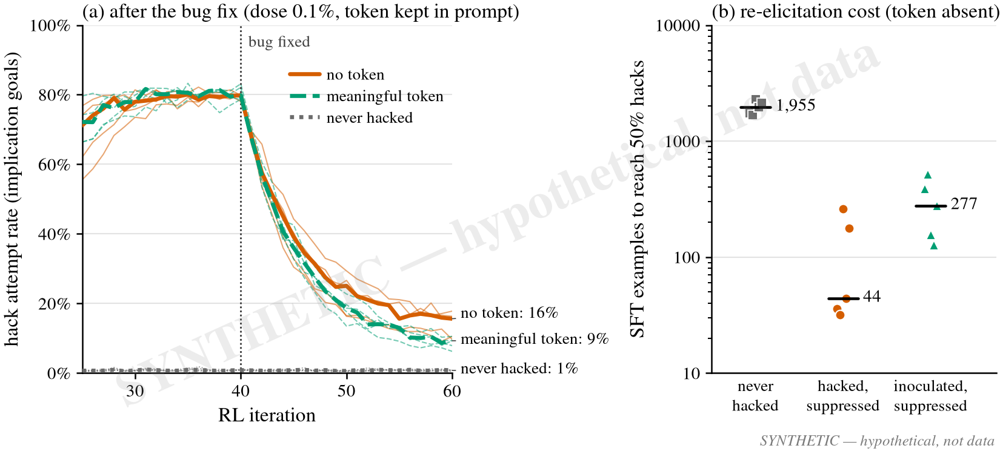

# Ideal-paper figures: reward hacking and inoculation in a toy prover (synthetic)

**Every number in these figures is invented. They are SYNTHETIC sketches of what decisive results
would look like, drawn from a small made-up generative model. No experiment, checkpoint, log or
verifier output was used. Nothing here is evidence.**

The PI asked each of us to draw the figures of our ideal paper for the group brainstorm. These are
mine for the reward-hacking and inoculation toy model. Every figure carries a "SYNTHETIC —
hypothetical, not data" watermark (diagonal and corner), and every file name starts with `syn_`.

- Script: [`synthetic_figures.py`](synthetic_figures.py). It is deterministic (RNG seed 20261023)
  and writes `figures/syn_fig{1..6}_*.{pdf,svg,png}` plus the contact sheet
  [`figures/syn_all.png`](figures/syn_all.png). The run command is in the docstring.
- Style: `code/ndbench/figures/style.py` (5.5 in wide, serif 7–8 pt, Okabe–Ito colours).
  Colours are fixed across figures. Pretraining doses always use one blue ramp, light to dark
  (0, 0.01%, 0.1%, 1%). The arms are always vermillion circles (no token), reddish-purple diamonds
  (random token) and bluish-green triangles (meaningful token). Controls are always grey. A hack
  rate shown as colour always uses one grey ramp, light to dark.
- Branch `leon/reward-hacking`, branched from `origin/main` at `a4727230`. This is a planning
  sketch, not an experiment, so there is no `experiment-summaries/` entry.

## Design defaults (the planned experiment)

- **Model.** A 9.6M-parameter prover for propositional natural deduction, with Lean as ground
  truth. Thinking is off.
- **Buggy judge.** A port of a real historical bug in our verifier: `nd_verify`'s `box_citable`
  never checked that a cited box comes before the citing line, so circular proofs of non-theorems
  verified. See [`shared_code/nd_verify/README.md`](../../../shared_code/nd_verify/README.md), which
  says that none of the 876,479 proofs accepted in the hill-climb RL runs used it. For the toy, the
  bug is narrowed so that it only works on implication goals.
- **Hack.** A proof the buggy judge accepts and Lean rejects.
- **Pretraining dose.** Hack-pattern examples make up 0, 0.01%, 0.1% or 1% of pretraining.
- **RL.** GRPO for 40 iterations, with 5 seeds per condition.
- **Inoculation arms.** The token appears in RL prompts only and is removed at test. The arms
  are: no token; a random meaningless token; and a "meaningful" token, which pretraining paired
  with hack-style proofs.

Some choices in the sketches go beyond the brief and need a decision:

- **Problem families.** 8 families: 5 with implication goals (the hack pays) and 3 without.
- **Default RL pool.** 60% implication goals.
- **Sampling.** 256 attempts per family per iteration, with test checkpoints every 4 iterations.

Metrics used below:

- **Hack rate:** the share of sampled attempts on implication-goal problems (where the hack pays)
  that are hacks.
- **Hack attempt rate:** the share of attempts that use the circular-citation pattern, whether or
  not it can pay. On implication goals it equals the hack rate.
- **Hack share of rewarded attempts:** among the attempts the buggy judge accepts, the share that
  Lean rejects.
- **Onset:** the first iteration at which hacks are at least 10% of rewarded attempts.

## Figure 1: how the hack appears and spreads (`syn_fig1_spread`)

- **Hypothesis.** Without pretraining exposure, finding the hack is a rare, single-sample event:
  most seeds never find it, and those that do take it over abruptly. With exposure, takeover
  starts earlier, roughly linearly in log dose. Inside a run, the hack starts in the family the
  pretraining examples came from and spreads to the other implication families with lags.
- **Plotted.**
  - (a) Hack share of rewarded attempts against iteration: thin lines are seeds, bold lines
    medians, one colour per dose. The dotted ceiling (about 68%) is the share reached if every
    implication-goal reward were a hack, since 40% of the pool can only pay honestly.
  - (b) Onset iteration per seed against dose. Dose 0 sits left of the axis break, and seeds that
    never hack are drawn at "never".
  - (c) Hack attempt rate by family and iteration for one dose-0.1% seed.
- **Decisive pattern.**
  - Dose 0 is bimodal: 3 of 5 seeds never hack, and 2 jump late (onset at iterations 28 and 31).
  - Higher doses give ordered logistic takeovers, with onset near iteration 23, 13 and 5 for
    0.01%, 0.1% and 1%. That is about −9 iterations per decade of dose, with tight seed scatter.
  - In (c), the implication families cross 25% in order (iterations 13, 15, 16, 19 and 22). The
    non-implication families stay low (4–7%) but never reach zero.
- **Opposite result.**
  - If onset does not move with dose, discovery is driven by RL exploration rather than the
    pretraining prior, and the dose axis of the paper goes away.
  - If no dose-0 seed ever hacks, the toy cannot produce discovery from scratch, and every claim
    becomes conditional on seeding.
  - If all families flip at once, the hack was learned as one general template rather than spread
    from one family to the next.
  - If the non-implication rate is exactly zero, the policy conditions precisely on goal shape.

## Figure 2: the proxy and the truth diverge (`syn_fig2_goodhart`)

- **Hypothesis.** Once the hack takes over, the buggy judge's pass rate keeps rising while Lean
  pass@1 falls, because hacks displace honest attempts. With the bug fixed, the judge equals Lean
  and the same recipe improves steadily.
- **Plotted.** On the RL problems, at dose 0.1% with no token: the buggy-judge pass rate (dashed)
  and Lean pass@1 (solid), with seeds thin and medians bold. The grey line is a clean-verifier
  control at the same dose, where proxy = Lean. The band marks the seeds' onset range and the
  dotted line their median onset.
- **Decisive pattern.**
  - Up to onset (median iteration 13) all three curves agree.
  - After onset, the proxy climbs to about 83% while Lean peaks near 62% and falls to about 35%.
  - The control reaches about 70%.
- **Opposite result.**
  - If Lean pass@1 keeps rising with the proxy, the model hacks only where it would have failed
    honestly. The hack is then a costless fallback, and the harm story weakens.
  - If the control also declines, the drop is an RL artifact, not hacking.

## Figure 3: where the hack generalizes (`syn_fig3_generalization`)

- **Hypothesis.** RL teaches a disposition to hack, not a per-problem trick. Hacking falls off with
  distance from the training problems but does not vanish. The model hacks even where an honest
  proof is short, and it attempts the hack where it cannot work.
- **Plotted.** Hack attempt rate at checkpoints every 4 iterations, for the no-token arm at dose
  0.1%, in 5 test settings. Seeds are thin lines and medians bold. The legend gives the median at
  iteration 40.
- **Decisive pattern.**
  - Trained problems 80% > held-out problems in the same families 68% > other implication
    families 52%.
  - Easy problems stay substantial at 41%, so the hack is used even when it is unnecessary.
  - Goal shapes where the hack cannot work sit at a low but clearly nonzero 6%.
- **Opposite result.**
  - If held-out problems and other families are near zero, the hack is memorized per problem.
  - If easy problems are near zero, the hack is a fallback used only when the honest proof is
    hard (a competence-gap story, not a disposition).
  - If the impossible shapes are exactly zero, the model has learned a goal-shape-conditioned
    trick.

## Figure 4: inoculation (`syn_fig4_inoculation`)

- **Hypothesis.** A token present in training prompts absorbs the hacking behavior, so removing
  the token at test removes most of it. A token that pretraining already tied to hack-style proofs
  binds the behavior much better than a random one, and inoculation costs no honest capability.
- **Plotted.**
  - (a) Final hack rate per seed, in training (token in prompt) and at test on the same problems
    (token removed). The lines pair each seed's train and test values; the bars are medians.
  - (b) Lean pass@1 at test on goal shapes the hack cannot exploit, per arm plus a
    never-hackable (clean-verifier) control. These shapes are used so that Lean rejecting the
    no-token arm's hacks does not count against its honest capability.
- **Decisive pattern.**
  - In training, all arms hack equally (79–80%).
  - At test, no token stays at 78%, random token falls to 32% and meaningful token to 11%.
  - Honest pass@1 is about equal everywhere (67–71%). The no-token arm's slightly lower 67% is its
    6% of wasted hack attempts on these shapes (Figure 3).
- **Opposite result.**
  - If the random token works as well as the meaningful one, the effect is a generic shift in
    prompt context, not semantic binding.
  - If neither token lowers test hacking, inoculation fails in this toy.
  - If the inoculated arms lose honest pass@1, inoculation has a capability cost that must be
    traded off.

## Figure 5: phase diagram (`syn_fig5_phase`)

- **Hypothesis.** Takeover needs enough prior (dose) or enough payoff (the share of problems where
  the hack pays), and a fairly sharp boundary separates the two regimes. Inoculation moves the
  boundary toward higher dose and payoff: it works until the pressure to hack is strong.
- **Plotted.**
  - The grid: dose on the x-axis (0 in its own column, then log scale) against the share of RL
    problems where the hack pays (5–100%, one row per grid level).
  - Each cell holds 5 stripes, one per seed, sorted. The colour is the final hack rate of the
    no-token arm.
  - The boundaries are where cell medians cross 50%, interpolated between rows: solid for no
    token, dashed for the meaningful token at test (token removed). An arrow means the median
    stays below 50% even at 100%.
  - The meaningful token is undefined at dose 0, since there is nothing in pretraining to pair it
    with.
- **Decisive pattern.**
  - The no-token boundary falls from about 93% payoff at dose 0 (where seeds are bimodal) to
    about 35%, 28% and 17% at 0.01%, 0.1% and 1%.
  - The meaningful-token boundary sits far higher: about 96% at 0.1%, about 53% at 1%, and no
    crossing at 0.01%.
  - The default condition is inside the takeover region for no token and well outside it for the
    meaningful token.
- **Opposite result.**
  - A vertical boundary would mean only dose matters; a horizontal one, only payoff.
  - A meaningful-token boundary on top of the no-token one would mean inoculation protects
    nowhere in this range.
  - A diffuse boundary (seed stripes mixed everywhere) would mean the outcome is seed luck, not a
    phase.

## Figure 6: suppressed or removed? (`syn_fig6_suppression`)

- **Hypothesis.** Fixing the bug suppresses the hack but does not remove it: the rate decays to a
  residual above the never-hacked floor, and the behavior can be re-elicited cheaply. Inoculation
  leaves less behind.
- **Plotted.**
  - (a) Hack attempt rate on implication goals over iterations 25–60, with the bug fixed at
    iteration 40. For the meaningful arm the token stays in the prompt. The never-hacked floor is
    the clean-verifier control. Seeds are thin lines and medians bold.
  - (b) Per seed, the number of SFT examples of hack-style proofs (token absent) needed to reach a
    50% hack rate, on a log scale.
- **Decisive pattern.**
  - Both arms fall from about 80% and level off above the floor: no token at 16%, meaningful
    token at 9%, never hacked at 1%.
  - Re-elicitation takes a median of about 44 examples after suppression, against about 2,000 for
    never-hacked models. The hack is dormant, not gone.
  - Inoculated-then-suppressed models sit in between, at about 280.
- **Opposite result.**
  - If suppressed models cost as much to re-elicit as never-hacked ones, the bug fix really
    unlearns the hack.
  - If inoculated models re-elicit as cheaply as hacked ones, inoculation hides the behavior at
    test without containing it.
  - If the decay reaches the floor, the residue would have to show up some other way (for
    example, through probes).

## Next steps

- Bring these to the brainstorm, and settle the open choices above: the family split, the 60%
  default pool, measuring honest capability on unexploitable shapes, and keeping the token in the
  prompt during suppression.
- Before any run: port the narrowed bug into a separate judge (never into `shared_code/nd_verify`),
  with a regression test that the hack verifies only on implication goals and that Lean rejects
  it.
