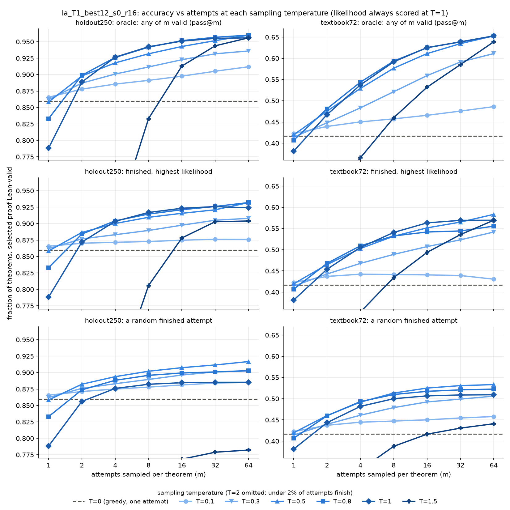

# Sampling-temperature sweep on Dan's r16 prover: boring, T=0.8 is fine

Question (Robbie): Dmitry's [proof-selection sprint](https://github.com/chainik1125/nd-rl/blob/dmitry/main/experiment-summaries/2026-10-06-proof-selection-sprint/summary.md)
found that keeping the finished proof with the highest likelihood out of 8 samples at T=0.8 recovers most of the
gap to pass@8. Does that just mean T=0.8 is too hot, and one cold sample would do as well?

Answer: no. Nothing here changes what anyone should do.

## Setup

- Model `la_T1_best12_s0_r16.pt` (sha256 `ba5d03de…`), Dan's `nd-takehome` at `4dcd0e4f`, Dmitry's collector and
  likelihood scorer unchanged at nd-rl `af00a584`. Only the sampling temperature varies.
- T in {0, 0.1, 0.3, 0.5, 0.8, 1, 1.5, 2}; 64 attempts per theorem (one at T=0); holdout250 and textbook72; seed 0.
- Likelihood is always scored at T=1. "Pick" = finished first, then highest mean token log-prob.
- Curves are exact expectations over m-subsets of the 64 attempts. One A40, 44 min, about $0.36.

## Results

Full table with theorem-bootstrap intervals: [results_table.md](results_table.md).

| | holdout250 | textbook72 |
|---|---|---|
| T=0, one attempt | 0.860 | 0.417 |
| T=0.5 pass@1 | 0.858 | 0.420 |
| T=0.8 pass@1 | 0.833 | 0.407 |
| T=0.8 pick of 8 | 0.915 | 0.532 |
| T=0.8 oracle pass@8 | 0.942 | 0.594 |
| T=0.1 oracle pass@64 | 0.912 | 0.486 |

- The T=0.8 row reproduces Dmitry's numbers (0.836 / 0.918 / 0.940 and 0.405 / 0.540 / 0.594).
- One attempt: T=0 to 0.5 are the same. T=0.8 costs about 0.03 on holdout250, T=1 about 0.07.
- Four or more attempts: T=0.5 to 1 are indistinguishable under both the oracle and the likelihood pick. Lower
  temperatures lose because the samples are near-duplicates.
- No single cold sample gets near the pick of 8 at T=0.8, so likelihood selection is not a decoding artifact.
- T=1.5 reaches the same oracle pass@64 with far fewer valid attempts; T=2 almost never finishes a proof.

## Limits

One generator seed, one sampling seed. Intervals are about ±0.03 (holdout250) and ±0.10 (textbook72), and no
paired tests between temperatures were run, so the ordering among T=0.5, 0.8 and 1 is unresolved.

## Reproduce

`launch.py up`, `launch.py run`, `launch.py down`, then `uv run --with numpy --with matplotlib analyze.py`.
The pools (502 MB) were left in the local `artifacts/temp_sweep_20261006/out` and not uploaded to Hugging Face.
