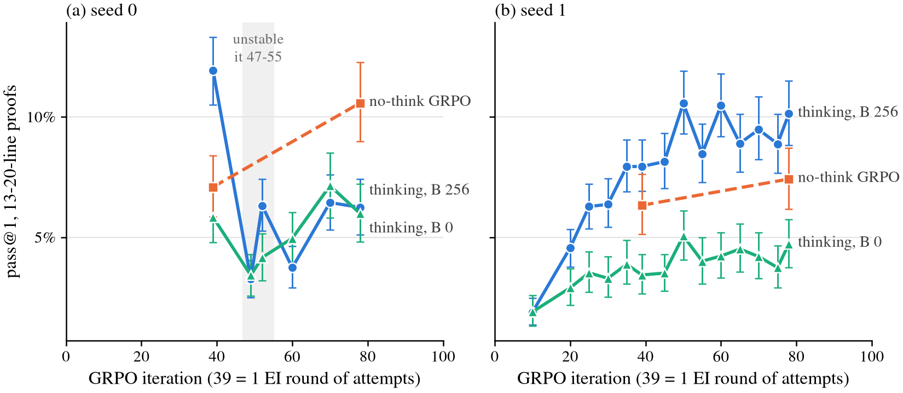
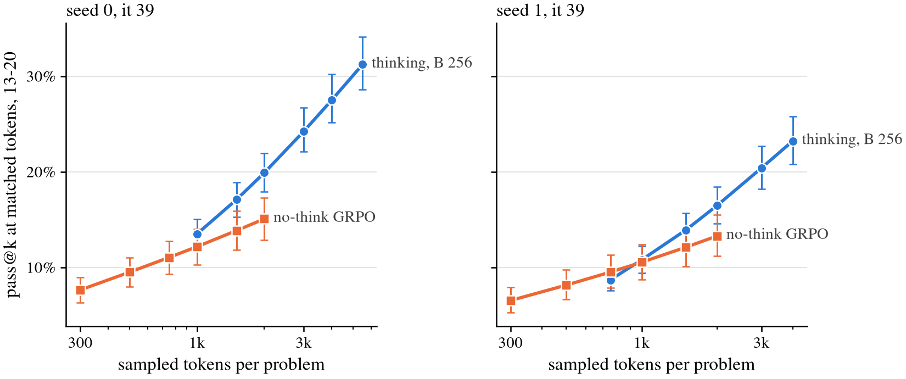
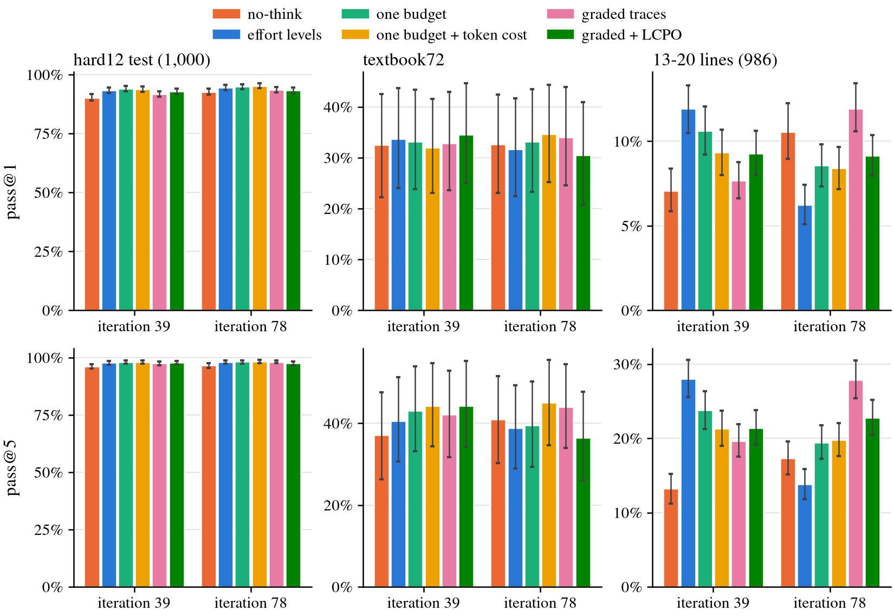
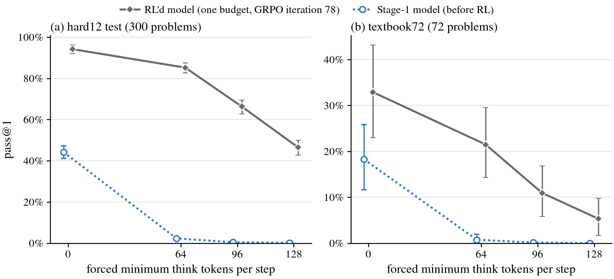
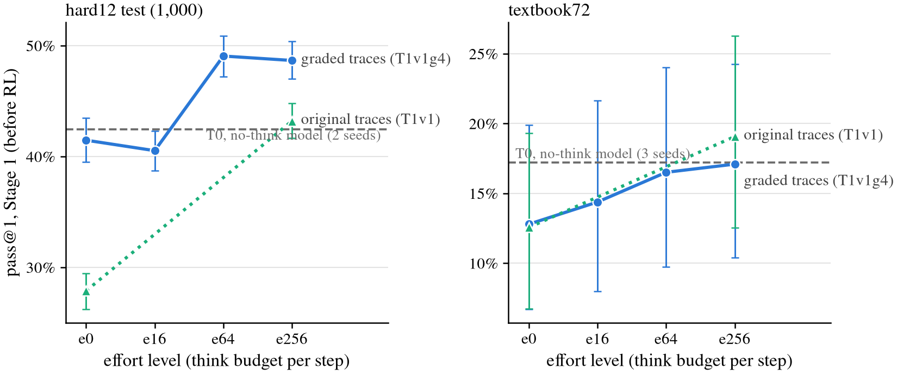

# RL results: thinking vs no-think, GRPO vs EI, and the length variants (2026-10-07 runs)

**Code and sources**
- Branch `leon/thinking`, built on the GRPO scoring fix (`7b082b7`); LCPO was added in `4608e60`.
- Every number below is generated by [`matched_eval/final_tables.py`](matched_eval/final_tables.py), which writes
  [`matched_eval/final_tables.md`](matched_eval/final_tables.md).
- Figures come from [`matched_eval/figs.py`](matched_eval/figs.py) and are in
  [`experiment-summaries/2026-10-05-thinking-traces/figures/`](../../../../experiment-summaries/2026-10-05-thinking-traces/figures/).
- Runs: `/scratch/cowifornia/nd-rl/think/runs/restart3_grpofix/` (GRPO) and `restart2_hard12/` (EI).

## Setup

**Training.**
- Every arm trains on the pool `rl_hard12`: 5,000 targets of 7–12 lines.
- GRPO:
  - recipe: the fixed loss, `--overlong fail`, dual clip 3, lr 1.5e-4, 256 targets × 16 attempts per iteration;
  - every GRPO run stopped at iteration 78 (Leon's call, 2026-10-07);
  - matched to EI on sampled attempts: one EI round is 5,000 × 32 = 160k attempts, so EI round 1 ↔ GRPO it39 and
    round 2 ↔ it78.

| arm | Stage-1 init | RL change | seeds |
|---|---|---|---|
| no-think GRPO | T0 | — | 0, 1 |
| effort levels | T1v1 | effort token `<e0>`–`<e256>` drawn per attempt | 0, 1 |
| one budget | T1v1 | B 256 only, no effort tokens | 0 |
| one budget + token cost | T1v1 | as above, plus a think-token penalty (`--len_penalty 0.2`) | 0 |
| graded traces | T1v1g4 (Stage 1 on graded-length traces) | effort levels | 0 |
| graded + LCPO | T1v1g4 | effort levels plus the LCPO length reward (`--len_target_coef 0.2 --len_target_mode exact --len_target_frac 0.5`) | 0 |
| EI no-think | T0 | Dan's ladder, k 32 | 0 |
| EI effort levels | T1v1 | Dan's ladder, k 32 | 0 |

Seed 1 is a full replicate: Stage-1 seed 1 followed by RL seed 1.

**Test sets.**

| set | size | k | role |
|---|---|---|---|
| `hard12_test_1k` | 1,000 | 16 | in distribution (same generator band as the pool) |
| textbook72 | 72 | 64 | real textbook problems |
| 13–20 lines | 986 | 8 | OOD, longer proofs |

- The 13–20 set is the 986 items of the 1,000-item eval subsample that are unchanged in the final sealed set
  ([test_13_20/README.md](test_13_20/README.md)). No model was used to select it.
- Thinking arms are read at B 256, their full budget, fixed before any eval. B 64 reads are in the tables but are
  not used for the headline comparisons.

**Statistics.** pass@k is unbiased, in % of the set. Intervals are 95% hierarchical-bootstrap intervals from
`code.thinking.stats`.
- One-run intervals resample theorems only, so they leave out seed-to-seed variance.
- Rows marked "seeds 0+1" resample seeds too.

## Results (observed)

### 1. GRPO beats EI in distribution at pass@1, not at pass@5, and not clearly out of distribution

hard12, GRPO minus EI at matched attempts (seed 0):

| arm | it39 − r1, pass@1 | it78 − r2, pass@1 | it39 − r1, pass@5 | it78 − r2, pass@5 |
|---|---|---|---|---|
| no-think | +12.3 [+10.6, +13.8] | +10.0 [+8.6, +11.6] | −0.4 [−1.5, +0.7] | −1.1 [−2.2, −0.1] |
| effort levels, B 256 | +15.6 [+14.1, +17.1] | +8.0 [+6.7, +9.3] | +1.4 [+0.5, +2.4] | −0.5 [−1.2, +0.3] |

- In absolute terms, no-think GRPO is at 90.3% / 92.8% pass@1, against 78.0% / 82.7% for EI.
- **Pass@1 vs pass@5.** GRPO raises pass@1 a lot and pass@5 not at all, so it sharpens: it concentrates on proofs
  EI can already find in 5 tries.
- **13–20, no-think:** GRPO is ahead by +2.0 / +2.9 pass@1. pass@5 ties.
- **13–20, thinking, at round 2:** EI is ahead.
  - EI effort levels at r2, B 256: 11.4% pass@1, 28.6% pass@5, at 1,447 tokens per attempt.
  - Seed-0 GRPO at it78: 6.2% / 13.8% (see §2 on that run).
  - Seed-1 GRPO at it78: 10.1% / 23.3%, at 679 tokens per attempt.
- **textbook72:** no difference is resolved.
- **Correction.** The earlier chat summary said "GRPO with thinking soundly beats EI". That holds for in-distribution
  pass@1 only.

### 2. Thinking vs no-think GRPO

Thinking (effort levels, B 256) minus no-think GRPO, same seed and iteration:

| set | point | seed 0 | seed 1 | seeds 0+1 |
|---|---|---|---|---|
| hard12, pass@1 | it39 | +3.0 [+1.5, +4.6] | +2.7 [+1.0, +4.4] | +2.9 [+1.4, +4.3] |
| hard12, pass@1 | it78 | +1.7 [+0.2, +3.1] | +2.6 [+1.1, +4.2] | +2.2 [+0.6, +3.8] |
| 13–20, pass@1 | it39 | +4.8 [+3.2, +6.5] | +1.6 [+0.2, +2.9] | +3.2 [+0.4, +6.3] |
| 13–20, pass@1 | it78 | −4.3 [−6.0, −2.6] | +2.7 [+1.2, +4.2] | −0.8 [−4.7, +3.0] |
| 13–20, pass@5 | it39 | +14.8 [+12.0, +17.5] | +9.7 [+7.3, +12.2] | +12.3 [+7.4, +17.2] |
| 13–20, pass@5 | it78 | −3.5 [−6.1, −1.0] | +9.4 [+6.9, +12.0] | +3.0 [−4.3, +10.1] |

- **In distribution:** thinking adds about 2–3 pp pass@1 and 2 pp pass@5 in both seeds, at roughly twice the
  tokens per attempt (245–290 vs 140–146).
  - At matched sampled tokens the gain shrinks but stays: seeds 0+1 pooled +1.3 [+0.1, +2.7] at 1,000 tokens per
    problem at it78.
  - Seed 1 alone: +2.0. Seed 0 alone: +0.6, not resolved.
- **On 13–20:**
  - The gain is mostly at pass@5: +9 to +15 pp wherever the run is healthy.
  - The seed-1 learning curve (`fig_rl_t1320_curves`) shows it at about 0 at it10, +2–3 at it20–30, and +4 to +6
    pass@1 from it35 through it78.
  - At matched sampled tokens per problem, the gain is about 0 at 1,000 tokens and +3 to +5 at 2,000 tokens at it39.
    Seed 1 at it78 is +3.2 [+0.8, +5.6] at 2,000.
- **Seed 0 loses the 13–20 gain after it39.**
  - It is already gone at it49 (`fig_rl_t1320_curves`).
  - This coincides with a clip-low spike: the fraction rose from 0.002 to 0.014–0.020 at it48–52, with alarms at
    49, 50 and 52. Grad norms stayed below 0.1, and the run's in-distribution score kept rising (94.5% at it78).
  - Seed 1 had no clip-low alarms. It raised banned-mass alarms at it39 and it46–52, at 0.0010–0.0019, just over the
    1e-3 threshold, which is harmless under masked scoring. It kept its gain.
  - Whether the spike caused the loss is not established.
- **textbook72:** every difference is within ±8 pp and none is resolved (72 problems).

### 3. Variants of the thinking arm (seed 0 only)

pass@1 / pass@5 at B 256, with tokens per attempt:

| arm | hard12 it78 | 13–20 it39 | 13–20 it78 | 13–20 tokens per attempt, it78 |
|---|---|---|---|---|
| no-think, seed 0 | 92.8 / 96.6 | 7.1 / 13.2 | 10.6 / 17.3 | 272 |
| no-think, seed 1 | 91.8 / 95.8 | 6.3 / 11.8 | 7.4 / 13.8 | 271 |
| effort levels, seed 0 | 94.5 / 98.1 | 11.9 / 28.0 | 6.2 / 13.8 | 752 |
| effort levels, seed 1 | 94.4 / 98.4 | 7.9 / 21.6 | 10.1 / 23.3 | 679 |
| one budget | 94.9 / 98.2 | 10.6 / 23.8 | 8.6 / 19.4 | 825 |
| one budget + token cost | 95.3 / 98.4 | 9.3 / 21.3 | 8.4 / 19.8 | 518 |
| graded traces | 93.6 / 98.2 | 7.7 / 19.7 | 11.9 / 27.9 | 1,028 |
| graded + LCPO | 93.3 / 97.6 | 9.3 / 21.4 | 9.1 / 22.8 | 1,961 |

- **Seed variance is as large as the variant differences.**
  - The two no-think seeds differ by 3.2 pp pass@1 on 13–20 at it78 (10.6 vs 7.4).
  - The two effort seeds differ by 4 pp at it39 and 3.9 pp at it78.
  - Every variant is a single run compared with no-think seed 0, so a 2–3 pp difference between variants is not
    evidence for one recipe over another.
- **Token cost** cut tokens per attempt by about 40% at it78 (hard12 293 vs 480; 13–20 518 vs 825) at unchanged
  accuracy (95.3 vs 94.9; 8.4 vs 8.6).
- **Graded traces** gave the highest 13–20 read at it78: 11.9% / 27.9% at B 256, and 12.8% / 28.5% at B 64 (post
  hoc).
  - Against no-think seed 0 that is +1.4 [−0.3, +3.0] pass@1 and +10.6 [+8.0, +13.2] pass@5.
  - It spends more tokens than effort levels, so it is behind no-think at matched tokens: −4.1 at 1,000 tokens per
    problem, and −1.1 [−3.5, +1.2] at 2,000. The 1,000-token read is clamped, because one B 256 attempt already
    costs about 1,000 tokens.
- **LCPO steers think length but brings no accuracy gain over plain graded.**
  - Training think tokens per block at it78, for e16 / e64 / e256 (targets 8 / 32 / 128):
    - LCPO: 9.4 / 37.8 / 87.8;
    - plain graded: 3.6 / 15.8 / 23.9.
  - It roughly doubles tokens per attempt: 1,961 vs 1,028 on 13–20 at it78.
  - Accuracy is no better than plain graded, and lower at it78:
    - 13–20 at B 256: 9.1% / 22.8%, against 11.9% / 27.9%;
    - 13–20 at B 64: 11.5% / 26.8%;
    - textbook72 at B 256: 30.5% pass@1, against 34.0%.
  - At matched tokens it is the weakest arm: −6.9 (1,000 tokens, clamped) and −9.7 (2,000) against no-think on
    13–20 at it78.
  - Interpretation, not checked against the think text: the extra length LCPO buys does not carry useful search.
- **Banned think mass stayed at 1e-5–2e-3 per iteration in every fixed run**, against 0.91 in the buggy run. The
  scoring fix holds.

### 4. Budget forcing (s1-style) lowers accuracy

`--min_think N` bans `</think>` until N tokens, with a cap of 256. pass@1:

| model | set | min 0 | min 64 | min 96 | min 128 |
|---|---|---|---|---|---|
| Stage-1 T1v1 | hard12 (300) | 44.2 | 2.3 | 0.5 | 0.1 |
| Stage-1 T1v1 | textbook72 | 18.3 | 0.7 | 0.1 | 0.0 |
| one budget, it78 | hard12 (300) | 94.1 [91.9, 96.1] | 85.2 | 66.3 | 46.4 [42.8, 50.0] |
| one budget, it78 | textbook72 | 32.9 [23.0, 43.3] | 21.5 | 10.9 | 5.3 [1.6, 9.9] |

- Every forced minimum lowers accuracy, and lowers it more the longer it is.
- The RL'd model degrades less than the Stage-1 model, but still degrades.
- Read: more forced thinking is not more useful thinking for this model. The model's own stopping point is better
  than any forced one.

### 5. Stage 1 on graded-length traces (T1v1g4)

pass@1 at e0 / e16 / e64 / e256:

| set | T1v1g4 | references |
|---|---|---|
| hard12 | 41.5 / 40.5 / 49.1 / 48.7 | T0 (seeds 1–2) 42.4; T1v1 B 0 / B 256 27.9 / 43.2 |
| textbook72 | 12.8 / 14.4 / 16.5 / 17.1 | T0 (3 seeds) 17.2; T1v1 B 0 / B 256 12.6 / 19.1 |
| 13–20 | 0.5 / 0.4 / 0.7 / 0.7 | at the floor |

- On hard12, training on graded lengths removes T1v1's no-think penalty: e0 is level with T0 (41.5 vs 42.4).
- At e256 it beats T0 by +6.2 [+4.3, +8.0] pass@1.
- On textbook72 it does not help: e256 minus T0 is −0.1 [−4.7, +4.5].
- After RL the no-think penalty comes back. The graded arm at B 0 reads 88.4% on hard12 at it78, the same as effort
  levels from T1v1 (88.3%) and below no-think GRPO (92.8%).

## Caveats

- **One seed per variant;** one-run intervals leave out seed variance (see §3).
- **The hard12 test set shares the pool's selection.** Targets were kept at 2–16/32 for T0 seed 0
  ([seed control](stage1_stats/hard12_seed_control.md)). That penalises any arm initialised from T0 seed 0 at the
  start of training. After RL every arm is above 87%, so this mostly affects the Stage-1 rows.
- **textbook72 has 72 problems.** Nothing on it is resolved below about ±8 pp.
- **Training stopped at it78.** Trends beyond that are unknown.
- **The 13–20 eval subsample was drawn before the set was finalised.** 14 of 1,000 items are excluded.

## Proposals (not run; need Leon's call)

1. **A second seed of the graded arm and of one budget + token cost.** Each costs about 3 GPU-h to it78 (the graded
   runs took 2.6–2.9 h), plus about 1.5 GPU-h of evals.
   The variant differences are within seed spread, and this is the cheapest way to rank them.
2. **Find out why the seed-0 effort run lost its OOD gain at it48.**
   - Restart from its it39 checkpoint twice: once with the same settings, once at half the learning rate.
   - Read 13–20 at it52. The alarm checkpoints it49, it50 and it52 are kept for comparison.
3. **Report pass@5 as the headline for thinking on 13–20.** That is where the effect is large and replicates
   (+9.4 to +14.8 in healthy runs).
