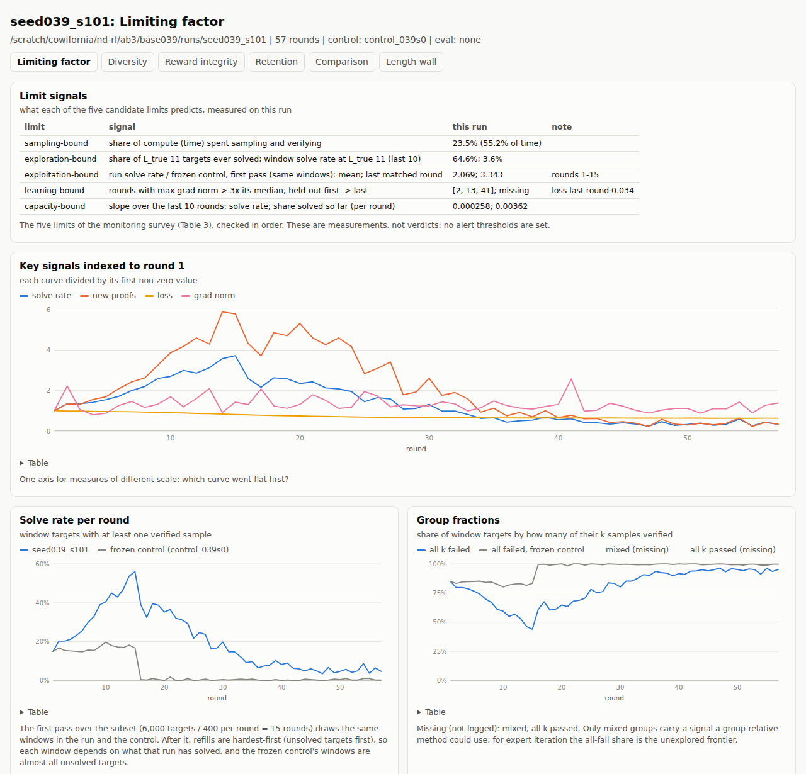
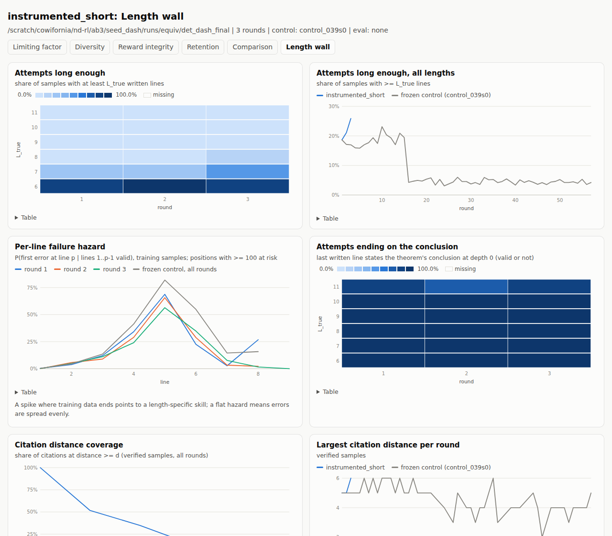
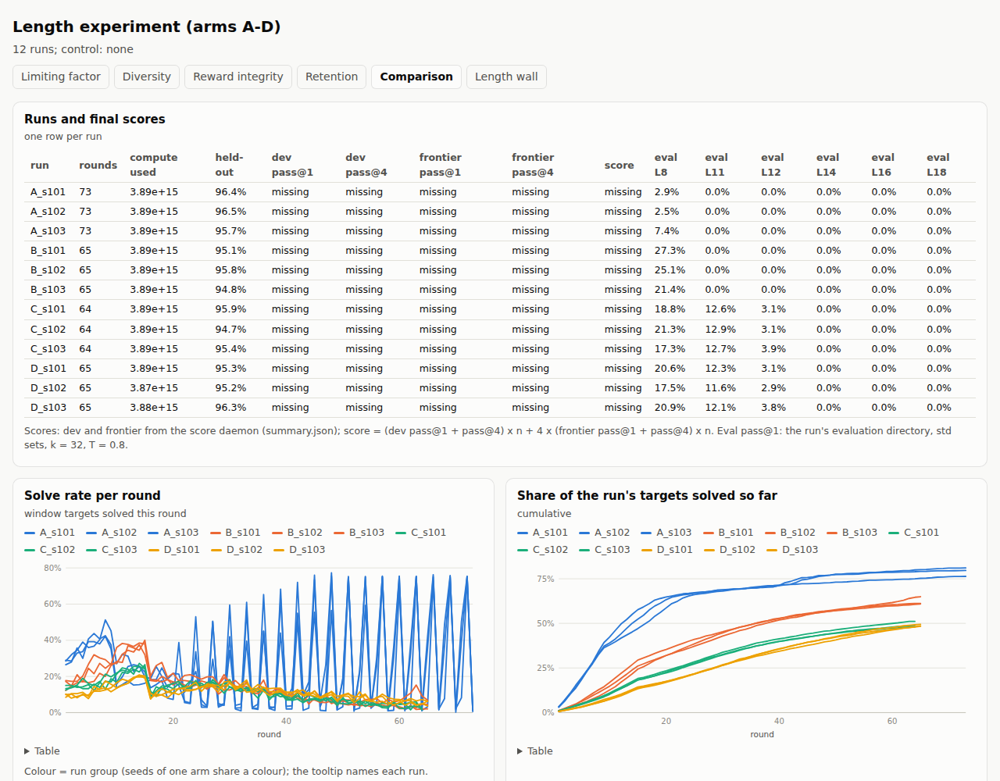

# RL run dashboards: what was built

Dmitry asked in the 2026-09-20 group meeting (transcript, 49:38) for "a decent set of dashboards that we monitor ...
so that it's less of a black box". His test is whether we can point at a curve and say "the model stopped learning
here, and this is why". This note first proposed the dashboards. Leon approved them with the monitor's defaults, and
the note now records what was built for the run-3 setup (ab3: a metered FLOP budget, pass@1 / pass@4 scores). The
monitoring survey behind the choices is `/scratch/cowifornia/nd-rl/ab/dash/RL_monitoring_survey.md` (PDF beside it).

## Summary

- **An instrumented copy of the seed recipe**, `ab3/seed_dash/rl.py`. It logs every field of the proposal's Table 1
  except the GRPO-only ones, plus four "length wall" fields. The logging does not change training: every round before
  the budget-limited tail round is bit-identical to the seed's (tested). The model checks cost about 1.5% of the
  compute budget.
- **A static HTML renderer**, `code/tools/rl_dash.py`, with tests in `code/tests/test_rl_dash.py`. It writes six
  dashboards per run from `metrics.jsonl` and friends, needs no network, and marks missing fields as missing, never as
  zero.
- **One frozen-control run.** The seed's sampling loop with training off, from the 039 s0 base, 57 rounds, about 15
  GPU-minutes. It is the dashboards' baseline.
- **An ignition set.** 300 non-sealed targets at `L_true` 9-10 with known proofs, used only to measure
  `ref_logp_unsolved`.
- **Retro-rendered dashboards** for every existing ab3 run: `/scratch/cowifornia/nd-rl/ab3/dash_out/index.html`.
- **W&B.** The machine has credentials, but the project `nd-rl-hillclimb` does not exist. Nothing was uploaded.

## Defaults chosen (the monitor's, approved by Leon)

- **Schema.** Every Table 1 field except the GRPO-only ones (`reward_std`, `adv_abs_mean`, `clip_frac`, `ratio_max`),
  plus the length-wall fields below.
- **Held-out check every round.** 40 records per length 2-6, and the start model at round 0.
- **No alerts yet.** The limiting-factor page shows measurements, not verdicts.
- **W&B only if credentials exist, and no upload until the monitor confirms.** The sync is written and was tested in
  offline mode.
- **Logging lives in a separate copy of the recipe** (`ab3/seed_dash/`). `ab3/seed/` is unchanged.
- **One frozen control**, from the 039 s0 base.
- **The ignition set is for measurement only.** Its proofs never enter training.

## The instrumented recipe (`ab3/seed_dash/rl.py`)

It is generated by `build/make_dash.py` from `ab3/seed/rl.py` (sha256 be380193a3fc...) plus one instrumentation block,
using anchored insertions only (sha256 4334df525101...). Its README (`ab3/seed_dash/README.md`) lists every field.

Table 1. Fields added, by record.

| record | fields | notes |
|---|---|---|
| `sample` (every round) | `frac_all_fail`, `frac_mixed`, `frac_all_pass` (and by `L_true`) | the wasted-group signal |
| | `pass_at` {1, 4, 32}, `pass_at_by_len` | unbiased, from each window target's success count; training temperature |
| | `distinct_per_solved`, `len_accepted`, `len_rejected`, `trunc_rate` | `trunc_rate` = samples without QED |
| | `entropy`, `kl_to_init_sampled` | on 64 of the round's samples, teacher-forced through the model that drew them |
| | `long_enough(_by_len)` | share of attempts with at least `L_true` written lines |
| | `first_error_line_hist`, `lines_at_risk_hist` | per-line failure hazard of rejected samples (lengthexp's line checker) |
| | `ends_on_conclusion(_by_len)` | last written line states the goal at depth 0, valid or not |
| | `cite_dist_hist`, `cite_dist_max` | current line minus cited line, over verified samples |
| `train`, `round_end` | `n_rl_records`, `n_retained`, `ft_secs`, `grad_norm_mean`, `grad_norm_max`, `gpu_mem_gb` | |
| | `phase_secs`, `phase_flops` | the round's time and metered FLOPs by phase: sample, verify, fine-tune, checks, mix, checkpoint, eval |
| `eval`, `source: dash` (every round, and round 0) | `heldout_greedy_by_len` (2-6), `heldout_greedy_dash` | a fixed 200-record subset of the harness's held-out slice |
| | `kl_to_init` | KL(current ‖ start) per token on 64 fixed held-out records (reference proofs) |
| | `ref_logp_unsolved`, `ref_logp_by_len`, `ref_tok_acc`, `ref_full_match` | the ignition set's known proofs, teacher-forced |
| `examples.jsonl` | 8 accepted and 8 rejected proofs per round | drawn with the instrumentation's own RNG |

**Why it does not change training.**
- **No shared state.** The instrumentation never touches the training RNG, the global torch or CUDA RNG, the graph
  sampler's cache or the budget planner's FLOP-rate estimates.
- **No gradients or sampling.** Every model pass runs under `torch.no_grad` and is greedy or teacher-forced, so it
  draws no random numbers.

**What it does change: compute.**
- **How much.** The meter charges the checks. A full round costs 9.7e11 FLOPs of checks: held-out greedy 1.9e11,
  fixed-set KL 1.2e11, ignition log-prob 4.8e11, sampled entropy and KL 1.8e11. A 3.9e15 run of about 60 rounds
  therefore spends about 6e13, about 1.5% of the budget. That is roughly one fine-tune round.
- **The cap.** `dash_max_frac` stops the checks at 2%. The KL and entropy subsets were halved from 128 to 64 to stay
  well under it.
- **Wall time.** It rises by about 1.7 s per round.
- **Effect on training.** Because the planner sees fewer FLOPs left, an instrumented run can end about one round
  earlier than the seed, and its last, budget-shrunk round differs.

**The equivalence test** (`ab3/seed_dash/tests/run_equivalence.sh`; results in `runs/equiv/cmp_*.json`):
- **`--smoke`, default mode.** The seed run twice, and the seed against the instrumented copy: rounds 1-2 and
  `final.pt` are bit-identical, with the same per-round accept counts.
- **Short real config (1.5e14 FLOPs), deterministic mode.**
  - Setup: `tests/det_harness.py` runs the frozen harness file unchanged with
    `torch.use_deterministic_algorithms(True)`.
  - Seed against seed, on GPUs 2 and 4: bit-identical in all three rounds.
  - Seed against instrumented: bit-identical in rounds 1-2 (checkpoints, 1,625 and 1,835 accepted samples, losses,
    FLOPs). Round 3 differs: it is the tail round, which the planner shrinks further in the instrumented run.
- **The same short config in default mode.** The seed is not reproducible against itself. Its round-1 fine-tune
  already differs (maximum weight difference 0.0084), because the memory-efficient attention backward used for the
  packed, masked batches is nondeterministic. The default-mode difference between the seed and the instrumented
  copy (0.0068) is of the same size.

## The frozen control

`ab3/seed_dash/rl_control.py` is the instrumented recipe with one line changed: `train=False`, `rounds=57`, no round
checkpoints, and model checks only at round 0.

**The run.**
- **Command:** `frozen_039/harness.py --rl rl_control.py --seed 101 --budget 1140 --no-score --gpu auto`.
- **Launch:** 04:58 UTC on 2026-09-26, when a GPU was free and no midtrain job was queued (the midtrain base arm
  was running on another card).
- **Size:** 882 s in `rl.run`, 8.54e14 FLOPs of sampling.
- **Output:** `ab3/seed_dash/runs/control_039s0_s101`.
- **Matching RL run:** `base039/runs/seed039_s101` (same base and seed). Rounds 1-15 draw identical windows in both
  runs. After that the refills are hardest-first, so each run's windows depend on what it has already solved.

Table 2. Frozen control against RL on the same base and target subset.

| | frozen control | RL (seed039_s101) |
|---|---|---|
| solve rate per round, rounds 1-15 (same windows) | 16.5% | 34.2% |
| window pass@1, rounds 1-15 | 12.5% | 23.4% |
| new distinct proofs per round, rounds 1-15 | 82 | 221 |
| solve rate per round, rounds 16-57 | 0.4% | 15.1% |
| targets solved by the end (of 6,000) | 1,062 (L6 836, L7 213, L8 13, L9-11 0) | 4,585 |

**The control at round 1.**
- Group fractions: all-fail 85%, mixed 9.8%, all-pass 5.3%.
- Attempts long enough for `L_true`: 88.5% at L6, 24.4% at L7, 1.0% at L8, and 0-0.2% at L9-11.
- 92% of attempts end on the conclusion.

**The start model (round 0).**
- `ref_logp_unsolved` is -0.561 per token.
- On the short instrumented run it rose to -0.455 after one RL round and -0.371 after two.

## The ignition set

It is in `ab3/seed_dash/ignition/`, with the builder `build_ignition.py` and `MANIFEST.json`.

- **Source.** 300 generator theorems from `ab2/data/reserve.jsonl` (records built fresh for run 2): 150 at `L_true`
  9 and 150 at 10. The reserve holds no `L_true` 11 records.
- **Proofs.** Each carries its verified minimal proof.
- **Excluded pools (by pkey and by key).** ab2 data and sealed sets, ab3 sealed sets, data_comp, the lengthexp /
  repr / goals test sets, midtrain's build files, and cap-6 train and held-out.
- **Excluded parts.** Every reserve record used as a part of a constructed theorem (test, data_comp or midtrain
  parts) is also excluded: 3,804 candidates.
- **Midtrain check.** `ab3/midtrain/data/` was empty when the set was built. Re-check with `--check-only` once it is
  filled.
- **Use.** The known proofs are only teacher-forced, without gradient, to compute `ref_logp_unsolved`. They never
  enter a training mix, and their prompts are never sampled for. The set is not sealed.

## The dashboards (`code/tools/rl_dash.py`)

```
python code/tools/rl_dash.py render RUN [RUN ...] --out DIR [--control RUN] [--eval LABEL=DIR] [--title T]
python code/tools/rl_dash.py fields RUN [RUN ...]          # which fields each run logged, derived or lacks
python code/tools/rl_dash.py wandb RUN [RUN ...] --mode dry-run|offline|online [--confirm-upload]
```

- **Arguments.** A RUN is a run directory, optionally labelled (`C_s101=/.../runs/C_s101`).
- **Evaluation directories.** They are joined automatically: `<exp>/eval/<label>` is used when its `meta.json`
  names the run's `final.pt`.
- **Output.** Each run gets five pages in `DIR/<label>/`, plus `DIR/5_comparison.html` and `DIR/index.html`.
- **Format.** Pages are plain HTML with inline SVG, hover tooltips, a table view under every chart, and light and
  dark themes.
- **Older runs.** Fields that older runs lack are shown as missing. A few are derived by exact identities, and the
  field-coverage table on every page says which: pass@1 = accept_rate; all-fail share = 1 - solved / window;
  pass@32 = solved / window when k = 32; truncation = 1 - qed_rate.

What each page shows:

1. **Limiting factor.**
   - A table of signals for the survey's five limits:
     - sampling: compute and time share;
     - exploration: share of the longest targets ever solved;
     - exploitation: run against control over the first pass;
     - learning: grad-norm spikes and held-out change;
     - capacity: slopes over the last 10 rounds.
   - Key curves indexed to round 1.
   - Solve rate against the frozen control, group fractions and new proofs per round.
   - FLOPs and wall time per round by phase.
   - Loss and grad norm.
2. **Diversity.** Window pass@1/4/32, pass@1 against the control, pass@1 by `L_true`, distinct proofs per solved
   target, and entropy.
3. **Reward integrity.**
   - Written against pruned length. Pruned drops uncited premises too, so the gap is not all padding.
   - The failure-reason mix, accepted against rejected length, and truncation.
   - New proofs with fewer written lines than `L_true` (a label or verifier check) and with more.
   - The example table.
4. **Retention.** Held-out greedy overall and by length, KL to the start model (fixed set and sampled), and the RL
   share of the fine-tune mix.
5. **Comparison.**
   - All runs overlaid, coloured by group so that seeds share a colour.
   - A table joined with summary.json scores (dev and frontier pass@1 / pass@4, score) and evaluation pass@1 at
     L8-18.
6. **Length wall.**
   - Attempts long enough by `L_true`, the per-line hazard (first, middle and last round against the control), and
     ends-on-conclusion.
   - Citation-distance coverage. For older runs it is derived from `found_targets.jsonl`.
   - Ignition-set log-prob.
   - When an evaluation directory exists: test-time pass@1 by length, attempts long enough, and the per-line hazard
     by length group.

**Retro-rendered pages** (`/scratch/cowifornia/nd-rl/ab3/dash_out/`, re-made by `render_all.sh`, 208 pages):

| group | runs | control |
|---|---|---|
| `base039/` | seed039_s101, seed039_s102, seed039s1_s101, seed039s2_s101 | the frozen control |
| `seed_dash/` | the short instrumented run (every field logged) | the frozen control |
| `seed/` | seed_s101, seed_s102 | none (original pretrain) |
| `lengthexp/` | A-D x 3 seeds, with their evaluations | none |
| `repr/` | abs / rel / nope / posline x 3, with their evaluations | none |
| `goals/` | goals x 3 and repr abs x 3, with their evaluations | none |

Figure 1. Limiting-factor page, seed039_s101 against the frozen control
(`dash_out/base039/seed039_s101/1_limiting.html`).



Figure 2. Length-wall page of the short instrumented run (`dash_out/seed_dash/instrumented_short/6_length_wall.html`).



Figure 3. Comparison page of the length experiment (`dash_out/lengthexp/5_comparison.html`).



**W&B.**
- **Credentials.** `~/.netrc` holds W&B credentials, and the default entity is `models`.
- **The project.** `nd-rl-hillclimb` does not exist under that entity, which shows no projects. The old
  `ab/common/wandb_sync.py` never ran (it left no state file).
- **The new sync.** `rl_dash.py wandb`:
  - flattens each record to `<phase>/<field>` (nested dicts joined with '.', `fail_reasons` as `fail/<reason>`);
  - logs `rl_step` as the x-axis.
- **Tests and the upload guard.**
  - Dry-run mode (the default) and offline mode were tested; offline mode writes local files only.
  - `--mode online` refuses to run without `--confirm-upload`.
- **Saved workspaces.** They need the project and the `wandb-workspaces` package, which is not installed, so they are
  not set up.

## Checks run

- **Repository checks.** `make -C code check` passes (ruff, format, pyright), and `make -C code test` passes (72
  passed, 3 skipped; 6 new tests).
- **Recipe checks.**
  - `ab3/seed_dash/tests/test_dash_cpu.py` covers pass@k, line parsing, first-error agreement with
    `lengthexp/ndcheck.classify` on 300+ corrupted proofs, the sample statistics, and that the recipe diff only adds
    code.
  - The equivalence runs are listed above.
  - `tests/check_greedy.py` shows the per-round greedy decoder gives outputs identical to the frozen decoder on 200
    records.
- **GPU use.** About 30 GPU-minutes in total, all through the GPU lock: the smoke and short equivalence runs, the
  15-minute control and the decoder check. No training experiment was started.

## Decisions for Leon

1. **Reproducibility.** The seed recipe is not bit-reproducible in PyTorch's default mode. Two runs with the same
   code and seed diverge from the first fine-tune on. Deterministic mode made same-seed runs identical, even across
   GPUs, at no visible speed cost in the short test. Should the harness turn it on? That changes a frozen file.
2. **Instrumented runs and promotion.** Instrumented runs spend about 1.5% of the FLOP budget on the checks, which is
   about one round. Should they count as GEAR candidates, or stay diagnostic only? The alternative is a harness-level
   allowance for instrumentation.
3. **W&B.** Which entity and project, and may we upload? The sync and the offline test are ready.
4. **More controls.** Should there be a frozen control per base? The current one covers only the 039 s0 base. The
   lengthexp and seed runs use the original pretrain, and repr / goals use their own re-pretrains. Each control costs
   about 15 GPU-minutes.
5. **The ignition set.** Keep it at `L_true` 9-10? The reserve has no `L_true` 11 theorems.

## Sources

- Meeting transcript: `docs/research_calls/group_meeting/group_meeting-20-09-2026.md` (49:38).
- Run-3 harness and meter: `/scratch/cowifornia/nd-rl/ab3/frozen/` (SPEC.md, harness.py, meter.py, metrics.py).
- Seed recipe: `/scratch/cowifornia/nd-rl/ab3/seed/rl.py`. Instrumented copy, control, ignition set and tests:
  `/scratch/cowifornia/nd-rl/ab3/seed_dash/` (README.md).
- Line checker and evaluation layout: `/scratch/cowifornia/nd-rl/ab3/lengthexp/` (ndcheck.py, evaluate.py,
  analyse.py).
- Monitoring survey: `/scratch/cowifornia/nd-rl/ab/dash/RL_monitoring_survey.md` (37 references).
