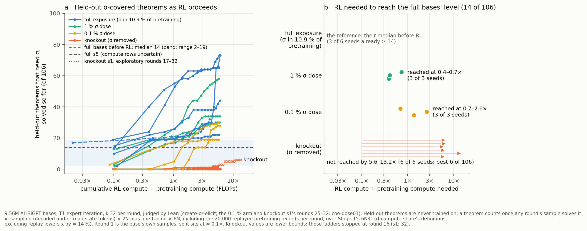

# How much RL does it take to bring back proof by contradiction?

A figure for the midterm write-up, built entirely from existing reads: create-or-elicit's 15 expert-iteration ladders,
with compute measured the way rl-compute-share measured it. No new training or sampling.

## Summary

The capability is solving held-out theorems whose every proof needs σ (classical proof by contradiction). These are the
106 strict σ-covered members of create-or-elicit's classical families; no ladder trains on them. The bar is what the
full-exposure bases solve **before any RL update**: a median of 14 of 106 (range 2–19 across 6 seeds) in their
round-1 samples at k 32.

| pretraining | RL ÷ pretraining compute needed to reach 14 of 106 | seeds |
|---|---|---|
| full exposure (σ in 10.9 % of K12) | none: it is their median before RL | 6 |
| 1 % σ dose | **0.39–0.73×** (rounds 2–3) | 3 of 3 |
| knockout (σ removed) | **not reached by 5.6–9.5×**; the best seed solved 5 of 106 | 0 of 6 |

- **Observed:** a little σ in pretraining makes it cheap for RL to recover the capability. With none, 16 rounds of
  this RL (24 for knockout s1) leave all six knockout seeds far below the bar. So without σ the RL needed is at least
  about 8× what a 1 % dose needs (5.6× against 0.73×; about 15× seed against seed at the medians).
- **Interpretation, not tested here:** the knockout row is a lower bound. Knockout s1's free positive reductios grew from
  11 to 123 per round over rounds 16–24 (create-or-elicit, Addendum 6), so some larger amount of RL might get there.
  With two dose levels and a lower bound, the figure cannot tell a threshold from a smooth curve.

**Next:** a 0.1 % dose arm is running as `coe-dose01`
([proposal 33](../../proposals/2026-10-31-coe-dose01.md)) to fill the gap between the 1 % dose and the knockout.

## How it is computed

- **y (panel a):** `heldout_cum_by_round` in create-or-elicit's `artifacts/coe/rounds/<ladder>.json` (fork branch
  `dan_create-or-elicit`), summed over families. A held-out theorem counts once any round's k 32 sample solves it,
  under the Lean-alone judge. Every arm gets the same samples per round.
- **x:** cumulative RL compute after each round's sampling, over the ladder's Stage-1 compute, as defined by
  rl-compute-share's reviewer (`review_rcs/ourruns.py`, fork branch `dan_rl-compute-share`):
  - sampling counts 2N per decoded token and per re-read state token;
  - fine-tuning counts 6N per trained token, including the 20,000 replayed pretraining records per round (excluding
    replay lowers x by about 14 %);
  - Stage-1 counts 6N·D, and N cancels.

  Round 1 is the base's own samples, so it sits at about 0.1×.
- **Check:** each ladder's total, including its last fine-tune, equals rl-compute-share's published ratio, on all 14
  ladders it counted (for example knockout s1 9.78×, dose1 s0 5.97×).
- **Ladders:**
  - full s0–s2 are the trajectory (r1–8) + rl-continue (r9–16) ladders, as in create-or-elicit's own figure;
  - full s3–s5, knockout s0–s5 and dose1 s0–s2 are create-or-elicit's.
- **Files:**
  - `extract_rl_curve.py` ran read-only on agent2 and wrote `rl_curve.json`;
  - `make_figure.py` draws `rl_needed.png` / `.pdf` from it. Run it with any Python that has matplotlib.

## Caveats

- **One organism:** 9.56M ALiBiGPT bases, T1 expert iteration, one family set. GRPO or a larger model could need more or
  less RL.
- **The bar is one choice:** the full bases' median before RL. A lower bar (5 of 106) would let knockout s1 count, at 7.3×
  (round 19). It is the only knockout seed above 1 of 106.
- **The full s5 ladder's compute rows are about 30 % below its siblings'** from round 1 on, and rl-compute-share left it
  out of its count. It is plotted dashed. It does not affect any number in the table.
- **Knockout s1's rounds 17–24 were exploratory** (create-or-elicit, Addendum 6) and are plotted dotted.
- **The review of create-or-elicit holds** that the families "need" σ only within 16 rounds of this EI, not beyond. This
  figure states the same thing as a compute bound.

## Sources

- [create-or-elicit summary](../../../experiment-summaries/2026-10-12-create-or-elicit-sigma-knockout-not-acquired-in-16-ei-rounds-needs-exposure-1pct-dose-restores/README.md)
  and its round figure `coe_rounds.png`, which shows the same data against EI rounds.
- [rl-compute-share summary](../../../experiment-summaries/2026-10-19-rl-compute-share-yue-rl-is-1e-4-of-pretraining-no-computable-tested-run-above-2e-2-hypothesis-supported/README.md),
  Q5 and its "scale curve" recommendation.
- [create-or-elicit next steps](../../papers/create-or-elicit/next_steps.md), item 3 (the 0.1 % and 0.01 % dose arms)
  and item 6 (longer knockout ladders).
