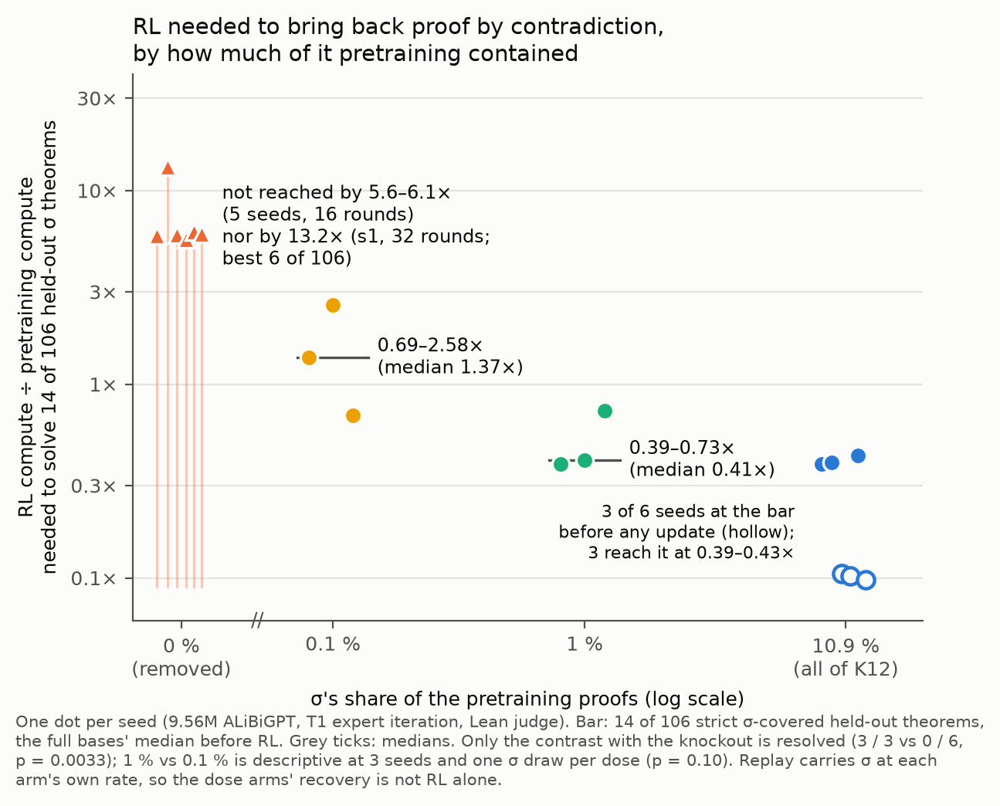

# How much RL does it take to bring back proof by contradiction?

A figure for the midterm write-up. It uses create-or-elicit's expert-iteration ladders plus one run made for this
figure (coe-dose01), with compute measured the way rl-compute-share measured it.

## Summary

**Setup.** The capability is solving held-out theorems whose every proof needs σ (classical proof by contradiction).
These are the 106 strict σ-covered members of create-or-elicit's classical families, and no ladder trains on them. The
bar is **14 of 106**: the median that the full-exposure bases solve before any RL update, in their own round-1 samples
at k 32 (range 2–19 across 6 seeds). Compute is the cumulative RL compute divided by the base's pretraining compute.

| σ in pretraining | RL ÷ pretraining compute to reach 14 of 106 | seeds that reach it |
|---|---|---|
| 10.9 % (all of K12) | at the bar by construction: 3 of 6 seeds are already there in their own samples, and the other 3 reach it at 0.39–0.43× (round 2) | 6 of 6 |
| 1 % | **0.39–0.73×** (rounds 2–3; median 0.41×) | 3 of 3 |
| 0.1 % (155 of 155,000 proofs) | **0.69–2.58×** (rounds 3, 5 and 8; median 1.37×) | 3 of 3 |
| 0 % (σ removed) | **not by 5.6–6.1×** (five seeds, 16 rounds), **nor by 13.2×** (s1, 32 rounds; it solved 6 of 106) | 0 of 6 |

**Observed:**
- **With no σ in pretraining, none of the RL we ran got there.** All three 0.1 % seeds cross the bar, against none of
  the six knockout seeds (one-sided Boschloo p = 0.0033). At round 16 the 0.1 % arm also solves more held-out theorems
  than the knockout (exact Mann–Whitney p = 0.012, the smallest attainable at these sizes).
- **A trace is enough.** The 0.1 % bases barely use σ in their own round-1 samples. They write 1, 0 and 2 free positive
  reductios (the knockout bases none, the 1 % bases 170–219) and solve 0, 0 and 3 of the 106. Yet all three cross. At
  round 16 they solve 30, 28 and 19 (1 %: 58, 34 and 30), and all three acquire the converse-contraposition family.
- **RL alone grows the form, not the coverage.** Knockout s1's free positive reductios rose from 11 to 123 per round
  over rounds 16–24, then stayed at about 140 per round over rounds 25–32. Meanwhile its held-out count went only from
  5 to 6.

**Interpretation (labelled, not established):**
- **The requirement looks graded.** The medians are 0.41× at 1 %, 1.37× at 0.1 %, and more than 5.6× at 0 %. That
  matches the pre-registered reading "graded". It rests on two crossing doses with three seeds and one σ draw each, so
  1 % against 0.1 % is descriptive: p = 0.10 for both the crossing compute and the round-16 count. Only the contrast
  with the knockout is resolved. Whether 0.01 % would fall between 0.1 % and none is untested.
- **The dose arms' recovery is not RL alone.** Each round's fine-tune replays 20,000 records of the arm's own
  pretraining set, which carries σ at the arm's rate (about 20 σ records per round at 0.1 %). Without a replay-only
  control, part of the recovery may be replayed exposure. The knockout ladders replay no σ and still grew free
  reductios, so RL alone can produce the form.

## The full trajectories

- **Panel a:** each ladder's held-out count against cumulative compute.
  - The dashed line is the bar, and the band is the full bases' range before RL.
  - Dotted is knockout s1's exploratory rounds 17–32.
- **Panel b:** the same crossings, one row per arm. The arrows are lower bounds: those ladders ended before reaching the
  bar.

## How it is computed

- **y:** `heldout_cum_by_round` in each ladder's `artifacts/coe/rounds/<ladder>.json`, summed over families.
  - create-or-elicit's files are on fork branch `dan_create-or-elicit`; `la_dose01_s*.json` and `la_ko_s1_r32.json` are
    on `dan_coe-dose01`.
  - A held-out theorem counts once any round's k 32 sample solves it, under the Lean-alone judge. Every arm gets the
    same samples per round.
- **x:** cumulative RL compute after each round's sampling, over the ladder's Stage-1 compute, as defined by
  rl-compute-share's reviewer (`review_rcs/ourruns.py`, fork branch `dan_rl-compute-share`):
  - sampling counts 2N per decoded token and per re-read state token;
  - fine-tuning counts 6N per trained token, including the 20,000 replayed pretraining records per round (excluding
    replay lowers x by about 14 %);
  - Stage-1 counts 6N·D, and N cancels.

  Round 1 is the base's own samples, so it sits at about 0.1×.
- **Crossing:** the x of the first round whose cumulative held-out count is at least 14.
- **Check:** each ladder's total, including its last fine-tune, agrees with rl-compute-share's published ratio to two
  decimals on all 14 ladders it counted (largest gap 0.0012×). coe-dose01's review recomputed the new ladders' ratios
  with its own implementation of the same definitions.
- **Ladders:**
  - full s0–s2 are the trajectory (rounds 1–8) and rl-continue (rounds 9–16) ladders, as in create-or-elicit's own
    figure;
  - full s3–s5, knockout s0–s5 and the 1 % dose s0–s2 are create-or-elicit's;
  - the 0.1 % dose s0–s2 and knockout s1's rounds 25–32 are coe-dose01's.

## Caveats

- **One organism:** 9.56M ALiBiGPT bases, T1 expert iteration and one family set. GRPO or a larger model could need more
  or less RL.
- **The bar is one choice.** With a lower bar of 5 of 106, knockout s1 would count, at 7.3× (round 19). It is the only
  knockout seed above 1 of 106.
- **Three seeds and one σ draw per dose.** All three 0.1 % seeds share the same 155 σ records, and the two doses share
  17 of them, so the seeds vary only initialisation and sampling.
- **Cut-offs bias y down on long proofs.** The 0.1 % ladders' k 32 samples (max_action 256, max_steps 48) cut off up to
  1.7 / 3.1 / 2.8 % of attempts per round in late rounds (s0 / s1 / s2). In the round-16 reads, excluded middle (37 of
  the 106) reaches 3.6 / 6.0 / 20.7 %. A cut-off attempt counts as a failure. The 1 % arm ran the same protocol, so
  the arms stay comparable.
- **Knockout s1's rounds 17–32 were exploratory:** rounds 17–24 in create-or-elicit (Addendum 6), and 25–32 in
  coe-dose01 with the same procedure.
- **Full s5 was misplaced in the first version.** Its round files were not tracked on the fork, so the extraction had
  no state re-prefill for it and put it at 0.02× in round 1. With the round files from create-or-elicit's bucket folder
  it sits at 0.106× in round 1 and 6.17× in round 16, alongside its siblings. No number in the table changed.
- **create-or-elicit's review** holds that the families "need" σ only within 16 rounds of this EI, not beyond. This
  figure states the same thing as a compute bound, now extended to 13.2× for one seed.

## Files

- `extract_rl_curve.py`: read-only on agent2; writes `rl_curve.json`. It stops if any ladder's round file is missing.
- `make_figure.py`: draws `rl_needed.png` / `.pdf` and the headline `rl_needed_headline.png` / `.pdf` from
  `rl_curve.json`. Run it with any Python that has matplotlib.

## Provenance

- **2026-10-31, `ad163fc`:** the first version, from create-or-elicit's ladders only (agent:claude).
- **2026-11-01, coe-dose01** ([proposal 33](../../proposals/2026-10-31-coe-dose01.md)): added the 0.1 % arm and
  knockout s1's rounds 25–32. Fork `dan-pandori/nd-takehome`, branch `dan_coe-dose01`, DONE
  [`ec488738`](https://github.com/dan-pandori/nd-takehome/commit/ec488738).
  - Reviewed in [`review_coe-dose01.md`](https://github.com/dan-pandori/nd-takehome/blob/4c932eec/review_coe-dose01.md):
    every headline number stands.
  - The librarian applied the review's corrections, marked inline, and fixed full s5 (`c948e1a`, `a1ed3ee`). That
    marked version is this folder at `cb2020b`.
  - Summary:
    [coe-dose01](../../../experiment-summaries/2026-10-31-coe-dose01-0p1pct-sigma-dose-reaches-the-bar-on-3-of-3-seeds-at-0p69-2p58x-rl-over-pretraining-flops-reading-graded/README.md).
- **2026-11-01, this version:** the corrections are folded into the text, and the headline chart has been added
  (agent:claude). `rl_curve.json`, `rl_needed.png` and `rl_needed.pdf` are unchanged from `cb2020b`.

## Sources

- [create-or-elicit summary](../../../experiment-summaries/2026-10-12-create-or-elicit-sigma-knockout-not-acquired-in-16-ei-rounds-needs-exposure-1pct-dose-restores/README.md)
  and its round figure `coe_rounds.png`, which shows the same data against EI rounds.
- [rl-compute-share summary](../../../experiment-summaries/2026-10-19-rl-compute-share-yue-rl-is-1e-4-of-pretraining-no-computable-tested-run-above-2e-2-hypothesis-supported/README.md),
  Q5 and its "scale curve" recommendation.
- [create-or-elicit next steps](../../papers/create-or-elicit/next_steps.md): item 3 lists the 0.01 % dose arm, the
  next point for this figure.
