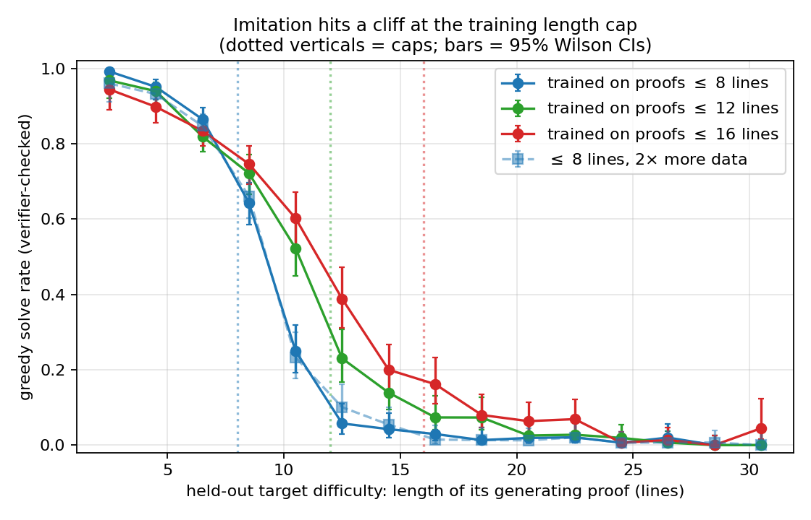
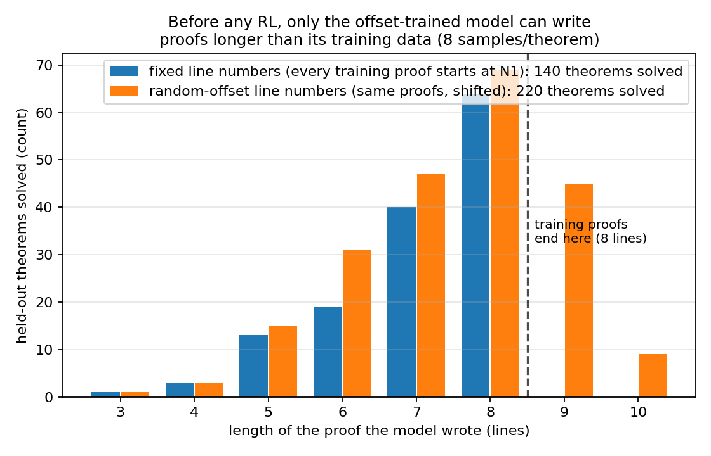
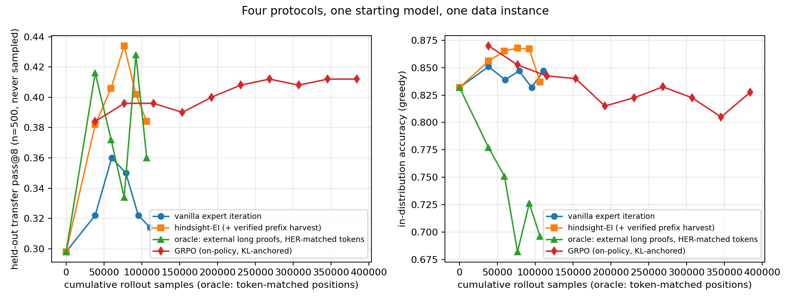
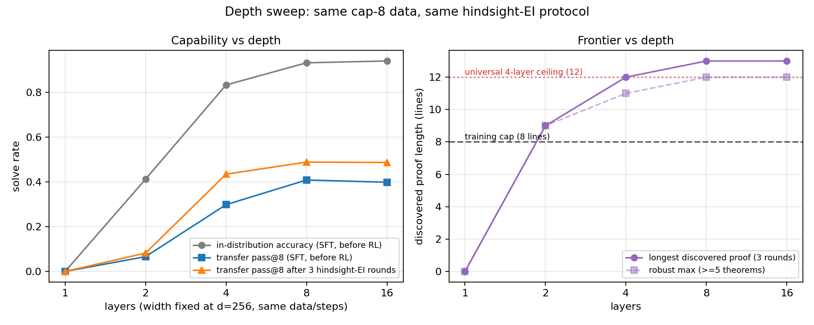

# Verifier-driven proof bootstrapping and length generalization

Status: completed June 9–10, 2026 experiment series, imported from the earlier natural-deduction
repository for local review.

The study trained 3.3M-parameter transformers from scratch on synthetic propositional
natural-deduction proofs and tested imitation, expert iteration, hindsight expert iteration,
GRPO, external-proof controls, proof-length caps, line-index tokenization, and model depth.

## Main observations

- Fixed line indices created a literal token wall: a model trained through `N8` never emitted a
  ninth proof line. Random index offsets removed that wall without reducing in-distribution
  accuracy.
- In the matched cap-6 sweep, SFT alone reached seven written lines. After three expert-iteration
  rounds, seven distinct accepted proofs had eight lines. A new post-hoc dependency audit retains
  all eight lines in each certificate.
- In the main cap-8 offset runs, two independent seeds each produced two dependency-pruned
  12-line certificates. Eight- and sixteen-layer variants reached 13 lines, with one and two
  dependency-pruned certificates respectively.
- The original five-round expert-iteration runs accumulated many new training-target proofs but
  barely improved never-sampled transfer. On a later fresh instance, hindsight-EI and GRPO raised
  transfer pass@64 from 40.8% to 50.8%, although those Part II comparisons were single-seed.
- Textbook reach peaked at 15/36 and did not improve durably.

Proof length here is the length of an accepted emitted certificate, including premises and
assumptions. Dependency pruning removes unused lines but does not search for a different, shorter
proof, so these lengths are not lower bounds on theorem difficulty.

## Key figures

## Imported evidence

- [Original full writeup](summary.md)
- [Original numbers ledger](results/numbers.md)
- [Original timestamped research log](log.md)
- [Original writing and red-team plan](writing_plan.md)
- [Post-hoc proof-length audit](proof-length-audit.md)
- [Archived implementation and runbooks](../../code/experiments/archived/nd_sprints_20260609_11/IMPORT.md)

Source: `../earlier-iterations/Natural Deduction LLM/nd_sprint`, source commit `e8766d2`. Raw
results and checkpoints were not duplicated; they remain in the earlier local repository.
