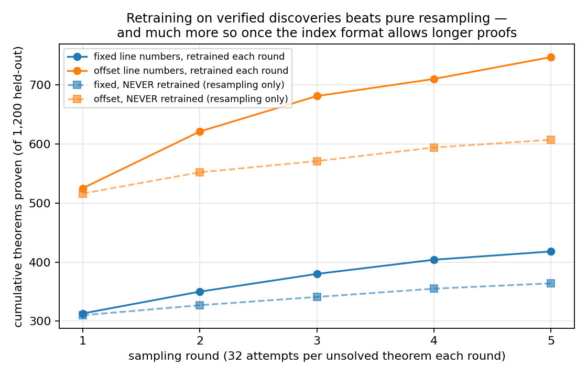
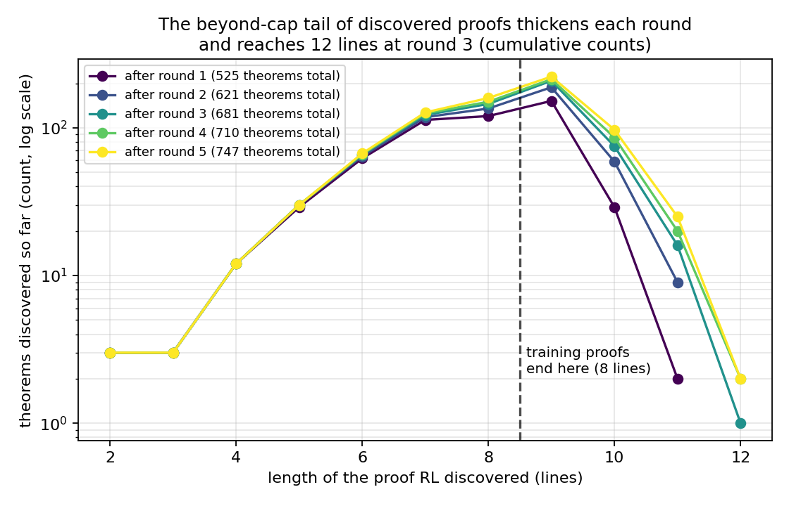
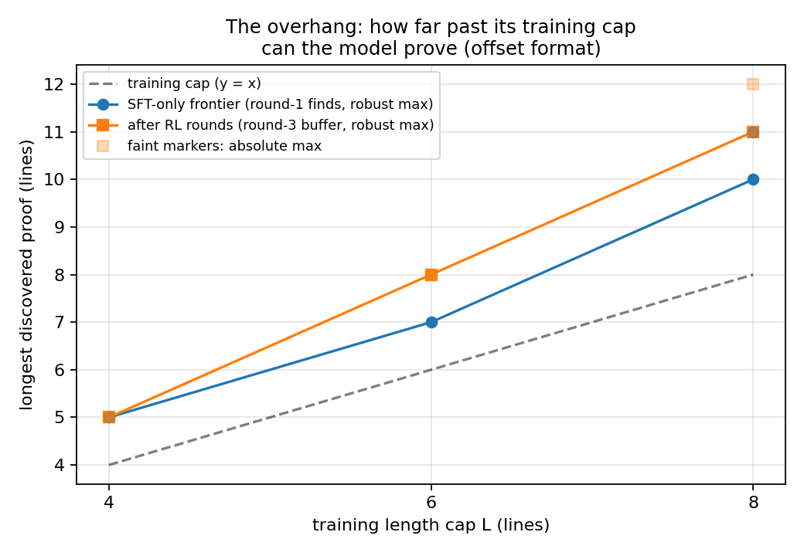

# Two Walls, Not One: What a Verifier Can and Cannot Buy a Small Prover

*10-hour autonomous research sprint, 2026-06-09/10. Code, figures, a numbers
ledger and a timestamped research log are in this repo
([process map](#10-research-process-map) · [log.md](log.md) ·
[results/numbers.md](results/numbers.md)). Part I (§1-10) is the sprint
deliverable as reviewed; Part II (§11-12) reports extension experiments run
interactively with the reviewer afterward — the cap-overhang sweep (§6a),
per-round forgetting curves (§6), a four-protocol bootstrapping comparison,
and a model-depth sweep.*

## Executive summary

We trained 3.3M-parameter transformers **from scratch** on short (2-8 line)
propositional natural-deduction proofs with a perfect, independently-implemented
verifier, asking a question frontier-model studies of RL from verifiable
rewards (RLVR; Yue et al., 2025) cannot settle:
can verifier-rewarded self-training reach theorems the model could not reach
before — and which kind of "compounding" (the proposal distinguishes three)
actually happens? Four findings:

**1. Imitation hits a sharp length cliff that more data does not move.** Models
solve 85-89% of held-out same-length theorems but collapse on longer proofs;
the cliff tracks the training length cutoff (8 → 12 → 16), persists on a
rule-composition-stable evaluation pool, and doubling the data does not move
its location (first-bin nudge only, 0.33 → 0.42) (Fig 1).

**2. The cliff hides a mechanical barrier we almost mistook for a reasoning
limit.** Line-index tokens `N9, N10, ...` never occur in 8-line-capped training
data, so writing a 9th proof line requires emitting a never-trained token. The
wall is literal — in every evaluation and all five RL rounds, the fixed-index
model solved beyond-cutoff theorems only with *short* proofs, never once
writing a 9-line one — and mechanistic: P(N9 | valid 8-line prefix) = 8×10⁻⁷
vs 4×10⁻² for an identically-trained model whose only difference is random
index offsets in its training data (n=300 prefixes). The ablation costs
nothing in-distribution, immediately yields 9-10-line proofs (Fig 2), and
moves never-sampled large-k coverage (pass@64: 0.310 → 0.448) more than RL
ever does. **A tokenization detail was worth more capability than five
rounds of RL.**

**3. Verifier self-training compounds *knowledge*: the pool of verified proofs
grows beyond what resampling explains, in both formats.** Five rounds of expert
iteration discover 418/1200 target theorems with the wall intact and 747/1200
with it removed; never-retrained controls (same sampling budget, frozen model)
reach 359-364 and 607. Above the wall this growth is qualitatively new content:
346 theorems were proven with proofs longer than anything in training, 301 of
which were *never* solved by the entire fixed-format study; the long-proof
tail thickens every round with a multiplier that grows with depth past the
cap (vs frozen-model resampling: ×2.6 at 10 lines, ×8 at 11, 12-liners
2-vs-0) (Figs 3-4). A post-hoc cap sweep (4/6/8) shows this overhang *scales
with the cap* — robust frontiers 5/8/11 after RL — rather than being a
constant few lines (§6a).

**4. But capability barely compounds: the gains stay on the theorems RL
trains against.** Finding 3's growth — including the proof-length ratchet of
Fig 4 — is measured on the 1,200 theorems RL samples. On a separate
500-theorem band RL never sampled (SE of a round-to-round *difference* ≈
3pp):
pass@64 moves +4.6pp (fixed, 0.310→0.356, ~1.5σ) and +1.0pp (offset,
0.448→0.458, <0.5σ) after five rounds;
pass@8 and pass@1 endpoints move ≤4pp, with intermediate rounds swinging up
to +8.4pp (the offset chain's round 4 — a swing that does not replicate in a
second-seed re-run, §9) and back; textbook-sequent reach never durably
exceeds the study's best round-0 level of 15/36 — the offset chain touches
15 once, at round 4, then falls back. In-distribution accuracy stays at
85-88% throughout: no collapse, no forgetting — and no generalized expansion
either. This is an expert-iteration analogue of the Yue et al. finding, in a
setting where pretraining cannot explain it. All findings replicate in
second-seed re-runs of both chains (§9).

**Takeaway.** With a perfect verifier, self-training is a *knowledge
accumulator*: it reliably banks verified proofs it could not have written at
round 0 — provided the output format does not make them unwritable at the
token level — but in five rounds it did not convert that bank into much
generalized proving ability. Both sides of the RLVR debate appear in one
controlled experiment: real self-generated novelty, and
sharpening-not-expansion on everything held out. The
practical lessons: audit your format for token walls before concluding
"RL can't create capability", and measure found-proof-length frontiers and
large-k coverage, not just solve rates — "hard" benchmarks leak easy short
proofs (§7).

| | |
|---|---|
|  |  |
| **Fig 1 — the cliff.** Greedy solve rate (verifier-checked) vs held-out target proof length; dotted verticals = each model's training cap; bars = 95% Wilson CIs. The cliff tracks the cap; 2× data (dashed) changes the curve only marginally near the cap. (Fig 1b in `results/figures/` shows the cliff persisting on a rule-composition-stable pool.) | **Fig 2 — the token wall.** Lengths of proofs written for solved beyond-cutoff theorems (8 samples each): with fixed line numbers (blue) not one proof exceeds 8 lines — zero across every fixed-format evaluation in the study (§4) — while random-offset line numbers in training (orange) yield 9-10-line proofs immediately, before any RL. (The offset model also solves modestly more at every length; the qualitative difference is past the dashed cap.) |
|  |  |
| **Fig 3 — knowledge compounding.** Cumulative theorems proven across expert-iteration rounds (solid) vs frozen-model resampling controls (dashed), 1,200 targets, 32 samples per unsolved target per round. Retraining beats resampling in both formats, far more with the token wall removed. | **Fig 4 — the frontier ratchet.** Discovered-proof-length histograms by round for the *4-layer* RL chain seeded from Fig 2's offset model (log scale; beyond-cap counts are small: 222/97/25/2 at 9/10/11/12 lines by round 5). This 4-layer model ceilings at exactly 12 lines — Part II (Fig 6) breaks that with depth. Set-level reach is real (301 theorems never solved by any fixed-format model); individual proofs may exceed minimal length (§7). |

### Part II headlines (post-sprint extensions; single-seed — see §11-12)

The reviewer pushed two further questions. **(A) Is there a protocol where
bootstrapping becomes self-sustaining or equals new knowledge?** We compared
four protocols from one checkpoint: plain expert iteration, *hindsight-EI*
(harvest the verifier-valid prefix of every failed proof attempt as a proof
of whatever it derived), GRPO (on-policy RL), and an *oracle* fed external
proofs at a matched token budget. **(B) What sets the 12-line ceiling?** A
depth sweep over {1,2,4,8,16} layers, same data and protocol.

| | |
|---|---|
|  |  |
| **Fig 5 — protocol matters; self-generated data ≥ external.** Held-out transfer (left) and in-distribution accuracy (right) vs samples. Hindsight-EI and GRPO expand transfer at every k (+9-11pp endpoints); the **oracle (green) matches their transfer but collapses in-distribution accuracy 14pp** — verified self-generated data is as useful per token *and* far better integrated (§11). | **Fig 6 — the ceiling is capacity, not protocol.** Same data and hindsight-EI protocol, varying depth. 1 layer can't do the task; capability and frontier both climb with depth; the **12-line ceiling of 4-layer models moves to 13 at depth 8** (a verified 4-deep nested case split) and saturates by 16 (§12). |

---

## Glossary (used throughout)

- **Primitives**: the 150k synthetic training proofs (2-8 lines) with their theorems.
- **Fixed / offset (line numbers)**: training proofs numbered `N1..Nk` from 1
  vs the same proofs with all indices shifted by a random per-proof offset.
- **Beyond-cutoff / OOD band**: held-out theorems whose *generating* proof has
  9-30 lines (their minimal proofs may be shorter — see §7).
- **Transfer set**: held-out band theorems never sampled during RL; all
  per-round transfer numbers in this document use its first 500 theorems
  (SE of a single rate ≈ 2pp; of a difference of two rates ≈ 3pp).
- **Solved**: the independent verifier accepts the emitted proof of exactly
  the prompted sequent. pass@1 = greedy; pass@8 at T=0.8; pass@k≥16 at T=1.0.
- **Round**: sample 32 proofs per unsolved target (T=1.0) → keep verified
  discoveries → retrain from scratch on primitives + all discoveries
  (upweighted 8×) → evaluate.

## 1. The question and why this setting

Yue et al. (2025) report that RL with verifier reward on frontier LLMs raises
pass@1 but not large-k pass@k: RL *sharpens* the base distribution rather than
expanding it. On a frontier model this is hard to interpret — pretraining
covers essentially all human mathematics, so "the base model couldn't" is
unfalsifiable. Following the project proposal (`proposal/`), we use
propositional natural deduction as a testbed where the question is exact: the
training distribution is fully specified, the verifier is perfect, and
"beyond the training distribution" is a measurable property (proof length,
rule structure, token content). The proposal's three claims map to: does RL
reach held-out targets (bootstrapping)? is what it produces useful training
data (data value)? and do iterated rounds compound — where its appendix A3
distinguishes *distributional* compounding (the discovered-proof pool keeps
growing usefully), *capability* compounding (round k solves what round k-1
could not, anywhere), and *efficiency* compounding (same reach, fewer
samples). Our answer: strong distributional, marginal capability, modest
efficiency — and the split only became visible after removing a format
artifact.

## 2. Setup

**Logic and format.** Fitch-style ND over atoms {P,Q,R,S}, falsum `F`,
connectives {~, &, v, >}; rules ANDI/ANDE/IMPE/IMPI/ORI/ORE/NEGE/NEGI/BOTE/DN
plus premise (PR), assumption (AS) and reiteration (R) lines. A proof is a
token sequence of numbered lines; `N7 | | ( ~ P ) : NEGI N4 N6 ;` reads "line
7, two subproofs deep, derives ¬P by ¬-introduction citing the subproof at
lines 4-6". The model is prompted `THM <premises> SEQ <conclusion> PRF` and
writes the whole proof, ending `QED`. Disjunctive syllogism, as our models
actually write it:

```text
N1 ( P v Q )   : PR          N4 |  F   : NEGE N3 N2
N2 ( ~ P )     : PR          N5 |  Q   : BOTE N4
N3 |  P        : AS          N6 |  Q   : AS
                             N7 Q      : ORE N1 N3 N5 N6 N6
```

**Verifier.** Implemented independently of the data generator (no shared rule
code); checks rule schemas, Fitch scoping/citability, premise-block match, and
the final-line conclusion. Audits: 2,853/2,853 generator proofs accepted and
374/377 random single-token corruptions rejected (the 3 survivors are
genuinely valid proofs); after the index-offset relaxation was added
mid-sprint, the audit was rerun on offset-indexed proofs: 501/501 positives
accepted, 499/500 corruptions rejected.

**Data.** Proofs are random bottom-up rule compositions (discharging rules
oversampled), linearized to Fitch style; a proof's theorem is (undischarged
assumptions ⊢ conclusion). 510k unique theorems, split **disjointly by theorem
identity** into train sets (150k at caps 8/12/16; 300k for the 2× condition),
length-binned held-out pools (including a *local-rules-only* pool with
identical generator settings at every length), 1,200 RL targets (9-20 lines),
the transfer set (9-24 lines), and 36 truth-table-validated textbook sequents.
Atom-renaming overlap with training: 1-3% for the OOD/transfer pools, 31% for
the iid pool, 10/36 for the textbook set (audited; the renamed ten are
exactly ten of the fifteen the base model solves).

**Models.** 4-layer, 8-head, d=256 GPT (3.3M params), context 512, from
scratch, 6k steps, batch 128, loss on proof tokens only; ~10 min per training
on one A40. Positional embeddings get a random offset per sequence, so length
failure is never "unseen positions" (the line-*index* wall of §4 is a separate,
vocabulary-level phenomenon we did not anticipate).

## 3. Finding 1 — the cliff (Fig 1)

Same-length held-out theorems: 85-89% greedy across all conditions (95-96%
pass@8). Past each model's cap, greedy solve falls steeply — for L8:
33% at 9 lines, 25% at 10, 8% at 12, ~2% at 15+. Three checks pin down what the cliff
is and is not:

- **It is not data-limited.** 2× data: beyond-cutoff total 6.2% vs 5.8%; the
  only visible change is in the most-reducible first bin (0.42 vs 0.33 at
  length 9). The cliff's location does not move.
- **It tracks the cap.** L12 holds 62-64% at 9-10 lines and falls past 12; L16
  solves 24% at 14 lines (L8: 7%) and falls past 16.
- **It is not (only) a rule-composition artifact — but cap-tracking is
  cleanest on the mixed pool.** Long random proofs are discharge-heavy (99%
  of the 9-30-line pool uses discharging rules), so we rebuilt the evaluation
  with discharging rules disabled at *every* length (Fig 1b:
  `fig1b_cliff_local_greedy.png`). The cliff persists there, and L16 clearly
  outperforms at 9-15 lines (41%/27%/15% at bins 8-9/10-11/12-13 vs L8's
  29%/10%/2%) — but L12 tracks L8 on this pool rather than its own cap,
  presumably because L12's added 9-12-line training proofs are almost all
  discharge-heavy and teach little about long local-rule chains. So:
  composition shift does not explain the cliff away, and it does inflate
  apparent within-band difficulty on the mixed pool.

## 4. Finding 2 — the token wall (Fig 2)

Training proofs of ≤8 lines contain index tokens `N1..N8` only. Three
independent measurements show the missing tokens — not reasoning — gate the
first lines past the cap:

1. **Behavioral cap.** Every solved beyond-cutoff theorem in every fixed-index
   evaluation was solved by a ≤8-line proof: 96/96 greedy, 140/140 at pass@8,
   418/418 RL discoveries across five rounds. Zero 9-line proofs, anywhere.
2. **Direct probe** (n=300 valid 8-line prefixes from band targets): the next
   token must be `N9`; the fixed-index model gives it mean probability
   8.3×10⁻⁷ vs the offset model's 3.9×10⁻². For lines 6-8 (in-vocabulary
   successor indices) the two models agree within ~1.5-3.5×. Both models put
   most next-token mass on `QED` after 7-8 lines — a length prior from the
   2-8-line training distribution — so the discriminating quantity is the
   cross-model ratio at the wall: ~50,000×.
3. **Surgical ablation.** Retraining on the same proofs with random index
   offsets (verifier accepts any consecutive numbering) leaves iid accuracy
   unchanged (88.9% vs 87.6%) and immediately yields 9-10-line proofs (24×9,
   5×10 among 125 greedy beyond-cutoff solves; 45×9, 9×10 among 220 at pass@8
   — Fig 2 shows the pass@8 decode).

The offset model still collapses by ~11-12 lines: behind the token wall is a
real structural barrier whose mechanism we did not identify. The decomposition
matters because the walls respond differently to self-training (§5-6) — and
because the format change alone shifted never-sampled large-k coverage from
pass@64 = 0.310 to 0.448 (+13.8pp), several times anything RL achieves below.

## 5. Finding 3 — knowledge compounds (Fig 3)

Both chains accumulate verified proofs faster than frozen-model resampling:

- **Fixed format:** 313 → 418 cumulative over 5 rounds; static controls (two
  seeds): 364, 359. Retraining bonus ≈ +15% (~3σ on a binomial spread, single
  chain seed).
- **Offset format:** 525 → 747; static control: 607. Bonus ≈ +23%, and the
  content is qualitatively new: the final buffer holds 346 theorems proven
  with >8-line proofs (222×9, 97×10, 25×11, 2×12). Cross-referencing every
  fixed-format result in the study, 301 of those 346 were never solved by any
  fixed-format model under any budget — they entered the training corpus only
  because the model could write beyond-training-length proofs. (45 were also
  solved short — see §7 on reducibility.)

The proposal's *data value* question (Claim 2) gets a within-study answer: at
matched token budgets, adding the model's own verified discoveries (offset
chain) outperforms adding generator-written long proofs (oracle control,
fixed format: rises to 0.314 pass@8 by rounds 3-4, ends 0.274), which in turn
outperforms adding more short primitives (flat at 0.214-0.246). The
offset-vs-fixed format difference makes the first comparison suggestive
rather than fully controlled.

## 6. Finding 4 — capability barely compounds (table below)

The growth in §5 (and the length ratchet of Fig 4) is measured on the 1,200
theorems RL repeatedly samples. This section asks the complementary question
— did the model get better on theorems it *never* trained against? — using
one consistent standard (transfer set, n=500; single-rate SE ≈ 2pp, SE of a
difference ≈ 3pp). Each row is one condition's round-0 → round-5 trajectory:

| condition | pass@1 r0→r5 | pass@8 r0→r5 | pass@64 r0→r5 | textbook (36) |
|---|---|---|---|---|
| RL, fixed | 0.156 → 0.178 | 0.244 → 0.274 (max 0.274) | 0.310 → 0.356 (~1.5σ) | 15 → 12 |
| RL, offset | 0.246 → 0.230 | 0.342 → 0.346 (max 0.426 at r4) | 0.448 → 0.458 (<0.5σ) | 12 → 13 (max 15 at r4) |
| + primitives (control) | 0.156 → 0.156 | 0.246 → 0.228 (max 0.246) | — | 15 → 12 |
| + oracle long proofs | 0.156 → 0.178 | 0.244 → 0.274 (max 0.314 at r3-4) | — | 15 → 12 |

(The fixed-RL and oracle rows ending at identical values is a verified
coincidence: their round-5 models solve 89/500 each at pass@1 but only 54 of
those theorems in common. Trajectories also differ — oracle peaks at 0.314
mid-run. Full per-round curves: `results/figures/fig3_bootstrap.png`.)

Reading: every cell moves by at most a few SE; nothing trends monotonically;
round-to-round retraining variance (each round trains from scratch on slightly
different data) visibly dominates (offset pass@8 by round: .342, .366, .380,
.374, .426, .346). The honest statement is a *level* effect, fixed once by the
format and once (smaller) by any long-proof data, plus noise — at no point
does iteration produce sustained transfer growth. Meanwhile there is no
catastrophic forgetting in either format: per-round in-distribution accuracy
is .876/.853/.884/.873/.864/.882 for the fixed chain and (in a fresh
instrumented run) .856/.854/.832/.870/.851/.837 for the offset chain — flat
within ~1.5σ despite the latter absorbing 127k tokens of 8×-upweighted
self-generated proofs. (Each round retrains from scratch on primitives +
discoveries, so the classic sequential-overwriting mechanism cannot occur;
what these curves test is data poisoning by self-generated content, and the
verifier prevents it.) With these budgets, self-training buys concentrated
competence on its own targets, not a generally stronger prover. (The textbook 15→12 dip is the flip side of concentration: the
fixed chain lost contraposition — one of the renamed-from-training items —
contraposition-converse and reductio across rounds while specializing toward
its discovery distribution.)

Where the frontier-level compounding of Fig 4 meets this table: discovered
9-12-line proofs are real and feed real growth of the *discovered set*
(Fig 3), and the offset chain's round-4 model briefly converts this into its
best transfer (0.426) and textbook (15/36, including consequentia mirabilis
and reductio it could not solve at round 0). A full second-seed replication
of the chain (run in the sprint's final hours, §9) does not reproduce the
round-4 spike (its round 4: 0.370) while reproducing the discovery and
frontier results almost exactly — so we read the spike as retraining luck
and the level effects as real.

Example of a round-5 discovery solved by no fixed-format model (we make no
minimality claim about individual proofs — see §7):

```text
THM ( R v ( R & S ) ) , ( ~ R ) , S  SEQ  ( F v Q )
N39-N41: premises          N44 |  ( R & S )  : AS
N42 |  R         : AS      N45 ( R & S )     : ORE N39 N42 N43 N44 N44
N43 |  ( R & S ) : ANDI N42 N41   N46 R      : ANDE1 N45
                           N47 F             : NEGE N46 N40
                           N48 ( F v Q )     : ORI1 N47
```

## 6a. Post-hoc addition: the overhang scales with the cap

A reviewer question after the main sprint — "how much can RL+SFT extend a
cap-L model, as a function of L?" — prompted a sweep: offset-format chains
trained at caps 4 and 6 (3 rounds each, targets just past each cap, fresh
data instance), combined with the cap-8 chain at its round-3 state:



| cap | SFT-only frontier (robust / max) | after RL (robust / max) | beyond-cap finds, r1 → r3 |
|---|---|---|---|
| 4 | 5 / 5 | 5 / 5 | 8 → 15 |
| 6 | 7 / 7 | 8 / 8 | 60 → 112 |
| 8 | 10 / 11 | 11 / 12 | 183 → 300 |

("Robust" = longest length with ≥5 discovered theorems. Frontiers measured on
each chain's own just-past-cap target band.)

The overhang is not a constant number of lines: it grows with the cap
(+1 → +2 → +3 robust after RL), as does the amount RL adds over SFT-only
sampling (0 → +1 → +1) and the raw volume of beyond-cap discoveries. At cap 4
the ratchet has almost nothing to mine — eight beyond-cap finds, a maximum
that never moves — while at cap 8 it compounds for several rounds. A natural
reading is that extrapolation reach scales with the compositional richness of
what the cap admits (2-4-line proofs contain almost no nested structure), and
RL can only amplify an overhang SFT already provides; but with one seed per
cap, no static controls at caps 4/6, and a different data instance than the
main chains, this section is preliminary — a dose-response sketch, not a
measured law.

## 7. Measurement lessons (and honest negatives)

- **"Hard" length labels leak short proofs.** A target's generating-proof
  length upper-bounds its difficulty: the entire fixed-format success on the
  band consists of finding ≤8-line proofs for nominally 9-20-line theorems,
  and discharge-heavy targets are *more* reducible than local-rule chains —
  inverting the proposal's predicted rule-class gap (its Fig 2 design).
  Frontier histograms over *found* proofs are the artifact-resistant
  measurement.
- **Found length ≠ needed length.** Discovered long proofs can be padded
  (one of the two 12-line discoveries hand-reduces to 8 lines; the §6 example
  reduces to 9). Emitted-length histograms alone cannot prove the ratchet —
  the set-level facts can: 301 theorems reached only via long proofs, under
  equal sampling budgets, by no fixed-format model. ("Reachable" is always
  policy-relative: some of the 301 may have short proofs every policy in this
  study happens to miss.)
- **Reachability is style-bound.** Explosion (`P & ~P ⊢ Q`, 5 lines) stays
  unsolved at k=256 by the base model: the discharge-heavy policy essentially
  never tries the direct pattern. Saturated ≠ impossible; it means the
  policy's support, not the length budget, is binding.
- **The fixed chain never crossed the wall** (zero >8-line proofs, 5 rounds),
  and **the offset chain's frontier gain is about density, not maxima**: the
  round-0 policy could already emit a rare 11-liner; what five rounds buy is
  the depth-multiplier (×2.6 at 10 lines, ×8 at 11) plus one extra line of
  maximum (12, twice). Per-round new beyond-cap finds also shrink sharply
  after round 1 (183 → 73 → 44 → 21 → 25): the loop is mining a finite
  pocket between the two walls, not accelerating.
- **The ratchet survives the frozen-model comparison, in sharpened form.**
  Resampling the frozen round-0 offset model with the identical cumulative
  budget also crawls up the length tail (final: 188×9, 38×10, 3×11, zero
  12-line proofs) — the round-0 policy can rarely emit an 11. What retraining
  changes is a multiplier that *grows with depth past the cap*: 1.2× at 9
  lines (222 vs 188), 2.6× at 10 (97 vs 38), 8× at 11 (25 vs 3), 2 vs 0 at 12.
  A dose-response pattern is exactly what "each round's long proofs enable the
  next round's longer ones" predicts, and is hard to get from lottery alone.

## 8. Pre-registered predictions scorecard

Predictions written at 22:15, before any substantive model evaluation (the
only prior run was a 22:12 pipeline smoke test whose tiny model solved 0/64);
first real numbers arrived 22:35. See log.md.

1. High iid accuracy, sharp drop past cap — **held**.
2. Drop steeper for discharging-rule targets — **inverted** (reducibility
   artifact, §7).
3. 2× data doesn't move the cliff — **held** (location unchanged; first bin
   nudged).
4. Round-1 RL discovers a nonzero set of band theorems concentrated at 9-12
   lines, *and transfer pass@8 rises above the SFT baseline* — **held for
   theorems, wrong about proofs (all ≤8 lines with the wall intact), and the
   transfer clause failed** (round-1 pass@8 fell, 0.244 → 0.230).
5. Rounds 2-5 keep rising — **held only for the discovered-set/frontier
   metrics above the wall; failed for transfer in both formats**.
6. Extra-primitives control flat — **held**.
7. Oracle control rises most — **held among fixed-format conditions; beaten
   by offset-format RL** (unpredicted).

## 9. Limitations

- **Seeds.** In the final hours we fully re-ran both chains with a second
  seed (fresh round-0 training included; ~2 GPU-hours each). Every
  qualitative claim replicates: the wall (fixed seed-1: 392/392 discoveries
  ≤8 lines, max exactly 8), discovery accumulation (fixed 392 vs 418; offset
  724 vs 747; offset round-1: 521 vs 525), the frontier tail (seed-1 final:
  216×9, 81×10, 18×11, 2×12 — both seeds top out at exactly 12 lines), and
  flat transfer (fixed pass@8 .204→.234; offset .334→.340). Seed-0's round-4
  transfer/textbook spike does **not** replicate (seed-1 round 4: 0.370),
  confirming the retraining-luck reading in §6. Round-0 *levels* vary by
  up to 5pp across seeds (offset pass@1: 0.246 vs 0.196), which calibrates
  how little weight any single-round transfer delta can bear. Static controls
  also have two seeds on the fixed side (364 vs 359).
- Expert iteration only (the proposal's method); no PPO/dense-reward variant.
- The structural barrier at ~11-12 lines is observed, not explained — natural
  follow-ups: mechanistic comparison of round-0 vs round-5 offset models, and
  tokenizations without absolute line indices.
- Offset models choose their starting index at sampling time; starts are
  ~uniform (p10=7, p90=53), so the `N64` vocabulary ceiling does not bind at
  our lengths, but it would for longer ratchets.
- Propositional fragment, 4 atoms, formula depth ≤2, one tokenizer family,
  ~36-sequent textbook set (small n; its per-round numbers are noisy).

## 10. Research process map

Timestamped detail in `log.md`; the key numbers carry provenance in
`results/numbers.md`. Shape of the 10 hours (clock times, sprint start 21:35):
**21:35-22:15** logic core (sampler, Fitch linearizer, independent verifier;
cross-validated before anything else), GPU pods, 510k-theorem data pools,
pre-registered predictions (22:15). **22:28** first SFT model; **22:43**
failure forensics surfaced the "index mismatch at line 9" mode. **22:50 the
pivot:** recognized the token wall, kept the fixed-format chain running as
the negative arm, launched the offset-format chain as the ablation arm, then
added never-retrained static controls after noticing the lottery-accumulation
confound. **23:00-00:20** cliff conditions, both chains, token-matched
controls, the N9 probe and second static seed (both demanded by a mid-sprint
methodology self-review), leakage audits, figure drafts, a no-context
figure-clarity test by a fresh agent, first full writeup (23:48). **00:25-**
two adversarial reviews by fresh-context agents; round 1 found a statistical
double standard between the chains, a reducible showcase proof, and an
unaudited verifier change; round 2 found exec-summary drift in both
directions, a stale ledger, and the L12 local-pool anomaly now reported in
§3 — all fixed in this version, at the cost of a humbler but better-supported
compounding claim. Final hours: seed-1 replications of both chains (results
in §9), final figures, this document.

Compute: 4 RunPod GPUs (3× A40, 1× RTX 4090), ≈$2/h combined, ≈$8 total by
pod-hour accounting (all pods terminated at 01:55). Every experiment here
re-runs in minutes; the repo's runbooks reproduce the whole study.

---

# Part II — Post-sprint extensions

## 11. Which protocol makes bootstrapping self-sustaining? (four arms)

The reviewer posed the sharpest version of the compounding question: is there
a protocol where the model error-corrects well enough that bootstrapping
becomes *equivalent to new knowledge*, possibly with a transition point? We
operationalized two criteria. **Criticality:** the novelty reproduction ratio
R_k = (new beyond-cap theorems at round k)/(round k−1) must stay ≥ 1.
**Equivalence:** a self-fed model must match an oracle-fed model given
external long proofs at the same token budget.

Four arms, one fresh data instance, one starting checkpoint (cap-8 offset
SFT; transfer baseline pass@1/8/64 = 0.188/0.298/0.408); the two EI-style
arms even share an identical round-1 rollout stream (same seed), so their
divergence isolates the data-protocol difference:

1. **Vanilla expert iteration** (the Part-I protocol).
2. **Hindsight-EI**: identical, plus *verified prefix harvesting* — the
   verifier localizes the first invalid line of every failed rollout, so the
   longest valid top-level prefix is kept as a proof of whatever it derived
   (relabeled theorem, re-verified end-to-end, held-out ids excluded).
   Failed attempts become training data instead of nothing.
3. **GRPO**: on-policy clipped policy gradient with group-relative advantages
   (8 samples/theorem), binary verifier reward — the RLVR-standard algorithm
   family. No interleaved SFT retraining; anchored only by a KL penalty to
   the frozen SFT reference.
4. **Oracle**: no rollouts; per round, add generator-written long proofs
   token-matched to hindsight-EI's cumulative additions (the "new knowledge"
   reference).


| arm | transfer pass@1 (peak/end) | pass@8 (peak/end) | pass@64 r0→end | iid end | ceiling |
|---|---|---|---|---|---|
| vanilla EI | .234 / .208 | .360 / .314 | .408 → .472 | .847 | 12 |
| hindsight-EI | **.300** / .248 | **.434** / .384 | .408 → **.508** | .837 | 12 |
| GRPO (3.5× samples) | **.312** / .300 | .412 / .412 | .408 → **.508** | .828 | 12 |
| oracle (external data) | .246 / .226 | .428 / .360 | — | **.696** | — |

Findings, with one consistent standard (n=500; difference SE ≈ 3pp):

- **Real capability expansion, at every k by endpoints.** Endpoint gains
  over the shared base: GRPO +11.2/+11.4/+10.0pp at k=1/8/64; hindsight-EI
  +6.0/+8.6/+10.0pp (its peaks are higher — .300/.434 — but Part I taught us
  to discount single-round peaks). The k=64 endpoint shifts (~3σ) plus
  GRPO's uniform endpoint lift are the solid whole-curve evidence that this
  is expansion, not sharpening. It also *recontextualizes* Part I's Finding
  4: Part I's instance showed ≤+1pp at k=64, this one +10pp — how much
  expandable headroom an instance has varies, and single-instance RLVR
  conclusions (including ours) inherit that variance.
- **The sharpening story is protocol-nuanced.** On its (fixed, n=400) eval
  slice GRPO's in-distribution accuracy drifted from .870 at first
  measurement to .805 at its low before partially recovering (.8275 final) —
  a mild, transient erosion rather than the steady decay we pre-registered —
  and contrary to that pre-registration it did *not* shrink large-k
  coverage, matching hindsight-EI's pass@64 endpoint while using 3.5× the
  samples (at the EI-matched budget of ~107k samples GRPO sits at ~.396-.400
  pass@8; it also gets 10 eval draws to the EI arms' 5, flattering its peak).
- **Bootstrapped data matched external data on transfer and crushed it on
  integration.** The oracle arm, token-matched to hindsight-EI, ends within
  noise of it on transfer (endpoint gaps 2.2-2.4pp, below the 3pp
  difference-SE; peak pass@8 .428 vs .434, a statistical tie; its pass@64
  went unmeasured — the checkpoint was discarded before the probe was
  conceived) while paying a 14pp in-distribution collapse (.832 → .696) that
  hindsight-EI avoided entirely. At matched token budgets, verified
  self-generated data is as good as external knowledge where they were both
  measured, and far better integrated — plausibly because it is expressed in
  the model's own style.
- **No protocol crossed the criticality threshold.** R_k declined in every
  arm (hindsight-EI discoveries: +544/+117/+54/+39/+17), the harvest itself
  skewed short (1,418 prefixes in round 1 but only 39 beyond 8 lines —
  failures usually die *before* the frontier, refuting our prediction of a
  frontier-length flood), and **every protocol hit the identical 12-line
  ceiling** — now observed across 3 protocols, 2 seeds and 3 data instances,
  always exactly 12. The blocker is not the data protocol.

Pre-registered predictions for this experiment: vanilla subcritical (held);
hindsight-EI holds R near 1 (failed — it raised data *value*, not R);
GRPO shows the pass@k sharpening signature plus iid erosion (failed on the
first — it expanded at k=64 — and only partially held on the second: a
transient on-slice dip, endpoint nearly recovered); hindsight ≈ oracle would
mean the equivalence transition (met on transfer where measured, exceeded on
integration cost).

## 12. The ceiling moves with depth (reviewer's suggestion: scale layers)

The universal 12-line ceiling, in 4-layer models whose discharging rules
require subproof state-tracking, suggested a capacity explanation. Sweep:
layers ∈ {1, 2, 8, 16} at fixed width (d=256), same cap-8 data, same
hindsight-EI protocol and step budget (depth 4 = §11's arm, same instance;
all "after RL" values at round 3 for comparability — the §11 arm continued
to round 5, ending .384):


| layers | iid (SFT) | transfer p8 SFT → after RL | theorems proven (3 rds) | frontier max / robust |
|---|---|---|---|---|
| 1 | .000 | .000 → .000 | 0 | — |
| 2 | .412 | .066 → .082 | 221 | 9 / 9 |
| 4 | .832 | .298 → .434 | 715 | 12 / 11 |
| 8 | .931 | .408 → .488 | 846 | **13** / 12 |
| 16 | .939 | .398 → .486 | 810 | **13** / 12 |

- **The 12-line ceiling moved at depth 8** — by the study's robust criterion
  (≥5 theorems) the frontier rises 11 → 12, and in absolute terms 12 → 13,
  on the strength of one 13-line proof at depth 8 and two at depth 16 (small
  n, stated plainly). The depth-8 13-liner is a verified *four-deep nested
  case analysis* (∨E within ∨E within ∨E within ∨E); nesting depth 4 appears
  in 0.08% of training proofs and was never produced by any 4-layer model
  across every protocol. This is consistent with a subproof-tracking
  capacity interpretation — we did no weight-level analysis, so it is a
  behavioral signature, not an inspected mechanism. (It also partially
  de-confounds the pool-reducibility caveat: the pool does contain
  ≥13-line-reachable theorems, so the 4-layer 12 was a model limit.)
- **One layer cannot execute the format at all** (0% everywhere; one lucky
  2-line textbook identity at pass@16); two layers learn fragments (41% iid)
  and bootstrap only feebly. The capability transition lives between 2 and
  8 layers.
- **Depth dominates protocol — with a params caveat.** An untouched 8-layer
  SFT model (iid .931, transfer .408) matches (within noise) or exceeds
  where every 4-layer model *ended* after any RL protocol; three hindsight
  rounds take it to .488, beyond anything in §11. Depth also cures
  qualitative blind spots: the 8- and 16-layer models solve `explosion`
  within one round (8-layer at round 1, 16-layer at SFT), which Part I's
  4-layer checkpoint missed at pass@256 (different instance — provenance in
  the ledger). Depth is confounded with parameter count (3.3M → 6.5M); the
  16≈8 saturation argues against raw parameters being the driver but a
  width-matched control was not run.
- **Saturation at this recipe:** 16 ≈ 8 on every metric (frontier 13 both).
  Width (fixed 256) or the step budget is plausibly the next binding
  constraint; the sweep cannot distinguish these.

**Part II takeaway, returning to the reviewer's question.** By the
pre-registered criteria, the *equivalence* half of the transition is met —
at depth 4 already, via hindsight harvesting: self-generated verified data
matches token-matched external knowledge on transfer and integrates far
better. The *criticality* half was never crossed at any depth or protocol:
discovery R_k decays everywhere (depth-8: +663/+124/+59), and what depth
demonstrably buys is a higher level and a higher saturation ceiling, not a
self-sustaining loop. The resulting picture: verified self-training
reliably converts *capacity overhang* into banked knowledge, and the
error-correction threshold the reviewer hypothesized tracks model depth —
behaviorally, the depth needed to track the structures being written. The
cleanest path to "RL creates new knowledge" in this testbed runs through
scale plus verification, with smarter recycling determining how much of the
overhang gets harvested and how cleanly it integrates.

**Part II limitations.** Every Part II number is one run: one seed, one data
instance per experiment, no replications (Part I's seed studies found ~5pp
round-0 variance — apply that prior here). GRPO's in-distribution curve uses
a fixed 400-example slice (the EI arms use the full 1,000). The oracle arm's
pass@64 was never measured (checkpoint discarded before the probe existed).
Depth confounds parameter count as noted, and §12's RL comparisons stop at
round 3. Replicating the hindsight arm and the depth-8 arm (~2 GPU-hours
each) is the first thing to do if any Part II number is to be leaned on.
