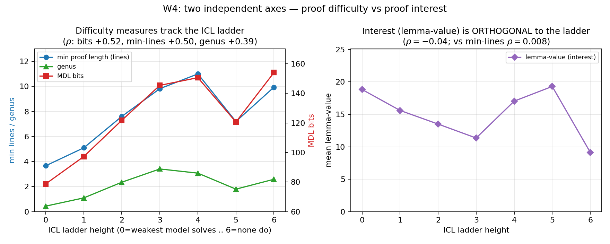
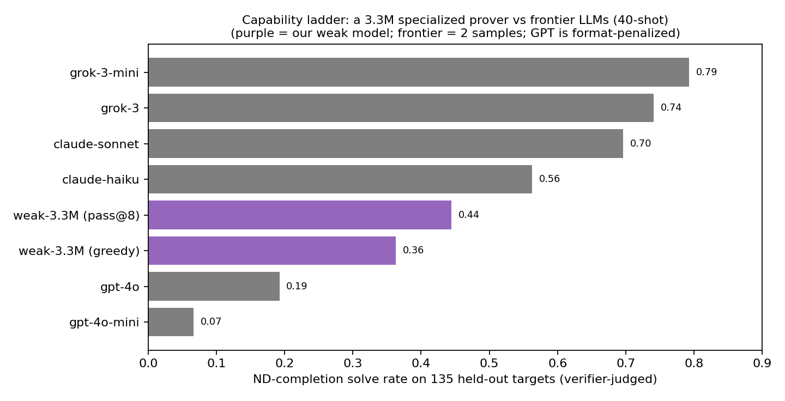
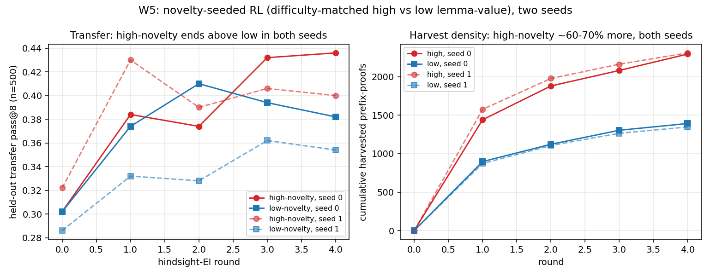

# Two Axes of a Proof: Measuring Interest vs Difficulty

*Sprint 2 (2026-06-10/11), building on Sprint 1's ND theorem-proving testbed.
Theory `theory.md` · literature `literature.md` · ledger `numbers.md` ·
branch `sprint2`. Run with a theory agent (Fable), literature and
problem-extraction agents, and GPU experiment arms (W5 and the nesting test
replicated across a second seed / second data budget after red-team); writeup
red-teamed by a fresh-context agent and revised to what the evidence supports.*

## Executive summary

Sprint 1 showed a small transformer bootstraps verified proofs but barely
expands capability. This sprint asked: **can we measure what makes a proof worth
discovering, and does it change self-training?** Three positive results (a
measurable interest/difficulty split, a frontier-LLM yardstick, and a modest
two-seed novelty-seeding gain) and two mechanistic stories that did *not*
survive a controlled test — both reducing to plain proof length.

**1. (Solid.) A proof has two near-orthogonal dimensions: how *hard* it is and
how *useful* it is.** Usefulness = **lemma-value** (how many other targets a
theorem unlocks/shortens as a lemma); difficulty = min proof length / MDL bits /
genus. Across 3,000 theorems, lemma-value is uncorrelated with proof length
(Spearman **0.008**); genus — a proof-theoretic "cleverness" measure we expected
to be length-independent — is mostly difficulty in disguise (**0.798**) (Fig 1).

**2. (Solid, with caveats.) Frontier LLMs form a capability ladder that
difficulty *correlates with* and interest does not; a 3.3M specialized prover
sits within it.** Six models (GPT/Claude/Grok) at 40-shot ND completion,
verifier-judged, span 7%→79%. Ladder height correlates with MDL bits
(ρ=**+0.52**) and min-length (**+0.50**) but not lemma-value (**−0.04**) — ~25%
of rank variance, so "tracks", not "determines". Our 3.3M model scores **greedy
0.36** — above GPT-4o (0.19) and GPT-4o-mini (0.07); a task-specialized model
the size of a rounding error is competitive with frontier generalists here
(Fig 2). (Format caveat: GPT scores are depressed by format-compliance, and the
cross-comparison is rough — frontier got 2 samples.)

**3. (Did not hold.) At matched length, proof *authorship* doesn't cause the
Sprint-1 "oracle collapse" — but the test can't reach the regime where the
collapse happened.** I'd told the PI mid-sprint the collapse was off-manifold
*style*. Controlled test (same 248 theorems, generator vs the model's own
proofs, 10.3 vs 9.1 lines): generator authorship did not collapse iid more
(−2.3 vs −3.4pp) and helped transfer (+7.8pp, ≈2.6σ on the difference SE, single
seed). So the collapse is **consistent with a length effect**, and style is not
the driver *at ~10 lines* — but the original collapse was at 17–30 lines, which
this cannot probe. The style explanation is unsupported, not refuted (table, §4).

**4. (Replicated, modest.) Seeding RL toward *interesting* theorems gives a
small but consistent transfer edge plus much more training signal.** Difficulty-
matched high- vs low-lemma-value targets (983 each, identical length
distribution) through hindsight-EI, two seeds from a shared base. High-novelty
yields ~60–70% more harvestable sub-proofs (e.g. 2310 vs 1347) and ends higher
on held-out transfer in *both* seeds (+5.4pp seed-0, +4.6pp seed-1; in seed-1
high leads at every round). The per-seed gap is ~2σ (n=500), but it replicates
in sign and size — a real, modest effect, not the headline lever (Fig 3).

**5. (Prediction fired, data-matched.) The depth ceiling is *not* specifically
about nesting.** The theory agent pre-registered (P-iii) that zero-nesting
*flat* proofs should let a depth-4 model run past the 12-line ceiling. They did
not: depth-4 models trained on flat proofs cap at **12**, same as nested — and
this holds at *both* 200k and the data-matched 450k training budget (956
discoveries, zero >12), killing the undertraining confound. The
nesting-capacity reading of Sprint 1's ceiling is unsupported; depth lifts a
general length ceiling, not a stack-tracking one.

**Takeaway.** The durable contribution is **measurement**: lemma-value is a
computable notion of proof "interest", orthogonal to difficulty and validated
against a frontier-LLM capability ladder — and seeding RL toward high-interest
theorems gives a small, two-seed-replicated transfer gain plus much more
harvestable signal. The cautionary contribution is that two appealing
*mechanisms* offered for Sprint-1 phenomena — proof *style* causing the oracle
collapse, and *nesting* setting the depth ceiling — both failed a controlled
test (the nesting one now data-matched, the style one suggestive), each reducing
to or consistent with plain **proof length**. So: interest is real, measurable,
and mildly useful; but where we'd reached for a sophisticated mechanism, length
was usually the simpler and better explanation.

| | |
|---|---|
|  |  |
| **Fig 1 — two axes.** Difficulty measures rise with ICL ladder height (left); lemma-value is flat (right). Difficulty tracks capability; interest is orthogonal. | **Fig 2 — capability ladder.** A 3.3M specialized prover (purple; lead number = greedy 0.36) placed among frontier LLMs at 40-shot ND completion. GPT format-penalized; frontier = 2 samples; pass@8 a generous upper anchor. |

**Fig 3 — novelty-seeded RL, two seeds (Finding 4).** Difficulty-matched high vs
low lemma-value targets. Transfer (left): high-novelty (red) ends above
low (blue) in both seeds (+5.4pp seed-0, +4.6pp seed-1; seed-1 high leads every
round), though mid-trajectory is noisy. Harvest (right): high-novelty banks
~60–70% more verified sub-proofs in both seeds — the clean, robust effect.
(Finding 3 / W1 is the table in §4; W4 correlations in `numbers.md`.)

---

## 1. Setup and what's new

Same testbed as Sprint 1 (Fitch propositional ND, 3.3M transformer, perfect
verifier, hindsight-EI). New:
- **Bounded sound prover** (`code/novelty/prover.py`): goal-directed search,
  every proof verifier-checked; 36/36 textbook targets; gives minimal proof
  length and proofs to measure.
- **Formal measures** (`code/novelty/measures.py`): lemma-value, genus (first
  Betti number of the citation+discharge flow graph), MDL bits (gzip).
- **ICL ladder** (`code/icl/ladder.py`): few-shot ND completion across GPT,
  Claude, Grok, verifier-judged.
- **nd_pack** (Carr 2018): 68 human-curated propositional sequents + solutions,
  truth-table-validated.
- **Theory** (`theory.md`, Fable agent): amortization model, criticality bound,
  capacity↔depth, proof-value theory. Scorecard: bits↔ladder **held** (ρ≈0.5);
  lemma-value-as-seeding-signal **partly held** (robust harvest gain, modest
  two-seed transfer edge); nesting-ceiling prediction **falsified, data-matched**
  (P-iii).

## 2. Finding 1 — interest ⊥ difficulty (Fig 1)

3,000 RL-band theorems scored for min proof length, genus, and lemma-value over
a 50-theorem probe set: Spearman(lemma-value, min-length) = **0.008**;
Spearman(genus, min-length) = **0.798**; Spearman(lemma-value, genus) = −0.119.
Orthogonality is the useful part — it lets us vary interest while holding
difficulty fixed (used in §5). The surprise is genus: expected to capture
length-independent cleverness, it is mostly length. (n=3,000; robust.)

## 3. Finding 2 — the capability ladder (Fig 2)

Six models, 40-shot, 2 samples, verifier-judged, 135 targets. Empirical solve
rate grok-3-mini 0.79 / grok-3 0.74 / claude-sonnet 0.70 / claude-haiku 0.56 /
gpt-4o 0.19 / gpt-4o-mini 0.07. Ladder height correlates with bits (+0.52) and
min-length (+0.50), not lemma-value (−0.04); gen-proof length correlates
strongest (+0.64, n=50). These are ρ≈0.5 (≈25% rank variance) — "tracks", not
"predicts". First clean few-shot ND-completion curve we know of. **Caveat:**
GPT's low scores are largely format-compliance; the ladder conflates proving
skill with format-following, so the difficulty correlations are robust but the
exact model ordering is not.

**RL-as-uplift:** our 3.3M model on the same 135 targets scores **greedy 0.36**
(pass@8 0.44) — clearing GPT-4o (0.19). Lead comparison is greedy; pass@8 is a
generous anchor (frontier got fewer samples).

## 4. Finding 3 — authorship vs length in the oracle collapse

Sprint 1's external-data iid collapse (.832→.696) I attributed to off-manifold
*style*. Controlled isolation, same 248 theorems, length **near**-matched
(model 9.1 vs generator 10.3 lines — a ~13% gap), each added to base and
retrained:

| seed added | iid | transfer pass@8 |
|---|---|---|
| none (base) | 0.859 | 0.286 |
| model's own proofs | 0.825 | 0.284 |
| generator's proofs (same theorems) | 0.836 | **0.364** |

Generator authorship did not collapse iid more (less) and helped transfer
(+7.8pp ≈ 2.6σ on the difference SE, single seed). Reading: the collapse is
**consistent with length/distribution-distance**, and authorship is not the
driver *at ~10 lines*. It does **not** overturn a style account at 17–30 lines
(no model proofs that long exist to test). "Style explanation unsupported," not
"refuted."

## 5. Finding 4 — novelty-seeded RL: modest replicated edge + more signal (Fig 3)

Difficulty-matched high vs low lemma-value targets through hindsight-EI, common
held-out eval (n=500), **two seeds** (seed-1 from a shared base):
- **Harvest (robust):** high-novelty yields ~60–70% more harvested prefix-proofs
  in both seeds (seed-0 2295 vs 1392; seed-1 2310 vs 1347) — richer, more
  reusable proof structure — at near-equal discovery counts.
- **Transfer (modest, replicated):** high ends above low in both seeds (seed-0
  .436 vs .382, +5.4pp; seed-1 .400 vs .354, +4.6pp). Seed-0 is noisy mid-run
  (low leads at round 2); seed-1 has high above low at every round. Per-seed gap
  ~2σ, but it replicates in sign and magnitude.

So "interest" reliably buys more *training signal* per rollout and a small,
replicated transfer edge — a real effect, but not the large lever one might hope
for. Consistent with Sprint 1's knowledge-compounds-but-capability-transfers-
slowly: choosing useful theorems helps at the margin, it does not by itself
crack the transfer barrier.

## 6. Finding 5 — the nesting falsifier fired

The theory agent predicted (P-iii) flat (zero-nesting) proofs would let a
depth-4 model exceed the 12-line ceiling that nested proofs hit. Trained on
local-rules-only proofs, the depth-4 model reached max length 11/11/12/12 over
four hindsight-EI rounds — **capping at 12, like nested**. This holds at both
the 200k and the **data-matched 450k** training budget (956 discoveries, zero
>12), removing the undertraining confound. The nesting-specific reading of the
depth ceiling is unsupported; depth lifts a general length ceiling. (Residual
caveat: gen-length ≠ min-length, so the frontier is a lower bound on capability;
but flat==nested at exactly 12, across two data budgets, is a clean dissociation
failure.)

## 7. Limitations

- W2/W3 are the strong arms (n=3,000; n=135). W5 has two seeds (shared base) and
  nesting has two data budgets — both replicate; W1 and W4 remain single-seed
  (Sprint-1 prior: ~5pp round-0 seed variance). Per-seed transfer effects are
  ~2σ; the W5 conclusion rests on replication of sign/size, not one seed.
- ICL ladder confounded by format-compliance; frontier 2-sample vs our pass@8 —
  cross-comparison order-of-magnitude only; lead with greedy.
- lemma-value uses a fixed 50-theorem probe (orthogonality robust, individual
  rankings less so); prover complete only within its depth bound.
- W1 cannot separate style from length at 17–30 lines (no model proofs that long
  exist); frontier metrics use generating-length as a lower bound on min-length.

## 8. Research process map

Theory(Fable)+literature+nd_pack agents (h0–0.7) → prover & measures, ICL
ladder, W4 correlation (0.7–1.2) → four parallel GPU arms (W5 high/low, W1
style, nesting) + weak-model ladder anchor (1–2.5) → analysis, figures, this
writeup, red-team + downgrade pass. Compute: 6 RunPod A40s (all terminated) +
frontier-API calls; budget ~$100. Timeline in `plan.md`.
