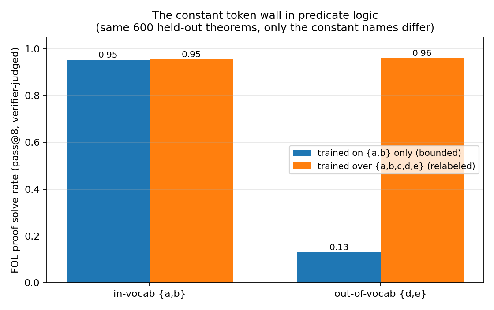
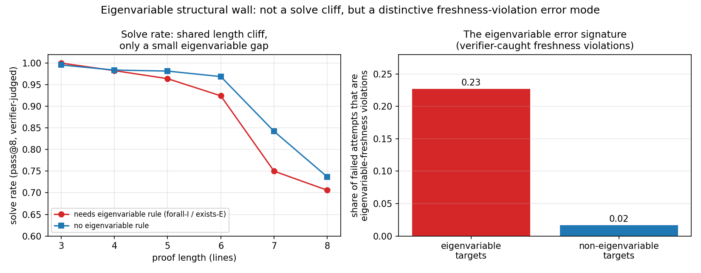

# First-order natural deduction and eigenvariable conditions

Status: completed June 11, 2026 experiment series, imported from the earlier natural-deduction
repository.

This sprint extended the propositional testbed with quantifiers, capture-avoiding substitution,
and independently checked eigenvariable side conditions, then tested vocabulary and structural
failure modes.

## Main observations

- The independently implemented verifier accepted 2,867/2,904 sampled proofs and rejected
  498/500 single-token mutations. The 37 generator rejections were attributed to caught
  eigenvariable violations rather than being silently admitted as training examples.
- A bounded model trained only with constants `{a,b}` fell from 95.3% pass@8 on in-vocabulary
  relabelings to 13.0% on structurally identical `{d,e}` relabelings. Training over the full
  constant inventory removed the wall at no observed in-distribution cost: 95.5% versus 96.0%.
- Eigenvariable-requiring targets did not produce a categorical solve-rate cliff: pass@8 was about
  94% versus 96% on the matched non-eigenvariable group. Their failures were qualitatively
  different, however: roughly 23% were freshness violations versus roughly 2% otherwise.

Both result families are single-seed first passes. Existential elimination was under-sampled by
the generator, and the study did not include a separate textbook benchmark.

## Key figures

## Imported evidence

- [Original full writeup](summary.md)
- [Archived FOL implementation and runbooks](../../code/experiments/archived/nd_sprints_20260609_11/IMPORT.md)

Source: `../earlier-iterations/Natural Deduction LLM/nd_sprint`, source commit `e8766d2`. Generated
datasets, raw result payloads, and checkpoints were not duplicated.
