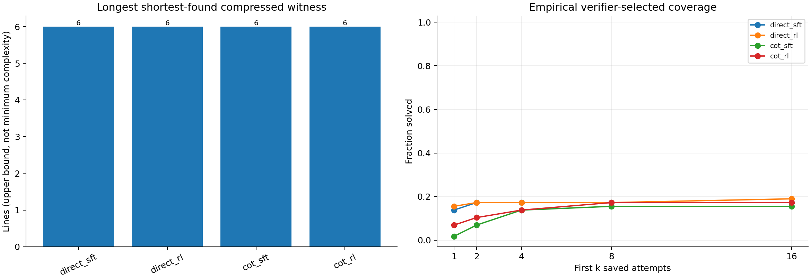
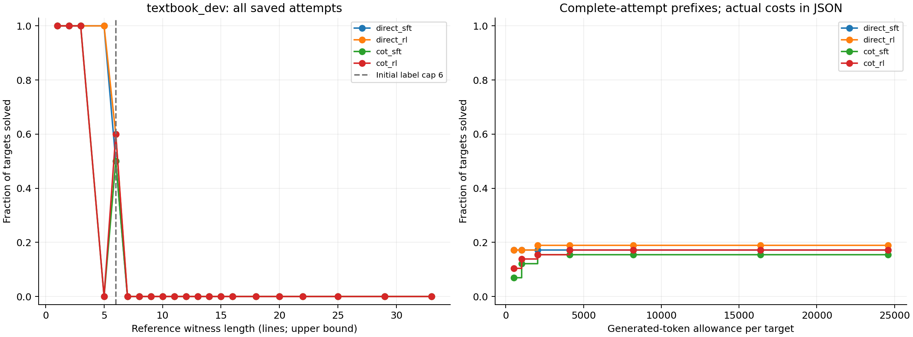

# Pair 1: independent endpoint audit

**Observed result: the held-out textbook proof window did not grow.** Across all four endpoints, the longest solved reference witness was **6 lines**, the longest per-target shortest strict-valid compressed proof was **6 lines**, and coverage among the **43 development targets with reference witnesses longer than six was 0/43**. This is a completed first-pair result, not the sprint-final conclusion. The 73 final-only problems remain unopened by this audit.

## Evaluation and validity

The audit waited for both `pair1_8m_direct` and `pair1_8m_cot` to finish RL and all sampled/greedy textbook evaluation endpoints. It then replayed 3,712 stochastic completions and 232 greedy completions on the same 58 textbook development targets. Every saved raw response was reconstructed with the 43-token scratch tokenizer, checked against its original prompt, and compared with its saved reward, final body, and token counts. Accepted proofs were compressed by dependency/reiteration removal and checked again with the strict verifier. Every check passed; missing/duplicate attempts would have failed the audit.

Eight checkpoint/data identity and completion-order checks passed. The first textbook evaluation started 40.224 seconds after its arm's RL completion; none began earlier. Both arms used 16 stochastic samples per target at temperature 0.8, seed 927, and a 1,536-token completion cap, plus separate greedy decoding. The saved runner/analysis versions were used without modification. [Completion audit](pair1_artifacts/completion_gate_audit.json), [sampled release](pair1_artifacts/book_release.json), and [greedy release](pair1_artifacts/book_greedy_release.json) preserve those identities.

## Coverage and inference budget

All counts below have denominator 58. Sampled first-k coverage differs from greedy decoding.

| Endpoint | Greedy | Sampled k=1 | k=2 | k=4 | k=8 | k=16 | Total tokens for all 16 attempts |
| --- | ---: | ---: | ---: | ---: | ---: | ---: | ---: |
| Direct SFT | 9 | 8 | 10 | 10 | 10 | 10 | 84,887 |
| Direct RL | 10 | 9 | 10 | 10 | 10 | 11 | 86,010 |
| CoT SFT | 6 | 1 | 4 | 8 | 9 | 9 | 175,009 |
| CoT RL | 4 | 4 | 6 | 8 | 10 | 10 | 172,616 |

At k=16, direct RL solves 11/58 (19.0%; Wilson 95% interval 10.9–30.9%) and CoT RL solves 10/58 (17.2%; interval 9.6–28.9%). Each RL endpoint gains one target over its SFT parent without losing a target at that sampling budget. CoT RL's solved set is a subset of direct RL's: one direct-only solution, zero CoT-only solutions. The paired difference, CoT RL minus direct RL, is −1/58; its target-bootstrap interval is −5.17 to 0 percentage points. This single pair does not establish a population-level ranking of training methods.

The CoT greedy endpoint loses two targets relative to its SFT parent (6→4), while direct greedy coverage rises 9→10. Increased stochastic sampling recovers short solutions for CoT; it does not recover any target with a reference witness longer than six.

The next table imposes the **same total generated-token allowance per target**, including scratch and final output. Complete attempts are admitted in their saved order; an expensive attempt cannot be skipped to take a later cheap one. Counts remain out of 58.

| Allowance | Direct SFT | Direct RL | CoT SFT | CoT RL |
| --- | ---: | ---: | ---: | ---: |
| 512 | 10 | 10 | 4 | 6 |
| 1,024 | 10 | 10 | 7 | 8 |
| 2,048 | 10 | 11 | 9 | 9 |
| 4,096 | 10 | 11 | 9 | 10 |
| 8,192–24,576 | 10 | 11 | 9 | 10 |

The direct RL endpoint dominates CoT RL's coverage at the tabulated allowances. CoT RL spends 172,616 generated tokens across the full sampled evaluation versus 86,010 for direct RL, approximately twice as many. These are generated-token costs, not FLOPs: prompt processing, padding, cache operations, and batch overhead are excluded. Curves are also censored by the 16 saved samples; they do not establish what unlimited sampling would achieve.

## Length interpretation

The development population contains 15 targets with reference witnesses of at most six lines and 43 with longer witnesses, extending to 33 lines. Every endpoint's successes lie in the first group. Among the ten targets with six-line reference witnesses, direct SFT and CoT SFT each solve five, and their RL endpoints each solve six. The additional direct-only advantage is a target in the five-line reference bin. Thus the within-arm one-target RL gains do not expand the measured length window.

Raw and compressed shortest-found length histograms agree for these endpoints. The five-target exact-length frontier is six for all four endpoints. Reference witnesses and discovered proofs are upper bounds on proof length, not certificates of minimum theorem difficulty. The result establishes no observed transfer beyond the original reference-length boundary at these budgets; it does not prove such transfer impossible.

## Training context and limitations

This pair shares an inherited approximately 8-million-parameter expanded-vocabulary parent. Both SFT arms used the same guarded cap-six pool and 3,000 updates, then 256 RL updates with eight prompts and eight completions per prompt. The RL mixture included the authorized training textbook prompts; no development proofs or completions entered training. CoT is a learned symbolic scratch sequence trained from reverse short-proof plans, not natural-language DeepSeek-R1 reproduction.

Equal update counts did not equalize training tokens. Direct SFT consumed 57,657,808 response tokens and CoT SFT consumed 102,662,253. Their RL rollout totals were 2,553,597 and 4,504,380 respectively. Only 44/2,048 direct groups and 187/2,048 CoT groups had mixed rewards. These aggregate training diagnostics suggest limited group-relative learning signal, but they are not evidence about any particular unsolved textbook proof.

This panel is now adaptive development data: subsequent choices informed by this report cannot be described as independent of it. The inherited parent also has historical structural overlap with textbook contexts, even though the audited base training source had zero exact canonical textbook matches. A fresh sprint partition does not erase that history. There is one training seed per arm here, small length-bin denominators, and no final-only result yet.

## Reproduction artifacts

Remote audit root: `/data/users/dmitry/nd-rl/r1-cot-20260909/reports/pair1_independent`.

- [Sampled aggregate report and paired comparisons](pair1_artifacts/book/summary.json)
- [Greedy aggregate report and paired comparisons](pair1_artifacts/book_greedy/summary.json)
- [Sampled artifact hashes](pair1_artifacts/book/completed.json)
- [Greedy artifact hashes](pair1_artifacts/book_greedy/completed.json)

Replay command pattern: `code/experiments/current/r1_cot/analyze.py --predictions <four completed attempts.jsonl paths> --labels data/textbook_dev.jsonl --release <book_release.json> --root /data/users/dmitry/nd-rl/take-home --initial-cap 6 --ks 1 2 4 8 16 --budgets 512 1024 2048 4096 8192 16384 24576 --bootstrap-resamples 5000 --out <fresh audit directory>`. The report records hashes for analysis, response reconstruction, strict verifier, base verifier/helper, and compressor. Figures were visually checked. Audit execution used CPU only and `CUDA_VISIBLE_DEVICES=""`.
