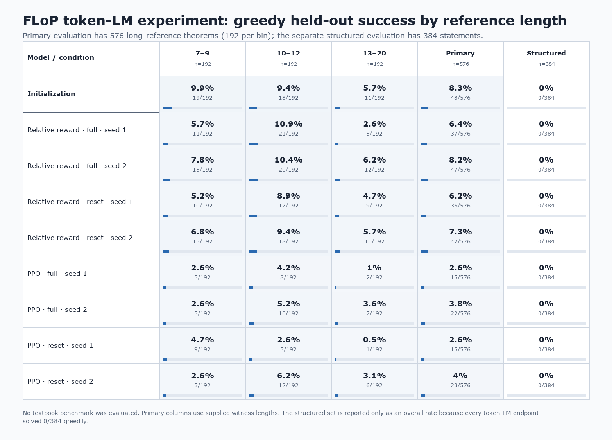

# FLoP adaptation to natural deduction

Status: completed remote experiment, imported from `simplex3` for local review.

Question: Which parts of FLoP-style backward-start training transfer to small symbolic policies and
token-generating natural-deduction language models?

## Observations

The symbolic curriculum enabled narrow depth extrapolation, including 129-line proofs on 1/16 and
2/16 later-added challenge statements, but the deepest successes covered only two atomic-projection
statements. On the token-LM experiment, RL did not improve observed held-out coverage and all 21 LM
endpoints solved zero of 384 structured statements, even with four samples.

## Success by reference length

The [underlying counts and source hashes](figures/success_by_reference_length.json) cover the
initialization and all eight primary RL endpoints. The structured set is shown separately; this
experiment did not evaluate a textbook benchmark.

## Imported evidence

- [Final summary and key depth-challenge figure](summary.md)
- [Compact synthetic proof-length ledger](reports/synthetic_proof_length_ledger_v1.json), derived
  from the oversized frozen analyses with their source hashes retained
- [Exact eleven-line full-start PPO witness](reports/witness_full_start_11line_v1.json)
- [Exact 129-line backward-reset witness](reports/witness_length_challenge_v1.json) and
  [complete length-challenge analysis](reports/analysis_length_challenge_v1.json)
- [Archived implementation, tools, and configurations](../../code/experiments/archived/flop_nd_20260910/IMPORT.md)

The summary, figures, compact ledger, and key witness evidence were copied or derived from
`simplex3:/data/users/dmitry/nd-rl/flop-nd-20260910-1934`. Other raw results and checkpoints remain
remote.
