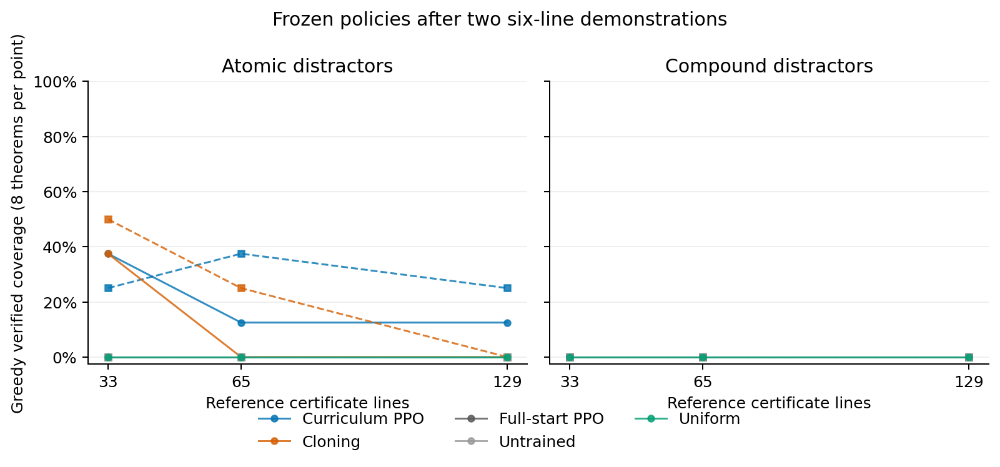

FLoP's most transferable idea is to train a policy to finish verified proofs from progressively earlier states, while a symbolic prover supplies legal deductions. In our natural-deduction experiments, that procedure supports narrow long-proof execution by a small action network. The tested token-LM adaptations do not improve observed held-out coverage.

FLoP's 2,082-inference result follows training from one 23-inference seed, with substantial RL interaction and multiple test attempts. In the inspected arithmetic configurations, training remains capped at the seed proof's length. The long test proof can repeatedly apply a locally learned procedure. The [paper walkthrough](reports/paper_walkthrough.md) explains this distinction and the paper's strong behavior-cloning controls.

1. **Two short proofs can support much longer symbolic executions, with narrow generalization.** A randomly initialized legal-action network trained on two six-line projection proofs learns both proofs through backward starts; each full-start PPO run observes zero successes in 26,214 episodes. On 640 structured final statements, curriculum PPO solves 64 and 79 greedily across two training runs, versus cloning's 74 and 83. Both produce checked 25-line proofs. Four-sample coverage is also close: 116 and 142 versus 121 and 134. PPO and cloning have different training budgets.

   A later-added depth challenge finds 129-line proofs on 1/16 and 2/16 statements for curriculum PPO, while cloning reaches 65 lines. Those deepest successes cover only two atomic-projection statements, both concluding the demonstrated atom P. One sampled final proof also composes projection with assumption and implication introduction, absent from the demonstrations, but it is just one of 160 scoped statements in one seed. Curriculum also solves 22 and 25 of 160 projection-plus-implication-elimination cases within four samples, versus 11 in each cloning seed. That rule is absent from both demonstrations. These are limited compositions and depth extrapolation.

   

2. **The broader symbolic curriculum helps, with substantial seed variation.** With 104 short source proofs and 512 theorem-only targets, curriculum PPO solves 239 and 159 of 384 structured final statements, versus full-start PPO's 117 and 166 and cloning's 15 and 6. The paired curriculum gain averages 14.97 percentage points, but reverses in one seed. Both PPO conditions fail all 96 scoped statements per seed. Their large gap over cloning also includes different training budgets and exposure to longer theorem statements.

3. **RL does not improve observed held-out coverage of our token-generating LM.** On the declared primary set with references of at least seven lines, initialization solves 48/576 greedily versus 15–47 for the eight RL endpoints. Learning from within-group reward differences beats matched continued supervision there; backward starts show no clear benefit. RL solves some statements initialization misses while losing more overall. One RL run finds eleven pruned seven-line certificates on the primary set, versus initialization’s two; premises count toward these lengths. PPO also finishes below matched continued-supervision controls. Verified-discovery replay lowers coverage in both continuation seeds. All 21 LM endpoints solve zero of 384 structured statements, even with four samples. A frozen-weight legal decoder raises initialization from 173 to 297/768 successes but only 9/384 structured successes.

The next LM experiment should train complete legal-inference choices with inference-level values, PPO/GAE and verified backward starts. Compare cloning, full starts and curriculum from the same initialization. Longer executions will also need a compact current-state input with the certificate stored externally. This training-through-decoder experiment remains proposed.

The [full report](reports/sprint_report.md) gives controls and limitations; the [implementation guide](reports/method_and_reproduction.md) includes runnable commands. Final evaluations and proof audits completed. New paid spending was $0; completion details are in the [manifest](manifest.json).
