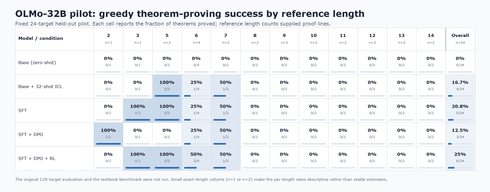

# OLMo-32B longer-proof pilot

Status: completed remote experiment, imported from `simplex3` for local review.

Question: Does SFT, preference training, or verifier RL improve longer-proof success beyond what the
same OLMo-32B base obtains from 32 in-context examples?

## Observations

On the fixed 24-target greedy pilot, ICL, SFT, SFT+DPO, and SFT+DPO+RL all solved the same one of
16 longer-reference targets. Their short-reference scores were 3/8, 4/8, 2/8, and 5/8,
respectively. The small panel therefore showed no longer-proof benefit from training beyond ICL.
The original 120-target and sampled-K4 evaluations were not run.

## Success by reference length

The [underlying counts and source hash](figures/success_by_reference_length.json) make the figure
reproducible. No textbook result is shown because that evaluation was not run.

## Imported evidence

- [Latest handoff](LATEST_REPORT.md)
- [Final five-method report](icl-extension-20260910-1754/summary.md), including the copied paired
  outcome figure
- [Historical trained-subset summary](historical_training_summary.md)
- [Archived implementation](../../code/experiments/archived/olmo_single_gpu_20260909/IMPORT.md)

The summaries and key figure were copied from
`simplex3:/data/users/dmitry/nd-rl/olmo-single-gpu-20260909-2014`. Raw checkpoints, evaluations,
and other large artifacts remain remote. The final report records a mixed-host evaluation: the
resumed ICL half ran on `simplex1`, while the first half ran on `simplex2`.
