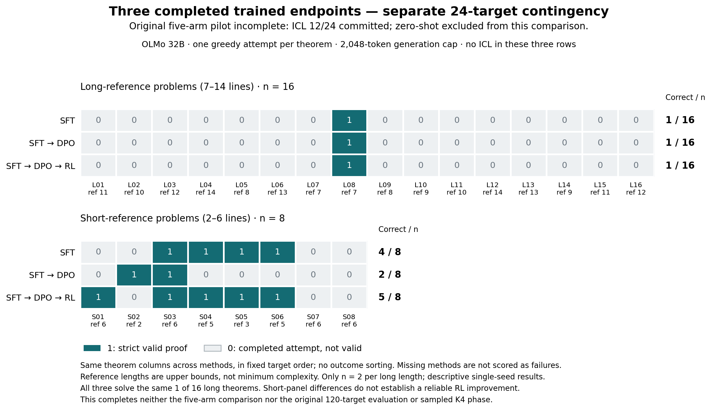

# No observed RL gain on longer proofs in a small OLMo-32B pilot

Final report, 2026-09-10 05:40 UTC. Training and the three-trained-endpoint evaluation are complete; independent evaluation review, figure review and 115 CPU tests passed. The original ICL comparison remains incomplete.

## Executive summary

We trained OLMo-3-1125-32B adapters on 32 formal proofs of at most six steps, then tested supervised training (SFT), SFT plus preference training (DPO), and SFT+DPO plus verifier-reward RL on the same unseen problems. This is a propositional natural-deduction task in the repository's proof language. Training is complete, but the requested ICL comparison is unfinished.

1. **RL added no success on the sixteen longer-reference problems.** Each trained checkpoint solved exactly the same one problem, using an identical seven-step proof that remains seven steps after independently checked compression. Every method failed the fourteen problems with reference lengths 8–14. This is a negative observation on a small, fixed panel, not evidence that RL cannot improve longer proofs generally.

2. **The short-problem improvement is small relative to SFT.** SFT solved 4/8, DPO 2/8, and the final RL checkpoint 5/8. RL gained four and lost one relative to DPO; three gains restored existing SFT successes. Relative to SFT, the full DPO+RL pipeline gained one and lost none. These eight problems and one training seed do not establish a reliable improvement.

3. **32B adapter RL is feasible on one H100, but this recipe was slow and supplied sparse learning signal.** All 40 RL updates completed, nineteen with nonzero current gradients, taking 166.26 minutes and peaking at 46.15 GB allocated memory. Only 23/160 rollout groups mixed valid and invalid answers. The implementation trains 134.2 million adapter parameters over four-bit base weights, not all 32 billion parameters.

The full five-method baseline remains incomplete: ICL has 12/24 committed attempts. GPU work stopped within the original 05:14 UTC cutoff. The strongest next step is to finish the frozen ICL and larger held-out evaluation before tuning against these results.

## Matched held-out results

All included methods completed all 24 pilot targets and passed native-token, strict-verifier, checkpoint and compute-ledger replay. The three checkpoints form the sequence base → SFT → DPO → RL. RL versus DPO isolates the added RL stage; RL versus SFT includes both DPO and RL.

| Completed endpoint | Short references, 2–6 steps | Longer references, 7–14 steps |
|---|---:|---:|
| SFT | 4/8 (50.0%) | 1/16 (6.25%) |
| SFT + DPO | 2/8 (25.0%) | 1/16 (6.25%) |
| SFT + DPO + verifier RL | 5/8 (62.5%) | 1/16 (6.25%) |

These are greedy pass@1 results with a common 2,048-native-token ceiling. Short and long cohorts are reported separately; they are not pooled into a 24-problem headline score. The [analysis identity and README](reports/trained_contingency_analysis_v1/README.md) explain why the analyzer's complete status applies only to these three trained endpoints.

Each column is the same theorem across all three checkpoints, in fixed evaluation order. The figure shows why DPO→RL's short-panel difference is larger than SFT→RL's: three successes are lost after DPO and restored after RL. [Caption and provenance](reports/trained_contingency_figure_v1/CAPTION.md); [independent cold read](reports/trained_figure_cold_read_v1.md).

On short problems, the added RL stage's paired difference against DPO is +37.5 percentage points, with a descriptive 95% paired bootstrap interval of −12.5 to +87.5 points. Against SFT, the full pipeline's difference is +12.5 points, interval 0 to +37.5. Both intervals include zero. The bootstrap uses 10,000 resamples of paired theorem identities; it does not measure training-seed uncertainty.

All three long-panel success vectors are identical. Their empirical paired-difference intervals collapse to zero because resampling this observed panel never changes the difference. That is not a population-equivalence test. Each method's long success-rate Wilson interval is approximately 1.1%–28.3%, illustrating how little sixteen targets constrain a broader rate.

There are two targets at each long-reference length. At length seven, each method solves 1/2; at each length 8–14, each solves 0/2. The sixteen long targets span seven generator families, with six from one family. These data cannot locate a reliable reasoning-length frontier.

## What the proofs show

The sole longer success derives ¬R from premises R→A and R→¬A. All three models produce the same seven-step proof: assume R, obtain A and ¬A, derive a contradiction, and discharge the assumption. Its canonical theorem identifier begins bc5fa561. Neither preference training nor RL adds another longer success.

The one success RL adds beyond SFT is a six-step instance of ¬(A∨B)→¬A, identifier 6b01f055. SFT's answer has an invalid subproof citation; DPO's has an invalid conjunction-elimination step; RL emits a valid proof. Conversely, on the two-step conjunction projection beginning 5717a680, DPO is valid while RL inserts an illegal subproof-depth marker and fails. This rules out a simple story that every short theorem improves monotonically along the training sequence.

These examples were inspected after the aggregate replay and are illustrations, not selection criteria. Across all 72 attempts, 70 actually emit the closing final marker, but only fourteen are strictly valid. Incorrect formulas, rule applications, references and subproof structure remain important failures; termination alone does not establish proof competence. See [native attempts and analysis-only certificates](reports/trained_contingency_analysis_v1/CONTINGENCY_IDENTITY.json) for exact input hashes and replay provenance.

A proof step is a semicolon-terminated numbered rule application, not a physical text line or model token. QED and final-block wrappers are excluded from step counts but included in generated-token accounting. Reference lengths are supplied witnesses, not certified minimum difficulty. Compression is separately verified analysis and never rescues an invalid answer.

## Training and numerical reliability

The base is [allenai/Olmo-3-1125-32B](https://huggingface.co/allenai/Olmo-3-1125-32B), pinned to revision c2b61dae89a1ad10e4ad5653d0e46b590902607b. It was the largest OLMo base candidate confirmed in the release inspection. All stages use rank-16 all-linear QLoRA. The implementation uses TRL's supervised, preference and GRPO trainers; it borrows the stage pattern from [OLMo's reasoning workflow](https://allenai.org/blog/olmo3), not Ai2's full training recipe or a proprietary DeepSeek implementation.

| Training stage | Completed updates | Actual training exposure |
|---|---:|---|
| SFT | 80 | 32 gold proofs, 320 presentations |
| DPO | 40 | Five acquired pairs, 100 pair presentations |
| Verifier RL | 40 | 640 generated responses in 160 groups |

Preference acquisition sampled 120 responses on the same 32 source theorems, obtaining five verifier-invalid negatives; the other 27 exhausted their four-attempt budget without one. RL starts from that exact DPO endpoint. It receives the same 32 theorem prompts and binary verifier feedback, without gold proofs or reference-length fields. Matching source examples does not match compute, repetition, or additional verifier labels.

Of the 160 RL groups, 123 are uniformly valid, fourteen uniformly invalid and 23 mixed. Uniform groups provide no current relative-reward gradient; optimizer momentum can still change parameters. All 640 adaptive training responses were replayed: 545 were valid, all at most six raw or compressed steps. This adaptive training fraction is not final-checkpoint accuracy and is not directly comparable with held-out greedy accuracy.

The first RL attempt stopped before any update because sampling-time and differentiable scoring log-probabilities differed by as much as 0.6237, above the frozen 0.1 tolerance. Full-FP32 computation over unchanged NF4-packed weights resolved the observed inconsistency: all 40 fresh-batch and 640 actual differentiable checks passed, with a maximum discrepancy of 0.0002389. SFT/DPO retain their earlier BF16-training provenance; RL and every evaluated endpoint use the same FP32 inference operator. These historical forward-pass receipts are not an independent GPU likelihood rerun or a general verdict on BF16 RL. [Numerical diagnostics](reports/numerical_consistency_v4/report.md) document the fixed-action controls.

## Runtime and unfinished work

| Evaluated trained endpoint | Generated native tokens | Responses at token cap | Full evaluator time |
|---|---:|---:|---:|
| SFT | 6,599 | 1/24 | 15.31 min |
| SFT + DPO | 6,059 | 1/24 | 13.86 min |
| SFT + DPO + RL | 4,600 | 0/24 | 4.57 min |

Every trained endpoint used 13,694 prompt tokens across the same targets. Wall time includes loading; generation-only times and padded work are separately recorded. The large time differences reflect batch decoding tails as well as native output lengths, not a general speed benchmark. Faster RL inference did not yield another long proof.

The original evaluation population was 56 short plus 64 long problems, followed by sampled coverage@4. Measured runtime led to a separate, outcome-blind 24-target pilot, selected by salted canonical hashes before any held-out prediction. Later, before any accuracy inspection, root interrupted slow ICL and prioritized SFT → RL → DPO in a separately frozen, reviewed continuation. All three finished by 05:13:27. The original interrupted five-arm job remains failed; it is never relabeled complete.

Zero-shot24 and ICL12 outputs are preserved from that earlier execution. Neither zero-shot nor a cherry-picked ICL subset enters the trained comparison above. A checked exact ICL-resume plan was prepared but never launched because the remaining window was too short. The original120-target and K4 phases were not launched, and textbook payloads remain sealed. No claim comparing ICL with SFT or RL is established.

Recorded sprint GPU leases total **307.59 minutes (5.13 GPU-hours)**, including failed, diagnostic, training and evaluation work, with no overlap and no paid cloud GPU jobs. [Final compute ledger](reports/compute_ledger_final_v1.json) reports no running or queued GPU jobs. Interrupted ICL closed calls account for 6,067 output tokens and 97,271 prompt tokens; an additional open call has unknown output, bounded by 8,192 native tokens. Its elapsed work is already included in GPU-lease time.

All files and checkpoints remain on simplex1. The completed RL continuation and final evaluation ran on simplex2 GPU3 through the approved scoped mount. The NFS server/mount infrastructure remains available; it holds no GPU, and [recovery/removal instructions](infrastructure/README.md) are retained. No commits, pushes or publication were made.

## Limits and next experiment

The strongest caveats are the unfinished ICL comparison, the small and family-reusing evaluation panel, one training seed, unequal optimization/oracle exposure, and unknown pretraining exposure. The five-pair DPO stage is a particularly weak intermediate baseline: part of RL's apparent gain repairs its losses relative to SFT. This pilot does not yet justify a claim that scaling the same RL schedule improves length transfer.

**Next:** under a newly authorized GPU window, resume the exact frozen ICL batches without retraining or changing decoding, then complete the original larger held-out comparison using these fixed checkpoints. Preserve interrupted-compute accounting and do not select checkpoints on longer-proof outcomes. Complete that baseline before proposing another training intervention.

## Artifact map and checks

- [Exact three-arm analysis, per-theorem outcomes and certificates](reports/trained_contingency_analysis_v1/README.md), [literal proof examples](reports/qualitative_evaluation_examples_v1.md), [methods](reports/methods.md), [reproduction and launch gates](reports/reproduction.md).
- [Final training diagnostics](reports/training_diagnostics_final_v4/training_diagnostics.md), [training-theorem replay](reports/training_signal_by_theorem_final_v4/training_signal_by_theorem.md), [generated training-proof lengths](reports/rollout_lengths_final_v4/report.md).
- [Independent completed-training audit](reports/final_training_independent_review.md), [prelaunch continuation review](reports/trained_contingency_independent_review_v1.md), [launch/transition receipt](infrastructure/trained_contingency_launch_v1.json).
- [Frozen kickoff](start.md), [decision log](research_log.md), [data exclusions](reports/data_audit.md), [test receipts](reports/local_test_receipt.md).
- [Independent evaluation audit](reports/trained_evaluation_independent_review_v1.md), [machine-readable audit](reports/trained_evaluation_independent_review_v1.json), [final-summary review addendum](reports/final_summary_independent_addendum_v1.md), [final resource status](reports/final_resource_status_v1.json), [machine-readable handoff](reports/final_status_v1.json).

The final CPU suite passed 115 tests in 27.201 seconds, including four new three-endpoint plotting fixtures; the independent figure cold read passed. The independent evaluation audit reproduced all 72 native attempts and checked 316 input hashes. The final-summary addendum passed a fresh read of the [archived scientific-content draft](reports/summary_reviewed_draft_v1.md); this final report changes only completion-status text and audit links from that archive. Tests using tiny models or fabricated plots are implementation checks and contribute no model-performance observations. The research-sprint skill guided frozen inputs, independent checks, deadline discipline and this evidence-first report.
