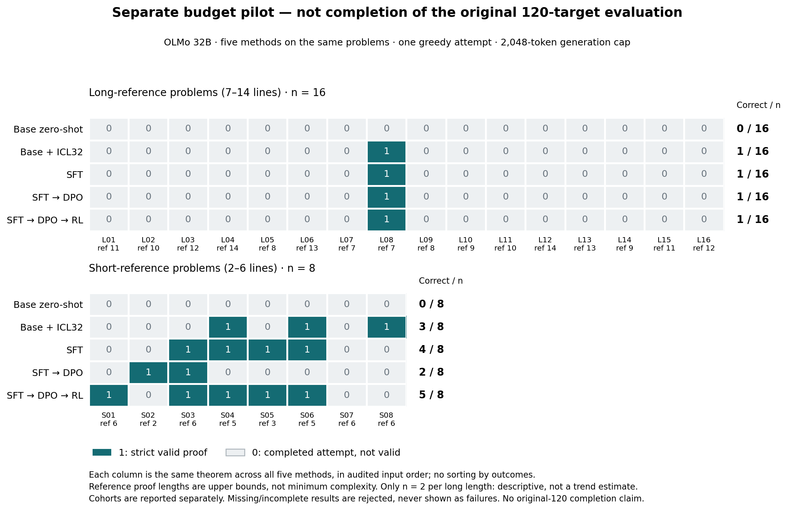

# The longer-proof pilot shows no gain beyond ICL

Final report, 2026-09-10 18:47 UTC. All five methods completed the same 24-target pilot; root's strict replay, independent native replay and final report review passed. GPU work ended at 18:27:55 UTC.

## Executive summary

We completed the requested comparison of in-context learning (ICL), supervised fine-tuning (SFT), and an SFT→preference-training→verifier-RL pipeline using the same OLMo-32B base and 32 short-proof examples. Training witnesses have at most six formal steps. The fixed held-out pilot contains eight short-reference problems and sixteen with references of 7–14 steps.

1. **Training added no longer-proof success beyond ICL.** ICL, SFT, SFT+DPO and SFT+DPO+RL each solve exactly the same one of 16 longer problems. All four produce the same seven-step proof body, which remains seven steps after strictly checked compression. None solves a reference 8–14 target. This is a narrow negative result on a small panel, not evidence that RL generally cannot improve reasoning.

2. **RL has the highest short score, but its advantage is uncertain and nonuniform.** Short scores are zero-shot 0/8, ICL 3/8, SFT 4/8, DPO 2/8 and RL 5/8. Compared with ICL, the full pipeline gains three and loses one; its +25-percentage-point difference has a descriptive paired 95% interval of −25 to +62.5 points. Against SFT it adds only one success. One short problem is solved by ICL and missed by every trained endpoint.

3. **The zero-shot baseline is strongly confounded by output-format failures.** Fifteen answers hit the token cap without a complete final block; the other nine close the block but fail on the wrong line-index syntax. ICL supplies concrete proof-language examples and yields 20 closed answers, four of which are valid. These results do not isolate general reasoning ability from task elicitation and formal-language compliance.

The user-approved extension finished ICL without retraining, changing decoding, or selecting new targets. It used 27.94 GPU-minutes on one H100. The complete five-method pilot is now available; the original 120-target and sampled-K4 evaluations remain unperformed. A larger frozen evaluation is needed before claiming that additional training improves length transfer.

## Matched results and what changed

All five methods have 24 unique completed greedy attempts under the same 2,048-native-token ceiling. These are strict validity results in the repository's propositional natural-deduction language, not informal proof grading.

| Endpoint | Short references, 2–6 steps | Longer references, 7–14 steps |
|---|---:|---:|
| Base zero-shot | 0/8 (0%) | 0/16 (0%) |
| Base + ICL 32 | 3/8 (37.5%) | 1/16 (6.25%) |
| SFT | 4/8 (50.0%) | 1/16 (6.25%) |
| SFT + DPO | 2/8 (25.0%) | 1/16 (6.25%) |
| SFT + DPO + verifier RL | 5/8 (62.5%) | 1/16 (6.25%) |

The methods share all targets; short and long cohorts are kept separate. All 120 native attempts were replayed, yielding 18 accepted certificates. No missing attempt was scored as a failure. The [reconciled analysis identity](../reports/reconciled_pilot_v2/PILOT_IDENTITY.json) binds the actual endpoint, execution, native-output and analysis records.

Each column is the same theorem across methods in frozen input order, not sorted by outcomes. L08 is the shared seven-step success. On short target S08, ICL succeeds while every trained endpoint fails. The figure's [reconciliation caption](../reports/reconciled_pilot_figure_v2/RECONCILIATION_CAPTION.md) explains the 12+12 ICL continuation, physical host change, original-job failure and incomplete larger experiment. The unchanged plotting helper validates whole-five-arm membership and report consistency; its input was produced by the new explicit reconciliation gate, not the historical original-job analysis wrapper.

On the eight short targets:

| Paired change | Gains / losses | Difference | Descriptive 95% paired interval |
|---|---:|---:|---:|
| ICL → SFT | 2 / 1 | +12.5 points | −25 to +50 points |
| ICL → SFT+DPO+RL | 3 / 1 | +25 points | −25 to +62.5 points |
| SFT → SFT+DPO+RL | 1 / 0 | +12.5 points | 0 to +37.5 points |
| SFT+DPO → SFT+DPO+RL | 4 / 1 | +37.5 points | −12.5 to +87.5 points |

All four intervals include zero. Three of RL's four gains over DPO restore successes that SFT already had, so a weak five-pair DPO intermediate explains much of that apparent improvement. RL versus DPO isolates the added RL stage; RL versus SFT includes both DPO and RL. Neither isolates a general effect of more training from all alternative optimization schedules.

The bootstrap resamples paired theorem identities 10,000 times. It is descriptive, uncorrected for multiple comparisons, and does not measure training-seed uncertainty or fully resolve dependence from reused generator families. ICL, SFT, DPO and RL have identical long-panel outcome vectors; their empirical paired intervals collapse to zero mechanically. This is not a population-equivalence test. Each 1/16 long rate has a Wilson 95% interval of approximately 1.1%–28.3%.

## What the raw proofs establish

The shared longer success, canonical identifier beginning `bc5fa561`, proves ¬R from R→A and R→¬A, where A=((R∧Q)∧R). It assumes R, obtains A and ¬A, derives contradiction, then discharges R. ICL and all three trained endpoints have the identical seven-step proof body. Their outputs each contain 124 native tokens, but ICL includes an extra two-newline suffix; the complete native response sequences are not identical. No reference 8–14 target is solved by any method. There are only two targets per long-reference length.

The ICL-only short success, `997a59b4` (S08), is an instance of ((A∨B)→S)→(A→S). ICL correctly introduces A∨B under an assumption of A, applies modus ponens and discharges both assumptions in six steps. SFT instead tries to derive S by an invalid conjunction-elimination step. DPO and RL fail parsing on a malformed final formula; their earlier conjunction-elimination steps are also semantically invalid. This counterexample prevents interpreting aggregate score order as uniform improvement. [Literal examples and exact raw-file hashes](reports/qualitative_examples_v2.md) retain the original text; no proof was repaired. The [display-whitespace note](reports/qualitative_display_note_v2.md) distinguishes Markdown separator whitespace from exact native text.

Zero-shot's 0/24 strict outcome requires particular care. All 15 unclosed answers reach the generation cap; all nine closed answers fail with `parse: expected line index, got 'N1:'`. No zero-shot output reaches a parsed proof in this protocol. ICL emits 20 final markers and four caps, versus 23/1 for SFT, 23/1 for DPO and 24/0 for RL. Better termination and syntax still do not imply valid reasoning: only 18 of 120 total attempts pass the strict checker. The comparison measures success on this exact formal task, and cannot establish that the base model lacks reasoning ability in another format.

A proof step is a numbered, semicolon-terminated rule application, not a model token or physical text line. Reference lengths are supplied witness upper bounds, not certified minimum difficulty. Any shorter valid proof would count. Compression is separately checked analysis and never rescues an invalid raw answer.

## Model, training and matching

The pinned base is `allenai/Olmo-3-1125-32B`, revision `c2b61dae89a1ad10e4ad5653d0e46b590902607b`. Rank 16 all-linear QLoRA trains 134.2 million adapter parameters over NF4-packed base weights; this is not full-parameter 32B RL. All 40 RL updates and the SFT/DPO stages completed in the original sprint. The implementation uses TRL's SFT, DPO and Dr.GRPO trainers, not an exact Ai2 or proprietary DeepSeek recipe.

ICL includes all 32 original gold demonstrations verbatim on every query. SFT used the same 32 examples for 80 optimizer updates and 320 presentations. DPO used five acquired preference pairs for 40 updates and 100 actual pair presentations. RL starts from that fixed DPO endpoint and receives the same 32 theorem prompts with binary strict-verifier rewards, without gold proofs or reference-length fields. Its 40 updates sampled 640 responses in 160 groups; only 23 groups mixed valid and invalid answers, and 19 updates had nonzero current gradients.

The source theorem bank and completion ceiling are matched, not training exposure, additional verifier feedback, optimization or total compute. Evaluation targets are excluded under canonical-theorem, premise-context and closed-goal-skeleton guards; related generator structures and unknown pretraining exposure remain limitations. There are seven long-target families and eight short-target families, with six long targets from one family.

SFT/DPO retain their earlier BF16-training provenance. RL and every evaluated endpoint use the same FP32-compute operator over unchanged four-bit weights. The original RL numerical failure and its resolution, exact checkpoint hashes, training diagnostics and full methods remain in the [original audited report](../summary.md) and [methods](../reports/methods.md). No training or checkpoint selection followed the pilot results.

## Compute, continuation and remaining scope

| Method | Observed generated native tokens | Observed prompt tokens | Closed-call generation time |
|---|---:|---:|---:|
| Zero-shot | 33,519 | 13,694 | 22.44 min |
| ICL 32 | 12,546 | 194,510 | 53.03 min |
| SFT | 6,599 | 13,694 | 14.22 min |
| SFT+DPO | 6,059 | 13,694 | 12.77 min |
| SFT+DPO+RL | 4,600 | 13,694 | 3.47 min |

These timings exclude model loading and compare different batch tails; they are not a general speed benchmark. ICL uses approximately 14.2 times as many prompt tokens as each non-ICL arm. Its six closed calls account for all 24 scored outputs, but an original interrupted four-target call remains open. That call's additional native output is unknown, bounded by 8,192 tokens, so ICL's observed generation total is a lower bound on total native generation work. Its elapsed GPU lease is fully charged, not treated as zero.

The extension preserved the first twelve ICL attempt records and all original byte prefixes, then appended twelve new attempts using the exact original evaluator step and fixed batch seeds. The new batches took 732.20, 730.59 and 145.34 seconds. The new owning job acquired one H100 on simplex1/g178 at 17:59:58 and completed at 18:27:55, using 27.94 GPU-minutes and peaking at 50.89 GB allocated memory (57.14 GB reserved). The original twelve ran on simplex2/g374; the host/device changed, with the same hardware class, driver and shared runtime. Historical source/owner receipts support the old half; the resumed model identity is not a new measurement of historical per-call execution or cross-device bitwise equivalence.

Recorded sprint GPU leases now total 335.53 minutes (5.59 GPU-hours), with no overlap and no paid cloud GPU jobs. The [final ledger](../reports/compute_ledger_icl_extension_final_v2.json) reports no running or queued GPU jobs. Files and checkpoints remain on simplex1; the approved shared-storage infrastructure is retained and holds no GPU. No unrelated process was stopped, and no commits, pushes or publication were made.

This is a complete reconciled five-method 24-target pilot across three executions. The original cancelled owner and interrupted pipeline remain failed, and their old completion guard was neither weakened nor invoked as if it passed. The extension was authorized after trained outcomes were known; it did not change targets, checkpoints or decoding. Original120-target and sampled-K4 evaluation remain unperformed, and textbook payloads remain sealed.

## Checks and next experiment

Root verified all 276 frozen inputs, preserved ICL prefixes, actual owner/stage records, five whole 24 statuses and exact checkpoint/runtime metadata before reading new outcomes. The unchanged native analyzer then replayed all 120 attempts and 18 accepted certificates, including separately verified compression, and rebound 331 input/output identities. The independent reviewer separately reproduced all 120 native outcomes, all 18 accepted certificates and all 140 paired comparisons, with 348 checked input identities. The [independent final report review](reports/final_summary_independent_review_v2.md) passed against the [exact archived scientific draft](reports/summary_reviewed_draft_v2.md); subsequent changes are status and artifact links only.

The existing 115-test CPU suite passed again in 27.243 seconds; all seven new reconciliation tests and three additional independent gate-ordering checks also passed. The plotting helper is unchanged. Fabricated/tiny-model test outputs are not experiment results. The research-sprint skill guided the frozen comparison, bounded independent review, explicit deadline and evidence-first reporting.

The next experiment is the already frozen larger target panel using these same completed checkpoints and literal proof protocol, followed by the planned sampled evaluation if separately budgeted. That would reduce dependence on this tiny panel and distinguish single-attempt behavior from sampled coverage. It has not been launched. Any intervention aimed at output-format compliance or a different RL schedule should be a separately specified comparison, not a repair of these saved outcomes.

## Artifact map

- [Complete reconciled analysis](../reports/reconciled_pilot_v2/report.md), [per-theorem results](../reports/reconciled_pilot_v2/per_theorem.jsonl), [identity and hashes](../reports/reconciled_pilot_v2/PILOT_IDENTITY.json), [native provenance gate](reports/reconciliation_gate_v2.json).
- [Figure and full caption](../reports/reconciled_pilot_figure_v2/RECONCILIATION_CAPTION.md), [plot provenance](../reports/reconciled_pilot_figure_v2/plot_provenance.json), [literal proof examples](reports/qualitative_examples_v2.md).
- [Extension scope](start.md), [decision log](research_log.md), [reproduction](reports/reproduction.md), [launch receipt](../infrastructure/icl_resume_launch_v2.json), [test receipt](reports/test_receipt_v2.json).
- [Independent prelaunch review](reports/icl_resume_v2_independent_prelaunch.md), [independent reconciliation-code review](reports/reconciliation_producer_independent_review_v2.md), [original completed-training audit](../reports/final_training_independent_review.md).
- [Independent full-five native audit](reports/full_five_independent_review_v2.md), [348-hash audit receipt](reports/full_five_independent_review_v2.json), [fresh figure/caption cold-read](reports/figure_cold_read_v2.md), [final summary review](reports/final_summary_independent_review_v2.md).
- [Final machine-readable handoff](reports/final_status_v2.json), [released-resource census](reports/final_resource_status_v2.json), [final freeze/identity/history hash check](reports/final_pre_handoff_hash_check_v2.json).
