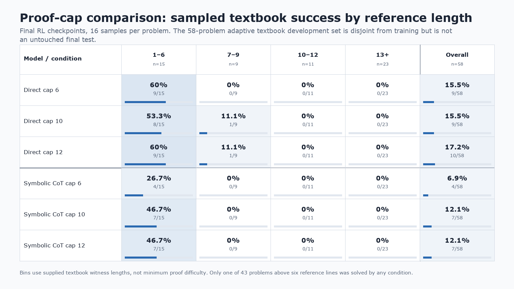

# Proof-cap comparison

Status: completed remote experiment, imported from `simplex3` for local review.

Question: Does increasing the initial proof-supervision cap from 6 to 10 or 12 lines, with direct
or symbolic-CoT output, extend verified textbook proof reach after RL?

## Observations

All six one-seed configurations completed. The primary objective was not achieved: sampled Direct
models reached a seven-line reference problem already solved after SFT, while CoT models reached at
most six reference lines. The best sampled coverage was Direct cap 12 at 10/58; Direct cap 6 had
the best greedy coverage at 7/58. Larger caps greatly improved long synthetic training success but
did not produce comparable textbook transfer.

## Success by reference length

The figure uses the final RL checkpoints and 16 samples per problem. The [underlying counts and
source hashes](reports/success_by_reference_length.json) record the derivation from the strictly
replayed outcomes and the 58-problem population.

## Imported evidence

- [Detailed final report and seven key figures](reports/summary.md)
- Cap-6 synthetic training-growth audits for [Direct](reports/cap6_direct_s20260910_training_growth.json)
  and [symbolic CoT](reports/cap6_cot_s20260910_training_growth.json)
- [Original remote README](REMOTE_README.md)
- [Archived implementation](../../code/experiments/archived/cap_comparison_20260910/IMPORT.md)

The documents and figures were copied from
`simplex3:/data/users/dmitry/nd-rl/cap-comparison-20260910-1958`. The report records all six
completed arms as running on `simplex1`. Raw runs and checkpoints remain remote.
