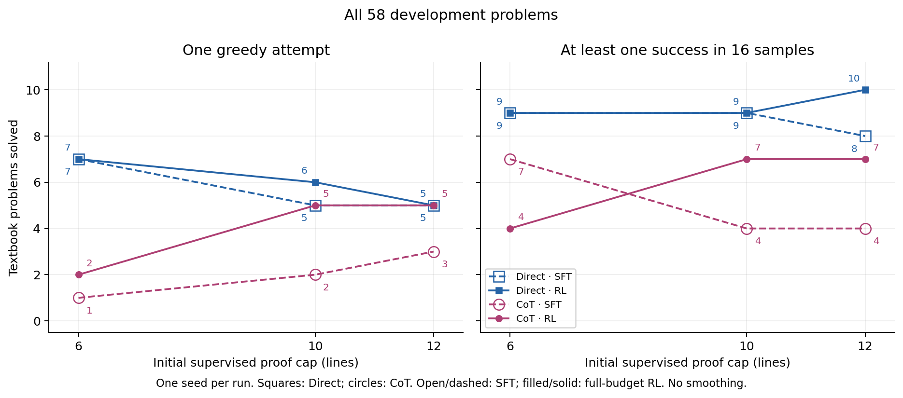
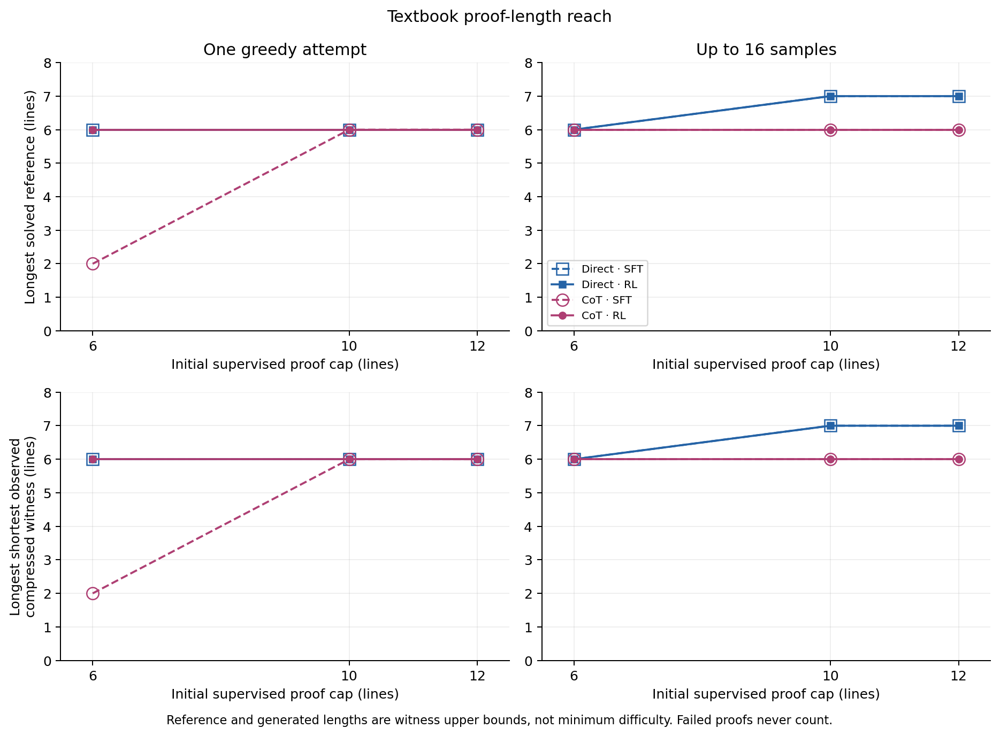
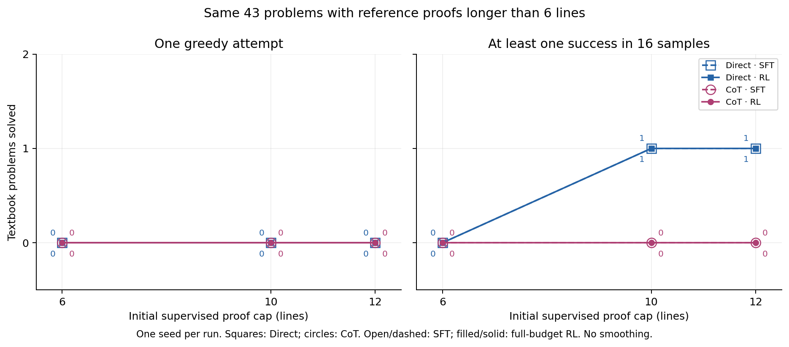
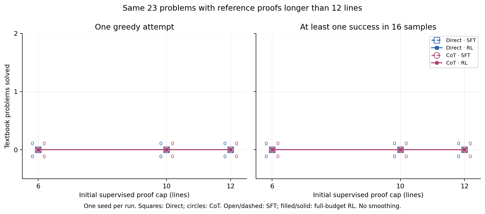
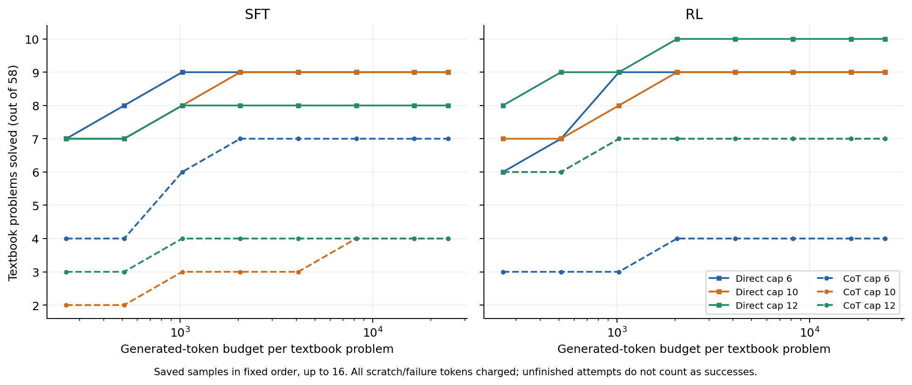
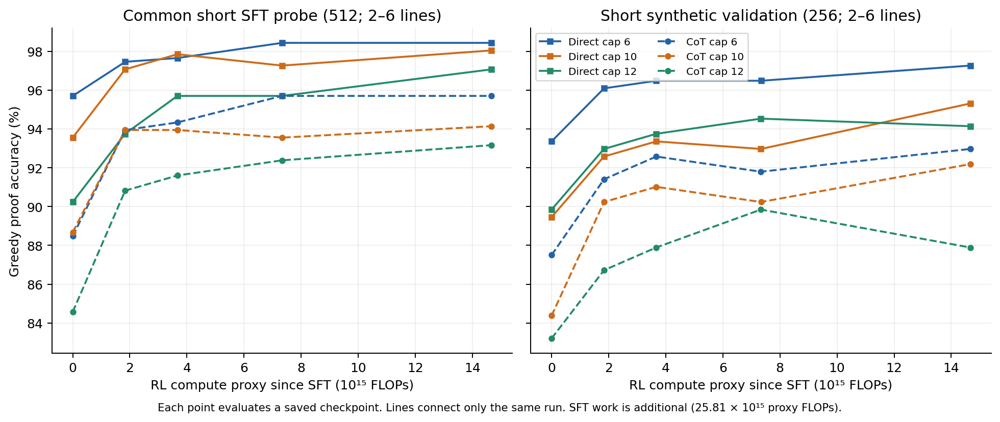
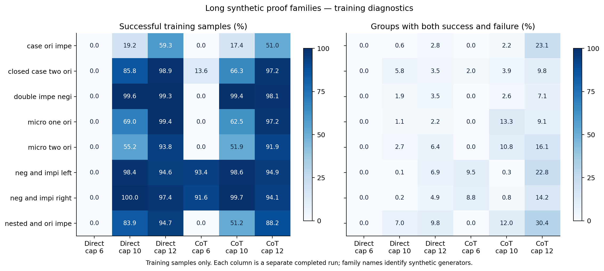

# Proof cap comparison

Generated 2026-09-11T00:32:32.180094+00:00. Branch `experiment/cap-comparison`.

Completed configurations: 6/6. One seed (20260910) per configuration. The benchmark is the existing **58-problem adaptive textbook development set**. No old final-test problems were evaluated for this comparison.

**The primary objective was not achieved: this symbolic-CoT implementation did not extend textbook proof reach beyond the initial supervision cap.** The longest solved textbook reference was **7 lines for sampled Direct models and 6 lines for CoT models**. For the seven-line problem, the shortest saved successful proof also had seven lines after compression. That result already existed after SFT at caps 10 and 12; no configuration increased its maximum solved reference length with 16 samples after RL. All final greedy witnesses were at most six lines. None of the models solved a textbook problem whose supplied reference exceeded its own training cap.

The best observed sampled coverage was **10/58 (17.2%) for Direct cap 12**, up from 8/58 after SFT, with greedy coverage unchanged at 5/58. Direct cap 6 had the best greedy count, 7/58. CoT caps 10 and 12 each reached 5/58 greedy and 7/58 sampled. The only textbook problem above six reference lines solved by any model was disjunction commutativity, already solved before RL by both larger-cap Direct models; the [complete longer-proof success audit](long_textbook_successes.json) records every accepted sample. These are one-seed observations, not evidence of a reliable ranking across seeds.

Raising the cap substantially improved success on long synthetic **training** prompts: Direct rose from 0% at cap 6 to 70.2% at cap 10 and 91.5% at cap 12; CoT rose from 12.8% to 59.9% and 87.9%. Cap-6 Direct produced **zero successes in 151,672 long-synthetic responses**, hence zero reward contrasts from that source. Larger-cap runs often succeeded there while solving only 0–1 of the 43 longer textbook problems. Our inference is that the small-cap setup has a severe sparse-reward problem, and the larger-cap setup still has a transfer problem. High training success alone does not resolve either measurement or generalization.

The next priority is the proposed [fragment-selection × backward-reset experiment](../../research/experiment_proposal_fragment_curriculum.md), with the complete externally supplied source certificate kept within its declared supervision cap. Measure whether selection creates useful same-theorem reward contrasts and improves full-start proofs on separate compositions. Add a dedicated long-synthetic validation cohort: the present pretraining and synthetic-validation probes both contain only 2–6-line references. This is a proposed follow-up, not a tested remedy. All conclusions here concern the existing adaptive 58-problem development benchmark; no untouched-test claim is made.

## Textbook results

Every textbook count below was reproduced by strict replay of the saved final proof against its original theorem. SFT and RL use the same evaluation procedure; each textbook evaluation started only after that arm completed its full RL budget.

| Model | Cap | Greedy SFT → RL (/58) | Sample16 SFT → RL (/58) | RL greedy max reference | RL sample16 max reference |
|---|---:|---:|---:|---:|---:|
| DIRECT | 6 | 7 → 7 | 9 → 9 | 6 | 6 |
| DIRECT | 10 | 5 → 6 | 9 → 9 | 6 | 7 |
| DIRECT | 12 | 5 → 5 | 8 → 10 | 6 | 7 |
| COT | 6 | 1 → 2 | 7 → 4 | 6 | 6 |
| COT | 10 | 2 → 5 | 4 → 7 | 6 | 6 |
| COT | 12 | 3 → 5 | 4 → 7 | 6 | 6 |

## Longer textbook problems

Reference lengths are supplied witness lengths, not minimum proof difficulty. Every configuration is compared on the same cohorts: 43 problems above six lines and 23 above twelve. The common >10 cohort and own-cap counts are also retained in `analysis_results.json`.

| Model | Cap | Common >6, greedy SFT → RL (/43) | Common >6, sample16 SFT → RL (/43) | Common >12, greedy SFT → RL (/23) | Common >12, sample16 SFT → RL (/23) |
|---|---:|---:|---:|---:|---:|
| DIRECT | 6 | 0 → 0 | 0 → 0 | 0 → 0 | 0 → 0 |
| DIRECT | 10 | 0 → 0 | 1 → 1 | 0 → 0 | 0 → 0 |
| DIRECT | 12 | 0 → 0 | 1 → 1 | 0 → 0 | 0 → 0 |
| COT | 6 | 0 → 0 | 0 → 0 | 0 → 0 | 0 → 0 |
| COT | 10 | 0 → 0 | 0 → 0 | 0 → 0 | 0 → 0 |
| COT | 12 | 0 → 0 | 0 → 0 | 0 → 0 | 0 → 0 |

| Model | Cap | RL greedy max shortest raw / compressed witness | RL sample16 max shortest raw / compressed witness |
|---|---:|---:|---:|
| DIRECT | 6 | 6 / 6 | 6 / 6 |
| DIRECT | 10 | 6 / 6 | 7 / 7 |
| DIRECT | 12 | 6 / 6 | 7 / 7 |
| COT | 6 | 6 / 6 | 6 / 6 |
| COT | 10 | 6 / 6 | 6 / 6 |
| COT | 12 | 6 / 6 | 6 / 6 |

For each solved problem, take its shortest observed accepted witness, then report the maximum across solved problems. Compressed certificates are reverified; compression cannot rescue a failed final proof. These remain upper bounds, not minimum lengths.

## Paired RL changes

| Model | Cap | Greedy Δ solved; 95% interval (percentage points) | Sample16 Δ solved; 95% interval (percentage points) |
|---|---:|---:|---:|
| DIRECT | 6 | +0; [-6.9, +6.9] | +0; [+0.0, +0.0] |
| DIRECT | 10 | +1; [+0.0, +5.2] | +0; [-5.2, +5.2] |
| DIRECT | 12 | +0; [+0.0, +0.0] | +2; [+0.0, +8.6] |
| COT | 6 | +1; [+0.0, +5.2] | -3; [-12.1, +0.0] |
| COT | 10 | +3; [+0.0, +12.1] | +3; [+0.0, +12.1] |
| COT | 12 | +2; [+0.0, +8.6] | +3; [+0.0, +12.1] |

Intervals use 5,000 paired target bootstrap resamples, conditional on the saved attempts and one training seed. They do not measure seed variation. Prespecified K=1/4/16 and token-budget contrasts are retained in `analysis_results.json`.

| Model | Cap | RL greedy token-limit attempts | RL sampled token-limit attempts |
|---|---:|---:|---:|
| DIRECT | 6 | 0/58 | 2/928 |
| DIRECT | 10 | 0/58 | 2/928 |
| DIRECT | 12 | 0/58 | 1/928 |
| COT | 6 | 0/58 | 2/928 |
| COT | 10 | 0/58 | 3/928 |
| COT | 12 | 0/58 | 1/928 |

The 1,536-token limit applies to each attempt, including scratch. Larger total token budgets in the graph mean more saved independent attempts; they do not extend the maximum length of an individual attempt.

## Training accuracy and compute

| Model | Cap | SFT updates | RL updates | SFT response tokens (M) | RL generated tokens (M) | SFT work (10¹⁵ proxy FLOPs) | RL work (10¹⁵ proxy FLOPs) |
|---|---:|---:|---:|---:|---:|---:|---:|
| DIRECT | 6 | 7,292 | 5,235 | 139.91 | 53.83 | 25.8086 | 14.6644 |
| DIRECT | 10 | 6,849 | 5,150 | 148.80 | 66.21 | 25.8096 | 14.6660 |
| DIRECT | 12 | 5,737 | 5,212 | 134.70 | 67.08 | 25.8087 | 14.6652 |
| COT | 6 | 3,997 | 3,840 | 127.89 | 57.72 | 25.8097 | 14.6647 |
| COT | 10 | 3,825 | 3,269 | 136.07 | 65.71 | 25.8107 | 14.6683 |
| COT | 12 | 3,194 | 3,179 | 122.82 | 65.67 | 25.8137 | 14.6657 |

Every arm uses the same SFT target (25,807,392,746,127,360 proxy FLOPs) and RL target (14,663,886,875,197,440). Training stops after the first completed update reaching each target. The proxy charges actual padded model forwards, backward passes, generation, likelihood checks and retention; it is not measured hardware FLOPs. SFT token counts measure response-label exposure; RL token counts include generated scratch and failed attempts. They exclude prompt/padding positions and additional retention-label exposure, which are charged in the compute proxy. SFT work is additional to the RL x-axis. Validation and pretraining points use the identical fixed 256/512 theorem cohorts, respectively. Both contain reference proofs of 2–6 lines, so these curves measure short-proof competence; they do not test longer-proof transfer. The pretraining probe covers common short examples, not the full SFT pool. See `fixed_probe_length_audit.json`.

## Observed RL learning signal

A group has eight responses to the same training theorem. With leave-one-out advantages, groups that all pass or all fail supply no policy reward contrast. The table separates training sources; these are training diagnostics, not validation scores. Retention updates can still occur when policy advantages are zero. An aggregate pass rate can mix theorems that always succeed with theorems that always fail; it does not establish that individual theorems produce useful reward contrasts.

| Model | Cap | Training source | Sample success | Mixed groups | Tokens with nonzero advantage |
|---|---:|---|---:|---:|---:|
| DIRECT | 6 | 14 permitted textbook training prompts | 21.8% | 2.8% | 1.7% |
| DIRECT | 6 | Long synthetic RL prompts | 0.0% | 0.0% | 0.0% |
| DIRECT | 6 | Short synthetic RL prompts | 99.0% | 3.8% | 2.2% |
| DIRECT | 10 | 14 permitted textbook training prompts | 21.4% | 4.4% | 2.7% |
| DIRECT | 10 | Long synthetic RL prompts | 70.2% | 2.9% | 3.4% |
| DIRECT | 10 | Short synthetic RL prompts | 97.7% | 5.3% | 3.2% |
| DIRECT | 12 | 14 permitted textbook training prompts | 20.5% | 6.0% | 3.5% |
| DIRECT | 12 | Long synthetic RL prompts | 91.5% | 4.8% | 4.9% |
| DIRECT | 12 | Short synthetic RL prompts | 96.9% | 6.8% | 4.2% |
| COT | 6 | 14 permitted textbook training prompts | 15.5% | 3.8% | 3.9% |
| COT | 6 | Long synthetic RL prompts | 12.8% | 1.4% | 1.9% |
| COT | 6 | Short synthetic RL prompts | 96.1% | 9.1% | 4.9% |
| COT | 10 | 14 permitted textbook training prompts | 19.7% | 5.4% | 4.0% |
| COT | 10 | Long synthetic RL prompts | 59.9% | 7.2% | 6.3% |
| COT | 10 | Short synthetic RL prompts | 94.9% | 9.5% | 5.7% |
| COT | 12 | 14 permitted textbook training prompts | 12.8% | 5.5% | 4.0% |
| COT | 12 | Long synthetic RL prompts | 87.9% | 16.4% | 16.7% |
| COT | 12 | Short synthetic RL prompts | 93.2% | 15.3% | 12.5% |

These family statistics cover the observed training rollouts over the full RL run. They are not held-out accuracy, fragment transfer utility, or an EDL estimate. No dedicated held-out long synthetic probe is included in this comparison.

## Training certificate lengths

This posthoc audit replays and compresses accepted training rollouts whose raw certificates exceed their own initial cap. RL-only synthetic prompts are disjoint from SFT but are repeatedly used during RL; they are not held-out problems.

| Configuration / audit | Raw training maximum | RL-only synthetic theorems with compressed certificate above cap | Longest such compressed certificate | SFT-exposed short theorems also producing above-cap certificates |
|---|---:|---:|---:|---:|
| [Direct cap 6](cap6_direct_s20260910_training_growth.json) | 7 | 0 | — | 1 |
| [Direct cap 10](cap10_direct_s20260910_training_growth.json) | 12 | 140 | 12 | 0 |
| [Direct cap 12](cap12_direct_s20260910_training_growth.json) | 12 | 0 | — | 0 |
| [CoT cap 6](cap6_cot_s20260910_training_growth.json) | 7 | 186 | 7 | 6 |
| [CoT cap 10](cap10_cot_s20260910_training_growth.json) | 11 | 3 | 11 | 0 |
| [CoT cap 12](cap12_cot_s20260910_training_growth.json) | 12 | 0 | — | 0 |

These count observed certificates, not the minimum lines required by their theorems. A [strictly verified counterexample](training_length_counterexample.json) shows a seven-line compressed model certificate with a six-line alternative: citing an existing assumption directly removes an unnecessary derivation. The textbook coverage and witness results remain the primary transfer measurements.

## Inspect generated proofs

The examples below show saved final proofs and, for CoT models, their symbolic scratchpads. They are posthoc illustrations selected by a fixed rule, not additional evaluations or evidence replacing the aggregate counts.

- [Direct cap 6 examples](cap6_direct_s20260910_examples.md)
- [Direct cap 10 examples](cap10_direct_s20260910_examples.md)
- [Direct cap 12 examples](cap12_direct_s20260910_examples.md)
- [CoT cap 6 examples](cap6_cot_s20260910_examples.md)
- [CoT cap 10 examples](cap10_cot_s20260910_examples.md)
- [CoT cap 12 examples](cap12_cot_s20260910_examples.md)
- [Cap-10 Direct's seven-line disjunction-commutativity proof, already present after SFT](cap10_direct_long_textbook_example.md)

[Failure diagnostics](failure_diagnostics.json) describe verifier errors, termination reasons and observed proof-text diversity for every completed run.

## Execution cost

| Configuration | Host / GPU | Pipeline wall minutes (SFT + RL + evaluations) |
|---|---|---:|
| DIRECT cap 6 | simplex1 / 4 | 94.2 |
| DIRECT cap 10 | simplex1 / 0 | 81.0 |
| DIRECT cap 12 | simplex1 / 2 | 76.4 |
| COT cap 6 | simplex1 / 4 | 84.4 |
| COT cap 10 | simplex1 / 2 | 85.7 |
| COT cap 12 | simplex1 / 2 | 77.8 |

The 5 interrupted attempts consumed 0.55 GPU-hours of pipeline occupancy. Completed comparison arms consumed 8.32 GPU-hours. These measure wall time holding one GPU, not full GPU utilization. Queue time is excluded; the separate implementation smoke test is excluded. The planned six configurations use one seed each; infrastructure retries are not additional seeds.

## Scope and limitations

- The architecture, initialization, seed, RL prompt pool, decoding limit and compute budgets are shared. The 8.87M-parameter models use an 8,192-token context and 1,536 generated-token limit for RL/evaluation.
- Initial caps constrain supplied SFT/retention certificates. The relative-reference tokenizer and verifier accept generated proofs beyond that cap; there is no six-line generation or acceptance cutoff. The per-attempt token budget still applies.
- CoT is a learned symbolic dependency-plan scratchpad followed by a final natural-deduction proof. This is an R1-inspired scratchpad/verified-reward experiment, not a reproduction of DeepSeek-R1. Only the final proof is rewarded; evaluation samples are independent and do not receive verifier feedback while generating.
- Cap 6 has 60,000 unique SFT examples; caps 10/12 have 63,372/64,969 with weighted long-proof mixtures. Raising the cap also expands family support. This is a comparison of training distributions, not an isolated causal effect of length.
- The common RL sampling mixture is 50% from 512 SFT-exposed short prompts, 45% from 1,303 long synthetic prompts disjoint from every SFT pool, and 5% from the 14 permitted textbook training prompts. The long synthetic source witnesses span 7–14 lines, including 72 above 12; RL receives no proof or length labels. See `rl_pool_length_audit.json`.
- All 4,969 added long certificates retain their lengths under the implemented dependency/reiteration compression, and every premise line participates in the final line's citation graph. The strict source audit and `long_source_dependency_audit.json` document these checks. Shorter alternative proofs can still exist.
- The 14 previously permitted textbook training classes contribute prompt-only RL exposure; no textbook proof labels or additional classes enter training. The 58 development problems remain disjoint from training. The historical final set was already released and is excluded here.
- 5 remote attempts were interrupted when other users' multi-GPU jobs appeared. The watchdog released only our own process groups. Partial attempts were archived on both hosts and excluded; retries used the same initialization and complete budgets. See `recovery_protocol.json`.
- All six configurations are retained in the inventory. One training seed limits conclusions about robustness; no averaging across configurations or procedures is used.

The cap 6 CoT same-seed infrastructure restart reproduced the SFT update count and compute exactly, but not the checkpoint or probe scores (training-pool 463→453/512; synthetic validation 225→224/256). Deterministic kernels were not enforced. The restart was required before textbook evaluation and was not selected by score; see `restart_reproducibility.json`. Small configuration differences require replication.

## Reproducibility

Training protocol SHA256: `6a98cbce899047deebd59f85c45e52a72478db501048373293f91a2128287df4`.

Analysis protocol SHA256: `2c6eaf3a88d97540d03187881b6f1bbc47edab1fd9ee9b8ef9cbb6a65dd0e29c`. Results bind every evaluated checkpoint and saved-attempt file. Analysis tests cover strict replay in both modes, proof compression, theorem/reward tampering, missing/duplicate attempts, and whole-attempt inference budgets.

`code/analyze.py` generates verified results; `code/report.py` generates this document and PNG/SVG figures. Dashboard project: `cap-comparison-v2`, with smoothing disabled and `compute/rl_budget_fraction` available as the x-axis.

The completed comparison contains **11,832 distinct textbook attempts**, all strictly replayed. The [completion audit](completion_audit.json) checks the frozen inputs and complete artifact inventory.

The [final dashboard snapshot](dashboard.png), [72-point accuracy audit](dashboard_accuracy_audit.json) and [browser check](dashboard_browser_check.json) document separate run labels, checkpoint identities, compute axes and disabled smoothing. The dashboard shows greedy accuracy; sampled coverage is in this report.
