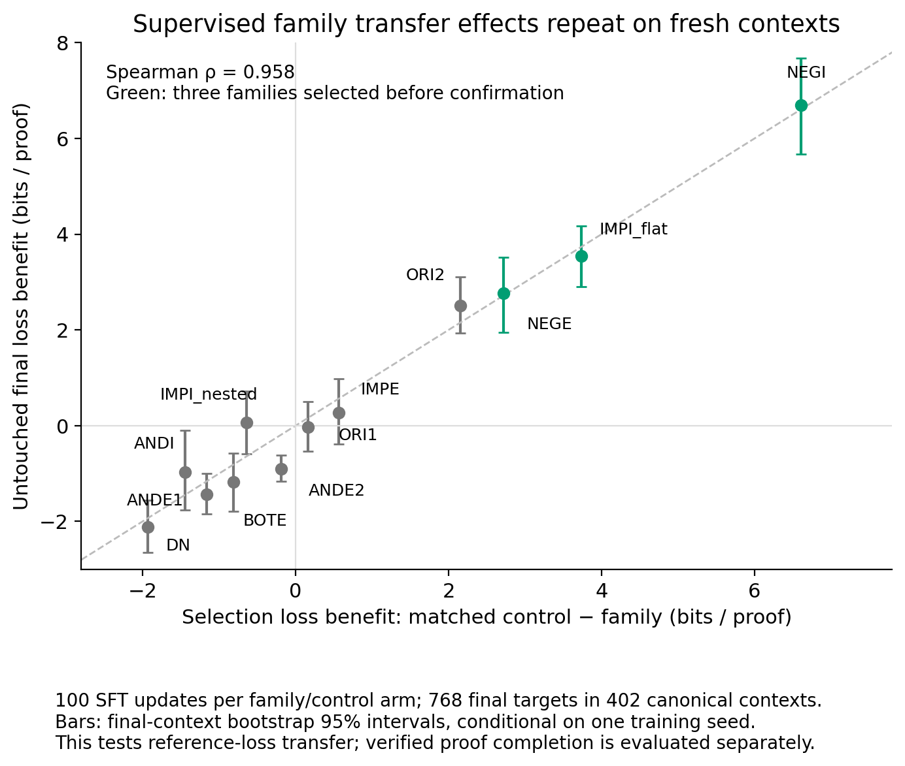
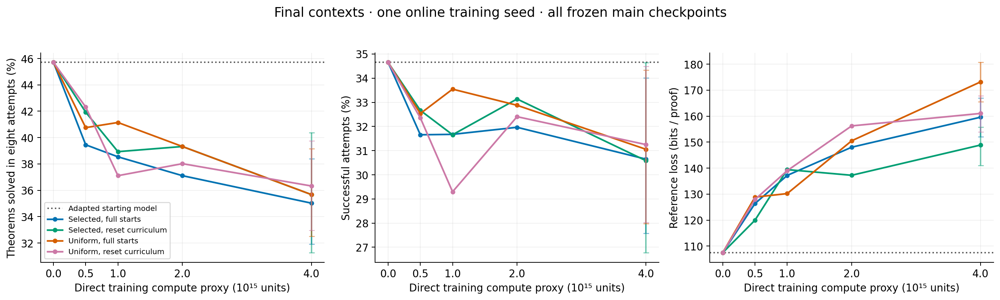
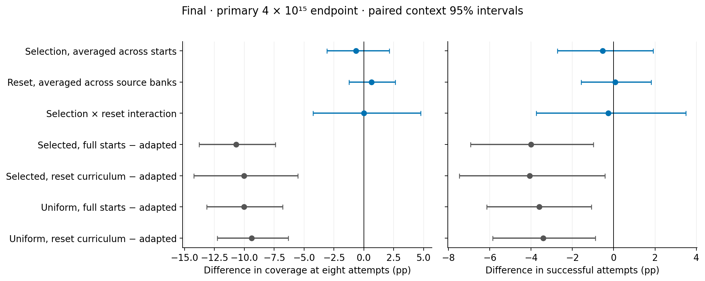
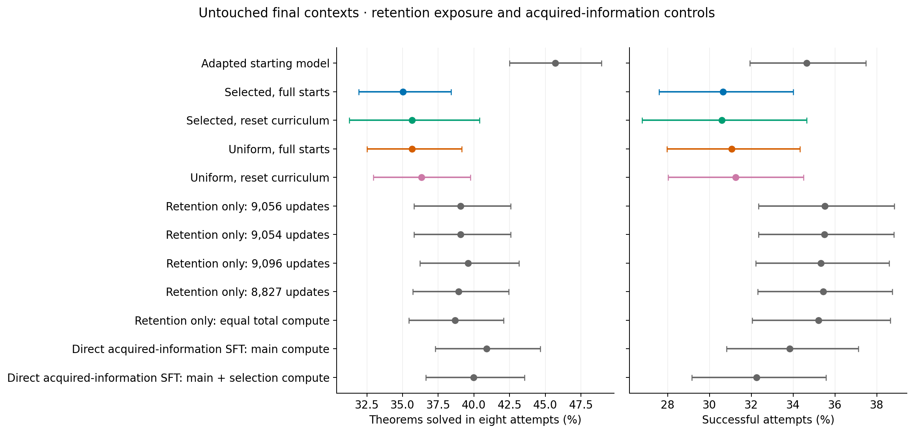

# Fragment transfer scores predict supervised learning; an RL proof-solving benefit remains unproven

We ran the [proposed proof-fragment experiment](../research/proof_fragment_selection_20260910.md) on an 8.87-million-parameter natural-deduction model. The selector ranks families by how much a short, controlled training intervention improves reference-proof loss on separate compositions. We then tested whether practicing those families with verifier-reward RL improves complete proofs from an empty prefix, with and without a backward-reset curriculum.

**The score predicts the supervised intervention it measures, but its selected mixture does not show a resolved advantage in verified proof coverage. Long RL training reduces coverage in all four conditions.** The useful next step is to calibrate transfer under the intended RL intervention and horizon before another long run.

1. **Family-level supervised transfer is reproducible on fresh contexts.** Across twelve fixed families, the frozen 100-update selection ranking predicts final relative loss effects with Spearman correlation **0.958**. The three chosen families beat their paired controls by **4.34 bits per reference proof**, with paired context-bootstrap 95% interval **[3.83, 4.81]**. Conditional surprise has final rank correlation only 0.056. These are effects of particular supervised interventions, rather than intrinsic information values of fragments. Combining the selected families solves **372/768** final targets in eight attempts, versus **369/768** for length- and source-count-matched uniform selection: **+0.39 percentage points [−1.72, +2.45]**.

2. **Neither transfer selection nor backward resets establishes a main RL coverage advantage.** At equal direct training compute, the four RL endpoints solve **269–279/768** targets, compared with **351/768** for their common adapted starting model. The selection marginal is **−0.65 points [−3.09, +2.13]**; the reset marginal is **+0.65 [−1.22, +2.64]**. All four arms lose both coverage and attempt success relative to the starting model. This is one online training seed, so the intervals describe variation across target contexts, not training runs.

3. **The controls distinguish useful loss prediction from useful proof learning.** Removing the RL policy loss while keeping the exact retention-example schedule raises final attempt success by **4.18–4.92 points**, with all four paired intervals above zero, even though reference loss becomes worse. A separate, freshly sampled reset diagnostic raises the fraction of groups with both successes and failures from **210/768 to 290/768**. That improves the opportunity for a relative-reward signal; it has not yet been tested as a training curriculum.

Primary fragment-training and RL source proofs, including reset sources, have at most **six total ND proof lines, including premises and assumptions**. Selection reads and differentiates reference proofs up to twelve lines. The information regime is therefore **six-line direct training with a twelve-line selection oracle**. Final evaluation was released only after training and selector choices closed. It contains 768 targets in 402 canonical contexts, with 256 targets in each reference-length bin. All final attempts began from an empty prefix, and success required strict verification. Most solved longer-reference targets have observed proofs of six lines or fewer; reference length does not certify minimum difficulty.

**What was tested.** The initial question was whether an information-informed fragment score could guide transferable practice, and whether backward resets would make that practice learnable through RL. Candidate construction retained complete source proofs, checked prefix states, active assumptions, scope changes and suffix provenance. Primary fragments are checked terminal windows, normally the last three total proof lines; this experiment does not enumerate every internal subgoal. The twelve terminal-rule/source-nesting families each supplied 64 candidate sources. Their labels describe proof forms, not independently established reasoning skills. Disjunction elimination remained a diagnostic because collection did not reach the prospectively required quota; it was excluded before outcomes were measured.

For each family, we started from the same adapted weights and trained both the family and a matched ordinary-fragment control for 100 supervised updates, with a common retention stream and equal padded compute. Utility is the control's mean reference loss minus the family's loss. Since the budget is common, ranking this difference is equivalent to ranking gain per unit compute. The selected bank contains the top three families—negation introduction, flat implication introduction and negation elimination—with 192 sources total. The uniform comparison has 192 sources and exactly the same total-line histogram. It inherits that selected histogram and differs in context concentration, so it is a conditional matched comparison rather than a completely oracle-free deployment baseline.

**The family loss ranking transfers, but mixture coverage remains unresolved.** The final target population was held apart from candidate acquisition, selection and development. The final rank correlation is 0.958, with conditional final-context bootstrap interval [0.867, 0.986]; ten of twelve utility signs agree with selection. Removing all final targets with checked parent, candidate or selection-oracle prefix witnesses leaves the selected-family benefit essentially unchanged at 4.345 bits.

*Each point is one of twelve fixed family/control supervised interventions at the same 100-update budget. The axes compare relative whole-reference loss benefits on selection and final contexts; positive values favor the family. Intervals resample final canonical contexts while holding the fitted interventions and selection estimates fixed. The correlation supports transport of this supervised loss statistic within the declared synthetic distribution; it does not measure uncertainty across new families or training seeds.*

At the same short mixture-training budget, the selected bank reaches 48.44% final coverage and the matched uniform bank 48.05%. The selected bank has a modest **0.813-bit reference-loss advantage [0.190, 1.480]**, but its coverage and attempt-success advantages are unresolved. The broader 768-source uniform diagnostic reaches 48.83%; it has different source support and is recorded separately. Individual-family replacement effects do not guarantee an additive gain when a fixed training dose is divided among families.

**Main RL loses unaided coverage despite successful controller operation.** The factorial crosses selected versus matched uniform sources with full starts versus backward resets. Every arm uses four prompts with eight responses each, temperature 0.8, a 512-token response budget, raw leave-one-out advantages and sixteen common retention examples per update. Supplied prefixes have zero direct action loss, while their processing cost is charged. Each arm stops after the first complete update crossing 4 × 10¹⁵ dense-compute proxy units. The proxy accounts for model work; it is not measured hardware FLOPs. All four frozen milestones are reported, without choosing a checkpoint from evaluation results.

| Final model | Targets solved in eight attempts | Successful attempts | Reference loss, bits/proof |
| --- | ---: | ---: | ---: |
| Adapted starting model | 351/768 (45.70%) | 34.65% | 107.47 |
| Selected sources, full starts | 269/768 (35.03%) | 30.65% | 159.58 |
| Selected sources, reset curriculum | 274/768 (35.68%) | 30.58% | 148.88 |
| Uniform sources, full starts | 274/768 (35.68%) | 31.05% | 173.17 |
| Uniform sources, reset curriculum | 279/768 (36.33%) | 31.25% | 161.03 |

*The four procedures share initial weights and one online training seed. The curves retain every frozen compute milestone. Coverage is the fraction of 768 final targets solved by at least one of eight independently sampled attempts; attempt success pools 6,144 attempts per model. Reference loss scores the full supplied certificate at temperature 1. Endpoint bars are context-bootstrap 95% intervals. Direct training compute excludes the separately charged selector acquisition cost.*

The endpoint interaction is **0.00 coverage points [−4.23, +4.75]**. The intervals permit small gains or losses, so they do not establish equivalence. Each complete RL procedure loses **9.38–10.68 coverage points** and **3.40–4.07 attempt-success points** relative to the adapted start, with all eight paired intervals below zero. Selection and reset each reduce reference loss relative to their factorial alternatives, by 12.87 and 11.42 bits respectively, while every RL arm has worse loss than the start.

*Points are paired effects on the same final targets at the primary 4 × 10¹⁵ endpoint. The first three rows are the selection marginal, reset marginal and interaction; the remaining rows compare each complete procedure with its adapted start. Bars are 95% intervals from 5,000 canonical-context bootstrap draws. They are conditional on one trained model per procedure and one decoding seed, with no multiplicity correction.*

The controllers did move backward: 183/192 selected-source controllers and 178/192 uniform-source controllers ended at an empty prefix. Only 2.65–3.88% of training response groups contained mixed rewards, however. The initial adapted policy already succeeded on 73.32% of full-start candidate attempts; latest-cut resets raised this to 91.81% and reduced mixed groups. The experiment began with many easy source tasks, limiting its test of the proposed sparse-reward rescue mechanism.

**Retention and direct-supervision controls constrain the explanation.** Equal compute produced 8,827–9,096 updates and thus different retained-example exposures. We trained one retention-only trajectory with the exact common example stream, optimizer initialization, learning rate, clipping and retention coefficient, saving weights at every corresponding main milestone. Removing the policy term changes the later parameters and Adam state, so this is a procedure ablation rather than an additive decomposition.

At matched final exposure, retention-only solves **299–304/768** targets with **35.34–35.51%** attempt success. Each RL arm has lower attempt success than its corresponding control by 4.18–4.92 points. Coverage deficits are resolved for the two full-start arms and unresolved for the two reset arms. Yet RL reference loss is 32–56 bits better than retention-only. Retention-only itself loses coverage from the adapted start, demonstrating deterioration under that narrow training procedure too. Its separate equal-total-compute endpoint solves 297/768.

*The four retention exposure controls match their corresponding main arm's completed update count and exact retained-example schedule, using less total compute. The additional retention endpoint matches total training compute. Direct acquired-information SFT supervises the candidate-plus-selection union, including twelve-line certificates, at the main budget and at the main-plus-selection budget. Bars show context-bootstrap 95% intervals on 768 final targets; comparisons use the paired intervals in the saved analysis, rather than overlap of these marginal bars.*

The direct acquired-information SFT controls solve **314/768** at the main compute budget and **307/768** at the selector-inclusive budget. Their reference losses are 57.48 and 58.77 bits, much lower than the main RL endpoints, but their coverage remains below the adapted start. These controls charge and use the longer certificates already available to selection; they are not guaranteed performance upper bounds. The separate short 100-update oracle reaches 374/768 while lowering attempt success to 28.65%, further showing that training horizon and the chosen metric matter.

**Theory and diagnostics identify a more specific next experiment.** The [theory synthesis](theory/theory_distillation_for_report.md) develops three constraints with primary literature and checked finite examples. A Taylor approximation can explain a realized update while failing to predict a long optimizer trajectory. Reward variance creates an opportunity for a policy update; useful transfer also requires alignment with the target loss gradient. Finally, mean attempt reward and eight-attempt coverage weight tasks differently: for task success probability p, their gradients differ by the coverage factor 8(1−p)⁷. The current raw leave-one-out policy loss targets mean attempt reward.

The measured one-update SFT utilities correlate −0.144 with 100-update utilities, with six of twelve signs reversing. A good local approximation therefore cannot by itself select a long training trajectory. The supplementary raw RL-gradient projection agrees negatively with 100-update SFT ranking (Spearman −0.497) but positively with one-update SFT ranking (+0.559). This diagnostic changes the learning procedure, prefix conditioning and horizon; it cannot isolate their effects. Its two independent rollout groups per source are too few for a calibrated population uncertainty claim.

The completed reset-fit diagnostic chooses legal starting cuts using an initial sample, then evaluates them with fresh responses. Chosen cuts yield mixed groups on **290/768** sources versus **210/768** for full starts: **+10.42 points [7.38, 13.68]**. The gain in mixed groups per audit compute is 1.40×, excluding the one-time fit cost. No training used those fitted cuts. Likewise, failed-rollout mining yields verified local proofs, but the matched mined-versus-reference prefix SFT comparison has unresolved coverage gain, **+0.78 points [−1.43, +3.06]**, and residual family/context/exposure imbalances. Both are useful diagnostics, rather than established improvements to the training recipe.

**Limits on generalization.** All conclusions concern one small model initialization, one online training seed, the fixed sampling procedure and the declared synthetic composition distribution. The main learning rate and retention weight were fixed without a hyperparameter search; all reported training horizons were frozen before evaluation. The first confirmation population became development data; the final population was opened only after global closure at 02:09 UTC. Final intervals resample 402 canonical contexts with equal one-third weights on the three reference-length bins. They do not include selector resampling, training-seed variance or multiple-comparison adjustment.

Complete-endpoint guards do not eliminate every intermediate witness. A frozen prefix audit identifies 32/768 final targets with a previously supplied cap-six proof, or 38/768 including the selection oracle. Removing either union preserves the headline conclusions; none of these witnesses occurs in the 10–12-reference-line bin. Even there, the adapted model's 59 covered targets include 49 with observed pruned proofs of six lines or fewer. Across the main RL arms, 83/88, 93/99, 94/96 and 98/100 covered targets with references longer than six lines have such short witnesses. Maximum solved reference length is twelve for all main arms, but maximum best observed pruned length is seven. These are observed proof upper bounds, not evidence that seven lines are required or that a new reasoning skill was acquired.

**The next experiment should calibrate actual RL transfer at two horizons.** The [prepared design](configs/rl_calibration_design_v1.json) runs paired family/control verifier-reward interventions from the same checkpoint and exact source-state distribution at a short and a longer budget. It would test whether short RL reference-loss effects predict longer RL effects, then compare frozen source mixtures on fresh verified coverage. The matched ordinary-source control and acquisition accounting remain part of that design. A training curriculum initialized by the fitted cuts would be a separate intervention. The RL-specific calibration, second online seed and difficulty-initialized training were not run: GPU contention and a blocking process-inspection approval wait consumed the available experimental window. Their frozen plans remain labeled unrun. A new selector or training recipe developed from these results needs fresh confirmation. Reusing this final population should be labeled follow-up evaluation or replication, rather than a newly untouched test.

**Artifacts, cost and validation.** The sprint used **2.71134 local H100 lease-hours**, with **$0 new cloud spending**. The post-baseline accounted work is **3.58685 × 10¹⁶ dense-compute proxy units**; the shared base training has a separately reported wall-time/token receipt because its proxy was not instrumented. The initial selector alone costs 2.64877 × 10¹⁵ units, approximately 66.22% of one main RL arm, so its overhead is material. All GPU jobs finished by 02:31:27 UTC and released their leases. Independent implementation audits reconstructed proof states and rewards for all **1,153,056 main training attempts** and all **196,608 final evaluation attempts**, reproducing the 32-model aggregate and all 74 final paired comparisons/contrasts. These checks do not independently replay every historical numerical optimizer update. An independent theory analysis also reproduced the reported final effects and prefix sensitivities.

The [methods and reproduction guide](reports/methods_and_reproduction.md) maps commands, data and checkpoints. The [complete model table](reports/final_models_v1.csv) and [paired-effect CSV](reports/final_paired_effects_v1.csv) provide spreadsheet exports. The main machine-readable evidence is [final evaluation](reports/final_seed1_v1.json), [family ranking](reports/final_calibration_ranking_v1.json), [retention development](reports/retention_development_v1.json), [certificate lengths](reports/final_certificate_lengths_v1.json), and [compute ledger](reports/compute_ledger_final_v1.json). The [manifest](manifest.json) distinguishes completed, failed and unrun jobs; the [research log](research_log.md) preserves decisions and failures. Frozen `configs/` and `snapshots/`, raw `results/`, `code/tests/` audit receipts, and `theory/` derivations remain local. Existing research files were preserved; no repository changes were published.
