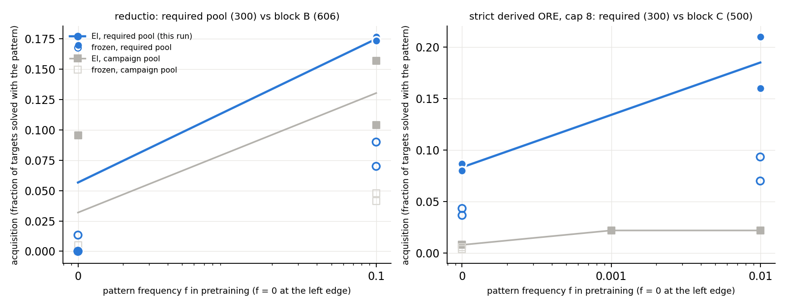
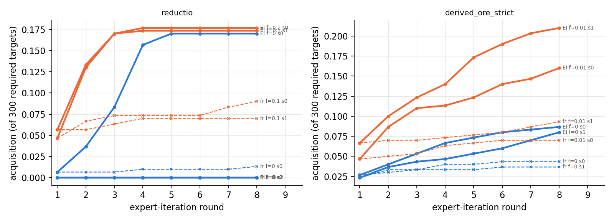

# Round 2, run 5: pattern dials on target pools that require the pattern

Status: completed 2026-09-17 22:05 UTC (autonomous executor session, two RTX 3090 pods,
≈ $2.8) and independently reviewed 2026-09-17 22:25 UTC. Review verdict: every count
reproduces; two sentences of the executor's write-up must be reworded and one claim is not
supported. Numbers below are the reviewer's. Run id `round2-run5`.

Review: [`review_round2-run5.md`](https://github.com/dan-pandori/nd-takehome/blob/2b50ee6/review_round2-run5.md)
(commits `134d132` phase 1 recount, `2b50ee6` phase 2 verdict; reviewer code
`review_run5_recount.py`, `review_run5_logic.py`; outputs `artifacts/review_r5/*.json`).
Executor write-up: [`run5.md`](https://github.com/dan-pandori/nd-takehome/blob/2b50ee6/run5.md)
(read the review first).

Question: the novelty campaign's reductio and cap-8 derived-ORE dials were measured on
target pools where the pattern was optional (most targets had a shorter, pattern-free proof).
What do the same dials show on pools where every target *requires* the pattern? Does RL at
f = 0 compose an absent rule sequence when nothing else scores, or does it only amplify what
the base model already emits rarely?

## Configuration

- Code, data and results: `dan-pandori/nd-takehome`, branch `dan_novelty`. Pre-registration
  (plan and expectations R5-E1…E4) committed in `d0d8f16` at 19:05:46 UTC; first pod created
  19:12 UTC; pools and queues committed in `fe14f1f` at 19:26 UTC; final numbers `3950c22`.
  Brief: `BRIEF_ROUND2.md` §Run 5. Policy: `AGENT_POLICY.md`.
- Necessity oracle: `minlen.py --forbid` (bounded prover with a rule restriction: no `DN`;
  or no `ORE` whose disjunction is a derived, non-hypothesis line) and `necessity.py`. A
  theorem *requires* the pattern if the unrestricted search finds a ≤ 10-line proof and the
  restricted search fails within the bound with no timeout. Oracle labels in
  `data/p2/run5_*_nec.jsonl` (945 reductio candidates; 1,568 + 1,381 + 5,040 cap-8
  derived-ORE candidates).
- Pools (`data/p2/targets_{reductio,derived_ore}_req.jsonl`, `transfer_*_req.jsonl`):
  reductio 300 targets + 150 transfer (classical-only schema instances, 7–10-line minimal
  proofs, no `( ~ ( ~` in the sequent; 16 schemata); strict derived-ORE 300 + 65 (generator
  theorems, 9–10-line minimal proofs, cap-8 setting). Both pools disjoint by renaming class
  from every training set an arm uses, the held-out sets and validation-36 (reviewer's own
  key, 0 overlap in every pair).
- Models: the campaign's Stage-1 checkpoints. Reductio: f = 0 seeds s0, s1, s2 (seed 7, the
  strongest igniter of the ignition study, was never pulled and was not run; logged in
  `QUESTIONS.md` 20:30 UTC before the queue) and f = 0.1 seeds s0, s1. Derived-ORE strict,
  cap 8: f = 0 seeds s0, s1 and f = 10⁻² seeds s0, s1.
- Arms: expert iteration k = 32, 8 rounds, T = 0.8, retain 20k; frozen controls at equal
  attempts (256 per target, same init and sampling seeds, `--no_train`); base pass@10⁴ at
  T = 0.8 on all 300 targets for each f = 0 model (`artifacts/r5/cov_*.jsonl`). 9 + 8 arms
  (5 EI + 5 frozen reductio, 4 + 4 derived-ORE) and 5 coverage runs. Arm outputs
  `artifacts/r5/<arm>/round_*.json`, `found_8.jsonl`; `artifacts/r5/summary.json`.
- Acquisition = fraction of targets solved with a verified proof whose dependency-pruned form
  contains the pattern (reviewer's own predicates); solved = ≥ 1 verified proof in rounds
  1–8; distinct proofs normalised for start index.
- Pods: p1 and p2, RTX 3090 at $0.50/h, created 19:12 and 19:20 UTC, shared with run 2 from
  21:34 UTC, still running for run 2 at RUN5 DONE. Run-5 share ≈ 5.6 pod-hours ≈ $2.8
  (pre-registration estimate $4–13, ceiling $50). See `docs/infra/spend.md`.
- Bucket: `hf://buckets/dan-pandori/nd-rl/round2/run5/{artifacts,ckpts,data}` (arm dirs,
  coverage files, `summary.json`; round-8 checkpoints of the 7 arms that trained; pools,
  transfer sets, oracle labels, candidate files). The reviewer confirmed the three
  directories exist; contents were not compared.
- Hard constraints (reviewer): `nd_verify` unmodified (tree hash equals `origin/main`);
  `artifacts/TEST_RUN_DONE` byte-identical (one test run, 2026-09-15); no evaluation file
  enters training except the model's own verified target proofs; no hand-written or
  LLM-written training proofs (1 % sample of each set re-verifies, 0 failures). **Flag:**
  the cap-8 Stage-1 sets contain 44,284 proofs of 7–8 lines. The brief prescribes this
  setting, but the derived-ORE half of the run is outside the take-home's cap-6 rule and must
  be labelled as such wherever it is quoted.

## Observations

All counts below were re-derived by the reviewer from the raw files with independent code
(own parser, normaliser, pruning, predicates, renaming key); every counted proof re-verified
with `nd_verify` (1,234 target proofs and all transfer proofs, 0 failures).

**Oracle.** `--forbid DN` proves 0 of 945 reductio candidates; the unrestricted search finds
≤ 10-line proofs for 559, of which 514 need ≥ 7 lines. Derived-ORE required: 120 / 68 / 196
of 1,568 / 1,381 / 5,040 candidates (7.7 / 4.9 / 3.9 %), 384 records = 365 distinct classes
= exactly the two pools. 0 inconsistencies, 0 timeouts. Independent logic check: all 450
reductio pool theorems are classically valid (truth table) and none is provable in G4ip
(Dyckhoff's intuitionistic decision procedure), so `DN` is required unboundedly, not only
within bound 10. No target of either pool was ever solved without the pattern: 0 in all
18 arms and 5 coverage runs (0 of 4,700+ distinct proofs). The executor's "9,600 target-arm
pairs" is 5,400 (18 arms × 300; 8,920 with transfer and coverage).

**Reductio (300 required targets, 7/8/9/10 lines: 52/133/82/33).**

| arm | EI solved (acq.) | frozen (256 attempts) | base pass@10⁴ | transfer /150 |
|---|---:|---:|---:|---:|
| f = 0 s0 | 51 (0.170) | 4 | 6 targets (113 hits in 3·10⁶, 3.8·10⁻⁵ per sample) | 25 |
| f = 0 s1 | 0 | 0 | 0 | 0 |
| f = 0 s2 | 0 | 0 | 1 target, 1 hit (3.3·10⁻⁷) | 0 |
| f = 0.1 s0 | 53 (0.177) | 27 | – | 27 |
| f = 0.1 s1 | 52 (0.173) | 21 | – | 27 |

Cumulative solved by round, f = 0 s0: 2 / 11 / 25 / 47 / 51 / 51 / 51 / 51; f = 0.1:
14 / 39 / 51 / 53 … and 17 / 40 / 51 / 52 …. Of f = 0 s0's 51 targets, 45 are not reachable
by its base model at 10⁴ samples. Every reductio proof found has box depth 1.

*Length wall, reviewer's wording.* All three solving EI arms solve 51–52 of the 52 seven-line
targets (the `nand_neg` and `negimp_to_pos` schemata, 7-line template `PR PR AS ANDI|IMPE
NEGE NEGI DN`) and 0 of the 248 targets at 8–10 lines, with one exception (f = 0.1 s0 solves
one 8-line `chain_neg`). Transfer is the same: 25–27 of the 27 seven-line theorems, 0 of 123
longer. The reductio acquisition numbers are therefore the size of the 7-line stratum
(52 / 300 = 0.173), not a property of the pattern across the pool. The executor's "0 / 26 each
in every arm" reads "≤ 1 of 26"; "length-limited at 7 lines for every f" is true of these
three arms within 8 rounds (n = 1 igniting f = 0 draw, 2 f = 0.1 draws) and false for the
same models on the 606 pool (below).

**Strict derived-ORE, cap 8 (300 required targets, 9/10 lines: 126/174).** Outside the
take-home's cap-6 rule; not a submission result.

| arm | EI solved (acq.) | frozen (256 attempts) | base pass@10⁴ (strict) | EI-only vs base | transfer /65 |
|---|---:|---:|---:|---:|---:|
| f = 0 s0 | 26 (0.087) | 13 | 27 targets (17,043 hits, 5.7·10⁻³ per sample; 13 within 256) | 8 | 8 |
| f = 0 s1 | 24 (0.080) | 11 | 27 targets (16,044 hits, 5.3·10⁻³; 11 within 256) | 7 | 8 |
| f = 10⁻² s0 | 48 (0.160) | 21 | – | – | 13 |
| f = 10⁻² s1 | 63 (0.210) | 28 | – | – | 14 |

Every base-solved target was solved with a strict-pattern proof. The frozen f = 0 controls'
13 / 11 targets are all base-reachable; EI reaches 8 / 7 targets the base does not reach at
10⁴ and solves 9- and 10-line targets (f = 0: 6–8 ten-liners; f = 10⁻²: 12–27) while the
frozen f = 0 models solve only 9-line ones. Solve rate equals strict acquisition exactly.
Against block C's 0.008 / 0.008 at f = 0 (taken from `numbers.md`, not re-derived): ×10.9
and ×10.0. Two f values only: "higher at 10⁻² in both seeds", not "monotone in f". Both f = 0
seeds share the same base reachability (27 / 300), so "in proportion to the base rate" was
not tested in this run.

**What stands (reviewer's verdict).** (i) Reductio at f = 0 with a zero-hit base draw stays
at 0 / 300 even when every target needs the pattern (two draws; s2's base rate is 1 hit in
3·10⁶, so "≤ 1 hit", not 0), while the one draw with a non-zero base rate is elicited to the
7-line stratum in 4 rounds, 13× its frozen control. (ii) Strict derived-ORE on a required
pool is amplification, not absence: the f = 0 base models already produce the strict shape
on 27 / 300 targets at pass@10⁴, EI doubles the frozen control in both seeds (26 / 13,
24 / 11) and adds 8 / 7 targets the base does not reach at 10⁴, and both f = 10⁻² seeds are
higher. Block C's flat dial was an artefact of a pool where ≈ 92 % of targets did not need
the pattern.

**Not supported.** The executor's claim that block B's 0.096 / 0.157 / 0.104 on the 606
pool were "the same phenomenon … confined to the shortest schema, extended by RL to its
7-line sibling and no further". The reviewer's recount of the block-B and ignition files
(same checkpoints, same k = 32, 8 rounds, T = 0.8): f = 0.1 s0 solved 95 = 61 seven-line +
25 eight-line + 9 longer (`neg_both` 22 / 30, `chain_neg` 11 / 30), reaching them in rounds
5–8; f = 0 s7 solved 112 = 62 + 31 + 19; eight sibling-injected arms 5–34 eight-line. 197 of
the 300 required targets are in the 606 pool; 33 of its 8–9-line ones were solved by at least
one 606-pool arm, 19 of them by the very f = 0.1 s0 checkpoint that solved 1 eight-liner in
run 5. Honest statement: in this run no arm passed the 7-line stratum in 8 rounds; the same
models passed it on the 606 pool, so the second stratum ignites stochastically and its
probability per run was not measured.

**Pre-registered expectations vs outcome** (`d0d8f16`, 19:05 UTC, before any pod job).

| id | expected | observed | verdict |
|---|---|---|---|
| R5-E1 | reductio reachable-required ≥ 250 of 945; derived-ORE required 15–25 % of candidates; 0 oracle inconsistencies | 514; 3.9–7.7 %; 0 | reductio and consistency met; derived-ORE fraction missed (≈ 2–4× lower). The executor's log calls E1 "held". |
| R5-E2 | f = 0: s1, s2 0 / 300; s0 ignites by round ≤ 4 to 0.15–0.35; f = 0.1 0.30–0.50 both seeds; frozen ≤ 3 targets each; 0 solved without pattern | 0 / 300 ✓; s0 first proof round 1, 47 by round 4, final 0.170 ✓; f = 0.1 0.177 / 0.173; frozen 4 / 0 / 0 and 27 / 21; 0 ✓ | half met; f = 0.1 level missed (below range) and frozen counts missed (executor's log omits the frozen miss) |
| R5-E3 | derived-ORE f = 0 strict 0.00–0.03 (base strict on ≤ 5 % of targets); f = 10⁻² 0.03–0.10; solve ≈ strict acquisition | 0.087 / 0.080; base 27 / 300 = 9 %; 0.160 / 0.210; solve = acquisition exactly | levels missed upward in every cell; the qualitative "solve = acquire" met |
| R5-E4 | derived-ORE frozen vs EI differ by < 3 targets; reductio EI ≥ 10× frozen for s0 / s7 | +13 / +13 (EI ≈ 2× frozen); s0 51 vs 4 (≈ 13×); s7 not run | derived-ORE half missed; reductio half met on one seed |

Figures (executor's, every plotted point checked by the reviewer against the recount):

## Limitations and next step

- n is small where it matters: one igniting f = 0 reductio draw, two f = 0.1 draws, 8 rounds.
  The 8-line stratum's ignition probability per run is unmeasured; the "7-line wall" is a
  statement about this run, not about the models.
- Seed 7 (the strongest igniter of the ignition study) was omitted from the reductio f = 0
  draws because its checkpoint was never pulled; this removed the draw most likely to show
  the 8-line stratum.
- Derived-ORE results are cap-8 (outside the take-home rule); two f values only; both f = 0
  seeds have identical base reachability, so the base-rate dependence is untested.
- The cap-8 pool's ten-target hand check was done after the arms ran (harmless: the pool was
  fixed before the arms and all 365 oracle proofs were machine-checked by the reviewer).
- Not re-derived by the reviewer: pod spend, kill-switch timing, the minlen searches themselves
  (checked for internal consistency; for reductio replaced by the unbounded G4ip argument),
  bucket contents. `run5.md` is 542 words against the brief's 400.

Next measurement (reviewer): rerun reductio f = 0.1 s0 / s1 and f = 0 s7 on the required pool
with two sampling seeds each and 16 rounds (or k = 64 to match the 606 pool's per-round sample
budget), reporting acquisition per length stratum (7 / 8 / 9 / 10) rather than pooled; that
gives the ignition probability of the 8-line stratum. For derived-ORE, add f = 10⁻³ as a third
point and two f = 0 seeds with different base reachability (the campaign's s0 and a fresh draw
with pass@10⁴ ≠ 27 / 300) to test "in proportion to the base rate".
