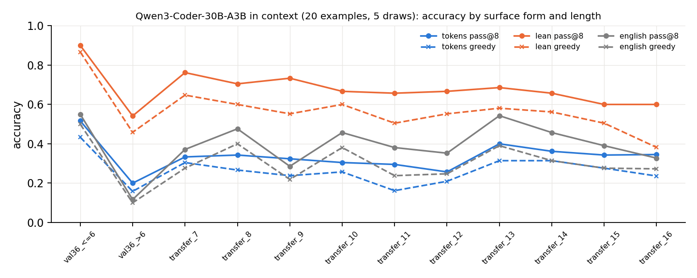
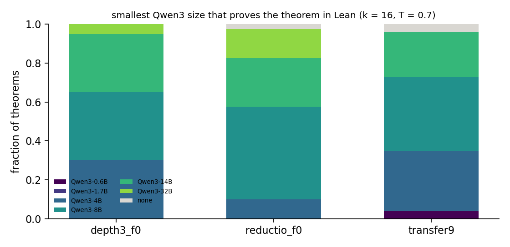

# Round 2, run 1: natural deduction in Lean, and novelty by model scale

Status: completed 2026-09-18 01:32 UTC (autonomous executor session, one A100 pod for
steps 2–3, ≈ $3.4; step 1 ran on the VPS with Lean 4.34.0 core) and independently reviewed
2026-09-18 02:55 UTC. Review verdict: every number in the write-up, `numbers.md` §Run 1,
`summary.json` and `scale_summary.json` reproduces from the raw generations with independent
code (all 21,240 token / English outputs re-judged with the reviewer's own extraction and
parser, all 21,432 Lean outputs re-checked with the reviewer's own batching, and all 9,430
accepted Lean bodies re-verified one per file; 0 differences, 0 `sorry` or search tactics
among the accepted, 0 theorem-header mismatches); the prompts are fair in the sense the brief
asked for. Four things must be reworded (what "rejected by both" and "second checker" mean;
what the +0.31 compares; the length result does not test the proposal's box-depth prediction;
the base-log-probability comparison covers one class of three) and two process flags stand
(no numeric pre-registration in `log.md` for steps 2–3; the 22:52 brief update that moved
run 1 to a parallel executor was neither followed nor acknowledged, so a second, independent
run-1 result exists on `dan_run1_lean`). No training happened in this run. Numbers below are
the reviewer's. Run id `round2-run1`.

Review: [`review_round2-run1.md`](https://github.com/dan-pandori/nd-takehome/blob/e1d6a3b/review_round2-run1.md)
(phase 1 recount `a67552c` / `0b72ce4`, phase 2 verdict `58e13aa` / `9b35e22`, merged
`e1d6a3b` at 02:54:59 UTC; reviewer code `review_run1_recount.py`,
`review_run1_agreement.py`, `review_run1_lean_recheck.py`, `review_run1_lean_single.py`,
`review_run1_single_check.py`; outputs `artifacts/review_r1/`). Executor write-up:
[`run1.md`](https://github.com/dan-pandori/nd-takehome/blob/e1d6a3b/run1.md) (read the review
first; its "rejected by both", "pass@8", "nothing below 4B", "opposite of the proposal's
prediction" and "15 % beyond 14B" carry the wordings the review corrects).

Question: three questions in one run. (1) Does an independent checker agree with
`nd_verify`: translate every proof the project has into Lean 4 and compare verdicts.
(2) Does writing the same proofs as Lean 4 change what a pretrained code model can do in
context, against the take-home token format and a plain-English control, on the same theorems
with the same worked examples? (3) Can "the smallest Qwen3 that proves it in Lean" serve as a
model-independent novelty measure for the campaign's RL-found proof classes, and does its
ordering agree with the Phase-1 base log-probabilities?

## Configuration

- Code, data and results: `dan-pandori/nd-takehome`, branch `dan_novelty`. Brief:
  `BRIEF_ROUND2.md` §Run 1. Policy: `AGENT_POLICY.md`. Scripts: `nd2lean.py` (translator and
  Lean checker, `6c4592d` 22:49:28 UTC; premise-naming fix `30d4110` 23:19:28), `lean_prompts.py`,
  `run_vllm.py`, `scale_prompts.py`, `run1_analysis.py` → `artifacts/r1/summary.json`,
  `scale_summary.json`. Prompt set committed `c8e298c` (23:24:03), scale set `a925656`
  (23:36:13); `RUN1 DONE` in `log.md` 01:32; `run1.md` trimmed in `ffee616` (01:36).
- Pre-registration: the proposal document (`docs/proposals/2026-09-17-proposals-round-2.md`
  on this repository's `dan_proposals` branch, committed 2026-09-17 18:44 UTC, before any
  run-1 job) carries two qualitative predictions ("Lean helps ≥ 10 pp, most on
  nested-box-heavy proofs"; "scale of first success correlates with base log-probability but
  ranks depth-3 proofs easier"), scored by the executor at 01:32. Unlike runs 2–5, `log.md`
  has **no numeric expectation per step** for run 1 (`git log -S'R1-E1'` finds nothing) and
  no prediction for step 3's absolute levels. The brief's step order (translator and agreement
  table committed before step 2) was met for the negatives and validation-36 (22:47–22:49);
  the premise-naming fix (23:19) and the found-pool agreement files (23:54–01:02) post-date
  the start of step 2's pod (23:22, first generation 23:35).
- Brief update not followed: `BRIEF_ROUND2.md` (`b997558`, 22:52:31 UTC) moved runs 1 and 4
  to parallel executors on `dan_run1_lean` / `dan_run4_grpo` and told `dan_novelty` not to run
  them; `dan_novelty` ran both anyway and did not mention the update in `STATUS.md`, `log.md`
  or `QUESTIONS.md`. `dan_run1_lean` has its own step-1 and step-2 results (its 02:20 brief
  note calls it an independent replication); this summary covers `dan_novelty`'s only.
- Step 1, translator: deterministic translation of `spec.md` proofs into Lean 4 (core, no
  Mathlib; Lean 4.34.0 via elan on the VPS): atoms as `Prop` variables with the fixed binder
  `(P Q R S : Prop)`, premises as hypotheses named by position, each line a `have`, boxes as
  typed lambdas, `Or.elim`, `False.elim`, `Classical.byContradiction`; NEGI boxes end with
  `exact (nE : False)`. The verifier's structural rules (forward citations, final line, depth
  jumps, premise position, arity, box citations, assumption depth) are re-implemented as Python
  pre-checks before any Lean source is written. Checked in chunks of 40 theorems per file,
  re-split on Lean's ≈ 100-error cap. Positives: every pool the project has (12 files, 253,470
  proofs, including the campaign's 212,913 RL-found proofs and the run-2 / run-5 found pools);
  negatives: 4,012 mutations of valid proofs (cited line ±k 508, rule swapped 874, atom swapped
  874, box bar added / removed 874, line dropped 874, plus run 3's 8 invalid strings), all
  rejected by `nd_verify`.
- Step 2, in-context: Qwen3-Coder-30B-A3B-Instruct, vLLM 0.29 on p6 (A100 80 GB), greedy +
  8 samples at T = 0.7, top-p 0.95, `max_tokens` 1,200. 236 test theorems = validation-36
  (12 with reference length ≤ 6, 24 with > 6) + 200 from `data/transfer.jsonl` stratified by
  the generator's line count (21 per length 7–15, 11 at 16); 236 distinct renaming classes.
  20 worked examples per draw (12 held-out generator proofs of lengths 2–6 + 8 RL-found
  transfer proofs of 7–9 written lines), 5 draws, 98 distinct example theorems, 0 in the
  renaming class of any test theorem and 0 in `train.jsonl`'s 154,990 classes; the same
  example list for the three forms of a draw. Three surface forms of the same prompt: Lean 4
  (examples translated by `nd2lean.translate`, header rendered from the theorem), the take-home
  tokens, and plain English with the rule names spelled out (6.9k / 7.5k / 10.5k characters
  of user message for tokens / Lean / English). 3,540 prompts × 9 completions = 31,860
  outputs. Lean outputs judged by Lean; token and English outputs parsed back to tokens and
  judged by `nd_verify`.
- Step 3, novelty by scale: 106 theorems in the Lean form with draw 0's examples:
  `depth3_f0` 40 (from `targets_depth3`, RL proofs of 7–9 lines by the campaign's f = 0 arm
  a1 s0, all box depth ≥ 3, first found at rounds 3–7), `reductio_f0` 40 (run 5's required
  reductio targets solved by f = 0 s0, 7-line proofs, rounds 1–5), `transfer9` **26** (every
  campaign transfer theorem whose RL proof is 9 lines; rounds 4–16). The brief asked for ≥ 30
  per class. 106 distinct classes, 0 overlap with the examples and 0 with the step-2 set.
  Qwen3 0.6B / 1.7B / 4B / 8B / 14B / 32B instruct, thinking off, k = 16 + greedy at T = 0.7:
  10,812 Lean bodies. A Phase-1 base log-probability (`base_logp_T1_max`) exists only for
  the 26 `transfer9` theorems.
- Hard constraints (reviewer): `nd_verify` unmodified (tree hash equals `origin/main`);
  `artifacts/TEST_RUN_DONE` byte-identical (one test run, 2026-09-15); no `train.py` call and
  no checkpoint written in this run; nothing touches supervised data or the cap.
- Pods: p6 (A100 80 GB PCIe, $1.59/h, 250 GB container disk) created 23:22:43 UTC
  (`~/pods.log`), deleted 01:30 (`log.md`): ≈ 2.1 pod-hours ≈ $3.4 at list price, which the
  executor quotes as "≈ $3.4 incl. model downloads" (57 GB for the 30B-A3B model, ≈ 90 GB for
  the six Qwen3 sizes, downloaded inside those hours). No run-1 budget line was written in
  `log.md`; policy ceiling $50. The reviewer did not re-derive spend. See
  `docs/infra/spend.md`.
- Bucket: `hf://buckets/dan-pandori/nd-rl/round2/run1/{artifacts/r1,data/r1}` (generations,
  scored rows, agreement files, prompts; `upload.log` lists 40 + 2 files, artifacts 160 MB,
  data 42 MB). Not re-derived by the reviewer: the bucket contents beyond `upload.log`, the
  vLLM sampling itself.

## Observations

All counts were re-derived by the reviewer with independent code: an own extraction of the
model outputs, an own English → token parser, own tables, paired deltas and bootstrap, an own
theorem-header renderer, own Lean batching with a sentinel after every theorem and one
theorem per file for every disagreement and every accepted body, plus a scan of every
accepted Lean body for `sorry`, `admit`, `exact?`, `simp`, `decide`, `tauto` and any
construct outside the have–exact fragment. Only `nd_verify` and Lean 4.34.0 are shared with
the executor (and, for the step-1 table, the executor's translator, because that translator's
agreement is what is under test).

**Step 1: the translator agrees with `nd_verify` on every record.** Positives: 253,470 /
253,470 accepted by both (`val36_ref` 36, examples 21, heldout 5,000, `rl_targets` 3,000,
transfer 1,638, `train10k` 10,000, campaign `found_transfer16` 75,085, `found_targets16`
137,828, `r2_depth4_found` 15,327, `r5_c8_found` 3,264, `r5_reductio_found` 2,271); the
`nd_verify` labels were re-verified on all 257,482 records with 0 label errors. Negatives:
4,012 / 4,012 rejected by both, 0 nd-only, 0 Lean-only. Re-running the current translator on
all negatives, validation-36, the examples and 1,000-record samples of four positive files
gives the file's verdict for every record, so the six agreement files produced before the
23:19 premise-naming fix are what the current code produces (their proofs all start at N1,
where the fix is a no-op; the five found-pool files, 233,775 records of which 232,010 start
above N1, were produced after the fix, 23:54–01:02).

*Who rejects the negatives.* 2,906 of the 4,012 are rejected by the translator's Python
pre-checks before any Lean source exists (`forward cite` 511, `final line` 368, `depth jump`
361, `PR position` 349, `missing PR` 342, `arity` 210, `bad box cite` 183, `AS depth` 81);
Lean itself rejects 1,106 (type mismatches). By mutation kind: atom 874 / 874 by Lean, rule
229 by Lean + 645 structural, cite 508 / 508 structural, depth 874 / 874 structural, drop
874 / 874 structural. The agreement table therefore does not exercise Lean's judgement on box
structure, citations or dropped lines. One known divergence the mutation set cannot see:
Lean's `¬A` is definitionally `A → False`, so two reviewer-made proofs that `nd_verify`
rejects (a `( ~ P )` premise cited as `( P > F )`) compile in Lean. No step-2 or step-3
theorem contains a `( A > F )` subformula, so the model-output scoring is unaffected.

**Step 2: the Lean form is proved far more often than the two ND formats, in every draw and
every bin.** n = 1,180 (theorem, draw) cells per form; 95 % Wilson intervals; "pass@9" is the
executor's "pass@8" (greedy ∪ 8 samples); samples-only pass@8 differs by ≤ 0.008.

| form | greedy | pass@8 (samples only) | pass@9 (greedy ∪ samples) | val-36 `> 6` greedy | val-36 `<= 6` greedy |
|---|---|---|---|---|---|
| Lean 4 | **0.563** [0.534, 0.591] | 0.672 | **0.675** [0.647, 0.701] | 0.458 | 0.867 |
| tokens | 0.258 [0.234, 0.283] | 0.320 | 0.326 [0.300, 0.354] | 0.158 | 0.433 |
| English | 0.292 [0.267, 0.319] | 0.378 | 0.386 [0.358, 0.414] | 0.100 | 0.500 |

Per draw (greedy): tokens 0.284 / 0.292 / 0.216 / 0.254 / 0.242, Lean 0.564 / 0.564 /
0.576 / 0.521 / 0.589, English 0.331 / 0.318 / 0.246 / 0.288 / 0.280. Paired deltas per
(theorem, draw), averaged over draws, bootstrapped over the 236 theorems (4,000 resamples):

| pair | greedy | pass@8 | pass@9 |
|---|---|---|---|
| Lean − tokens | **+0.305** [+0.257, +0.353] | +0.352 [+0.301, +0.403] | +0.348 [+0.298, +0.400] |
| English − tokens | +0.035 [−0.003, +0.072] | +0.058 [+0.015, +0.098] | +0.059 [+0.018, +0.101] |
| Lean − English | +0.270 [+0.216, +0.324] | +0.294 [+0.239, +0.348] | +0.289 [+0.233, +0.344] |

By length bin (greedy Lean / tokens / English): val-36 `<= 6` 0.867 / 0.433 / 0.500; `> 6`
0.458 / 0.158 / 0.100; transfer 7: 0.648 / 0.305 / 0.276; 8: 0.600 / 0.267 / 0.400; 9:
0.552 / 0.238 / 0.219; 10: 0.600 / 0.257 / 0.381; 11: 0.505 / 0.162 / 0.238; 12: 0.552 /
0.209 / 0.248; 13: 0.581 / 0.314 / 0.391; 14: 0.562 / 0.314 / 0.314; 15: 0.505 / 0.276 /
0.276; 16 (n 55): 0.382 / 0.236 / 0.273. The paired Lean − tokens greedy delta is ≥ +0.23 in
every bin except transfer 16 (+0.145), largest at val-36 `<= 6` (+0.433) and transfer 7
(+0.343). Token accuracy is flat from 7 to 15 lines (0.31, 0.27, 0.24, 0.26, 0.16, 0.21,
0.31, 0.31, 0.28): "length" is the generator's line count of one proof, not the shortest
proof or the box depth, so the bins are not a difficulty ladder. Stratifying the 200 transfer
theorems by the **box depth** of their generating proof (reviewer's predicate,
`artifacts/review_r1/delta_by_box_depth.json`): depth 1 (n 27) +0.35 greedy / +0.36 pass@9,
depth 2 (n 80) +0.22 / +0.27, depth 3 (n 93) +0.35 / +0.41; no monotone relation with
nesting in either direction. Unfinished outputs (no `QED` / final `exact` / final rule
line): tokens 16 greedy + 96 samples, Lean 15 + 91, English 6 + 52 of 1,180 / 9,440 each, so
truncation at 1,200 tokens is not what separates the forms.

*What the Lean checker accepts that the ND judges cannot.* Of the 5,943 accepted Lean bodies,
4,108 are line-for-line in the prompt's have–exact fragment; 1,822 use the same constructors
in term style (`fun h => …` without `by`, inline `Or.elim`, `⟨n1, n2⟩`, `exact n3.elim`); 10
use `match` on a disjunction and 8 `Classical.em`. None uses automation: 0 of 5,943 contain
`sorry`, `exact?`, `simp`, `decide`, `tauto` or any search tactic (3 outputs tried; all
rejected). The executor's checker would have passed a `sorry` or an `exact?` (both compile
with a warning only, `lean` exits 0; the reviewer verified this on a test file), so this scan,
not the checker, establishes it. The ND rejections are dominated by citation and arity
slips (`rule check failed: NEGE` 117 / 146, `bad box cite` 100 / 100, `bad line cite`
99 / 88, `wrong ref count for ORE` 79 / 98 of 876 / 835 greedy rejections for tokens /
English); the split of ND rejections into "wrong proof" and "right idea, wrong citation or
format" was not measured.

**Step 3: median smallest size 8B in every class; the classes separate only in the tail.**
First-success size per theorem (reviewer's verdicts = the executor's); cumulative count of
theorems with ≥ 1 accepted output by size; accepted outputs of 1,802 per size: 0.6B 1, 1.7B
0, 4B 166, 8B 804, 14B 1,194, 32B 1,322; every one of the 3,487 accepted bodies compiles alone
in its own file; automation attempts 0 / 40 / 52 / 14 / 3 / 4 by size, all rejected.

| class | n | first at 0.6B | 1.7B | 4B | 8B | 14B | 32B | none | proved by 4B / 8B / 14B / 32B (cumulative) | fraction |
|---|---:|---:|---:|---:|---:|---:|---:|---:|---|---|
| depth3_f0 (RL, 7–9 lines) | 40 | 0 | 0 | 12 | 14 | 12 | 2 | 0 | 12 / 26 / 37 / 40 | 0.30 / 0.65 / 0.93 / 1.00 |
| reductio_f0 (RL, 7 lines) | 40 | 0 | 0 | 4 | 19 | 10 | 6 | 1 | 4 / 21 / 26 / 34 | 0.10 / 0.53 / 0.65 / 0.85 |
| transfer9 (RL, 9 lines) | 26 | 1 | 0 | 8 | 10 | 6 | 0 | 1 | 9 / 18 / 25 / 25 | 0.35 / 0.69 / 0.96 / 0.96 |

Ordering against the Phase-1 base log-probability, possible for the 26 `transfer9` theorems
only: Spearman −0.237 between `base_logp_T1_max` and first-success size (higher base
log-probability ↔ smaller first size, weakly). The 8 theorems with the lowest base
log-probability (−74 … −54) first succeed at 8B / 14B / none; the 8 highest (−30 … −8) at
0.6B / 4B / 4B / 4B / 8B / 14B / 14B / 4B. The reductio class keeps 7 of 40 theorems beyond
14B (6 first at 32B, 1 never = 17.5 %); the depth-3 class 2 (both at 32B); transfer9 1
(never).

**What stands (reviewer's verdict).** (i) Qwen3-Coder-30B in context proves 56 % of the
theorems greedily when they are posed in Lean against 26 % in the take-home token format and
29 % in plain English (paired +0.31 [+0.26, +0.35], the same ordering in all five example
draws). (ii) The English control shows the token format's opacity (rule names) is not the
cause: English − tokens is +0.035 greedy. (iii) On the RL-found classes the smallest Qwen3
that writes a Lean proof is 4B–14B for 90 % of the theorems, median 8B in every class, with
nothing at 1.7B and one theorem at 0.6B. (iv) The translator agrees with `nd_verify` on
253,470 valid proofs of every kind the project has produced and rejects all 4,012 mutations.

**What the review rewords.**

1. *"4,012 / 4,012 rejected by both" and "the project has a second checker".* 2,906 of the
   negatives are rejected by the translator's own re-implementation of the structural rules
   and never reach Lean; Lean's judgement is exercised only on the 1,106 atom / rule mutations
   that survive translation, and Lean identifies `¬A` with `A → False` where `nd_verify` does
   not. The supported statement: Lean checks the logical content of every valid proof the
   project has and rejects every content mutation; the structural rules are mirrored in
   Python, not delegated. (`numbers.md` says this correctly; `run1.md` does not.)
2. *What the +0.31 compares.* The Lean form is scored by a type checker that accepts any
   well-typed term (1,822 of 5,943 accepted bodies are term-style rather than the prompt's
   line format), while the two ND forms must hit one exact line syntax and their rejections
   are mostly citation and arity slips. The +0.31 is real as a statement about what a checker
   accepts from the model; "Lean makes the model better at natural deduction" needs a
   format-tolerant ND judge, or a Lean judge restricted to the have–exact fragment, to
   separate the model from the judge. None of the gain is Lean doing the proving (0 automation).
3. *"Largest gain on the shortest theorems, the opposite of the proposal's prediction" is not
   supported.* The bins are generator line counts, which are neither difficulty (token
   accuracy is flat over 7–15) nor nesting; by box depth the gain is +0.35 / +0.22 / +0.35
   (depth 1 / 2 / 3). The proposal's "most on nested-box-heavy proofs" is neither confirmed nor
   reversed; the supported statement is "large and roughly uniform, ≥ +0.22 in every depth
   and length bin".
4. *The base-log-probability comparison covers one class of three.* Spearman −0.24 is over the
   26 transfer theorems, the only ones with a Phase-1 log-probability; "ranks depth-3 proofs
   easier than their base probability (< 10⁻⁵) suggested" is not derivable from run-1 files
   (the depth-3 and reductio theorems have no per-theorem log-probability, and the "< 10⁻⁵" is
   the campaign's pre-RL pool rate, a different quantity).
5. Minor: "pass@8" is greedy ∪ 8 (pass@9); "nothing below 4B" is off by the one 0.6B theorem;
   "15 % beyond 14B" is 17.5 %; the third scale class has 26 theorems against the brief's
   ≥ 30; `run1.md` omits the 137,828 target proofs and the run-2 / run-5 pools from its
   agreement sentence; `run1.md` is 464 words against the brief's 400.

**Proposal predictions vs outcome** (proposal committed 2026-09-17 18:44 UTC; no per-step
numeric expectations in `log.md`).

| prediction | reviewer's value | verdict |
|---|---|---|
| Lean helps ≥ 10 pp | +30.5 pp greedy, +34.8 pp pass@9, paired over 236 theorems; ordering Lean ≫ English ≳ tokens in every draw | **held** |
| … most on nested-box-heavy proofs | by box depth +0.35 / +0.22 / +0.35 (depth 1 / 2 / 3); by generator length +0.43 (val-36 `<= 6`) … +0.15 (16) | **not tested** by the run's bins; neither confirmed nor reversed (the executor scored it as "the locus did not hold") |
| scale of first success correlates with base log-probability | Spearman −0.24, n = 26 (transfer9 only) | held weakly, one class of three |
| … but ranks depth-3 proofs easier | depth-3 proved 40 / 40 by 32B, 37 / 40 by 14B; no per-theorem base log-probability exists for the class | not derivable; label the source |
| brief: ≥ 30 theorems per scale class | 40 / 40 / 26 | short in the third class (every 9-line RL transfer proof there is) |
| brief: commit the translator and agreement table before step 2 | negatives and val-36 at 22:47–22:49, before the pod (23:22); the premise fix (23:19) and the found-pool files (23:54–01:02) after | met for the parts that existed; the found-pool agreement post-dates step 2 |

Figures (executor's; the reviewer confirmed every curve and bar matches the recount).
Accuracy by surface form and length bin, greedy (dashed) and greedy ∪ 8 samples (solid,
labelled "pass@8" in the legend, which is pass@9 in the review's terms); and the smallest
Qwen3 size that proves each theorem in Lean, stacked by class.

## Limitations and next step

- The +0.31 is a difference between judges as much as between surface forms: the Lean judge
  accepts any well-typed term, the ND judges one line format. Until the token and English
  outputs are re-scored with a repair-tolerant judge (or the Lean judge restricted to bodies
  that translate back into the calculus), "the model is better at Lean" and "Lean tolerates
  more ways of being right" are not separated.
- The length bins are generator line counts, not difficulty or nesting, so the run does not
  test where the Lean gain sits. The box-depth stratification above is the reviewer's, on the
  generating proof's depth, and shows no monotone relation.
- The scale measure has four usable levels (4B / 8B / 14B / 32B) and k = 16; "first size" is a
  threshold, not a rate, and the base-log-probability comparison exists for 26 theorems of
  one class. The third class is 26 < 30.
- The agreement table exercises Lean's judgement on 1,106 of 4,012 negatives; the structural
  rules are mirrored in Python. The executor's `lean_check` passes `sorry` / `exact?`
  (warning only); the reviewer's scan, not the checker, establishes that no accepted body
  uses them. Lean's `¬A ≡ A → False` identification is a known divergence from `nd_verify`
  that no mutation reaches.
- Process: no numeric pre-registration for steps 2–3; the 22:52 brief update reassigning
  run 1 to `dan_run1_lean` was neither followed nor acknowledged, so two independent run-1
  results exist and neither has been compared with the other (`dan_run1_lean`'s own step-2
  commit message quotes a paired delta of +0.347 [+0.300, +0.393]; not reviewed here).
  The reviewer did not re-derive pod spend, the bucket contents beyond `upload.log`, or the
  vLLM sampling.

Next measurement (reviewer): (1) fairness of the judge: re-score the token and English outputs
with a repair-tolerant judge (accept a proof if a single citation index or arity fix makes it
verify; the run-3 review's one-token repair search exists) and, symmetrically, restrict the
Lean judge to bodies that translate back into the calculus; report the paired delta under
both. (2) Stratify step 2 by the reference proof's box depth and by shortest proof length
(`minlen.py`), which is what the proposal predicted on. (3) Give the depth-3 and reductio
scale theorems a Phase-1 per-theorem base log-probability (one pass of the take-home base
model on the RL proof, as was done for the transfer pool) so the ordering comparison covers
all three classes, and top the third class up to ≥ 30 with 9-line proofs from the round-9–16
continuation. (4) Make the Lean checker stand on its own: reject any `sorry` / `exact?`
warning (or check `#print axioms`) in `lean_check`, add formula-level mutations the translator
cannot pre-filter (swap `( ~ A )` ↔ `( A > F )`, swap a conjunct, re-associate) so that Lean's
own judgement is what the agreement table measures, and raise k to 64 on the 4B and 8B models,
where the ladder is steepest (12 → 26 depth-3 theorems). (5) Reconcile with `dan_run1_lean`:
same translator claims, same prompts? If the two agreement tables and the two paired deltas
agree, the result is replicated for free.
