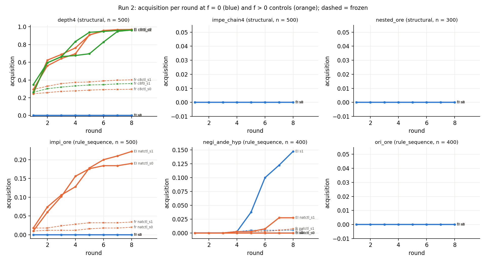

# Round 2, run 2: six new patterns, classes pre-registered

Status: completed 2026-09-18 01:30 UTC (autonomous executor session, three RTX 3090 pods
shared with run 5 until 22:05, ≈ $6–6.5 executor's share) and independently reviewed
2026-09-18 02:15 UTC. Review verdict: every number in the write-up, `numbers.md` §Run 2 and
`summary.json` reproduces from the raw per-round and coverage files with independent code and
predicates; every counted proof re-verifies; the five Stage-1 sets are exactly f = 0 for their
patterns and class-disjoint from every pool; the classes and expectations were committed before
any set existed and the executor scored two of them as wrong. Six things must be reworded
(the `c8ctl` arms are f = 0 arms, not "f > 0 controls"; "300 shortest" is "300 random"; the
depth-4 pool's shape; "length, not structure" is a hypothesis; three undisclosed items; the
write-up's length). Numbers below are the reviewer's. Run id `round2-run2`.

Review: [`review_round2-run2.md`](https://github.com/dan-pandori/nd-takehome/blob/fad6455/review_round2-run2.md)
(commits `b610f94` phase 1 recount, `fad6455` phase 2 verdict; reviewer code
`review_run2_recount.py`, sub-commands `sets`, `pools`, `arms`, `cov`, `ckpts`; outputs
`artifacts/review_r2/`). Executor write-up: [`run2.md`](https://github.com/dan-pandori/nd-takehome/blob/fad6455/run2.md)
(read the review first; its table column "f > 0 control" and both figure legends carry the
mislabel the review corrects).

Question: does "RL crosses zero coverage for a structural repetition of a learned move, not for a
new rule sequence" survive six patterns whose class was assigned before any set was assembled?
Three patterns were pre-registered as structural (box depth 4, an IMPE chain of length ≥ 4, an
ORE nested inside an ORE), three as rule sequences (an ORE inside an IMPI box, NEGI with ANDE on
its hypothesis, and ORI consumed by ORE as a decoration control), each with a numeric
expectation at f = 0.

## Configuration

- Code, data and results: `dan-pandori/nd-takehome`, branch `dan_novelty`. Pre-registration
  (classes and expectations, `log.md` "Run 2 — PLAN and PRE-REGISTERED CLASSES /
  EXPECTATIONS") committed in `5b3b257` at 19:45:07 UTC; the first target-generation log was
  written 19:57, the sets were assembled 21:19–21:21, the first Stage-1 checkpoint 21:44:51
  (gate 0 met). The cap-8 addendum (`c8f0`) was committed in `73cd145` at 22:51:24, before its
  set (00:02) and its checkpoints (00:13) (met). Four control arms (`c8ctl`, `natctl`) were
  queued ≈ 22:11 and disclosed as "outside the pre-registration" in `be90708` at 22:13:47,
  before their first checkpoint (22:26): not pre-registered, correctly labelled. `RUN2 DONE`
  in `log.md` 01:30; `run2.md` trimmed in `bf51319` (01:36). Brief: `BRIEF_ROUND2.md` §Run 2.
  Policy: `AGENT_POLICY.md`. Scripts: `patterns2.py` (six predicates, 15 verifier-checked
  tests), `run2_sets.py`, `necessity.py`, `required_pool.py`, `chain_pool.py`, `ore_pool.py`,
  `coverage.py`, `expert_iter.py`, `run2_analysis.py` → `artifacts/r2/summary.json`.
- Stage-1 sets (cap 6, 155,000 = 31,000 per written length 2–6, uniform per length from
  `pool_cap6_recon`, every run-2 candidate class and the held-out set excluded; 0 cap
  violations, 0 unparsable, 811 random records per set re-verified with 0 failures):
  `train_r2_struct` (a plain draw; 0 depth-4, 0 chain-4, 0 nested-ORE proofs because no
  ≤ 6-line proof can hold them; impi_ore 130, negi_ande_hyp 11, ori_ore 36 at their natural
  rates), `train_r2_impi_ore_f0`, `train_r2_negi_ande_hyp_f0`, `train_r2_ori_ore_f0` (each with
  its own pattern at exactly 0 by the reviewer's predicate, pruned and written form). Two
  Stage-1 seeds per set (`train.py --mode abs --steps 6000 --bs 128 --cap 6`). Two **cap-8**
  sets feed control arms only, outside the take-home's cap-6 rule: the addendum's
  `train_r2_c8_depth4_f0` (154,994 = 22,142 per length 2–8, depth-4 "removed") and the
  campaign's `train_derived_ore_strict_f0_c8` (the `c8ctl` parents, Sep 16 checkpoints). Both
  hold 0 depth-4 proofs: the generator's box cap is 3, so no cap-8 pool proof has a fourth box.
- The generator cannot produce three of the six shapes (`QUESTIONS.md` 20:30, defaults
  followed). Depth-4 targets come from the unchanged generator with its box-depth cap raised
  from 3 to 5 (`make_coverage_sets.py --gen_max_depth 5`, target pools only); IMPE-chain and
  nested-ORE targets are schema instances with random sub-formulas (`chain_pool.py`, seven
  schemata; `ore_pool.py`, five), oracle-labelled with `necessity.py` (bound 10; 13 for
  nested ORE). No schema proof enters any training set, and no arm ever found a proof of a
  schema target.
- Pools (targets / transfer; every oracle proof re-verified, every record's key and theorem
  re-derived, 0 oracle timeouts): depth4 500 / 200 (min-proof lines 8 / 9 / 10: 269 / 53 / 178;
  176 required, 324 uses-only; 473 of 500 have no premise and 377 of 500 are right-nested
  implication chains ending in an `( X > X )` identity, so the proof is "open four boxes, close
  four boxes"); impe_chain4 500 / 200 (8 / 9 / 10: 110 / 246 / 144; no restriction oracle
  exists, all "uses"); nested_ore **300 / 41** (11 / 12 / 13: 113 / 172 / 15; all required;
  343 required of 800 candidates, so the pool is short of the pre-registered 500 + 200);
  impi_ore 500 / 200 (7–10: 144 / 171 / 132 / 53; 109 required); negi_ande_hyp **400 / 94**
  (213 / 86 / 83 / 18; 97 required; 807 candidates from 49 M generator tries); ori_ore
  **400 / 160** (310 / 81 / 8 / 1; the generating proof has the pattern in 400 / 400, the
  shortest proof never does, by construction: a decoration control). Every Stage-1 set has 0
  renaming-class overlap with every target and transfer file; the non-zero overlaps with the
  other cap's held-out set are harmless because each arm is scored on its own held-out set.
- Arms (identical expert iteration, EI): 8 rounds, k = 32, T = 0.8, retain 20,000 Stage-1
  records, `max_per_thm` 4 × weight 4, 600 steps at 3·10⁻⁴; frozen controls at equal
  attempts (8 × 32 = 256 per target); base reachability = pass@2,000 on 300 targets of each
  pool per Stage-1 draw (`coverage.py --limit 300` takes the first 300 records of the
  shuffled pool, all lengths in proportion, not "the 300 shortest" as pre-registered). Pattern
  theorem = ≥ 1 verified proof whose dependency-pruned form has the pattern (reviewer's
  predicate; the unpruned count is identical in every cell); round = first per-round file the
  (theorem, normalised proof) appears in; ignition = ≥ 2 % of targets with a pattern proof, as
  pre-registered. 12 pre-registered EI arms + 12 frozen; 8 control arms (`c8ctl` ×2, `c8f0`
  ×2, `natctl` ×4) + their frozen controls; 40 arms in all, 39 with files.
- Drift measurement (pre-registered for zero-hit draws that ignite: pass@2,000 on the
  round-1…4 checkpoints): no zero-hit draw ignited. The one drift file,
  `drift_negi_ande_hyp_s1_r4`, measures the round-4 checkpoint, which was trained on the arm's
  first pattern proof (found in round 4), so it is post-first-proof. The round-1…3
  checkpoints of that arm were never written: EI skips the fine-tune when a round has no
  accepted proof, so nothing is trained, and nothing can drift, before the first proof.
- Pods: p1, p2 (RTX 3090, $0.50/h, created 19:12 / 19:20 for run 5, shared with run 2 from
  21:34, run 5 finished 22:05), p3 (RTX 3090, created 19:46, run 2 only); all three deleted
  01:14 UTC after the pulls. Wall time 19:12 / 19:20 / 19:46 → 01:14 ≈ 17.4 pod-hours ≈ $8.7
  at list price, of which run 5's share is ≈ 5.6 pod-hours (its ledger row); the executor's
  own split for run 2 is ≈ $6.5 (`STATUS.md`) or ≈ $6 (`numbers.md`, which dates p3 from
  20:05). Pre-registration ≈ $8, ceiling $50. The reviewer did not re-derive spend. See
  `docs/infra/spend.md`.
- Bucket: `hf://buckets/dan-pandori/nd-rl/round2/run2/{artifacts/r2,data/r2,ckpts/r2}`
  (uploaded 01:27–01:30; artifacts 624 MB, data 868 MB, checkpoints 295 MB). The reviewer
  confirmed the three directories exist. Locally only the round-8 checkpoints of most arms
  were pulled (plus rounds 4–8 of `negi_ande_hyp` s1); the `mix_*.jsonl` files were not
  pulled, so the training mixes are known through the `round_<r>.json` counts (RL records 0
  in every round of the nine empty arms).
- Hard constraints (reviewer): `nd_verify` unmodified (tree hash equals `origin/main`);
  `artifacts/TEST_RUN_DONE` byte-identical (one test run, 2026-09-15); every training record
  is a generator-pool proof (no hand-written or LLM-written proof anywhere); `expert_iter.py`
  reads targets, transfer, held-out and val-36 for sampling and tracking only; `gen.py`
  unchanged; checkpoint provenance read from the 24 `.pt` files' stored arguments (every
  Stage-1 model from its named set, 6,000 steps, seeds 0 / 1; every `_r8` from its own `_r7`
  on `mix_8.jsonl` at `--cap 0`).

## Observations

All counts were re-derived by the reviewer from the raw per-round and coverage files with
independent code (own proof parser, dependency pruning, start-index normaliser, atom-renaming
key, and own predicates for the six patterns written from the pre-registration's one-line
definitions and self-tested against verifier-checked hand-built proofs; only `nd_verify` is
shared). Every distinct proof in every arm re-verified against its prompt (3,913 target and
1,688 transfer proofs, 1,072 coverage proofs, 80,618 oracle and restricted proofs; 0 failures,
0 unparsable). The reviewer's cumulative solved count equals the executor's `round_<r>.json`
in every round of all 39 arms with files; `run2.md`, `numbers.md` §Run 2 and
`artifacts/r2/summary.json` are identical to the recount.

**Pre-registered arms** (cap-6 Stage-1, f = 0 for the arm's pattern). Base = pass@2,000 on
300 targets of the Stage-1 draw: theorems with a verified pattern proof, and pattern hits per
sample. Acquisition = pattern theorems / pool at round 8.

| pattern (class) | seed | base: pattern theorems / 300; rate per sample | EI cumulative pattern theorems r1…r8 | EI r8 acquisition (solved) | frozen r8 solved (with pattern) | transfer r8 solved (pattern) / n | held-out greedy r8 |
|---|---|---|---|---:|---:|---:|---:|
| depth4 (structural) | 0 | 0; 0 in 600k | 0 … 0 | 0.000 (0 / 500) | 0 (0) | 0 / 200 | 0.957 |
| depth4 | 1 | 0; 0 | 0 … 0 | 0.000 (0) | 0 (0) | 0 / 200 | 0.959 |
| impe_chain4 (structural) | 0 | 0; 0 (coverage file cut at 96 / 300 theorems) | 0 … 0 | 0.000 (0 / 500) | 0 (0) | 0 / 200 | 0.957 |
| impe_chain4 | 1 | 0; 0 | 0 … 0 | 0.000 (0) | 0 (0) | 0 / 200 | 0.959 |
| nested_ore (structural, 11–13 lines) | 0 | 0; 0 (269 theorems at k = 2,000) | 0 … 0 | 0.000 (0 / 300) | 0 (0) | 0 / 41 | 0.957 |
| nested_ore | 1 | 0; 0 (100 theorems at k = 500, re-queued smaller) | 0 … 0 | 0.000 (0) | 0 (0) | 0 / 41 | 0.959 |
| impi_ore (rule sequence) | 0 | 0; 0 | 0 … 0 | 0.000 (0 / 500) | 0 (0) | 0 / 200 | 0.946 |
| impi_ore | 1 | 0; 0 | 0 … 0 | 0.000 (0) | 0 (0) | 0 / 200 | 0.961 |
| negi_ande_hyp (rule sequence) | 0 | 0; 0 | 0 … 0 | 0.000 (0 / 400) | 0 (0) | 0 / 94 | 0.944 |
| negi_ande_hyp | 1 | **2; 5.0·10⁻⁶** (3 hits in 600k) | 0 0 0 **1** 15 40 49 59 | **0.147** (59 / 400) | 2 (2) | 12 (12) / 94 | 0.970 |
| ori_ore (decoration control) | 0 | 125 solved, **0 with pattern**; 0.12 per sample | 0 … 0 | 0.000 (217 / 400) | 148 (0) | 94 (0) / 160 | 0.967 |
| ori_ore | 1 | 148 solved, 0 with pattern; 0.16 | 0 … 0 | 0.000 (219 / 400) | 173 (0) | 97 (0) / 160 | 0.969 |

Nine of the twelve pre-registered arms found no verified proof of any target in 256 attempts
× 500 targets (the generator-pool models' written frontier is 7–8 lines; the depth-4, chain
and nested-ORE targets are 8–13 lines, the impi_ore and negi targets 7–10). The one igniting
arm, `negi_ande_hyp` s1, is the one draw with a non-zero pre-RL rate: its frozen control at
the same 256 attempts holds 2 theorems, EI reaches 59 (first proof round 4, ignition round 5),
all 7–8-line proofs of uses-only targets (0 of the 97 required ones), and the pattern reaches
12 of the 94 never-trained transfer theorems. The 30× gain over the frozen control at equal
attempts is the run's one RL effect on a cap-6 f = 0 draw. `ori_ore` behaves as the
decoration control it was pre-registered to be: 0 pattern proofs in EI, frozen, base and
transfer, while EI raises plain solving from 148 / 173 (frozen) to 217 / 219.

**Controls outside the pre-registration (`c8ctl`, `natctl`; disclosed at 22:13) and the
pre-registered addendum (`c8f0`).** The reviewer's relabel: the `c8ctl` Stage-1 sets hold 0
depth-4 proofs (as the executor found at 00:36), so the four cap-8 arms are all **f = 0 depth-4
arms at cap 8**, not "f > 0 controls"; only `natctl` is an f > 0 (natural-rate) control.

| arm | seed | Stage-1 set (own pattern count) | base: pattern theorems / 300; rate | EI cumulative pattern theorems r1…r8 | EI r8 acq. (solved) | frozen r8 (pattern) | required stratum solved, all with pattern | transfer r8 (pattern) / n | held-out greedy r8 |
|---|---|---|---|---|---:|---:|---:|---:|---:|
| depth4 `c8ctl` | 0 | campaign cap-8 derived-ORE set (depth4 **0**) | **110; 0.132** | 123 312 344 381 453 479 484 485 | **0.970** (485) | 148 (150) | 162 / 176 | 187 (187) / 200 | 0.924 |
| depth4 `c8ctl` | 1 | same | 134; 0.115 | 147 280 321 348 455 475 479 481 | 0.962 (481) | 201 (202) | 162 / 176 | 189 (189) | 0.934 |
| depth4 `c8f0` | 0 | cap-8 set, depth-4 "removed" (0 → 0) | 131; 0.195 | 174 297 331 417 469 474 479 481 | 0.962 (481) | **no files** (`args.json` only) | 161 / 176 | 187 (187) | 0.923 |
| depth4 `c8f0` | 1 | same | 128; 0.106 | 131 297 332 338 348 414 474 482 | 0.964 (482) | 180 (180) | 161 / 176 | 187 (187) | 0.932 |
| impi_ore `natctl` | 0 | struct (impi_ore 130 = 0.084 %) | 12; 6.2·10⁻⁴ | 5 30 51 78 88 92 92 95 | 0.190 (95) | 10 (10) | 4 / 109 | 34 (34) / 200 | 0.966 |
| impi_ore `natctl` | 1 | struct | 26; 1.3·10⁻³ | 9 37 53 64 89 100 105 111 | 0.222 (111) | 17 (17) | 4 / 109 | 45 (45) | 0.963 |
| negi_ande_hyp `natctl` | 0 | struct (negi 11 = 0.007 %) | 0; 0 | 0 … 0 | 0.000 (0) | 0 (0) | 0 / 97 | 0 / 94 | 0.957 |
| negi_ande_hyp `natctl` | 1 | struct | 4; 1.2·10⁻⁵ | 0 0 0 1 1 3 11 11 | 0.028 (11) | 3 (3) | 0 / 97 | 3 (3) / 94 | 0.961 |

All four cap-8 Stage-1 draws were trained on sets with zero depth-4 proofs, yet each writes
verified depth-4 proofs at 11–20 % per sample before any RL (110–134 of 300 targets in 2,000
samples; frozen controls 150–202 of 500 at 256 attempts), and EI lifts that to 0.96–0.97 with
every solved target solved *with* the pattern (the only pattern-free solutions anywhere are
2 + 1 uses-only targets in two frozen controls; 0 violations in EI). Written lengths are 8–11
lines. The same pattern at cap 6 is 0 in 600,000 pre-RL samples and 0 after RL in both draws.
The `natctl` rows are elicitation of a pattern present in the data at 130 / 155k (impi_ore:
base 12–26 theorems → 95–111 with EI, ignition round 2) and near-absence at 11 / 155k (negi:
one draw 0 → 0, the other 4 → 11). Held-out greedy stays intact in every arm (0.944–0.973 at
cap 6, 0.918–0.934 at cap 8).

**What stands (reviewer's verdict).** (i) At cap 6, none of the six pre-registered patterns
was acquired from a draw with a zero pre-RL rate: two structural and three rule-sequence
patterns stayed at 0 / 500 through 256 attempts per target with frozen controls at 0, and the
one arm that moved (negi s1, 0.005 → 0.147) is the one draw that emitted the pattern before
RL. (ii) The natural-rate controls show the same thing from the other side (impi_ore at
130 / 155k: base 12–26 theorems → 0.19–0.22; negi at 11 / 155k: 0 → 0 and 4 → 11). (iii) At
cap 8, four Stage-1 draws trained on no depth-4 proof write depth-4 proofs at 11–20 % per
sample before any RL, and EI takes them to 0.96–0.97. Together with the ignition study, the
run supports the executor's restated rule: the pre-registered syntactic classes predicted
nothing that the base rate did not, and the one genuine zero-to-something event in the run
happened in Stage-1 pretraining (cap 8, depth 4), not in RL.

**What the review rewords.**

1. *The `c8ctl` arms are f = 0 arms, not "f > 0 controls".* The `run2.md` table column and
   both figure legends contradict the text and the 00:36 log entry.
2. *"300 shortest targets" is "300 random targets"* (first 300 records of the shuffled pool,
   e.g. depth-4: 8 / 9 / 10 lines 156 / 33 / 111). Immaterial for the zero-rate arms.
3. *The depth-4 pool's shape belongs next to the 11–20 %.* No-premise identity chains whose
   proof the conclusion dictates (open a box per antecedent, close them in order). The number
   says the cap-8 models extend "one box per antecedent" from three to four on such theorems;
   it measures a narrow generalisation and is not on the same scale as the campaign's depth-3
   base rates (premised generator theorems, ≈ 10⁻⁶ at cap 6).
4. *"The structural negatives are length, not structure" is a hypothesis the run does not
   separate.* The cap-6 draws do write 8-line proofs of other shapes (negi s1: 7 targets at 8
   lines; each ori_ore arm: 32 distinct 8-line proofs) and never an 8-line four-box proof,
   although 269 of the 500 depth-4 targets have 8-line pattern proofs. What the run shows is
   that a pattern whose minimal instance exceeds the cap has base rate 0 and is not acquired.
5. *Three undisclosed items:* `frozen_depth4_c8f0_s0` holds `args.json` only (one frozen
   control of four lost; the other three are 0.30–0.40, conclusions unaffected); the
   pre-registered "ten targets per pattern hand-checked in this log" does not appear in the
   log for run 2 (the reviewer spot-checked two oracle proofs per pattern by eye, all six
   patterns present as labelled); "3,151 run-2 pool classes excluded" is 49,337 classes
   (every candidate file plus held-out), with disjointness holding either way.
6. `run2.md` is 545 words against the brief's 400.

**Pre-registered expectations vs outcome** (`5b3b257` 19:45 UTC; addendum `73cd145` 22:51 UTC).

| id | expectation | reviewer's value | verdict |
|---|---|---|---|
| depth4, STRUCTURAL | acquired 2 / 2, ≥ 0.20 at r8, ignition by round 4; base ≈ 0 | base 0 / 0 (600k samples each); EI 0 / 500 and 0 / 500; frozen 0 | **wrong**: not acquired at cap 6 from either draw |
| impe_chain4, STRUCTURAL | acquired 2 / 2, ≥ 0.20; base small non-zero | base 0 (s0's coverage file stopped at 96 theorems); EI 0 / 500 both; no proof of any chain target in 512k attempts | **wrong** |
| nested_ore, STRUCTURAL | ≤ 0.02 both, base 0 (length-limited) | 0 / 300 both, base 0 | met, as a length limit (11–13-line targets) |
| impi_ore, RULE SEQUENCE | ≈ 0 (≤ 0.05) unless pre-RL rate > 0 | base 0 / 0; EI 0 / 500 both | met, but uninformative: neither draw produced any valid proof of any target; `natctl` elicits 0.19–0.22 from a base of 12–26 theorems |
| negi_ande_hyp, RULE SEQUENCE | ≈ 0 from zero-rate draws; ≥ 1 of 2 draws with pre-RL rate > 0 → elicitation | s0: base 0 → 0; s1: 3 hits / 600k → 0.147 (frozen 0.005) | **met exactly** |
| ori_ore, decoration control | ≤ 0.02, frozen ≈ EI | 0 pattern proofs in EI, frozen, base and transfer; EI solves 217 / 219 vs frozen 148 / 173 | met for the pattern; solving itself is not "frozen ≈ EI" |
| drift | zero-hit draws that ignite show rate > 0 on r2–r4 checkpoints before the first proof, in ≥ half the cases | no zero-hit draw ignited; the one drift file is post-first-proof (28 / 300 theorems, 8.6·10⁻³ per sample) | not testable from the files |
| addendum `c8f0` | cap 8 with depth-4 removed acquires depth 4 (≥ 0.20 in ≥ 1 of 2) if "structural repetition" is the rule; ≈ 0 with base 0 if a length margin is needed | 0.962 / 0.964, but base 0.11–0.20 per sample and frozen 0.36 before any RL; the "removed" set had nothing to remove | the stated outcome occurred but its premise (base 0) did not: elicitation of a Stage-1 generalisation, not RL acquisition from zero |
| pools 500 + 200 per pattern | – | 500 + 200 for three; 400 + 94, 300 + 41, 400 + 160 for negi, nested_ore, ori_ore | short, disclosed by the file sizes |
| budget ≈ $8, ceiling $50 | – | not derivable from files; executor ≈ $6–6.5 | – |

The executor's results-vs-expectations entry (`log.md` 01:30) scores depth4 and impe_chain4
as wrong and the rest as held; the reviewer calls this honest.

Figure (executor's; the reviewer confirmed both figures plot the recount's numbers). Cumulative
acquisition per round for every arm, f = 0 arms in blue, controls in orange and green, frozen
controls dashed. **Legend correction from the review:** the orange and green depth-4 curves
(`c8ctl`, `c8f0`) are f = 0 arms at cap 8, not "f > 0 controls"; only the `natctl` curves in
the impi_ore and negi_ande_hyp panels are f > 0 controls.

## Limitations and next step

- The run's clean negative is confined to cap 6 and to draws with a zero pre-RL rate. Only one
  cap-6 f = 0 draw in four (counting the `natctl` pair) emitted `negi_ande_hyp` at all, so how
  often a cap-6 draw generalises to any of these patterns is not measured here.
- The cap-8 half (two Stage-1 sets, eight arms) sits outside the take-home's cap-6 rule:
  labelled controls, not submission models. Its 11–20 % base rate is measured on a pool of
  no-premise identity chains and should not be compared with the campaign's depth-3 rates.
- Three target pools are not generator output (depth-4 from a raised box cap; chain and
  nested-ORE from schemata). No arm found a proof of any schema target, so the schema pools
  contributed only zeros. Nested ORE's shortest instances (11–13 lines) exceed every written
  length these models have reached, as pre-registered.
- The drift measurement is not testable as posed: nothing is trained before an arm's first
  proof. The coverage files for impe_chain4 s0 (96 theorems) and nested_ore s1 (100 theorems
  at k = 500) are truncated, with 0 hits in both.
- One frozen control (`frozen_depth4_c8f0_s0`) has no files; the training mixes were not
  pulled; the reviewer did not re-derive pod spend, kill-switch timing, the executor's hand
  check, or the bucket contents beyond the three directories' existence.

Next measurement (reviewer): (1) the length-margin clause directly: cap-7 f = 0 sets (two
seeds) on the same depth-4 pool; the clause predicts base rate ≈ 0 at cap 7 (minimal instance
8 lines) and the observed 11–20 % at cap 8, and a cap-7 rate between them would say the
margin is soft. (2) A depth-4 pool that is not identity chains (premised generator theorems
whose depth-4 proof is 9–10 lines and required) at cap 8, to see whether the 11–20 % survives
when the conclusion no longer dictates the proof. (3) The run-3 protocol on a rule-sequence
pattern with base rate 0: inject 1 / 4 / 16 sibling or generator `impi_ore` proofs into the
cap-6 f = 0 draws (7-line targets, within the frontier) and continue EI; if the pattern
ignites like depth-3 did, the rule-sequence negatives are base-rate zeros, not a harder kind
of novelty; if not, the class distinction has content after all. (4) Two more `negi_ande_hyp`
draws, to see how often a cap-6 f = 0 draw emits the pattern at all (1 of 4 so far).
