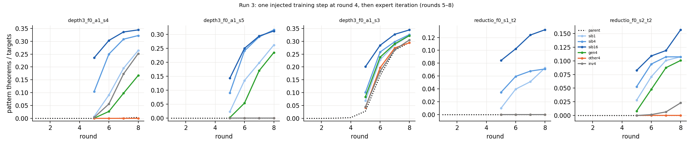

# Round 2, run 3: minimum outside data for ignition

Status: completed 2026-09-18 01:06 UTC (autonomous executor session, two RTX 3090 pods,
≈ $1.6–2.5) and independently reviewed 2026-09-18 01:32 UTC. Review verdict: every number
reproduces; one sentence of the executor's write-up (the invalid-string control) must be
reworded because its interpretation is not supported by the design; two disclosures were
missing. Numbers below are the reviewer's. Run id `round2-run3`.

Review: [`review_round2-run3.md`](https://github.com/dan-pandori/nd-takehome/blob/d26b0cb/review_round2-run3.md)
(commits `f7059c8` phase 1 recount, `d26b0cb` phase 2 verdict; reviewer code
`review_run3_recount.py`, `review_run3_splits.py`; outputs `artifacts/review_r3/recount.json`,
`splits.json`). Executor write-up: [`run3.md`](https://github.com/dan-pandori/nd-takehome/blob/d26b0cb/run3.md)
(read the review first).

Question: the ignition study found that one training step on a sibling arm's whole found set
(239 depth-3 / 51 reductio theorems) ignited 11 / 11 dead arms. What is the minimum outside
data that does this, and must it be the pattern itself? Four probes on each dead round-4 state:
how many sibling proofs (1 / 4 / 16), four short generator instances of the pattern on unrelated
theorems, four proofs of the *other* pattern, and four verifier-rejected strings that carry the
pattern's tokens.

## Configuration

- Code, data and results: `dan-pandori/nd-takehome`, branch `dan_novelty`. Injection files
  committed in `3ef50a4` (22:09:25 UTC); pre-registration (plan and expectations R3-E1…E4) in
  `734d51f` at 22:14:24 UTC; first injection manifests written 22:14:41 / 22:14:46 and first
  injected-step checkpoints 22:15:29 / 22:15:37 (gate 0 met, by 17 s); final numbers `72fd969`
  (00:59); `RUN3 DONE` `d7c37b6` (01:06). Brief: `BRIEF_ROUND2.md` §Run 3. Policy:
  `AGENT_POLICY.md`. Scripts: `run3_inject.py` (injection step and continuation),
  `run3_analysis.py` → `artifacts/r3/summary.json`; the code that built the four injection
  files in `data/r3/` is **not** in the repository (the 16 records are).
- Parents (the round-4 states, from the ignition study's checkpoints `ckpts/p2/`):
  depth-3 f = 0 set a1, seeds **s4** and **s5** (pre-RL pattern hits in 600k samples on 300
  targets: 1 and 0; 0 pattern theorems through round 4; s4's own parent later reached 1 / 4 at
  rounds 7 / 8, s5 never); **s3** as a *reference*, not a test (its round-4 found file already
  holds 3 pattern theorems, first at round 3, and its round-4 fine-tune trained on them; the
  pre-registration's "0 pattern theorems at round 4" is wrong; it self-ignites at round 5 in
  every condition); reductio f = 0 seeds **s1** and **s2** on the 606-target pool (0 valid proofs
  of any kind through round 4, so the round-4 state is the Stage-1 model with an empty found
  set). Tests are s4, s5, s1, s2 (4 arms × 6 conditions = 24 cells); s3 adds 6 reference cells.
- Sibling sources: depth-3 from a1 s2's `found_4.jsonl` (10,202 records = 602 distinct
  start-index-normalised proofs, 284 with depth ≥ 3 on 239 theorems); reductio from s7's
  `found_4.jsonl` (1,902 records = 51 distinct proofs, all reductio, 51 theorems).
- Conditions (`artifacts/p2/<arm>_<cond>_manifest.json` stores every injected record):
  `sib1` / `sib4` / `sib16` = 1 / 4 / 16 sibling pattern proofs of distinct theorems (7–8-line
  RL proofs); `gen4` = 4 verifier-valid 6-line generator proofs with the pattern
  (`data/r3/inject_{depth3,reductio}_gen4.jsonl`, class-disjoint from every target, transfer,
  held-out and validation-36 theorem); `other4` = the other pattern's `gen4` file; `inv4` = 4
  generator pattern proofs with **one citation index edited** (`src: invalid_*`; rejected by
  `nd_verify`, reasons stored and reproduced: bad box cite ×4, ref out of range ×1, IMPE ×1,
  NEGE ×2).
- Recipe per cell: one 600-step fine-tune (`train.py --cap 0`, lr 3·10⁻⁴, seed s·1000 + 4)
  from the parent's round-4 checkpoint on the arm's own `found_4` (≤ 4 per theorem, ×4) +
  the injected records (×4) + 20,000 retained Stage-1 records; then rounds 5–8 of expert
  iteration, k = 32, T = 0.8, retain 20k, resuming the own found set. Ignition = cumulative
  pattern theorems ≥ 20 / 1,000 (depth-3) or ≥ 12 / 606 (reductio); plateau = round-8
  acquisition. Pattern theorem = ≥ 1 verified proof whose dependency-pruned form has the pattern
  (reviewer's own predicate); round = first per-round file the (theorem, normalised proof)
  appears in.
- Pools (reviewer's renaming key, atoms relabelled by first appearance; 0 overlap in every
  pair): `targets_depth3` 1,000, `transfer_depth3` 500, `targets_reductio2` 606,
  `transfer_reductio2` 300, held-out, validation-36; both Stage-1 sets 155,000 proofs, lengths
  2–6 exactly 31,000 each, and exactly f = 0 for each arm's own pattern (the depth-3 set holds
  10,547 reductio proofs and the reductio set 5,687 depth-3 proofs, which matters for `other4`).
- Pods: p4 (RTX 3090, $0.50/h, created 22:05 UTC, 18 depth-3 jobs, 2 concurrent) and p5
  (RTX 3090, created 22:17 UTC, 12 reductio jobs); both shared with run 4 from ≈ 23:15 UTC;
  p4 deleted 01:14 UTC, p5 handed to run 4. Run-3 jobs ran ≈ 5.0 pod-hours of wall time
  (p4 22:05–01:01, p5 22:17–00:20), ≈ 2.1 of them before run 4 shared the cards; ≈ $1.1–2.5
  at list price, executor's own share estimate ≈ $1.6 (pre-registration ≈ $3, ceiling $50).
  See `docs/infra/spend.md`.
- Incidents (disclosed by the executor, checked by the reviewer): a trailing-slash rsync
  nesting made the first `gen4` / `other4` / `inv4` job of each pod fail on a missing file and
  briefly ran `gen4` twice (both copies killed, outputs deleted, re-queued); depth-3 s5 `inv4`
  round 8 and the whole reductio s2 `inv4` arm were re-run after CUDA OOM kills in run 4's
  launch window. The files on disk are single clean runs (checkpoint chains and mtimes
  consistent); the killed reductio s2 `inv4` attempt had reached 6 / 47 pattern theorems at
  rounds 5–6 against 0 / 1 in the surviving rerun (see the marginal cell below).
- Bucket: `hf://buckets/dan-pandori/nd-rl/round2/run3/{artifacts/r3,data/r3,ckpts/r3}`
  (artifacts 851 MB; 56 checkpoints, 687 MB: every injected-step `*_r4t.pt` and every round-8
  `*_r8.pt`; data 20 KB). The reviewer confirmed the three directories exist (01:05 UTC);
  contents were not compared.
- Hard constraints (reviewer): `nd_verify` unmodified (tree hash equals `origin/main`);
  `artifacts/TEST_RUN_DONE` byte-identical (one test run, 2026-09-15); no evaluation file
  enters training except through the brief's own sibling condition (see disclosure 1 below);
  Stage-1 sets cap 6 with 0 violations; `gen4` / `other4` records are generator output that
  verifies. **Flag, not a quarantine:** the five `inv4` checkpoints (`ckpts/r3/*_inv4_*`) were
  fine-tuned on verifier-rejected strings, as the brief's control prescribes and the standard
  `--cap 0` EI recipe permits; they must not be used as submission models or quoted as
  take-home results. The 25 other arms trained only on verifier-accepted proofs.

## Observations

All counts were re-derived by the reviewer from the raw per-round files with independent code
(own parser, dependency pruning, start-index normaliser, box-depth counter, reductio predicate,
renaming key; only `nd_verify` shared with the executor). Every distinct pattern proof
re-verified against its prompt (5,000+ proofs, 0 failures) plus 200 random non-pattern proofs
per arm (0 failures). Per-round files are nested, resumed records equal the parent's `found_4`
exactly, and the reviewer's cumulative solved counts equal the executor's `round_<r>.json` at
every round in all 30 arms. `artifacts/r3/summary.json` and the `run3.md` table are identical to
the recount element for element.

**Cumulative pattern theorems at rounds 5 → 8** (test arms; parents 0 through round 4).
"excl." = round 8 excluding the injected theorems themselves (see disclosure 1). Ignition
round at the pre-registered thresholds (20 depth-3 / 12 reductio); "–" = never through round 8.

| condition | depth-3 s4 (/1,000) | depth-3 s5 (/1,000) | reductio s1 (/606) | reductio s2 (/606) |
|---|---|---|---|---|
| sib1 | 8 / 91 / 195 / **264** (excl. 263; r6) | 23 / 135 / 198 / **262** (261; r5) | 6 / 24 / 31 / **44** (43; r6) | 17 / 43 / 61 / **65** (64; r5) |
| sib4 | 105 / 250 / 308 / 322 (318; r5) | 91 / 241 / 291 / 316 (312; r5) | 21 / 36 / 41 / 43 (39; r5) | 32 / 57 / 65 / 65 (61; r5) |
| sib16 | 236 / 303 / 336 / 344 (328; r5) | 143 / 250 / 294 / 312 (296; r5) | 51 / 62 / 75 / 80 (64; r5) | 50 / 66 / 72 / 95 (79; r5) |
| gen4 | 1 / 27 / 98 / 167 (r6) | 2 / 54 / 170 / 235 (r6) | 0 / 0 / 0 / 0 (–) | 5 / 29 / 53 / 61 (r6) |
| other4 | 0 / 0 / 0 / 0 (–) | 0 / 0 / 0 / 0 (–) | 0 / 0 / 0 / 0 (–) | 0 / 0 / 0 / 0 (–) |
| inv4 | 4 / 56 / 173 / 252 (r6) | 0 / 0 / 0 / 0 (–) | 0 / 0 / 0 / 0 (–) | 0 / 1 / 4 / 14 (r8, marginal) |

Reference s3 (3 pattern theorems already trained on at round 4): 322 / 326 / 344 / 322 /
294 / 305 at round 8 for sib1 / sib4 / sib16 / gen4 / other4 / inv4, all igniting at round 5,
including `other4` and `inv4` (42 / 45 pattern theorems at round 5 against the parent's 28).
It is a self-igniter and tests nothing about injection.

Ignition rounds are insensitive to the threshold (at 10 / 20 / 40 and 6 / 12 / 24 only two
depth-3 cells and two reductio cells move by one round; s2 `inv4` becomes "never" at 24).
Excluding the injected theorems moves no ignition round at the pre-registered thresholds.
Every reductio proof found is a pattern proof (solved = pattern theorems in all 12 reductio
arms). Held-out greedy accuracy stays at the parents' level in all 30 arms (0.869–0.905 vs
parents 0.870–0.902), including the `inv4` arms: training on four invalid strings did not
damage the models.

**Transfer (never trained on).** The pattern reaches the transfer pool in every igniting arm
and in no non-igniting arm: depth-3 sib1 137 / 133 of 500 at round 8, sib16 181 / 172, gen4
88 / 118, inv4 (s4) 127; reductio sib1 17 / 30 of 300, sib16 39 / 46, gen4 (s2) 30, inv4 (s2)
6. Not reported by the executor; added by the reviewer.

**Against the ignition study's full-sibling injection** (ivS = the sibling's whole `found_4`,
239 / 51 theorems; reviewer's recount): depth-3 s4 / s5 / s3 reached 286 / 300 / 297 pattern
theorems at round 5 and 330 / 335 / 336 at round 8 under ivS. Sixteen proofs give 236 / 143 /
201 at round 5 and 344 / 312 / 344 at round 8 (the plateau, one round later); four proofs
105 / 91 / 101 → 322 / 316 / 326; one proof 8 / 23 / 69 → 264 / 262 / 322 (still rising at
round 8). Reductio: 16 proofs 80 / 95 at round 8 (64 / 79 excluding the injected 16), against
0.11–0.18 acquisition for the full injection.

**The one marginal cell, reductio s2 `inv4`.** 14 / 606 at round 8, first proof at round 6,
threshold crossed at round 8 exactly. The killed first attempt of the same job (same command,
same seed) had 6 / 47 pattern theorems at rounds 5–6 against 0 / 1 in the surviving rerun: two
runs of one seed differ by 46 theorems at round 6, and the surviving one is the one on file.
The condition is at the edge of igniting for s2 and at 0 for s1.

**What stands (reviewer's verdict).** (i) One verifier-valid sibling proof, repeated four times
inside one 600-step fine-tune against 20,000 retained records, ignites all four test arms (two
depth-3 draws with 0–1 pattern hits in 600k pre-RL samples, two reductio draws with 0 valid
proofs of any kind), and four proofs reach the full-sibling plateau within four rounds.
(ii) The same step with four valid proofs that lack the pattern ignites nothing (0 / 4), so it
is the injected pattern and not the extra training step that ignites. (iii) Four 6-line
generator instances of the pattern on unrelated, class-disjoint theorems ignite 3 / 4: the
pattern transfers from short, easy examples to 7–12-line targets and to the never-trained
transfer pool.

**What must be reworded (the `inv4` sentence).** The executor wrote that "four *invalid*
strings that merely carry three box bars ignite depth-3 s4 … for the structural pattern the
seed can be a token statistic, not a proof". The injected strings do not merely carry three box
bars: each of the 8 `inv4` records is a complete 6-line pattern proof with one citation index
changed, and exactly one single-token repair makes each verify (reviewer's exhaustive search
over all citation tokens × all line indices; e.g. `IMPI N2 N5` → `IMPI N1 N5`). Box bars,
formulas, rule sequence and 5 of 6 citations are those of a correct pattern proof. The brief
asked for "the pattern's surface tokens but invalid structure"; what was injected is valid
structure with an invalid citation, so the control separated *verifier acceptance* from
structure, not surface tokens from structure. The supported statement is: a structurally
correct pattern example need not be verifier-valid to seed the pattern (1 clear of 2 depth-3
test draws; 0 and a marginal 14 / 606 for reductio). The pre-registered inference "token
statistics, not valid structure" does not follow from this design.

**Two disclosures that were missing.**

1. *The sibling-injected theorems are targets.* The pre-registration says "the injected
   theorems are not targets". That is true of `gen4` / `other4` / `inv4` and false of every
   `sib*` arm: the sibling files are `found_4.jsonl` of arms run on the same pool, so each
   `sib*` arm receives 1 / 4 / 16 verified proofs of its own targets, and every one is re-found
   by the arm. The effect on every count is ≤ 16 theorems (the "excl." values above) and no
   ignition round moves; conclusions unchanged.
2. *`other4`'s pattern is not novel to the models.* The depth-3 arms' Stage-1 set holds 10,547
   reductio proofs (6.8 %) and the reductio arms' set 5,687 depth-3 proofs (3.7 %), so `other4`
   controls for "one extra fine-tuning step on four valid outside proofs", not for "a second
   unseen pattern". (`numbers.md`'s "with pattern 4" for `other4` means the *other* pattern.)

**Pre-registered expectations vs outcome** (`734d51f`, 22:14 UTC, before the first pod job).

| id | expected | observed (reviewer) | verdict |
|---|---|---|---|
| R3-E1 | `sib16` ignites 5 / 5 by round 5–6 and reaches the plateau (depth-3 ≥ 0.30, reductio ≥ 0.10); `sib4` ≥ 4 / 5; `sib1` ≥ 2 / 5 | sib16 5 / 5 at round 5, r8 0.344 / 0.312 / 0.344 and 0.132 / 0.157 (0.328 / 0.296 / 0.328 and 0.106 / 0.130 excl. injected); sib4 5 / 5 (all round 5); sib1 5 / 5 (rounds 6, 5, 5, 6, 5) | met; sib1 stronger than allowed |
| R3-E2 | `gen4` ignites ≥ 3 / 5; depth-3 more likely than reductio | 4 / 5 including the reference (3 / 4 tests: s4 r6, s5 r6, s2 r6; s1 never); depth-3 2 / 2 vs reductio 1 / 2 | met |
| R3-E3 | `other4` ignites 0 / 5 (s3 excepted) | 0 / 0 / 0 / 0 pattern theorems through round 8 in s4, s5, s1, s2; s3 ignites (294) | met |
| R3-E4 | `inv4` ignites 0 / 5; "if it ignites, what transfers is token statistics, not valid structure" | s4 ignites (252, r6), s5 never, s1 never, s2 14 at round 8 (marginal; same-seed replicate disagreed); 1 clear + 1 marginal of 4 tests | **wrong** for depth-3 s4; the pre-registered interpretation does not follow (above) |

The executor's results-vs-expectations entry (log 01:06) reports R3-E4 as wrong for depth-3
and marginal for reductio and lists the reference s3 separately; the reviewer calls this
honest.

Figure (executor's; every curve checked by the reviewer against the recount). Parent curves
dotted; rounds 5–8 after the injected step.

## Limitations and next step

- The invalid-string control did not test what the brief and pre-registration described
  (structure-broken strings with the token statistics kept); it tested verifier acceptance.
  The "token statistic, not a proof" reading is not supported and should not be quoted.
- n is small where it matters: two depth-3 and two reductio test draws, one run per cell, and
  one same-seed replicate (reductio s2 `inv4`) that disagreed with the surviving run by 46
  theorems at round 6. Marginal cells need repeated sampling seeds.
- The sibling conditions leak 1 / 4 / 16 target proofs into training (≤ 16 theorems of
  effect); `other4` is not a novel-pattern control for these models.
- Five `inv4` checkpoints in the bucket were trained on verifier-rejected strings and are
  flagged; the code that built the injection files is not in the repository.
- Not re-derived by the reviewer: the pre-RL coverage counts (taken from the ignition study's
  summary, which the ignition review reproduced), pod spend, kill-switch timing, bucket
  contents beyond the existence of the three directories. `run3.md` is 489 words against the
  brief's 400.

Next measurement (reviewer): (1) repeat `inv4` with strings whose *structure* is broken while
the token statistics are kept (same three box bars with the IMPI chain scrambled or the closing
formulas randomised) on s4, s5 and the two reductio draws, two sampling seeds each; this is the
control the pre-registration described, and the same-seed disagreement says single runs of
marginal cells are not enough. (2) Find the floor below one proof: one sibling proof at weight
1 instead of 4, or at a tenth of the learning rate, to measure how much gradient the ignition
needs. (3) Inject sibling proofs of non-target theorems (gen4-style class-disjoint theorems at
7–9 lines, since the sibling's transfer finds are evaluation data) to make the sibling condition
free of the target leak.
