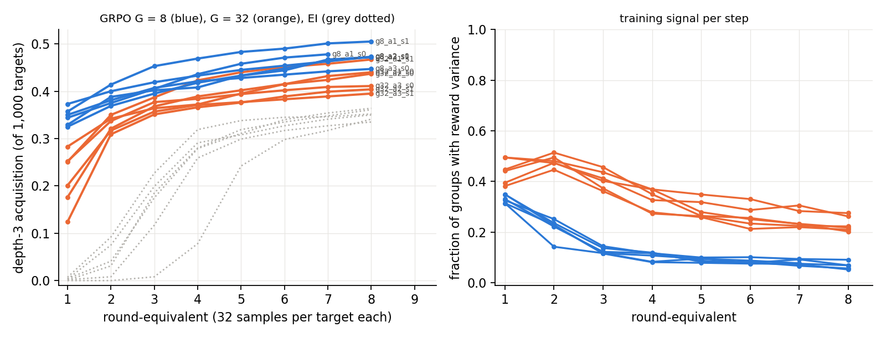

# Round 2, run 4: GRPO vs expert iteration at f = 0

Status: completed 2026-09-18 01:45 UTC (autonomous executor session, two RTX 3090 pods shared
with run 3, ≈ $1.6–2.4) and independently reviewed 2026-09-18 02:04 UTC. Review verdict: every
number in the write-up reproduces from the raw files with independent code, the implementation
is what the brief asked for, and the three bookkeeping losses are disclosed; two things the
write-up says or implies are not supported by the data (the draws are rare-prior, not
zero-prior, and the sprint contrast is not settled), one expectation is mis-scored, and the
write-up omits a base-rate number and a transfer comparison. Numbers below are the reviewer's.
Run id `round2-run4`.

Review: [`review_round2-run4.md`](https://github.com/dan-pandori/nd-takehome/blob/bc6c4b4/review_round2-run4.md)
(commits `32cd143` phase 1 recount, `bc6c4b4` phase 2 verdict; reviewer code
`review_run4_recount.py`, `review_run4_train.py`; outputs `artifacts/review_r4/recount.json`,
`train.json`). Executor write-up: [`run4.md`](https://github.com/dan-pandori/nd-takehome/blob/bc6c4b4/run4.md)
(read the review first).

Question: is "structural patterns cross zero coverage" a property of expert iteration's
keep-any-success rule, or of RL against a verifier in general? The earlier sprint reported that
GRPO "saw nothing" where expert iteration acquired the depth-3 box pattern. Same six Stage-1
draws, same 1,000 targets, same sample budget: on-policy GRPO against expert iteration (EI).

## Configuration

- Code, data and results: `dan-pandori/nd-takehome`, branch `dan_novelty`. Pre-registration
  (plan and expectations R4-E1…E4) committed in `cb3c07e` at 23:07:23 UTC; the first arm's
  `args.json` was written 23:09:19 and its first found file 23:12:32 (gate 0 met, by 2 min).
  The chunked-update commit `faa87d9` (23:14:28) landed after the first two arms had started;
  the reviewer checked that it changes only how the backward pass is split (chunks of 128
  sequences, zero-advantage sequences skipped), not the gradient. Final numbers, `run4.md` and
  the figure in `cf223e9`; `RUN4 DONE` in `52b0c32` (01:45). Brief: `BRIEF_ROUND2.md` §Run 4.
  Policy: `AGENT_POLICY.md`. Scripts: `grpo.py` (the algorithm), `run4_analysis.py` →
  `artifacts/r4/summary.json`.
- Algorithm as implemented and run (reviewer's reading of `grpo.py`, `args.json` and the
  checkpoints' `extra` dicts): on-policy; each step samples P prompts × G completions from
  the current parameters at T = 0.8 (P·G = 512: G = 8 → 64 prompts, G = 32 → 16 prompts);
  binary `nd_verify` reward on the prompted sequent; advantage A = r − mean(r over its group),
  no std normalisation; one AdamW step (lr 10⁻⁴, β = (0.9, 0.95), no weight decay) on
  −Σ A·log π(completion) / (P·G·400). No KL, no clipping, no replay, no retained data. 500
  steps × 512 = 256,000 samples = EI's 8 × 32 × 1,000; the prompt order is a reshuffled cycle
  over the targets, so every target receives exactly 256 samples under both algorithms. Two
  inert knobs: the fixed divisor is invisible to Adam, and the recorded gradient norms
  (0.03–0.13) never reach the clip of 1.0.
- Arms: 12 = G ∈ {8, 32} × Stage-1 draws a1–a3 × training seeds 0, 1. The draws are the
  follow-up's depth-3 f = 0 block-A models (sets `train_depth3_f0_{a1,a2,a3}`, 155,000 proofs
  each, max written length 6, 0 depth-3 proofs by the reviewer's predicate). Pools:
  `targets_depth3` 1,000, `transfer_depth3` 500, held-out 5,000; 0 renaming-class overlaps
  between each Stage-1 set and the three pools.
- EI reference: the follow-up's block-A arms on the same checkpoints
  (`artifacts/p2/ei_depth3_f0_<draw>`; k = 32, T = 0.8, 8 rounds, retain 20,000 Stage-1
  records, 600 fine-tuning steps per round). GRPO is bookkept at eight round-equivalents
  (boundaries at steps 62, 125, 188, 250, 312, 375, 438, 500): every distinct verified proof
  sampled during training, transfer pass@32 at the boundary (never trained on), greedy on
  transfer and held-out, a checkpoint. Depth-3 acquisition = targets with ≥ 1 verified proof
  whose dependency-pruned form has box depth ≥ 3 (reviewer's own predicate); round = first
  per-round file the (theorem, normalised proof) appears in.
- Bookkeeping losses (disclosed by the executor, consistent with the files' mtimes, nesting and
  checkpoint `extra`): `grpo_g8_a1_s0`'s round-8 files were lost when p5 was deleted (its
  round-8 checkpoint exists locally and in the bucket), so it is compared at round-equivalent 7
  (224,256 samples) against EI's round 7; `grpo_g8_a2_s1`'s round-1 files were overwritten by a
  killed duplicate process (the reviewer takes its round-1 values from the surviving run's
  `round` field: 351 depth-3 / 625 solved, not the duplicate's 329 / 605); `grpo_g32_a2_s0`
  was re-run from scratch after p4 was deleted before its pull. Seven p5 arms died at start
  with CUDA OOM (one process took 12 GB) and were re-queued after the chunked update.
- Pods: p4 (RTX 3090, $0.50/h, created 22:05 UTC for run 3; run-4 jobs from ≈ 23:09; deleted
  01:14) and p5 (RTX 3090, created 22:17 for run 3; run-4 jobs from ≈ 23:15; deleted ≈ 01:36).
  Run-4 jobs occupied ≈ 4.5 pod-hours of wall time (p4 ≈ 2.1, p5 ≈ 2.4), shared with run 3's
  tail until 01:01 on p4. The executor's two figures disagree: `STATUS.md` ≈ $1.6 (its split
  of the two cards' 6.4 pod-hours with run 3), `numbers.md` ≈ $2.4 (all run-4 wall hours at
  list price); the reviewer flagged the $0.8 gap and did not re-derive it. Pre-registration
  ≈ $5, ceiling $50. See `docs/infra/spend.md`.
- Bucket: `hf://buckets/dan-pandori/nd-rl/round2/run4/{artifacts/r4,ckpts/r4}` (301 files;
  12 round-8 checkpoints `grpo_*_r8.pt`, all `{grpo_round: 8, step: 500}`, tokenizer `abs`).
  No `data/` directory: the run adds no data. The reviewer confirmed the listings only.
- Hard constraints (reviewer): `nd_verify` unmodified (tree hash equals `origin/main`);
  `artifacts/TEST_RUN_DONE` byte-identical (one test run, 2026-09-15); `grpo.py` reads the
  target pool as its RL prompts by design and `transfer` / `heldout` only inside the boundary
  evaluation, never in the update; no supervised file is read at all (the only data in a
  gradient are the model's own samples weighted by verifier reward minus the group mean, so no
  invalid string is ever a positive example); the three Stage-1 sets are cap 6 with 0
  violations, 1,563 random proofs re-verified per set with 0 failures; f = 0 holds (0 depth-3
  proofs in each set); no hand-written or LLM-written training proofs. GRPO trains on its own
  7–11-line verified samples, which is the RL step the take-home permits.
- Not run: the proposal's 85M / relative-unary-codec GRPO arm (no access to the sprint's code;
  `QUESTIONS.md` 01:45).

## Observations

All counts were re-derived by the reviewer from the raw per-round files with independent code
(own proof parser, dependency pruning, start-index normaliser, box-depth counter, renaming key;
only `nd_verify` shared with the executor). Every distinct normalised target proof re-verified
against its prompt: 14,741 (GRPO, 12 arms) + 4,471 (EI, 6 arms), 0 failures, 0 unparsable;
every distinct transfer proof at the last boundary (4,587) and in the EI round-8 files
(2,242), 0 failures. Per-round found files nest, `round` fields match, duplicate records 0,
and the executor's cumulative solved counts equal the recount at every round in every arm
except the one duplicate-run cell. `artifacts/r4/summary.json` and the `run4.md` table are
identical to the recount.

**Base rates of the six Stage-1 draws** (ignition study's coverage files, 300 targets × 2,000
samples, reviewer's predicate; every stored proof re-verified). Not quoted in `run4.md`; the
policy asks for a base-model number next to every "RL solved X".

| draw | valid samples / 600k | targets solved | depth-3 hits (theorems) | depth-3 rate per sample |
|---|---:|---:|---:|---:|
| a1 s0 | 1,963 | 17 | 152 (6) | 2.5·10⁻⁴ |
| a1 s1 | 2,620 | 19 | 370 (7) | 6.2·10⁻⁴ |
| a2 s0 | 1,574 | 11 | 301 (8) | 5.0·10⁻⁴ |
| a2 s1 | 930 | 7 | 3 (2) | 5·10⁻⁶ |
| a3 s0 | 315 | 2 | 6 (1) | 1·10⁻⁵ |
| a3 s1 | 1,444 | 14 | 1,128 (12) | 1.9·10⁻³ |

All six draws have a non-zero depth-3 base rate; a2 s1 and a3 s0 are the two rare-prior draws,
and under EI they are the draws that ignite latest.

**Results at matched sample budgets** (round 8 = 256,000 samples; `g8_a1_s0` at round 7 =
224,256 against EI's round 7). Depth-3 = theorems of 1,000 with a verified proof of box depth
≥ 3; solved = any verified proof.

| draw | EI depth-3 r8 (r7) | EI solved r8 (r7) | G = 8 depth-3 r8 (r7) | G = 8 solved r8 (r7) | G = 32 depth-3 r8 (r7) | G = 32 solved r8 (r7) | solved ratio G8 / EI, G32 / EI |
|---|---|---|---|---|---|---|---|
| a1 s0 | 335 (327) | 645 (623) | – (**478**) | – (**778**) | 440 (432) | 728 (718) | 1.25 (at r7), 1.13 |
| a1 s1 | 364 (354) | 698 (686) | 505 (501) | 819 (814) | 467 (458) | 798 (790) | 1.17, 1.14 |
| a2 s0 | 350 (341) | 589 (579) | 473 (463) | 777 (764) | 437 (424) | 737 (724) | 1.32, 1.25 |
| a2 s1 | 341 (317) | 652 (624) | 475 (470) | 799 (793) | 404 (399) | 725 (719) | 1.23, 1.11 |
| a3 s0 | 361 (348) | 605 (590) | 447 (442) | 747 (738) | 411 (409) | 710 (705) | 1.23, 1.17 |
| a3 s1 | 352 (346) | 583 (572) | 472 (465) | 780 (768) | 395 (389) | 691 (685) | 1.34, 1.19 |

(The a2 s1 G = 8 cell is 475 by the files rule and 472 by the surviving run's `round` field;
the reviewer's phase-2 correction takes 472, the executor's value.) Means: G = 8 0.474
(0.447–0.505), G = 32 0.426 (0.395–0.467), EI 0.351 (0.335–0.364).

**Cumulative depth-3 theorems per round-equivalent** (of 1,000):

| arm | r1 | r2 | r3 | r4 | r5 | r6 | r7 | r8 |
|---|---:|---:|---:|---:|---:|---:|---:|---:|
| EI a1 s0 / a1 s1 | 2 / 4 | 8 / 41 | 117 / 175 | 259 / 279 | 299 / 311 | 317 / 340 | 327 / 354 | 335 / 364 |
| EI a2 s0 / a2 s1 | 3 / 0 | 75 / 0 | 199 / 8 | 291 / 78 | 308 / 242 | 327 / 298 | 341 / 317 | 350 / 341 |
| EI a3 s0 / a3 s1 | 1 / 7 | 31 / 92 | 185 / 227 | 280 / 319 | 319 / 338 | 335 / 345 | 348 / 346 | 361 / 352 |
| G8 a1 s0 / a1 s1 | 344 / 357 | 375 / 414 | 405 / 453 | 436 / 469 | 458 / 483 | 471 / 490 | 478 / 501 | – / 505 |
| G8 a2 s0 / a2 s1 | 373 / 351 | 400 / 391 | 419 / 405 | 433 / 411 | 445 / 436 | 454 / 447 | 463 / 470 | 473 / 475 |
| G8 a3 s0 / a3 s1 | 350 / 325 | 381 / 369 | 407 / 395 | 421 / 418 | 428 / 433 | 435 / 448 | 442 / 465 | 447 / 472 |
| G32 a1 s0 / a1 s1 | 176 / 251 | 321 / 350 | 368 / 387 | 389 / 423 | 402 / 440 | 415 / 451 | 432 / 458 | 440 / 467 |
| G32 a2 s0 / a2 s1 | 283 / 124 | 342 / 309 | 364 / 351 | 372 / 366 | 395 / 376 | 415 / 389 | 424 / 399 | 437 / 404 |
| G32 a3 s0 / a3 s1 | 252 / 201 | 337 / 317 | 377 / 357 | 384 / 371 | 394 / 377 | 402 / 383 | 409 / 389 | 411 / 395 |

Every GRPO arm crosses the run-3 review's ignition threshold (20 theorems) inside the first
round-equivalent (the first 32,000 samples, 62 updates), including the two rare-prior draws
(a2 s1: 351 / 124; a3 s0: 350 / 252), where EI needs 4 / 2 rounds. Groups of 8 beat groups of
32 on all six draws, in acquisition (+31 to +77) and in solved (+50 to +89).

**The acquired sets nest.** On every draw the EI arm's depth-3 theorems are, up to 1–3, a
subset of the G = 8 arm's (EI − G8 = 1, 3, 1, 1, 3, 2; G8 − EI = 144, 144, 124, 135, 89, 122).
The extra theorems are the longer ones: by oracle minimum length, a1 s0 length 9 has 30
depth-3 theorems under EI vs 94 (G8) / 69 (G32), length 10: 14 vs 33 / 27, length 11: 11 vs
25 / 24 (the 7- and 8-line targets are at ceiling for all three). Written lengths reach 10–11
lines in the GRPO arms (8–42 proofs of ≥ 10 written lines per arm; EI 0, longest 9). A handful
of depth-4 proofs appear (0–3 per GRPO arm; EI 0–1).

**Training signal and in-distribution damage** (per-step values the executor's; round means
and minima the reviewer's).

| arm | reward per sample r1 → r8 | groups with reward variance: step 1 / max round mean / r8 mean | held-out greedy r1 → r8 (min) | transfer greedy r8 |
|---|---|---|---|---:|
| G8 a1 s0 | 0.37 → 0.74 (r7) | 0.11 / 0.31 / 0.08 | 0.756 → 0.562 (0.562) | 0.554 |
| G8 a1 s1 | 0.42 → 0.79 | 0.06 / 0.33 / 0.05 | 0.803 → 0.644 (0.599) | 0.670 |
| G8 a2 s0 | 0.40 → 0.73 | 0.12 / 0.35 / 0.06 | 0.833 → 0.672 (0.672) | 0.592 |
| G8 a2 s1 | 0.38 → 0.76 | 0.09 / 0.31 / 0.07 | 0.767 → 0.621 (0.621) | 0.620 |
| G8 a3 s0 | 0.32 → 0.71 | 0.03 / 0.35 / 0.07 | 0.740 → **0.340** (0.340) | 0.578 |
| G8 a3 s1 | 0.35 → 0.72 | 0.05 / 0.33 / 0.09 | 0.796 → 0.531 (0.531) | 0.548 |
| G32 a1 s0 | 0.25 → 0.63 | 0.12 / 0.47 / 0.22 | 0.733 → 0.564 (0.564) | 0.534 |
| G32 a1 s1 | 0.34 → 0.70 | 0.06 / 0.49 / 0.28 | 0.846 → 0.643 (0.643) | 0.604 |
| G32 a2 s0 | 0.31 → 0.63 | 0.12 / 0.49 / 0.26 | 0.906 → 0.657 (0.657) | 0.560 |
| G32 a2 s1 | 0.24 → 0.63 | 0.06 / 0.45 / 0.21 | 0.829 → 0.610 (0.610) | 0.588 |
| G32 a3 s0 | 0.25 → 0.61 | 0.06 / 0.49 / 0.22 | 0.773 → **0.376** (0.310) | 0.516 |
| G32 a3 s1 | 0.27 → 0.61 | 0.12 / 0.51 / 0.20 | 0.731 → 0.521 (0.511) | 0.536 |

The EI arms keep held-out greedy at 0.903–0.945 at round 8 (Stage-1 level; they retain
20,000 Stage-1 records each round) and end at transfer greedy 0.510–0.580. Every GRPO arm
loses 0.2–0.6 of held-out greedy by the first boundary already and ends at 0.34–0.67; the
loss is spread over all lengths 2–6 (G8 a3 s0 at the end: 0.48 / 0.26 / 0.29 / 0.36 / 0.32
by length). Transfer greedy of the GRPO arms (0.52–0.67) is at or above EI's. The
reward-variance signal starts at 0.03–0.12 of groups, peaks inside round-equivalents 1–2
(round means 0.31–0.35 for G = 8, 0.45–0.51 for G = 32) and then falls to 0.05–0.09 (G = 8) /
0.20–0.28 (G = 32) as the per-sample reward rises to 0.61–0.79: the signal saturates rather
than grows.

**Transfer (never trained on; of 500).** Not compared by the executor; added by the reviewer.
The two bookkeepings differ (EI's `found_transfer_8` is the union of 8 × 32 samples across the
evolving models; GRPO's `found_transfer_<r>` is a fresh pass@32 of the boundary model), so
both like-for-like readings are given: solved / depth-3.

| draw | EI union | G8 union | G32 union | EI round-8 only | G8 last boundary | G32 last boundary |
|---|---|---|---|---|---|---|
| a1 s0 | 331 / 186 | 393 / 236 | 370 / 218 | 231 / 140 | 338 / 200 | 315 / 183 |
| a1 s1 | 337 / 183 | 422 / 264 | 406 / 249 | 224 / 126 | 381 / 229 | 353 / 202 |
| a2 s0 | 304 / 184 | 403 / 249 | 386 / 233 | 206 / 131 | 347 / 210 | 323 / 190 |
| a2 s1 | 331 / 179 | 409 / 253 | 368 / 218 | 241 / 137 | 351 / 207 | 338 / 188 |
| a3 s0 | 315 / 193 | 381 / 235 | 357 / 213 | 216 / 125 | 332 / 197 | 302 / 174 |
| a3 s1 | 307 / 189 | 382 / 236 | 347 / 206 | 230 / 138 | 330 / 192 | 313 / 183 |

The pattern generalises to the transfer pool under both algorithms, and more so under GRPO.

**What stands (reviewer's verdict).** At an equal sample budget on the same six Stage-1
draws, on-policy GRPO reaches the depth-3 pattern in the first 62 updates on every draw and
ends 0.40–0.51 against expert iteration's 0.34–0.36, solving 11–34 % more targets, at the cost
of the in-distribution model (held-out greedy 0.34–0.67 vs 0.90–0.95), the expected price of
no KL and no retained data. The result is solid and the direction is not in doubt.

**Two things the write-up says, or implies, that the data do not support.**

1. *"Crosses zero coverage" is the campaign's term for f = 0 in the supervised set, not for a
   zero prior.* All six draws have a non-zero Stage-1 depth-3 rate (3–1,128 hits per 600k
   samples), and the acquired sets nest: on every draw the EI arm's depth-3 theorems are, to
   within 1–3, a subset of the GRPO arm's, and the extra 89–144 are the longer targets (oracle
   length 9–12). GRPO here is a faster and less conservative eliciter of a prior that is rare
   but present, the "rare-but-known" side of the project's question, and it tells us nothing
   yet about igniting from a true zero. The run-3 / ignition-study draws with 0 hits in 600k
   (depth-3 a1 s5, reductio s1 / s2) are the ones that would test that, and they were not run
   under GRPO.
2. *The sprint contrast is not settled.* "GRPO saw nothing" in the sprint may be a property
   of a zero-prior model (the 85M / relative-codec draw), of its targets, or of the algorithm;
   this run removes only the third possibility for non-zero priors. The executor's sentence
   "the difference must sit in the sprint's model, codec or targets" should read "… or in the
   base rate of its draw".

**Pre-registered expectations vs outcome** (`cb3c07e`, 23:07 UTC, before the first pod job).

| id | expected | observed (reviewer) | verdict |
|---|---|---|---|
| R4-E1 | G = 8 acquires depth-3 in ≥ 4 / 6 arms but later and lower than EI (round-8 equivalent 0.10–0.30); G = 32 in 6 / 6 at 0.25–0.40 | G = 8: 6 / 6, all ignite in round-equivalent 1, 0.447–0.505 at the end (EI 0.335–0.364); G = 32: 6 / 6, round-equivalent 1, 0.395–0.467 | **wrong in both directions**: G = 8 is earlier and higher than EI, not later and lower; G = 32 is above the band and above EI |
| R4-E2 | the fraction of groups with reward variance starts at 0.05–0.20 and rises to ≥ 0.4 by the end in every acquiring arm | starts at 0.03–0.12 (as expected), peaks inside round-equivalents 1–2 (0.31–0.51) and falls to 0.05–0.28 | **wrong** on the trajectory: the signal saturates rather than grows. The executor scored it wrong too but described the start as 0.31–0.51, which is the round-1 mean, not the step-1 value |
| R4-E3 | final solve rate within ±20 % of the EI arm's on the same draw | paired per draw, G = 8 / EI = 1.17–1.34 (5 of 6 above +20 %; a1 s0 at round 7: 1.25); G = 32 / EI = 1.11–1.25 (1 of 6 above) | **not met** for G = 8 (higher than the band), met for 5 / 6 G = 32 arms. The executor scored it "held at the top of the band" by comparing ranges (solved 691–819 vs 583–698) instead of pairs; the reviewer calls this mis-scored, with no effect on the conclusion's direction |
| R4-E4 | ≥ 1 of 12 arms degrades (held-out greedy < 0.5 at some boundary) | 2 of 12 meet the registered criterion (both a3 s0: G8 0.477 / 0.458 / 0.340 at r6–r8; G32 0.466 at r5, 0.310 at r7); every arm ends 0.2–0.6 below its Stage-1 level | **met**; the executor's "held in 12 / 12" uses a looser criterion than the one registered |

The executor's results-vs-expectations entry (log 01:45) scores E1 and E2 as wrong and E4 as
met; the reviewer calls this honest, with E3 scored generously.

**Smaller points from the review.** The per-round lists printed for `g8_a2_s1` in
`numbers.md` still carry the duplicate's round-1 values (329 / 605, reward 0.38, variance
0.31) although the text says they are excluded; the survivor's are 351 / 625. The fixed loss
divisor and the gradient clip are inert under Adam and are worth a sentence. The write-up
should carry the six base rates and an EI transfer column. The two spend figures should
agree.

Figure (executor's; the reviewer confirmed it plots the recount's numbers; two label
collisions at the right edge are cosmetic). Cumulative depth-3 acquisition per
round-equivalent, GRPO G = 8 and G = 32 against EI on each draw, with held-out greedy.

## Limitations and next step

- The six draws are rare-prior draws (depth-3 base rates 5·10⁻⁶ – 1.9·10⁻³ per sample), so
  the run measures elicitation speed and reach, not ignition from a true zero. "Crosses zero
  coverage" means f = 0 in the supervised set and should not be read as a zero prior.
- The sprint's negative ("GRPO saw nothing") is not reproduced and not explained: the
  sprint's 85M / relative-codec model, its targets and its code were not available. Only the
  algorithm-for-non-zero-priors explanation is removed.
- One arm (`g8_a1_s0`) is reported at round-equivalent 7; one round-1 cell comes from a killed
  duplicate; one arm was re-run from scratch. The re-run of `g8_a1_s0` to round 8 would cost
  ≈ $0.40 and 40 min (`QUESTIONS.md` 01:45, default: not run).
- Without KL or retained data, every GRPO arm loses 0.2–0.6 of held-out greedy accuracy. The
  comparison is therefore between two recipes that differ in more than the update rule
  (EI retains 20,000 Stage-1 records per round; GRPO retains nothing), and "faster" is not yet
  separated from "different" (see the second variant below).
- Not re-derived by the reviewer: the greedy / pass@32 evaluations themselves (every proof the
  files contain was re-verified, but nothing was re-sampled), pod spend, kill-switch timing,
  bucket contents beyond the listings.

Next measurement (reviewer): (1) GRPO on the zero-base-rate draws, same recipe and budget:
depth-3 a1 s5 (0 hits in 600k; EI never ignited by round 8 without injection), reductio s1 and
s2 (0 valid samples of any kind at Stage-1), G = 8, two sampling seeds each (≈ 6 × 15 min on
one RTX 3090, ≈ $1). Expected if run 4's reading is right: 0 pattern theorems throughout (the
group-mean baseline has no gradient when every group is all-zero; the variance fraction stays
0). If any of them ignites, GRPO differs from EI in kind, not only in rate, and the sprint's
negative needs a different explanation. (2) A cheap variant that would separate "faster" from
"different": EI on the same six draws with the update applied every 512 samples (one
fine-tuning step per batch on the verified samples, no retained data); if that matches GRPO's
curves, the gain is update frequency, not the policy gradient.
