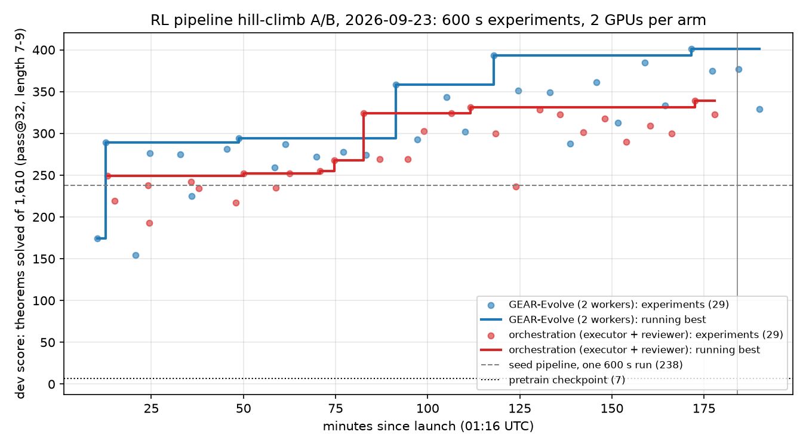

# GEAR versus review-gated orchestration: an A/B test of two agent frameworks hill-climbing the RL stage

Status: complete (search 01:16 to 04:20 UTC on 2026-09-23; sealed evaluation finished 04:45 UTC).

Question: given the same pretrained prover, the same frozen harness, two GPUs, two Claude agents and
three hours, which framework produces the better RL pipeline: GEAR-Evolve (a population-based search
controller, Jeddi et al. 2026) or Dan's review-gated research orchestration (pre-registration,
independent recount, reviewed incumbent)? The score is theorems solved at pass@32 on a sealed set of
1,610 length-7-9 theorems. After the search, each arm's chosen checkpoint was tested on sealed
length-10, length-11-14 and textbook sets that no agent ever saw.

## Summary

- **GEAR reached a dev score of 401; the orchestration arm reached 339 (best checkpoint) with 324 as its
  reviewed incumbent.** The unmodified seed pipeline scores 238 in one 600-second run and the pretrained
  checkpoint scores 7. Both arms ran exactly 29 experiments.
- **On the sealed length-10 set GEAR's checkpoint solved 15 to 20 of 907 theorems, the orchestration
  checkpoints 5 to 11.** No checkpoint solved more than one of the 459 length-11-14 theorems, and none
  solved any textbook problem with a reference proof longer than six lines. The pretrained model solves
  zero at length 10.
- **The two arms found different levers.** GEAR's recipe is many small rounds: 400-target windows with
  short fine-tunes, hardest targets refilled first, training samples at temperature 1.0, made affordable by
  a sampler that drops finished sequences from the batch and KV cache. A follow-up at equal sample counts
  shows the recipe is better per sample, not only per second (367-374 against 316-320 on dev). The
  orchestration arm's gain came from a hypothesis: textbook-schema targets were never being solved, so it
  added a dedicated exploration stream over them. That gain is seed-dependent (331 versus 236 on two seeds).
- **The review gates did what they are designed to do, at a cost.** Every count reproduced; the reviewer
  rejected seven single-seed claims, found a logging bug and a confounded run, and refused to adopt the
  339 checkpoint because its two-seed mean beat the incumbent by 12.5, under the +15 bar it had committed
  to in advance. The executor spent seven of its 29 runs on replicates.

## Configuration

**Task and data.** Start from `robbiethompson2018/nd-rl-checkpoints`, run `share_pretrain_4l_seed0`
(4 layers, d=256, 3.2M parameters, absolute tokenizer, pretrained on cap-6 proofs). RL targets: 3,804
theorems of true length 7-9 from the ladder-A `rl_targets` pool, plus 15,410 length-7-9 theorems from
its reserve pool as an optional extra. Retention data: the 154,990 cap-6 pretraining records. Sealed
sets, all disjoint from every training pool by atom-renaming class: dev = the ladder-A transfer pool at
length 7-9 (1,610); test-10 = both ladder pools at length 10 (907, of which 451 from the transfer pool);
test-11-14 = both pools at length 11-14 (459); textbook = the 58 problems in `textbook_dev.jsonl` from
the `dmitry/cap-comparison-textbook-eval-data` branch (reference lengths 1 to 33). SHA-256 of the
sealed files is in `evidence/` and in `/scratch/cowifornia/nd-rl/ab/sealed/SHA256SUMS`.

**Frozen harness.** One experiment = `rl.run(model, tok, targets, 600 s, ...)` followed by automatic
scoring at k=32, temperature 0.8, `max_new` 512. Only `rl.py` may change. The harness hashes every
frozen file into `summary.json`; the scorer runs on the host and returns only aggregate counts to the
agent's container. Full contract: `code/experiments/current/rl_hillclimb_ab_20260923/common/SPEC.md`.

**Arms.** Each arm ran in its own Docker container with only its arm directory mounted and two RTX 3090s.
Arm A (GEAR-Evolve): two Opus 5.5 workers sharing one frontier of four elites managed by a deterministic
controller implementing the paper's selection score, roles (BEST, LEAN, DIVERSE), crossover scheduling
and promotion margins, which the workers may edit under a logged protocol. Arm B (orchestration): one
Opus 5.5 executor holding both GPUs and one independent Opus 5.5 reviewer; the proposer and librarian
roles were folded into the executor (pre-registrations) and the reviewer (ledger and digest). Both arms
started from the same seed `rl.py` (plain expert iteration, 4 rounds, 1,500 targets, k=32) and the same
brief listing candidate directions. The seed pipeline's baseline node was the first experiment in each
arm. Deadline 04:20 UTC, three hours after launch.

**Post-deadline evaluation.** Each candidate checkpoint was scored on dev with a second sampling seed and
on the three sealed sets with two sampling seeds each (`common/final_eval.sh`). As an add-on, each arm's
framework-chosen recipe was run once more for 600 s with 456 length-10 targets added to the pool (seed 7)
and scored on the same sets; for that run the length-10 test is partly in-distribution, so only its
transfer-pool half (451) is clean.

**Code, seeds, artifacts.** Frozen sources, controller, briefs and container scripts:
`code/experiments/current/rl_hillclimb_ab_20260923/`. Raw runs, checkpoints, transcripts and the score log:
`/scratch/cowifornia/nd-rl/ab/` (not in Git; 71 run directories). Worker reports, the GEAR frontier,
history, decision and reflection logs, all 29 pre-registrations and 29 reviews, the ledger and digest:
`evidence/`. Scoring is at a fixed seed; training on GPU is not bit-reproducible.

## Observations

### Search phase

| arm | experiments | distinct recipes | best dev | median dev | running best (minutes after launch) |
|---|---:|---:|---:|---:|---|
| GEAR-Evolve | 29 | 29 | 401 | 294 | 289 at 13, 358 at 91, 393 at 118, 401 at 172 |
| orchestration | 29 | 22 (+7 seed replicates) | 339 | 269 | 249 at 13, 324 at 83, 339 at 172 |

GEAR's frontier at the deadline: n025 BEST 401 (temperature-1.0 rollouts on hardest-first refill windows,
held-out greedy 0.885), n017 LEAN 393 (400-target windows, 135 fine-tune steps, 15 rounds, held-out 0.910),
n023 385, n027 377. The step changes were: using the whole budget with more, shorter rounds (174 to 289);
the compacting sampler, which cut sampling from 50 to 30 seconds per round so ten rounds fit (289 to 358);
400-target rounds on top of it (393). Everything after that was within noise. Workers made six controller
edits (versions 3 to 8), for example skipping crossover partners that had scored well below their own
parent, after the forced crossover paired the best node with a known-bad GRPO node on description novelty
alone.

The orchestration ledger at the deadline: incumbent exp13 (324, textbook-source exploration stream at
temperature 1.0, held-out 0.896); exp23 (339, the same with a cheap late-round focus; replicate 323) not
adopted. Every allocation change before the textbook stream scored 193 to 268 and was rejected. The
executor's own pre-registration for exp13 predicted 250 and "about 5" textbook solves; it got 324 and 145.
Seed dependence of the stream: exp17 331 and 236; exp19 328, 301, 309; exp21 323, 318, 300; exp23 339, 323.

Things that did not help in either arm: a GRPO pass before the supervised step (GEAR: minus 56),
hindsight relabelling (about 15 by-products per run), rarity weighting, lighter cap-6 retention (minus 60),
persistent AdamW state (length 7 collapsed), sampling batch 1024, the extra 15k-target pool, learning-rate
changes, and a length curriculum (length 9 up, length 7 down, net zero).

### Sealed evaluation of the chosen checkpoints

Counts are theorems solved at pass@32; two sampling seeds are shown as a/b.

| checkpoint | dev (1,610) | length 10 (907) | length 10, transfer half (451) | length 11-14 (459) | textbook (58) | held-out greedy |
|---|---|---|---|---|---|---|
| pretrained model | 7 / 5 | 0 / 0 | 0 / 0 | 0 / 0 | 7 / 9 | 0.906 |
| GEAR n025 (BEST) | 401 / 406 | 15 / 20 | 7 / 7 | 0 / 0 | 7 / 7 | 0.885 |
| GEAR n017 (LEAN) | 393 / 378 | 17 / 11 | 9 / 6 | 0 / 0 | 7 / 6 | 0.910 |
| orchestration exp13 (incumbent) | 324 / 328 | 9 / 11 | 3 / 4 | 0 / 0 | 5 / 5 | 0.896 |
| orchestration exp23 (best) | 339 / 338 | 5 / 7 | 2 / 5 | 1 / 0 | 7 / 7 | 0.901 |

The textbook solves are the same seven-to-nine problems with reference proofs of one to six lines that
the pretrained model already solves. No checkpoint solved any of the 44 textbook problems with a
reference proof of seven or more lines. The orchestration arm's "textbook" gains were on the ladder
pools' schema-instantiated targets (contraposition, export and the like with random sub-formulas), and
they did not transfer to these problems.

### Add-on: train with length 10 in the pool, test at 11 and above

| recipe (one 600 s run, seed 7, 4,260 targets) | dev | length 10 transfer half (451) | length 11-14 (459) | textbook (58) | rounds | held-out greedy |
|---|---|---|---|---|---|---|
| GEAR n025 recipe | 388 | 5 | 1 / 0 | 9 / 7 | 17 | 0.891 |
| orchestration exp13 recipe | 290 | 1 | 0 / 0 | 5 / 6 | 5 | 0.909 |

Ten minutes of training that includes length-10 targets does not reach length 11.

### Follow-up: is GEAR's lead a throughput artefact? (run 04:55 to 05:25 UTC, seed 7, one run each)

Leon asked whether GEAR's compacting sampler amounted to gaming the wall-clock budget. Two tests, scored
on the sealed dev set with two sampling seeds and on the length-10 set (files under
`/scratch/cowifornia/nd-rl/ab/_followup/`):

| run | samples drawn | rounds | RL secs | held-out greedy | dev (s0 / s1) | length 10 (907) |
|---|---:|---:|---:|---:|---|---:|
| orchestration exp13 recipe with GEAR's sampler transplanted, 600 s | 211,936 | 5 | 560 | 0.911 | 304 / 306 | 3 |
| GEAR n025 recipe, fixed 13 rounds, no clock | 166,400 | 13 | 503 | 0.914 | 367 / 374 | 26 |
| orchestration exp13 recipe, fixed 4 rounds, no clock | 164,320 | 4 | 447 | 0.901 | 316 / 320 | 2 |

The transplant did not help the orchestration recipe (304 against 324 for exp13 itself), because that
recipe already compacted its sampler every 8 steps and its rounds are large: about 47,700 samples per
round including the textbook stream, against 12,800 for GEAR's 400-target windows. At equal samples,
GEAR's recipe still leads by about 50 dev theorems and by 26 to 2 at length 10, with the split reversed by
length: the orchestration recipe is stronger at length 7 (103 against 70, its schema targets) and GEAR's is
far stronger at length 9 (194-203 against 118-121). GEAR's recipe ran 1,755 fine-tune steps to the
orchestration recipe's 1,200 over the same samples and solved 1,548 training targets against 655.

Reading: the sampler let GEAR fit more rounds into 600 seconds, but the recipe is also better per sample.
What it does differently is many small rounds, each a 400-target window with a short fine-tune, hardest
targets refilled first, and training samples at temperature 1.0; that is closer to on-policy iteration
than the seed's four large rounds. The earlier statement in this note that GEAR's gains "came from
throughput" is therefore only half right. One seed per run; the ~50 margin is above the ~15 noise rule
but unreplicated.

### Process observations

- All 58 scored runs recorded frozen-file hashes identical to the manifests. A scan of all four
  transcripts found no attempt to read the sealed sets, the host filesystem or the other arm. No run was
  quarantined. No usage-limit pause occurred.
- The reviewer session ended itself after its setup message at 01:18 (a `claude -p` run ends when the
  model answers) and was resumed with its context at 01:20; a persistence instruction was then put in every
  worker's inbox and no other session stopped early.
- The reviewer's first re-score ran on a GPU the executor was using and slowed a clock-limited run by
  about 35 percent (exp03, rejected as confounded). After that the reviewer re-scored only on idle GPUs,
  which blocked its re-scores between 02:06 and 04:08 while both GPUs stayed busy.
- Scoring noise between sampling seeds on one checkpoint ranged from 1 to 15 theorems; training noise
  between seeds of one recipe ranged from 16 to 95.

## Interpretation

On this task and budget, GEAR's population search climbed faster and higher than single-incumbent
hill-climbing with review gates, and its checkpoint also extrapolated better to length 10. The follow-up
tests below show the gap is not a throughput artefact: at equal sample counts the GEAR recipe still trains
the better model. The plausible reasons for the search-phase gap are structural: GEAR promoted anything that beat the weakest elite by five theorems and immediately
recombined it, so the throughput discovery spread to every line within two crossovers; the orchestration
arm's +15-over-two-seeds bar and its replicate runs spent a quarter of its budget confirming rather than
exploring. That bar is also why its ledger is trustworthy in a way GEAR's frontier is not: n017's children
averaged about 360, so its 393 is partly luck, and the reviewer's own report says the same about
dev-selected checkpoints.

Neither framework produced longer proofs in the sense the project cares about. Length 10 moved from zero
to about two percent, length 11 and above stayed at zero, and the real textbook problems did not move.
The 600-second budget rewards throughput tricks, and the sealed dev set at length 7 is dominated by
schema-instantiated textbook targets that the orchestration arm learned to hit without that transferring
to Carr-style problems.

## Limitations and next step

This is one run per framework with the same agent model, so the ranking is anecdotal; the noise figures
above say how much. The proposer and librarian roles were not separate sessions. The 600-second budget
and the pass@32 dev metric shaped what "better" meant. The two arms could not see each other, but both
briefs listed the same candidate directions, which narrows the difference between frameworks to their
search and adoption rules.

Next: replicate the top recipe of each arm over four seeds at the same budget to separate recipe from
luck; then run the best recipe at a longer budget (30 to 60 minutes) with length-10 targets to see whether
length 11 opens at all; and build the length-7 dev bin from generator theorems, or report the schema and
generator halves separately, so the dev score cannot be moved by schema memorisation alone. For the
framework comparison itself, the useful second run is GEAR with the reviewer's two-seed rule inserted at
promotion time.
