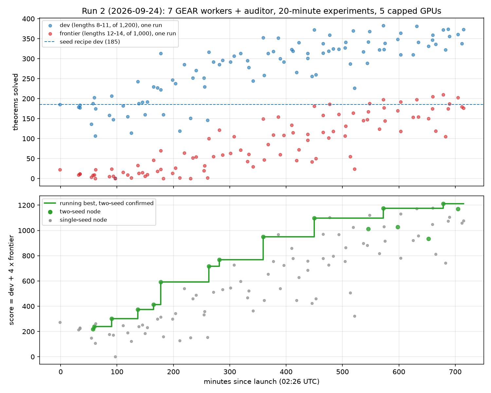

# Run 2: seven GEAR-Evolve workers and an auditor hill-climb the RL stage towards proofs of length 12-14

Status: complete (search 02:26 to 14:30 UTC on 2026-09-24; sealed evaluation 17:12 to 18:42 UTC; same-card
replicate of the top two recipes 18:44 to 20:30 UTC, in the "Same-card replicate" section).

Question: starting from the run-1 winner (small rounds, hardest-first refill, temperature-1.0 samples, compacting
sampler) and a target pool of true length 6-11, how far can twelve hours of autonomous hill-climbing with web
research push a 3.2M-parameter prover on theorems of true length 12-14 that it never trains on, and what limits it?

## Summary

- **Two-seed best after twelve hours: dev 383 of 1,200 (lengths 8-11) and frontier 198 of 1,000 (lengths 12-14)**,
  against 185 and about 20 for the seed recipe. A two-hour run of the best recipe on the full pool reached
  **dev 499 and frontier 322** (247 at length 12, 70 at 13, 5 at 14: the first length-14 proofs in either run).
- **Four levers did the work, all found by the workers from cited papers or their own diagnostics**: checking each
  proof line as it is generated and resampling rejected lines (doubled dev and frontier); a CUDA-graph version of
  that sampler (30 rounds per run instead of 18); a fix for training proofs whose renumbered line indices overflow
  the last index token (12% of length-11 samples were dying that way); and target subsets weighted towards the
  longest lengths and towards rare proof schemas.
- **Noise is large and the two-seed rule was essential.** Second seeds averaged 154 score points below first seeds
  and were lower in 13 of 16 replicates; identical code with the same seed differed by 34 to 234 points. Six nodes
  that a single seed would have crowned were stopped.
- **On the sealed half of the length-12-14 set the two-hour champion proves 707 of 1,931 theorems at pass@256**
  (570 / 127 / 10 at lengths 12 / 13 / 14), where the pretrained model and run 1's best prove none, and it is the
  first checkpoint to solve any textbook problem above six lines (3 of 44).
- **Nothing was quarantined in 99 nodes**; two rulings were needed (penalties on the model's own rejected samples:
  allowed; logit or head scaling inside the checkpoint: not promotable).

## Configuration

**Pools** (built the same morning with the fork's generator at depth 5-6 and up to 5 premises, then minimal-length
labelling to bound 16; `evidence/POOLS.md`): training targets 15,738 at true length 6-11 (1,000 / 2,500 / 2,500 /
2,500 / 2,500 / 4,738; 21% schema instances); visible dev 1,200 (300 per length 8-11, 40% schema); frontier 1,935
at 12-14, split in half by length and source into a visible half and a sealed half; 9 theorems at 15 (sealed); the
58 textbook problems (sealed). All class-disjoint, including under premise reordering; textbook and validation-36
classes excluded. Generation gave 560,000 distinct classes in two minutes; labelling took two hours; true length
collapses (91% of candidates with generation length 12 or more label 9 or shorter), so length 15-16 is essentially
unreachable with this generator.

**Harness.** As in run 1 (`code/experiments/current/rl_hillclimb_run2_20260924/common/SPEC.md`), with: 1,200 s
per experiment; dev scored at pass@32 and the frontier at pass@64 (from 03:02 UTC on a fixed stratified subset of
1,000 frontier theorems, 700 / 200 / 100 by length, because the full set cost ten minutes per experiment); a
per-GPU lock so eight sessions share five GPUs (made first-come-first-served at 05:00 after a worker starved for 41
minutes); a scoring service on the host that returns only aggregate counts. The GPUs carry an administrator-set
150 W power cap (350-450 W possible), so SM clocks sat at 210-780 MHz under load and differed by card; this is the
largest single source of run-to-run noise.

**Agents.** Seven Opus 5.5 workers in one GEAR-Evolve frontier of four elites, plus an Opus 5.5 auditor that
replicated every candidate BEST with a second seed, ran two-hour champion runs of the current best, audited every
promoted node's code, kept the ideas ledger and wrote a digest every two hours. All eight ran as in-process
sessions on host paths for twelve hours (no containers this time). Rules as in run 1: only `rl.py` changes; only
verified self-generated proofs, verified by-products and cap-6 records may be trained on; sealed files off limits;
every node cites a source. The controller began at run 1's version with a two-seed rule for BEST, a held-out floor
of 0.85 and cited sources; the workers changed it eight times (v10 to v17), each version passing its test suite and
a dry run before the monitor installed it. The promotion score changed at 05:31 UTC from dev alone to
dev + 4 x frontier, once the frontier signal proved real (all nodes were re-scored on the stored numbers).

**Records.** `evidence/`: the auditor's digests and report, the champion table, the ideas ledger (165 rows), the
reflection and decision logs, every worker's report, the final frontier and full node history, every controller
version, pool documentation and checksums. `code/experiments/current/rl_hillclimb_run2_20260924/`: harness,
controller, briefs, monitor scripts, pool-building tools, and the recipes of the nine key nodes. Raw runs and
checkpoints: `/scratch/cowifornia/nd-rl/ab2/` (not in Git).

## Observations

### The frontier at the deadline (score = dev + 4 x frontier; two seeds marked *)

| node | score | dev (8-11) | frontier (12-14 of 1,000) | held-out | what it adds, and who found it |
|---|---|---|---|---|---|
| n078 BEST* | 1,175 (1,198, 1,152) | 383 | 198 (L12 162-171, L13 43, L14 0) | 0.92 | index-shift cap on the CUDA-graph line-verified sampler with a rising training temperature (w2) |
| n092 LEAN* | 1,212.5 (1,286, 1,139) | 372.5 | 210 (L13 52 on seed 0) | 0.94 | last-three-round weight averaging on n078's line (w2); 2.5 points short of the promotion margin |
| n096* | 1,170.5 (1,311, 1,030) | 360 | 202 | 0.93 | 9,000-target subset on the weight-averaged line (w3); first seed had one length-14 solve |
| n060* | 1,098 | 372 | 181.5 | 0.92 | CUDA-graph sampler on the schema-coverage node (w5); champion 2's recipe |

Seed recipe (n000): dev 185, frontier 18 on the full set at 02:27; re-run under the later, hotter conditions at
06:48: dev 177, frontier 10. Running best of the two-seed score: 300 (05:31) → 591 (06:11) → 769 (08:13) → 950
(09:11) → 1,098 (10:38) → 1,175 (12:45).

### Champion runs (two hours on one GPU)

| recipe | 20-min two-seed dev / frontier | 2-hour dev / frontier | length 12 / 13 / 14 | rounds, samples |
|---|---|---|---|---|
| n024 on its fixed 6,000-target subset | 313 / 69.5 | 410 / 220 | 171 / 49 / 0 | 91, 1.16M |
| same, checkpoint at 50 minutes | | 397 / 216 | 166 / 49 / 1 | 43 |
| n060 on all 15,738 targets | 372 / 181.5 | 499 / 322 | 247 / 70 / 5 | 110, 1.40M |

The first champion saturated its subset after 50 minutes (3,890 of 6,000 solved) and gained nothing in the
remaining 70; the second, on the whole pool, kept climbing and solved 10,564 of 15,738 targets. Held-out accuracy
stayed at 0.92-0.94 in both.

### What moved the score (each with the node that established it; single seed unless stated)

- **Line-verified sampling** (arXiv 2502.03438, implemented independently by w1, w6 and w4): an incremental Fitch
  checker validates each generated line; a rejected line is masked out of the KV cache and resampled from the
  saved line-start logits, up to a retry budget. Dev 206.5 vs 185 two-seed at first (n010), then 314 / 59 vs 188 /
  13 on a GEM-loss base (n024). Every later elite carries it.
- **A CUDA-graph decode step for that sampler** (w3, n046): sampling 38 → 21 s per round, 30 rounds instead of 22,
  score 591 → 950.5 two-seed.
- **Capped line-index shift** (w2, from a CPU diagnostic, n023 → n036 → n078): the tokenizer's random start-index
  augmentation spread proof starts over N1-N59, so long proofs ran past N64 and died (12% of length-11 samples on
  n006). Capping starts at N41 added 125 (two-seed) to 244 points on four lines. The control that always starts at
  N1 (n030) collapsed length 11 to zero: the shift augmentation is what lets the model count past its longest
  trained proof.
- **Target subsets that favour long lengths and rare schemas**: length-weighted quotas (L6 0.5 … L11 3) doubled the
  frontier on the line-verified base (n038, +306 two-seed) after losing 8 points on the plain sampler at 02:48;
  schema coverage (every rare textbook schema fully represented in each length's quota) +136 on one seed (n041)
  and again in n050 and n060.
- **Mixed, unresolved on single seeds**: rising training temperature 1.0 → 1.3 (POLARIS; +167 on one line, -99 to
  -241 on others); weight averaging of the last three to five rounds (+152, +183, -433); easy-to-hard first pass
  (+56, -187); a 9,000-target subset (+132 on a fast card, refuted as a fixed setting after two replicates lost).
- **Did not help**: negative-sample penalties on the first invalid line (dev collapsed to 1), step-level DPO
  (-537), backtracking in the sampler (slower, no more solves), fine-tune batch 256 (-227 on capped GPUs),
  longest-first proof selection (-303), retry heating (-323), annealed decoding (dev 107), knapsack-style k by
  length, GEM loss without line verification, entropy minimisation on citations, hindsight relabelling (1-8 proofs
  per round), shape-weighted retention, replacing retries with fresh targets.

### Noise, and what the two-seed rule caught

Replicates ran on whichever card was free; under the power cap a card's speed sets the round count (16 to 30 for
one recipe), and slower cards drew the replicates more often than the first seeds. Second seeds averaged -154 score
points; six same-code, same-seed pairs differed by 34 to 234 points. The rule stopped n010, n075 (1,183 → 840),
n082 (1,218 → 835), n088 (1,235 → 631), n096 (1,311 → 1,030) and n092 (1,286 → 1,139) from taking BEST on one seed,
and the stale-pending demotion added at v12 saved six replicates. The same-card replicate below shows how much of that
spread was the card.

### Same-card replicate

After the run the monitor reran the two top recipes, n092 (LEAN) and n078 (BEST), with two fresh seeds each, one
after another on GPU 4 (`evidence/samecard/`, script `same_card_compare.sh`), 1,200 s each, scored exactly as
during the search.

| recipe | seed | dev (1,200) | frontier (1,000) | score | rounds |
|---|---:|---:|---:|---:|---:|
| n092 | 101 | 364 | 226 | 1,268 | 30 |
| n092 | 102 | 367 | 229 | 1,283 | 30 |
| n078 | 101 | 367 | 221 | 1,251 | 29 |
| n078 | 102 | 368 | 214 | 1,224 | 29 |

On one card, seeds of the same recipe differ by at most 4 dev and 7 frontier theorems (15 and 27 score points),
against 34 to 234 points for the same code on different cards during the search. The card, not the seed, made most
of the search's noise. The two recipes are close: n092 leads by 38 score points on the two-seed means (1,276
against 1,238), a gap slightly larger than either recipe's seed spread, so the controller's BEST (n078) was not the
better recipe on equal hardware, but the difference is small next to the recipes' lead over the seed (185 dev).

### Sealed evaluation

Scored by the monitor after the deadline on GPUs the agents no longer held (`monitor/final_eval_ab2.sh`). The sealed
half of the length-12-14 set (1,931 theorems) was never seen by any agent; the visible half is shown alongside it
so leakage can be judged. Counts are theorems solved at the stated k; the pretrained model and run 1's best
checkpoint (trained on lengths 7-9 only) are the references.

| checkpoint | dev, seed 1 (1,200) | visible 12-14, full set, k=64 (1,935) | **sealed 12-14, k=64** (1,931) | **sealed 12-14, k=256** | sealed L12 / L13 / L14 at k=256 (1,414 / 359 / 158) | sealed 15 (9), k=256 | textbook (58), k=256 |
|---|---|---|---|---|---|---|---|
| pretrained model | 1 | 0 | 0 | 0 | 0 / 0 / 0 | 0 | 9 |
| run 1 best (n025) | 96 | 0 | 0 | 0 | 0 / 0 / 0 | 0 | 9 |
| n078 BEST, seed 0 | 376 | 408 | 437 | 515 | 420 / 88 / 7 | 1 | 9 |
| n092 LEAN, seed 0 | 387 | 450 | 462 | 519 | 422 / 92 / 5 | 0 | 10 |
| champion 2 (n060, full pool, 2 h) | 497 | 649 | **667** | **707** | 570 / 127 / 10 | 2 | 10 |

The sealed half tracks the visible half within a few percent for every checkpoint (n078 437 sealed against 408
visible at the same k), so the search did not overfit the frontier set it could see. At k=256 the two-hour
champion proves 37 percent of the sealed length-12-14 theorems (40 percent at length 12, 35 percent at 13, 6
percent at 14), two of the nine length-15 theorems, and 10 of the 58 textbook problems: the nine short ones the
pretrained model already solves plus, for the first time in either run, one seven-line and two eight-line textbook
problems (3 of 44 with reference length seven or more).

### Process

- Eight sessions ran the full twelve hours with no usage-limit pauses and no early exits. Workers could not
  overwrite the controller file themselves (a tool-permission refusal that did not apply to w2 and w4 at other
  times), so the practice became: a worker stages a tested candidate, the monitor installs it. Two workers' final
  reports could not be written by their sessions and were saved from their hand-backs.
- Monitor decisions in order: frontier scoring moved to a fixed 1,000-theorem subset (03:02); the promotion score
  became dev + 4 x frontier (announced 04:40, installed 05:31); GPU lock made FIFO (05:00); ruling that penalties on
  own rejected samples are allowed (04:32) and that logit or head scaling is not promotable (06:00); duplicate-code
  nodes counted as extra runs of one recipe (05:20, 09:00); champions restricted to two, restarted once when BEST
  moved six minutes after launch, and run on the full pool from champion 2 (08:25); margin widened to 40 (06:25).
- The auditor's limiting-factor readings moved from exploration-bound (04:25: two thirds of targets never solved,
  length-11 solves appearing only in the last rounds) to sampling-bound (06:20: line verification halved
  throughput) to mildly sampling-bound with healthy long-length exploration (10:20), and to subset-exhaustion at
  the two-hour budget.

## Interpretation

The run's product is a recipe, not a checkpoint: line-verified sampling plus the index-shift fix plus long-heavy
target subsets, run on the whole pool for as long as the budget allows. On the visible frontier that recipe moves
length 12 from one percent to a quarter of theorems and length 13 from zero to a fifth within two hours, and
produces the first length-14 proofs. Length 14 remains near zero because its theorems are dominated by one De
Morgan schema whose proof shape the model has never emitted; the workers' diagnostics point at two further
ceilings, citation errors (about 0.42 invalid-token mass per proof at temperature 0.8 against 0.05 for formula
bodies) and box depth (found proofs reach depth 5 while the cap-6 data stops at depth 3), both of which look like
the same kind of counting gap the index-shift fix closed.

## Limitations and next step

Single-seed comparisons in this run are confounded by card speed under the power cap; only the two-seed means and
the champion runs should be quoted. The visible dev and frontier sets were used for promotion, so the sealed half
of the 12-14 set and the textbook set are the numbers that count; see the sealed-evaluation section. Length 15-16
could not be tested beyond nine theorems. No agent saw the sealed files (instruction plus transcript audit, no
container this time).

Next (run 3, set up 2026-09-24 evening): a compute-metered budget replaces the wall clock, so card speed no
longer changes the score; before it, a length-generalisation experiment trains the plain recipe on lengths up to
7, 9 and 11 and tests every length to 18. Earlier list: replicate on the first seed's card and add a duplicate-run path to the controller; make the pool refill
budget-aware so long runs never saturate; raise the GPU power cap if the machine allows it (the single largest
throughput lever); and attack length 14 and the textbook problems by making the classical-detour shapes appear at
all, for example by seeding their closing steps or by extending the pool past length 11 with a generator that
produces deeper boxes.
