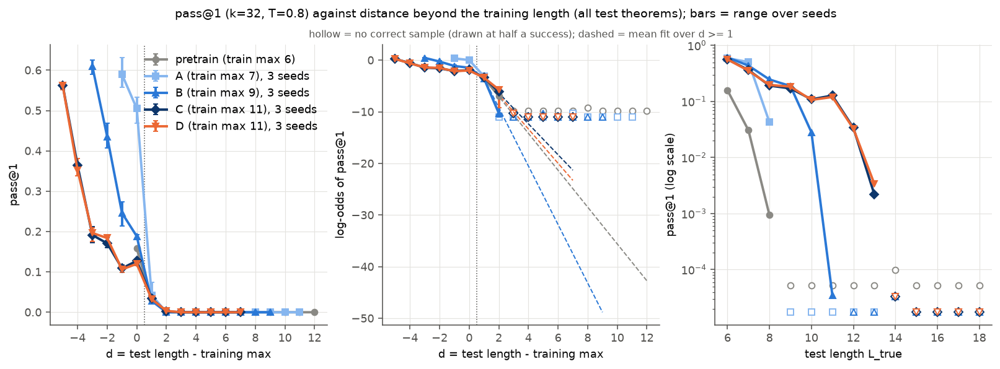
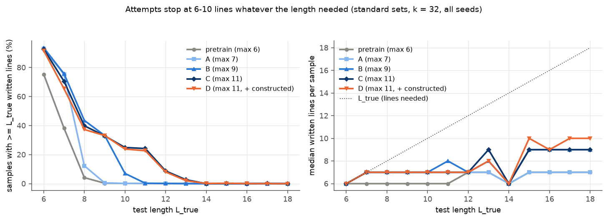
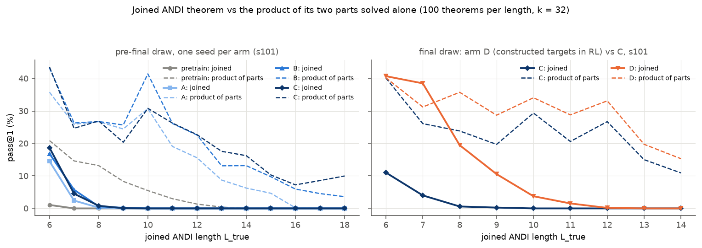

# Length generalisation: does RL on longer proofs generalise, or only move the edge?

Status: complete. Arms A, B and C were trained on 2026-09-24. Arm D, the final test draw, the composition diagnosis
and the analysis followed on 2026-09-25. This was a monitor-run experiment: no hill-climbing agent saw any of it.

Question: a small natural-deduction prover is pretrained on proofs of at most 6 lines. Does RL training on longer
proofs make it better at proofs of any length? Or does it only move the edge of what it can do? A follow-up asks why
long constructed theorems fail, and whether training on constructed composition targets helps.

## Summary

- **RL moves the edge. Nothing generalises past it.**
  - RL raises pass@1 up to the arm's own training maximum (12.7% at length 11 for C, against 0% before RL).
  - One line past its training maximum, each arm's pass@1 is 2.8-4.3%. Two lines past, it is at most 0.3%.
  - No arm solves anything at lengths 14-18.
- **Attempts are too short.**
  - At every test length the median attempt has 6-10 written lines.
  - From length 14 on, no arm's attempts are as long as the theorem needs (at most 0.3%).
  - Faked conclusions are a minority of failures: mostly 4-12%.
- **Long constructed theorems also fail because the model does not compose.**
  - The two halves of a conjunction theorem are each solved about half the time.
  - The joined theorem is solved at 15-21% of the rate that solving the parts independently would give, and not at
    all from length 10.
  - Prompt format changes nothing.
- **Training on constructed targets (arm D) teaches composition only at short lengths.**
  - At joined length 6-9, D reaches 80% of the part product; C reaches 14%.
  - From length 10 on, D reaches only 4%. On the standard test sets D equals C, within 1.6 points.
  - D's RL rarely found proofs of its long constructed targets, so it had little to learn from there.

## Setup

- **Model.** The run-3 base checkpoint: a 4-layer GPT, d = 256, 8 heads, 3.2M parameters, absolute line-index
  tokenizer (N1 to N64). It is pretrained on 154,990 proofs of at most 6 lines ("cap-6") and has no RL
  (`evidence/SPEC_ab3_frozen.md`).
- **Recipe.** The run-3 seed recipe: plain expert iteration against the verifier (`rl_C.py` in the working folder).
  - Each round samples 32 proofs per target at temperature 1.0 for a 400-target window.
  - The verified proofs are fine-tuned on for 135 steps with a fresh AdamW, mixed with 20,000 cap-6 records.
  - Each run uses a 6,000-target subset drawn with equal numbers per length.
  - Line-index starts are capped, so trained proofs fit N1-N64 with room for 24 lines.
- **Compute.** Every run has the same metered budget: 3.9e15 FLOPs (`evidence/SPEC_ab3_frozen.md`). All 12 runs used
  99.3-99.7% of it, in 24.5-36.0 minutes on one RTX 3090 each (`evidence/runs_summary.json`).
- **Arms.** A, B and C differ only in their caps; D is C with a different RL pool. Each cap is set to the same value
  twice:
  - `max_len_train` drops targets longer than the cap;
  - `max_proof_lines_train` drops found proofs with more written lines than the cap.

  | arm | RL targets (true length) | caps | rounds | samples | held-out greedy (cap-6) |
  |---|---|---|---|---|---|
  | pretrain | none (pretrained on ≤ 6 lines) | - | - | - | - |
  | A | 6-7 | 7 | 73 | 0.93M | 0.96 |
  | B | 6-9 | 9 | 65 | 0.83M | 0.95-0.96 |
  | C | 6-11 | 11 | 64 | 0.81M | 0.95-0.96 |
  | D | 6-11, plus constructed ANDI/chain targets (30% of each length) | 11 | 65 | 0.83M | 0.95-0.96 |

  Rounds, samples and held-out figures come from `evidence/runs_summary.json`. Arm D's pool is run 2's 15,738
  targets plus 6,744 constructed ones (`evidence/POOLS_COMP.md`). D ran through a frozen harness copy whose only
  changed file is the target pool.
- **Seeds.** 101, 102 and 103 for each RL arm. Pretrain is one checkpoint.
- **Test sets** (`evidence/testsets_MANIFEST.json`, `evidence/report.md` header). Up to 300 theorems per length:

  | lengths | source | notes |
  |---|---|---|
  | 6-7 | fresh run-2 reserve records | 60% generator, 40% textbook schemas |
  | 8-11 | run 2's dev set | 60% generator, 40% textbook schemas |
  | 12-14 | run 2's sealed set | length 14 has only 158 theorems, 114 of them textbook instances of a single schema |
  | 15-18 | constructed sets built for run 3 | conjunctions of two small theorems ("ANDI") and cut compositions ("chain"); ANDI is 74% of length 17 and 94% of length 18 (`evidence/report.md` §8) |
  | 6-14 | matched set of the same constructions | a control for construction style; roughly half ANDI and half chain |

  - Every test theorem is class-disjoint from all RL pools, from arm D's pool and from the pretraining data (0
    overlaps).
  - After the data builder finished the long sets, the constructed sets were redrawn from the final files. Only 63%
    of the earlier matched draw and 65% of the earlier length 15-18 draw survived (`evidence/redraw_check.json`).
    Every arm was evaluated on the final draw.
- **Evaluation.**
  - 32 samples per theorem at temperature 0.8, up to 1,024 new tokens, each checked by the verifier.
  - An incremental checker finds each failed sample's first bad line. It agreed with the verifier on all 2,686,528
    evaluated samples (`evidence/report.md`, Checks).
  - pass@k are unbiased estimates from the 32 samples.
- **Construction caveats** (`evidence/POOLS_ab3_sealed.md`).
  - The constructions have about twice run 2's premise count.
  - ANDI prompts are capped at 60 tokens.
  - 548 of the 600 ANDI labels at lengths 17-18 are certified upper bounds rather than exact minimal lengths.
    Additivity held in 2,736 of 2,736 exact cases.

## Results

### pass@1 by arm and test length (standard sets; mean of 3 seeds, in %)

Bold marks each arm's own training maximum. Source: `evidence/report.md` §1, with seed ranges there.

| arm | L6 | L7 | L8 | L9 | L10 | L11 | L12 | L13 | L14 | L15-18 |
|---|---|---|---|---|---|---|---|---|---|---|
| pretrain | **15.8** | 3.1 | 0.1 | 0.0 | 0.0 | 0.0 | 0.0 | 0.0 | 0.0 | 0.0 |
| A | 58.9 | **50.5** | 4.3 | 0.0 | 0.0 | 0.0 | 0.0 | 0.0 | 0.0 | 0.0 |
| B | 61.0 | 43.5 | 24.6 | **18.8** | 2.8 | 0.0 | 0.0 | 0.0 | 0.0 | 0.0 |
| C | 56.2 | 36.4 | 19.1 | 17.1 | 10.9 | **12.7** | 3.4 | 0.2 | 0.0 | 0.0 |
| D | 56.2 | 35.3 | 19.6 | 18.4 | 10.6 | **12.0** | 3.3 | 0.3 | 0.0 | 0.0 |

pass@32 reaches at most 13.3% one line past an arm's training maximum and at most 1.7% two lines past
(`evidence/report.md` §1).

### Distance past the training maximum

- **One line past.** pass@1 is 3.1% (pretrain), 4.3% (A), 2.8% (B), 3.4% (C) and 3.3% (D).
- **Two lines past.** It is 0.0-0.3% for every arm.
- **Fitted slopes.** Per run, a logistic in the distance d was fitted over d ≥ 1 (`evidence/report.md` §2):
  - Pretrain drops 3.57 log-odds per extra line (one run).
  - C drops 2.99 [95% seed interval 0.99-4.99]; D drops 3.32 [-1.89 to 8.52]. D minus C is 0.32 steeper, with Welch
    p = 0.82.
  - A's slope cannot be estimated: nothing is solved beyond one line past its maximum. B's slope can be estimated
    for one seed only (5.66).
  - So the planned test of whether the slope depends on the training maximum could not be run. Generator-only fits
    give the same picture: C 3.08, D 3.39.

### Attempt lengths and fake finishes

- **Written lines** (`evidence/report.md` §7).
  - The median attempt has 6-10 written lines at every test length, for every arm.
  - The share of attempts at least as long as the theorem needs, for arm C, is 93% at length 6, 40% at 8, 25% at 10,
    9% at 12, 3% at 13 and 0% at 14-18.
  - Arm A's share is already 0% at length 9.
- **Fake finishes** (`evidence/fake_finish.md`).
  - A fake finish is a failed sample whose first bad line states the theorem's conclusion with an invalid step.
  - Fake finishes are 4-12% of failed samples at most standard lengths. The exceptions are length 13 (11-23% for
    the RL arms, 28% for pretrain) and pretrain at length 14 (25%). At lengths 15-18 they are 1-6%.
  - So most attempts are not fake finishes. They break earlier, on an ordinary invalid step.

### Where failures happen

- **Position** (`evidence/report.md` §4).
  - The first rejected line is on average at line 3.2-5.3 at test lengths 6-14. At 15-18 it is at line 5.1-6.9
    for the RL arms and 4.1-4.3 for pretrain.
  - At most 7% of all failures fall at the arm's own training maximum or the two lines after it, because few
    attempts survive that far.
- **Hazard** (`figures/fig_hazard.png`: the chance that line p fails when lines 1 to p-1 were valid). On the long
  test sets (16 and 18) the attempts that do survive fail almost surely near their arm's own training maximum. The
  hazard is close to 1 by about line 6 for pretrain, lines 7-8 for A, line 10 for B and lines 11-13 for C and D.
  This is a reading of the figure; the hazard values are not tabulated.
- **Other failure kinds.** Early QED is at most 1% of failures and running out of tokens 0%.
- **Running past N64.** Line indices past N64 affect at most 1% of pretrain's failures. 22% of pretrain's samples
  start too high to fit 18 lines; for the RL arms, 0% do.

### Label checks

- No correct proof at any length was shorter than its label: 0 theorems across all arms, with a median excess of 0
  lines (`evidence/report.md` §3). So labels that are too high do not inflate the long-length results.
- Certified upper-bound labels at 17-18 are covered in the setup caveats.

### Composition diagnosis (ANDI theorems)

**Method.** For 100 ANDI theorems per joined length:
- Both parts were evaluated alone, on one seed per arm.
- Two baselines: "product" is the rate expected if the two part proofs were simply written one after the other with
  independent errors; "min" is the rate of the weaker part, a ceiling.
- Sections 1-5 of `evidence/composition.md` used the earlier draw. Those theorems are valid, but not all are in the
  final files. The arm-D comparison uses the final draw.

**Joined vs product, joined length 6-9** (`evidence/composition.md` §1):

| arm | joined pass@1 | product of parts | joined / product [95% theorem bootstrap] | mean part pass@1 |
|---|---|---|---|---|
| pretrain | 0.3% | 14.3% | 0.02 [0.01, 0.03] | 40.9% |
| A | 4.3% | 28.2% | 0.15 [0.11, 0.20] | 54.6% |
| B | 5.9% | 30.5% | 0.19 [0.14, 0.25] | 55.8% |
| C | 6.0% | 28.9% | 0.21 [0.15, 0.27] | 53.8% |

**Findings** (`evidence/composition.md`; §2 onward):
- **Longer joined theorems.** At joined length 10-14 the joined rate is 0% for every arm, while the product is
  16-23% for A-C.
- **Prompt controls.** Grouping premises by part, ordering conjuncts to match the premises, and restoring the
  original atom letters change pass@1 by at most 1.1 points. Every 95% interval includes zero (§3).
- **Attempt length.** The RL arms' joined attempts have a median of 7-9 lines; pretrain's have 6-7. At joined
  length 6-9, 35-55% of them are long enough; at 10-14, 0.4-5.2%; at 15-18, 0%. The parts alone are written to full length 98-99% of the time.
- **Long-enough attempts still fail.** At joined length 6-9, joined attempts that are long enough are correct only
  10-13% of the time, against the 28-31% product (§2).
- **Premise count.**
  - The pretraining data has 0-3 premises and never 4 or more. 57% of the joined theorems have 4 or 5.
  - More premises lower both joined and part rates.
  - Joined theorems with 3 premises still reach only about a quarter of their product (§4).
- **Failure location** (§5). Across all seeds at joined length 6-9, failed joined samples of the RL arms break down
  as:
  - writing a conjunct with an invalid step: 29-33%;
  - citing the other part's premises or lines: 22-25%;
  - writing the joined goal with an invalid step: 17-22%.

  In 73-75% of them, neither conjunct had been validly derived before the error.

### Arm D (constructed targets in RL) against arm C

- **Standard sets** (`evidence/report.md` §8).
  - D's pass@1 differs from C's by -1.1 to +1.3 points at every length from 6 to 18, and pass@4 by -1.6 to +1.3.
  - Both arms are at 0% from 14 to 18.
- **Constructed matched set, all families** (§8). D - C by length:

  | length | 6 | 7 | 8 | 9 | 10 | 11 | 12 | 13-14 |
  |---|---|---|---|---|---|---|---|---|
  | D - C | +34.0 points (11.6% → 45.6%) | +29.5 | +22.5 | +11.5 | +5.8 | +2.2 | +1.3 | about 0 |

  - For ANDI, D rises from 12.5% to 39.5% at length 6, from 3.9% to 37.8% at 7 and from 0.1% to 13.1% at 9. It
    reaches only 1.7% at 11.
  - The sealed constructed sets at 15-18 are 0% for both arms, in every family.
- **Joined vs product, final draw, s101** (`evidence/composition.md` §6).
  - At joined length 6-9, D solves 27.3% against a product of 34.0%, a ratio of 0.80 [0.67, 0.94]. C solves 4.0%
    against 27.5%, a ratio of 0.14.
  - At joined length 10-14, D's ratio is 0.04 [0.02, 0.07].
  - At length 6, D's joined rate equals the product: 40.7% against 40.2%.
- **Training side** (`evidence/report.md` §5). By the end of training, D had solved 93-98% of its ANDI training
  targets at lengths 6-7, 62% at 8, 44% at 9, 16% at 10 and 4% at 11. These rates are estimated from the pool
  shares, because the subset was not logged by family.

## Interpretation

**Observed.**
- RL on longer targets raises accuracy up to the trained length.
- Past it, every arm fails the same way: a few percent one line past the maximum, near zero two lines past.
- Attempts stop at 6-10 lines whatever the theorem needs.
- On long tests, attempts that survive die near their own arm's training maximum.
- On constructed theorems the model also fails to put two solvable halves together, and prompt format is not the
  reason.
- Training on constructed targets fixes that at the short lengths where the model found proofs, and nowhere else.

**Hypotheses, not tested here.**
- *"RL only moves the edge."* The data fit it: the one-line-past rate is similar across arms. The stronger test,
  equal per-line slopes, could not be run because arms A and B hit zero too soon.
- *Expert iteration can only reinforce proofs the model already finds.* Long targets, standard or constructed,
  rarely yield a proof, so they give little training signal. D's solve rates on its own constructed targets are
  consistent with this.
- *A stopping or length habit, not missing skill for the parts, sets the wall.* The parts are written to full
  length; joined attempts are not. The hazard rising near each arm's own maximum points the same way.

## Limitations

- **Seeds.** Three seeds per arm. Slopes for A and B could not be estimated, and the intervals for C and D are wide.
  The part-alone test used one seed per arm.
- **The test mix changes with length.**
  - Textbook schemas are 40% at 6-12, 34% at 13 and 72% at 14, where they come from one schema.
  - 15-18 is constructed only. Constructed theorems are much harder at short lengths: 11.6% against 56.2% for C at
    length 6 (`evidence/report.md` §6).
  - So the zeros at 15-18 mix length with construction style.
- **Labels.** At 17-18 most labels are certified upper bounds.
- **Earlier draw.** Composition sections 1-5 used the earlier draw.
- **D's pool changes more than composition.** The constructed 30% of its targets also have about twice run 2's
  premise count (`evidence/POOLS_COMP.md`).
- **Line count and token position cannot be separated.** Longer proofs also reach token positions not seen in
  training.

## Next steps

Two approved experiments were running when this was written; both train with arm C's recipe. They have since been
reported in [representation and goal notes](../2026-09-25-representation-and-goals-length/README.md), followed by a
[mid-training test](../2026-09-26-midtraining-long-glued/README.md).
- **Representation** (`/scratch/cowifornia/nd-rl/ab3/repr`): five tokenizer and position-encoding variants, three
  seeds each.
- **Goals** (`/scratch/cowifornia/nd-rl/ab3/goals`): the prover writes its own `GOAL` notes between proof lines.

Context only: the same seed recipe and budget on the new "039" pretrained checkpoint reached dev pass@32 of
43-49%, against 24-25% on this base (`evidence/base039_context.json`).

**Observation added 2026-09-28 (existing outputs, no new runs): recipes without the written-line cap train on long
proofs and get further** (`evidence/uncapped_written_length.json`).
- **The difference.** Every arm here drops found proofs longer than its cap in written lines. The run-3 seed recipe
  and run 2's recipes keep a found proof of a length-6-11 target however long it is written.
- **Run 2's two-hour champion** (old base, [run-2 record](../2026-09-24-rl-hillclimb-run2/README.md#sealed-evaluation)).
  - 86% of the found proofs of its length-11 targets had 12-21 written lines.
  - On the sealed length-12-14 set, the source of this experiment's 12-14 tests, its pass@1 is 13.9% / 11.1% / 1.5%
    at L12 / 13 / 14, against 3.4% / 0.2% / 0% for arm C here.
- **The run-3 seed recipe on the 039 base.**
  - It keeps 5.8-9.7% of its found proofs at 12-15 written lines.
  - It scores 10.3-15.6% pass@1 at L13 on the harness frontier set (four runs). The capped arm-C recipe on the same
    base scores 1.2% at L13 on this record's test set (the mid-training record's base arm).
- **Reading.** This fits the main finding if "trained length" means the written length of the training proofs, not
  the targets' true length.
- **Not a controlled comparison.** The champion also ran about three to four times the wall time and trained with
  line-verified sampling, and the frontier set is not the sealed set. The controlled test is arm C with and without
  the written-line cap at equal compute, or scoring the existing seed-recipe checkpoints on this record's test sets.
  Neither has been run.

## Records

- **Code as run:** [code/experiments/current/length_generalisation_20260925](../../code/experiments/current/length_generalisation_20260925/README.md),
  with the commands, scratch paths and checkpoint hashes.
- **Raw data** (not in Git): evaluations, samples and checkpoints are under `/scratch/cowifornia/nd-rl/ab3/lengthexp/`.
- **`evidence/`:**
  - `report.md` and `results.json`: the main analysis, generated.
  - `composition.md` and `composition_results.json`: the composition diagnosis and arm D.
  - `fake_finish.md` and `.json`; `runs_summary.json` (per-run training statistics and checkpoint hashes).
  - `redraw_check.json`; `base039_context.json`.
  - `testsets_MANIFEST.json` (final draw) and `testsets_MANIFEST_predraw.json`.
  - The data builder's notes (`POOLS_ab3_sealed.md`, `FEASIBILITY_ab3_long_sets.md`, `POOLS_COMP.md`) and checksums
    (`sealed_SHA256SUMS`, `data_comp_SHA256SUMS`).
  - `SPEC_ab3_frozen.md`: the run-3 harness specification.
  - The figure links inside `report.md` and `composition.md` refer to files now in `figures/`.
- **`figures/`:** `fig_main.png` (pass@1 against distance), `fig_main_gen.png` (generator theorems only),
  `fig_matched.png` (standard vs matched), `fig_attempts.png`, `fig_first_error.png`, `fig_hazard.png` and
  `fig_composition.png`.
