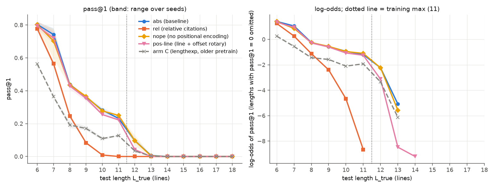
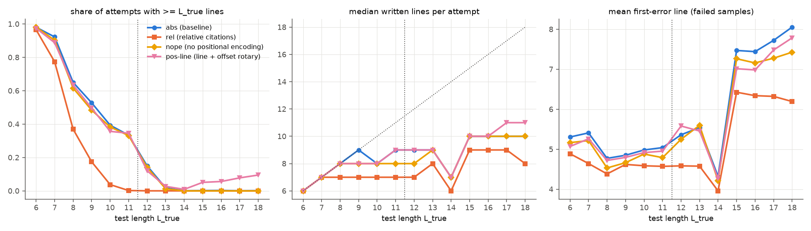
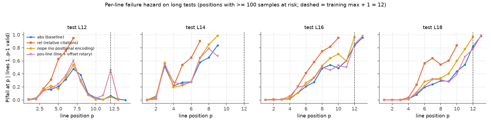
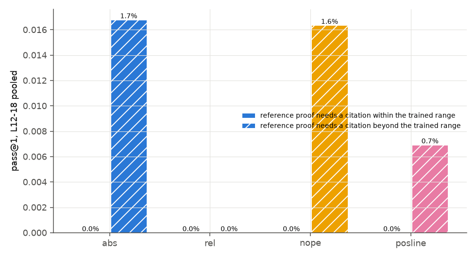
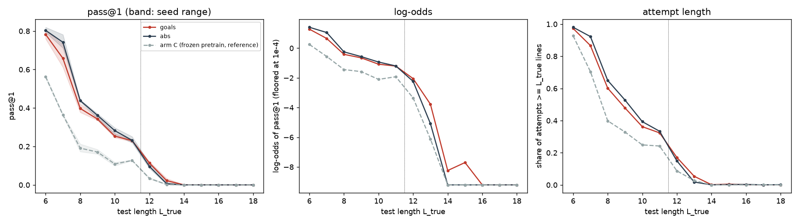

# Representation and goal notes: do they help the prover past its training length?

Status: complete for abs, rel, nope, pos-line and goals (3 seeds each). pos-rand is pretrained only; how it should
sample and be evaluated awaits the PI's decision (see "Pending decision"). Both experiments were run by the
monitor's agents on 2026-09-25.

Question: the prover is trained by RL on theorems of true length 6-11. Past 11 lines it fails. The preceding
[length-generalisation experiment](../2026-09-25-length-generalisation/README.md) found that its attempts are too
short, and that attempts that survive die near the longest proofs it trained on. Does changing how a proof is
**represented** move that wall? Training stays on lengths 6-11; testing covers every length from 6 to 18. Two sibling
experiments share one baseline (abs):
- **repr:** five representations of line positions and citations.
- **goals:** the prover writes its own notes of what it still has to prove.

## Summary

- **No representation moves the wall.**
  - Past length 11 every variant falls off at the same place, except rel, which falls off earlier.
  - pass@1 is at most 2.2% at length 13 and 0.0% at lengths 14-18, for every variant.
  - On long tests, the attempts that survive die one to three lines past the longest trained proofs (11 lines).
- **Removing positional encoding changes nothing (nope).** nope matches abs at every length: 9.6% against 9.6% at
  length 12.
- **Line-based positions do slightly worse just past the training length (pos-line).** 4.2% against 9.6% at
  length 12. In distribution they match abs.
- **Relative citations fail for a reason unrelated to length (rel).** The model never learned to cite more than 5
  lines back, because pretraining proofs never do. Almost every long test proof needs a longer jump. rel already
  collapses at lengths 9-11.
- **Goal notes help a little at lengths 12-13 and not beyond (goals).**
  - pass@1 at 13 is 2.2% against 0.6% for abs.
  - In distribution goals is about 3 points lower.
  - On long conjunctions the model plans the split, but after finishing the first part it rarely notes the part it
    still owes.

## Setup

- **Model.** A 4-layer GPT, d = 256, 8 heads.
  - Every repr variant has 3,210,240 parameters. goals has 512 more, for its one extra token (`evidence/pretrain_summary.json`).
  - All share the same vocabulary of 99 tokens (100 for goals).
- **Variants.**

  | variant | what the model reads and writes | positions seen by attention |
  |---|---|---|
  | abs (baseline) | line indices N1..N64 written out; citations name a line index | RoPE on token positions |
  | rel | no line indices; a citation says how many lines back (B1, B2, ...) | RoPE on token positions |
  | pos-rand | as abs | RoPE; in training, each sequence gets a sorted random subset of positions 0-1023 (Ruoss et al. 2023) |
  | nope | as abs | none: the causal mask only (Kazemnejad et al. 2023) |
  | pos-line | as abs | two-part rotary: half the rotary pairs turn with the line number, half with the offset inside the line |
  | goals | as abs, plus `GOAL <formula>` notes between lines, removed before checking | RoPE on token positions |

  The design choices are argued in `repr_README.md` and `DESIGN.md` of the working folder:
  - why random subsets instead of a random offset (RoPE ignores a constant offset);
  - why a two-part rotary instead of giving every token of a line one position;
  - where goal notes are written.
- **Pretraining.** The pretraining team's run 039 recipe: Muon on the block matrices for 95% of training, then AdamW.
  - It ran for a fixed 2,911 steps of 256 records. That is 039's step count, instead of its 300-second clock,
    so every variant gets the same optimizer steps on our slower cards.
  - The data are the 154,990 cap-6 proofs, byte-identical to 039's (`evidence/repr_STATUS.md`).
  - goals trains on the same proofs with notes added.
- **Reproduction check.** Before trusting the variants, our abs re-pretrain was compared with the three released 039
  checkpoints, measured with the same code (`evidence/repr_report.md` §1).
  - Held-out greedy is 98.8-99.0% for ours against 98.75-98.85% for theirs.
  - Validation loss is 0.0938-0.0945 against 0.0933-0.0967.
  - Our measurement of the released checkpoints reproduces 039's own reported held-out greedy exactly
    (`evidence/pretrain_summary.json`).
- **RL.** Arm C of the length experiment: plain expert iteration on targets of true length 6-11, and only proofs of
  at most 11 written lines are trained on.
  - The RL file is arm C's with representation plumbing only; for abs it behaves identically.
  - goals verifies its samples with the notes removed and trains on its own notes as written.
- **Compute.** Every run has the same metered budget of 3.9e15 FLOPs.
  - All 15 RL runs used 99.1-99.7% of it, in 22-40 minutes each (`evidence/runs_summary.json`).
  - Rounds: abs 58-59, rel 70-71, nope 60, pos-line 60-61, goals 51-52. rel proofs are shorter, so they cost less;
    goals proofs are longer.
  - Total GPU time: 11.1 GPU-hours for repr (`evidence/derived.json`) and about 3.5 for goals
    (`evidence/goals_STATUS.md`).
- **Seeds.** Pretraining seeds 0, 1 and 2, each paired with RL seed 101, 102 or 103. So seed i of every variant
  trains on the same RL target subset.
- **Test sets.** The length experiment's final draw (2026-09-25 02:27 UTC), frozen as a copy so that every variant
  sees the same theorems (`evidence/testsets_MANIFEST.json`).
  - 300 theorems per length from 6 to 18, except 158 at length 14.
  - Lengths 15-18 are constructed theorems, mostly conjunctions of two smaller theorems: 55% at 15 and 95% at 18
    (`evidence/goals_DESIGN.md` §1.3).
  - A matched constructed set covers lengths 6-14.
- **Evaluation.** 32 samples per theorem at temperature 0.8, up to 1,024 new tokens, each checked by the verifier.
  - An incremental checker finds the first bad line of each failed sample. It agreed with the verifier on all 2.5
    million repr samples (`evidence/repr_report.md`, Checks).
  - pass@k are unbiased estimates from the 32 samples.

## Results

### pass@1 by variant and test length (standard sets; mean of 3 seeds, in %)

Sources: `evidence/repr_report.md` §2 (repr variants and arm C) and `evidence/goals_report.md` §1 (goals). Seed
ranges are there. No seed of any variant exceeds 0.1% at lengths 14-18.

| variant | L6 | L7 | L8 | L9 | L10 | L11 | L12 | L13 | L14-18 |
|---|---|---|---|---|---|---|---|---|---|
| abs | 80.4 | 74.2 | 43.8 | 36.1 | 28.2 | 23.2 | 9.6 | 0.6 | 0.0 |
| rel | 77.7 | 56.4 | 24.6 | 8.3 | 0.9 | 0.0 | 0.0 | 0.0 | 0.0 |
| nope | 80.2 | 70.2 | 43.5 | 36.5 | 27.8 | 25.0 | 9.6 | 0.4 | 0.0 |
| pos-line | 79.4 | 72.0 | 42.9 | 35.4 | 25.5 | 22.3 | 4.2 | 0.0 | 0.0 |
| goals | 78.3 | 65.8 | 39.8 | 34.2 | 25.4 | 23.0 | 11.4 | 2.2 | 0.0 |
| arm C, older pretrain (reference) | 56.2 | 36.4 | 19.1 | 17.1 | 10.9 | 12.7 | 3.4 | 0.2 | 0.0 |

- **pass@4 shows the same picture.** At length 13 it is 1.2% for abs, 0.8% nope, 0.1% pos-line, 0.0% rel and 4.3%
  goals. From 14 on it is at most 0.1% (`evidence/repr_report.md` §2, `evidence/goals_report.md` §1b).
- **The stronger 039 pretraining lifts the whole curve, but not the wall.** abs solves 23.2% at length 11 against
  12.7% for arm C of the length experiment, which used the older pretrain with the same RL. Both are at zero from
  length 14.

### Drop per extra line past 11

A logistic fit of pass@1 against length per run. The slope is the loss in log-odds per extra line, and brackets are
95% seed intervals. Nearly all successes past 11 are at lengths 12 and 13 (goals adds at most 0.1% at 14-15), so the
slopes describe the fall from 12 to 13 lines.

| variant | slope over L12-18 | slope over L11-18 | source |
|---|---|---|---|
| abs | -3.22 [-5.15, -1.28] | -1.53 [-1.94, -1.12] | `evidence/repr_report.md` §3 |
| nope | -3.19 [-5.12, -1.25] (2 of 3 seeds estimable) | -1.66 [-2.34, -0.97] | same |
| pos-line | -5.00 [-20.28, 10.28] (2 of 3 seeds estimable) | -2.16 [-2.63, -1.68] | same |
| rel | not estimable (successes at fewer than two lengths) | not estimable | same |
| goals | -1.94 [-2.69, -1.20] | - | `evidence/goals_report.md` §2 |

- **pos-line is steeper than abs.** Over 11-18 it loses 0.62 more log-odds per line (Welch p 0.013; the exact
  permutation test gives p 0.10, the smallest possible with 3 against 3 runs).
- **nope and abs do not differ.** The difference is 0.13 (Welch p 0.54).
- **goals is flatter than abs.** The paired difference is +1.28 [-0.32, +2.87], permutation p 0.10.

### Differences from abs (seed means)

| variant | measure | difference from abs | test | source |
|---|---|---|---|---|
| nope | pass@1 at L12 | -0.03 points | Welch p 0.99 | `evidence/repr_report.md` §3 |
| nope | pass@1 pooled L12-18 | -0.04 points | Welch p 0.92 | same |
| pos-line | pass@1 at L12 | -5.4 points | Welch p 0.008, permutation p 0.10 | same |
| pos-line | pass@1 pooled L6-11 | -1.4 points | Welch p 0.21 | same |
| rel | pass@1 pooled L6-11 | -19.7 points | Welch p 0.0001, permutation p 0.10 | same |
| goals | pass@1 at L12 | +1.8 points [-2.6, +6.1] | paired 95% interval | `evidence/derived.json` |
| goals | pass@1 at L13 | +1.6 points [+0.6, +2.6] | same | same |
| goals | pass@1 pooled L12-14 | +1.35 points [+0.01, +2.69] | same | same |
| goals | pass@1 pooled L6-11 | -3.2 points [-11.3, +4.8] | same | same |

### Attempt lengths

- **Attempts stay short for every variant** (`evidence/repr_report.md` §4, `evidence/goals_report.md` §3).
  - The median attempt has 6-10 written lines at every test length (6-11 for pos-line, 6-9 for rel).
  - Share of attempts at least as long as the theorem needs:

    | variant | L12 | L13 | L15-18 |
    |---|---|---|---|
    | abs | 15.0% | 1.8% | 0.1-0.3% |
    | nope | 14.0% | 1.3% | 0.0% |
    | pos-line | 12.0% | 2.7% | 5.1-9.5% |
    | rel | 0.0% | 0.0% | 0.0% |
    | goals | 17.1% | 5.4% | 0.0-0.5% |

  - pos-line writes longer attempts on the long sets, but they still fail (next section).
- **First errors come early.** On lengths 6-14 the first bad line is on average at line 4-6 for every variant; on
  15-18 at line 6-8 (`evidence/repr_report.md` §5, `evidence/goals_report.md` §4).

### Hazard on long tests

The hazard is the chance that line p fails when lines 1 to p-1 were valid, over positions where at least 100
samples are still at risk.
- **Few attempts get that far.** At lengths 15-18 only 1.6-7.2% of attempts are still valid at line 12, for abs and
  goals alike (samples at risk in `evidence/goals_report.md` §4b).
- **Hazard pooled over lengths 15-18** (`evidence/repr_report.md` §5):

  | variant | line 10 | line 11 | line 12 | line 13 |
  |---|---|---|---|---|
  | abs | 0.47 | 0.57 | 0.81 | 0.97 |
  | nope | 0.63 | 0.74 | 0.94 | - |
  | pos-line | 0.44 | 0.59 | 0.83 | 0.99 |
  | rel | 0.91 | 1.00 | - | - |

  A dash means fewer than 100 samples were still at risk.
- **goals dies about one line later.** At length 18 its hazard is 0.66, 0.85 and 0.97 at lines 12, 13 and 14,
  against 0.82 and 0.98 at lines 12 and 13 for abs. At length 15 it is 0.47, 0.60 and 0.88 against 0.71 and 0.98
  (`evidence/goals_report.md` §4b, `figures/goals_fig_hazard.png`).

### rel: citation coverage

- **Pretraining never cites far back.** Its citations point 1 line back 53% of the time, 2 lines 31%, 3 lines 11%,
  4 lines 2.8%, 5 lines 1.6%, and never further (`evidence/derived.json`, from `evidence/repr_report.md` §8).
- **rel never learns to cite further.**
  - None of the proofs rel's RL trained on cites more than 5 lines back, in any seed.
  - abs's RL-trained proofs make 9-10% of their citations beyond 5 lines (`evidence/derived.json`).
  - rel's own samples at lengths 12-18 contain no citation beyond 5 lines (`evidence/repr_report.md` §8).
- **The long tests need longer jumps.** All but one of the 1,835 reference proofs at lengths 12-18 cite more than 5
  lines back somewhere.
- **Finer bins.** Theorems grouped by the longest jump their reference proof needs (`evidence/repr_report.md` §8;
  shares from `evidence/derived.json`):

  | longest jump needed | share of L12-18 theorems | abs | nope | pos-line | rel |
  |---|---|---|---|---|---|
  | 6 lines | 0.8% | 0.0% | 0.0% | 0.0% | 0.0% |
  | 7-8 lines | 9.9% | 8.8% | 8.8% | 4.7% | 0.0% |
  | 9-10 lines | 37.4% | 2.2% | 2.1% | 0.6% | 0.0% |
  | 11 or more lines | 51.9% | 0.0% | 0.0% | 0.0% | 0.0% |

  No variant solves any theorem that needs a jump of 11 lines or more.
- **The same cap hurts rel in distribution.**
  - pass@1 at length 11 is 0.0% against 23.2% for abs.
  - During RL, rel solved 0-3% of its length-10 and length-11 targets, against 39-63% for abs
    (`evidence/repr_report.md` §7).
  - rel's first errors are ordinary invalid steps (85%), not bad citation tokens. When it needs a long jump, it
    cites a nearer, wrong line.
- **Per the monitor, no augmentation was added.** So this run does not test relative citations fairly.

### goals: what the notes do

- **The format is learned.**
  - Notes are well formed: 0.02-2% of samples contain a malformed note (`evidence/goals_report.md` §6).
  - After pretraining, 99.8% of correct greedy proofs carry exactly the canonical notes (`evidence/goals_STATUS.md`,
    02:10 UTC).
- **Under RL the notes drift but stay truthful.** RL trains on the model's own notes, uncorrected. By the last round,
  51-93% of verified proofs carry exactly the canonical notes, and 85-100% of notes still name a goal that really is
  pending (`evidence/goals_report.md` §6).
- **On long conjunctions the model plans the split.** At lengths 15-18 it names one of the two parts in 73-79% of
  attempts. It derives the first part somewhat more often than abs: 23% against 18% at length 16, 18% against 12% at
  length 18 (`evidence/goals_report.md` §8b).
- **It then loses the part it still owes.** After deriving the first part, the next note should name the second.
  It does so less often as length grows (`evidence/goals_mechanism.md`):

  | test length | 6 | 12 | 15 | 16 | 17 | 18 |
  |---|---|---|---|---|---|---|
  | next note names the owed part | 74% | 63% | 28% | 21% | 9% | 7% |

  At 15-18 the rest is mostly no note before the error (47-62%) or a note naming the whole conclusion (12-24%).
  Both parts are derived in at most 0.1% of attempts at 15-18.
- **Faked conclusions.** A faked conclusion is a failed attempt whose first bad line states the theorem's
  conclusion with an invalid step. They are 10-19% of failures at lengths 15-18, for goals and abs alike
  (`evidence/goals_report.md` §8b).
- **The notes cost compute.** They add 13% to proof tokens in pretraining and 25% on RL-length proofs
  (`evidence/goals_DESIGN.md` §1.3). goals made 51-52 RL rounds against abs's 58-59.

### In-distribution checks

Nothing is broken in distribution. The one exception is rel, which falls behind from length 7 on
(`evidence/repr_report.md` §6, `evidence/goals_report.md` §5).

| variant | held-out greedy after pretraining | held-out greedy after RL | pass@1 pooled L6-11 |
|---|---|---|---|
| abs | 98.9% | 98.6% | 47.7% |
| rel | 99.0% | 98.7% | 28.0% |
| nope | 98.5% | 98.8% | 47.2% |
| pos-line | 98.7% | 98.5% | 46.3% |
| goals | 98.7% | 98.7% | 44.4% |

### Matched constructed set

The matched set gives the same ordering (`evidence/repr_report.md` §10, `evidence/goals_report.md` §8). At length
12, pass@1 is 8.2% for goals, 6.8% abs, 6.3% nope, 1.8% pos-line and 0.0% rel. At length 14 only goals is above zero,
at 0.6%.

## Interpretation

**Observed.**
- Whatever the representation, pass@1 falls to near zero within two lines of the training maximum and is zero from
  length 14.
- On long tests, attempts that survive die one to three lines past the longest proofs trained on (11 lines). The
  hazard passes 0.8 at lines 12-13 for abs, nope and pos-line, and at lines 13-14 for goals. rel dies earlier, at
  lines 10-11, because it cannot cite far enough back.
- Removing positional information entirely (nope) changes nothing measurable. Switching to line-based positions
  (pos-line) makes the first line past the maximum slightly worse. Goal notes give a small gain at lengths 12-13 only.
- Attempts stay at 6-10 lines whatever the theorem needs, for every variant.

**Hypotheses, not tested here.**
- *The wall is set by the length of the proofs trained on, not by how positions are encoded.* Three observations
  fit this: nope equals abs; pos-line's line coordinate does not move the wall; and in the length experiment each
  arm died near its own training maximum. A direct test would train these variants on longer proofs.
- *Expert iteration cannot teach line 12 and beyond.* It only reinforces proofs the model already finds, and only
  proofs of at most 11 lines are trained on. So nothing ever trains the lines past 11.
- *rel's failure is about untrained tokens, not about relative citations.* A version whose training covers
  longer jumps would test this.
- *Notes of the owed goal fail with length for the same reason proofs do.* The note that names the second
  conjunct is itself a length-dependent behaviour, learned only on short proofs.

## Limitations

- **Three seeds.** An exact permutation test of 3 against 3 runs cannot go below p = 0.10. Some slopes could not be
  estimated for every seed.
- **Slopes rest on two lengths.** Nearly all successes past 11 are at lengths 12 and 13, so the slopes say nothing
  about 14-18.
- **rel is not a fair test of relative citations.** Its tokens for jumps of 6 or more lines were never trained.
- **pos-rand was not run past pretraining** (next section).
- **goals trades compute for notes.** It had about 12% fewer RL rounds and trains on its own uncorrected notes. It
  also samples up to 768 tokens per RL attempt instead of 512 (`evidence/goals_DESIGN.md` §5). Part of its
  in-distribution loss may come from this, not from the notes themselves.
- **The test mix changes with length.**
  - Length 14 has only 158 theorems.
  - Lengths 15-18 are constructed, mostly conjunctions, so their zeros mix length with construction style (see the
    length experiment's record).
- **Line count and token position are still confounded for abs, nope and goals.** pos-line separates them in its
  positions, but not in what it learned from.
- **One reference proof per theorem.** The rel split uses it to define the needed jump. Another valid proof might
  need shorter jumps.
- **GPU time is a lower bound.** It excludes lock waits, model loading and tests (`evidence/derived.json` states
  the method).

## Pending decision: pos-rand

pos-rand is pretrained for all three seeds. On the approved sampling and evaluation positions (0, 1, 2, ...), every
seed scores 0.0% held-out greedy, and validation loss is 0.59-0.67 against 0.094 for abs. On training-style random
positions it scores 74-77% held-out greedy, at a validation loss of 0.093-0.094 (`evidence/repr_report.md` §1). On
evenly spaced positions at the training density, seed 0 scores 78.7% (`evidence/posrand_diag_s0.json`). The
other variants score about 99%. Ruoss et al. use random positions at test time too.

Its RL and evaluation have not been run. The four options put to the PI:
1. **Sample and evaluate on random positions.** This is Ruoss et al.'s test-time procedure; contiguous positions
   would be reported as a check. The RL sampler would need a position-table path. pos-rand would start RL at about
   75% held-out greedy.
2. **Keep contiguous positions, as in the approved design.** RL would start from a model with 0% held-out greedy on
   those positions.
3. **Change the training scheme and re-pretrain,** for example by mixing contiguous sequences into training. This is
   a design change.
4. **Drop pos-rand** from the comparison.

## Records

- **Code as run:**
  [code/experiments/current/repr_goals_length_20260925](../../code/experiments/current/repr_goals_length_20260925/README.md),
  with file roles, commands, scratch paths and checkpoint hashes.
- **Raw data** (not in Git): checkpoints, evaluations and samples are under `/scratch/cowifornia/nd-rl/ab3/repr/`
  and `/scratch/cowifornia/nd-rl/ab3/goals/`.
- **`evidence/`:**
  - `repr_report.md` and `repr_results.json`: the repr analysis, generated.
  - `goals_report.md` and `goals_results.json`: the goals analysis against the same abs runs, generated.
  - `goals_mechanism.md` and `.json`: what the notes say on conjunction theorems.
  - `runs_summary.json` and `pretrain_summary.json`: per-run statistics and checkpoint sha256 for every RL run and
    pretrain, including the released 039 checkpoints.
  - `derived.json`: numbers computed for this summary: GPU time, citation shares, goals minus abs paired intervals.
  - `posrand_diag_s0.json`: pos-rand held-out greedy under three position schemes.
  - `testsets_MANIFEST.json`: the test draw.
  - `goals_DESIGN.md`, `goals_structure_stats.json` and `goals_data_VALIDATION.json`: the note design, its token
    costs and the annotation checks.
  - `repr_STATUS.md` and `goals_STATUS.md`: the timestamped work logs.
  - The figure links inside the two reports refer to files now in `figures/`; goals figures carry a `goals_` prefix.
- **`figures/`:**
  - `fig_pass.png`: pass@1 and log-odds by length for the repr variants, with arm C.
  - `fig_attempts.png` and `fig_hazard.png`: attempt lengths, first errors and the per-line hazard, for the repr
    variants.
  - `fig_rel_split.png`: pass@1 at long lengths by the citation distance needed.
  - `goals_fig_main.png` and `goals_fig_hazard.png`: goals against abs and arm C.
