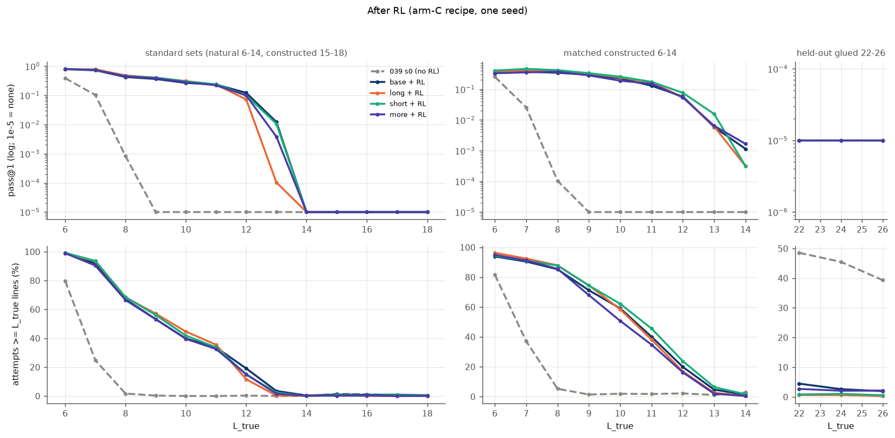
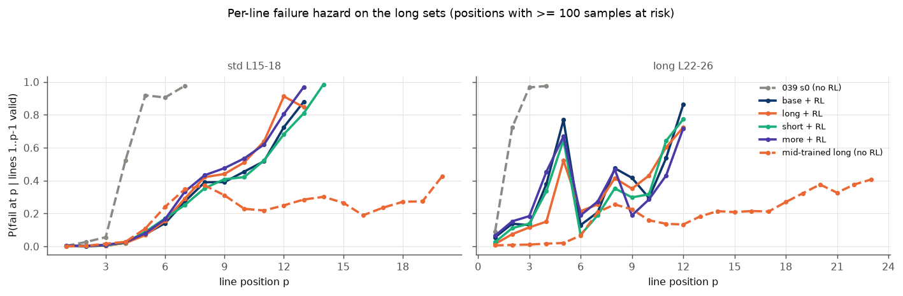
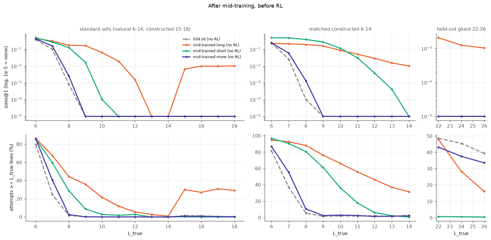

# Mid-training on long glued proofs: does it carry RL past its training length?

Status: complete, one seed. Proposed by Leon on 2026-09-25 and run by the monitor's agents on 2026-09-26, 04:25-07:34
UTC. Working folder:
[code/experiments/current/midtrain_long_glued_20260926](../../code/experiments/current/midtrain_long_glued_20260926/README.md).

Question: RL on theorems of true length 6-11 stops working one or two lines past 11
([length generalisation](../2026-09-25-length-generalisation/README.md)), and changing the proof representation
does not move that edge ([representation and goal notes](../2026-09-25-representation-and-goals-length/README.md)).
LLMs get a mid-training stage on long sequences before RL. Does a short supervised stage on long proofs, glued
together from shorter ones, do the same here? RL still trains on lengths 6-11 only.

## Summary

- **No.** After the same RL, the model mid-trained on long proofs is no better past length 11 than the one without
  mid-training, and on natural theorems at 12-14 it is worse: 2.9% pass@1 against 5.3% (one seed).
  - Nothing is solved on the standard sets past length 13 by any RL arm.
  - Nothing is solved on chain theorems at 15-18 (a glue type absent from mid-training) by any checkpoint, before or
    after RL.
- **Mid-training alone teaches a construction, not length.** Before RL, the long mid-trained model solves 1.4% of
  the constructed conjunctions at 15-18 and 0.15% of glued 22-26, where every other checkpoint scores 0%. Both sets
  are built the same way as its training data. On natural theorems at 12-14 it scores 0.06%.
  - It writes long attempts only on constructed conjunctions. At least L_true lines: 27-31% of attempts at 15-18,
    but 1-6% on natural theorems at 12-14, whose prompts are just as long (54 against 55 tokens).
- **RL removes what mid-training added.** After the 11-line-capped RL, the long arm's attempts at 15-18 are back to
  a median of 10-11 lines, and its per-line failure rate climbs towards 0.9 by line 12-13, like every other RL arm.
  Before RL it stayed flat at 0.2-0.3 out to line 20.
- **In distribution, mid-training helps a little.** At lengths 6-11 after RL: long 49.7%, short 49.0%, more 48.0%,
  base 46.7% pass@1. Held-out greedy on cap-6 is 98% for all four.

## Setup

- **Arms.** All start from the released 039 s0 pretrain.

  | arm | mid-training (3 epochs, 234 steps, batch 128, AdamW lr 3e-4 to 3e-5) | RL |
  |---|---|---|
  | base | none | arm C |
  | long | 2,000 glued proofs of 16-24 lines + 8,000 cap-6 records | arm C |
  | short | 2,000 glued proofs of 6-11 lines + the same 8,000 cap-6 records | arm C |
  | more | 10,000 cap-6 records | arm C |

  short separates "long" from "glued"; more separates "long" from "more fine-tuning".
- **Glued proofs** (`evidence/POOLS_MIDTRAIN.md`).
  - Two or three verified generator theorems on disjoint atoms, joined by a conjunction tree. The proof is the parts'
    proofs in sequence plus one conjunction line per join.
  - Every proof passed the verifier (6,452 checks, 0 failures). The training and test glues share no part, no part
    was used by the constructed theorems of earlier experiments, and no glued theorem appears in any existing file.
- **RL.** The arm-C recipe of the length experiment (`rl_C.py`, byte-identical): targets and training proofs of at
  most 11 lines, 3.9e15 metered FLOPs, seed 101. All four runs used 99.4-99.6% of the budget in 30-37 minutes.
- **Evaluation.** lengthexp's `evaluate.py`, unchanged: 32 samples per theorem at temperature 0.8, unbiased pass@1
  and pass@4. Eight checkpoints: the start model, the three mid-trained models before RL, and the four arms after RL.

  | test set | theorems | built how | fair test of length for the long arm? |
  |---|---:|---|---|
  | natural L6-11 | 1,800 | generator theorems (in distribution) | - |
  | natural L12-14 | 758 | generator theorems | yes: never glued |
  | chain L15-18 | 393 | two parts joined by cut | yes: glue type never trained |
  | conjunction L15-18 | 807 | two parts joined by a conjunction | no: the same construction as half of the long data |
  | matched L6-14 | 2,700 | conjunction and chain joins | partly |
  | glued L22-26 | 450 | three parts joined by conjunctions | no: built exactly like the long data |

## Results

Table 1. pass@1 by group (pass@4 in the report).

| checkpoint | natural 6-11 | natural 12-14 | chain 15-18 | conjunction 15-18 | glued 22-26 |
|---|---:|---:|---:|---:|---:|
| 039 s0, no RL | 8.2% | 0% | 0% | 0% | 0% |
| mid-trained long, no RL | 20.0% | 0.06% | 0% | 1.38% | 0.15% |
| mid-trained short, no RL | 15.4% | 0% | 0% | 0% | 0% |
| mid-trained more, no RL | 9.9% | 0% | 0% | 0% | 0% |
| base + RL | 46.7% | 5.3% | 0% | 0% | 0% |
| long + RL | 49.7% | 2.9% | 0% | 0% | 0% |
| short + RL | 49.0% | 4.4% | 0% | 0% | 0% |
| more + RL | 48.0% | 4.1% | 0% | 0% | 0% |

Table 2. After RL, pass@1 on natural theorems just past the training length.

| arm | L11 | L12 | L13 | L14 |
|---|---:|---:|---:|---:|
| base | 23.5% | 12.2% | 1.2% | 0% |
| long | 23.3% | 7.3% | 0.01% | 0% |
| short | 23.9% | 10.0% | 1.1% | 0% |
| more | 22.1% | 10.0% | 0.4% | 0% |

- **Paired differences** on natural 12-14 (95% theorem bootstrap, which leaves out seed-to-seed variation): long
  minus base -2.4 points [-3.4, -1.5], long minus short -1.5 [-2.4, -0.6], long minus more -1.2 [-2.2, -0.3].
- **Before RL, on constructed theorems** the long mid-trained model writes long attempts. Its median attempt at 15-18
  is 12-15 lines, and 27-31% of attempts reach L_true, against 0-2% for the other checkpoints before RL. Its
  failures there are ordinary invalid inferences (75%), not mis-copied premises (6%).
- **After RL** the long arm's attempts at 15-18 have a median of 10-11 lines, at most 1% reach L_true, and the
  per-line failure rate rises with position like every other RL arm (Figure 2).

Figure 2. The probability that line p is the first invalid line, given lines 1 to p-1 were valid. On the
conjunctions at 15-18 (left), the mid-trained long model before RL (dashed orange) holds at 0.2-0.3 out to line 20.
Every RL arm climbs towards 0.9 by line 12-14. On glued 22-26 (right), the RL arms fail early at line 4-5, while
copying the long premise block.

## Interpretation

- **Observed:** before RL, mid-training on glued conjunctions lets the model write and sometimes finish long proofs
  of the same construction. It does not transfer to natural theorems at 12-14 or to chain joins at 15-18.
- **Interpretation:** what it learned is tied to the conjunction shape of the goal, not to proof length in general.
  The natural and constructed sets at 12-18 have prompts of the same length, and it writes long attempts only for
  the constructed ones.
- **Observed:** RL capped at 11-line proofs brings the long arm back to the same length profile as every other arm,
  including the rising per-line failure rate past about line 8.
- **Open:** whether RL that keeps some glued long proofs in its fine-tune mix, or allows longer training proofs,
  would keep the mid-trained behaviour. Neither was tested; Leon has asked that RL stay at 6-11 to avoid shortcuts.
- **Open:** why the long arm is worse than base at 12-13 after RL. It is one seed. For scale, arm C's three seeds in
  the length experiment spanned 3.1-3.9% at L12 on the older base.

## Caveats

- **One seed.** Confidence intervals are over theorems, not seeds.
- **The 3-part share is tied to length.** 3-part joins are 11% of the short data, 67% of the long data and 100% of
  glued 22-26.
- **Prompts in the glued data are long.** Mean prompt tokens: long data 118, short data 94, glued 22-26 test 130,
  against 52 for the RL pool and 37 for cap-6. The natural 12-14 and conjunction 15-18 tests are 54 and 55.
- **Glued 22-26 labels are upper bounds**, with a proved lower bound of 15. pass@1 counts any verified proof, so it
  does not depend on the label; the share of attempts reaching L_true does.
- **No truncation.** Mid-training packs whole records (at most 800 tokens) and never cuts one.

## Cost

About 5.0 GPU-hours against about 4 planned: RL 133 minutes, evaluation 163 minutes, mid-training 1 minute. The
long test sets are costly because their prompts are long and the mid-trained checkpoints write long attempts.
Another user's jobs shared some cards during evaluation, outside the GPU lock. RL runs were started only on free
cards, and their budget is in FLOPs, so the sharing affects wall time only.

## Where things are

- Report with every table, generated by `analyse.py`: `evidence/report.md`; numbers: `evidence/results.json`.
- Data construction and checks: `evidence/POOLS_MIDTRAIN.md`. Mid-training logs: `evidence/mt_<arm>.json`. RL run
  summaries: `evidence/runs_summary.json`.
- Code: [the working folder](../../code/experiments/current/midtrain_long_glued_20260926/README.md). Run outputs,
  checkpoints and data are in `/scratch/cowifornia/nd-rl/ab3/midtrain/`.
