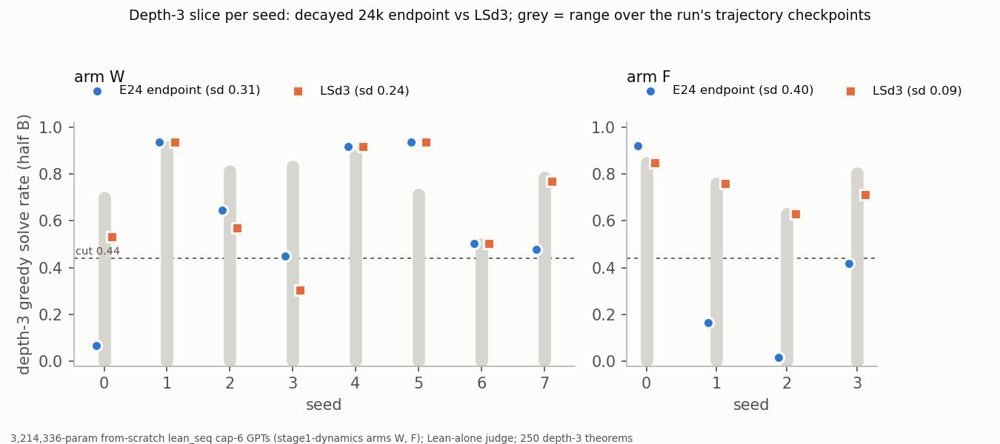

# ckpt-avg: does checkpoint averaging or loss-based selection remove Stage 1's depth-3 oscillation?

Status: **completed and reviewed 2026-09-28; the answer is no.** No averaging or selection variant
meets the pre-registered adoption rule, so there is no new Stage-1 standard. No hard-constraint
violation, nothing quarantined. The reviewer's recommendation is **accept, with eight rewordings and
four unreported expectation sub-misses**. Numbers and wording below are the reviewer's where the two
differ.

Question: [`stage1-dynamics`](../2026-09-27-stage1-dynamics-saturation-and-seed-variance/README.md)
found that the depth-3 "mode" is an oscillation along each run: all 12 of its 24,000-step runs crossed
the 0.44 cut 1–10 times. Two remedies were tested: **uniform weight averaging of a run's late
checkpoints**, and **choosing the checkpoint by per-length validation loss**. Does either collapse
the across-seed sd, and what does it cost the mean? Brief: proposal 14 item 8
([`2026-09-28-after-state-env.md`](../../docs/proposals/2026-09-28-after-state-env.md)).

Review: [`review_ckpt-avg.md`](https://github.com/dan-pandori/nd-takehome/blob/fd59710/review_ckpt-avg.md)
(fork branch `dan_ckpt-avg`; commits [`6af9e00`](https://github.com/dan-pandori/nd-takehome/commit/6af9e00)
§Recount, blind; [`fd59710`](https://github.com/dan-pandori/nd-takehome/commit/fd59710) §Compare/§Verdict).
Reviewer code: `review_ca/` on that branch. Executor write-up:
[`run_ckpt_avg.md`](https://github.com/dan-pandori/nd-takehome/blob/ba02c3d/run_ckpt_avg.md),
`numbers.md` § ckpt-avg (CA1–CA5), `log.md`. Pre-registration: `preregistration/ckpt-avg.md`
(commit [`1694e10`](https://github.com/dan-pandori/nd-takehome/commit/1694e10), pushed 04:21:40Z,
before the first pod at 04:22:02Z. The file's own "written ~04:45" is a mis-estimate).

## Configuration

- **Model, for every number here:** `stage1-dynamics`' checkpoints, a 3,214,336-parameter GPT
  (4 layers, d 256, 8 heads), **from scratch**, `lean_seq`, **cap 6**, WSD schedule (lr 1e-3, linear
  decay to 1e-4 over the last 20 % of steps). No training in this run.
  - **Arm W** (primary): seeds 0–7, trained on `data/p2/train_depth3_f0_a1.jsonl` (155,000 records,
    0 depth-3). It has trajectory checkpoints every 1,000 steps, plus decayed endpoints at 24k (E24),
    12k (E12) and 6k (E6).
  - **Arm F** (secondary, n = 4): seeds 0–3, trained on `data/sd/train_fresh.jsonl` (572,759 records),
    with trajectory checkpoints every 2,000 steps.
  - **Arm R**: stage1-dynamics' ten same-command-line checkpoints, re-evaluated only to store literal
    texts.
- **Judge: Lean alone** (`sd_eval.py`; `nd_verify` never called). Greedy, batch 2,500, `max_new` 400,
  fast path with compaction, fixed across every checkpoint. Peak GPU memory was 9.02 GB.
- **Split.** `ca_split.py` (seed 20260928) divides the 5,000-theorem held-out file into halves A and B
  of 2,500 each. Each half has 500 theorems of each of len2–5, 250 len6 non-depth-3 and 250 depth-3.
  The halves share 0 renaming classes. **Half A is used only for selection** (per-slice loss,
  `artifacts/ca/valloss_A.jsonl`). **Every accuracy is on half B.**
- **Variants** (fixed in `ca_plan.py`):
  - **A{D}_K{K}**: uniform average of the last K stable-phase checkpoints before decay point D.
  - **T24_3 / T24_5**: E24 averaged with the 2 or 4 decay-phase checkpoints before it.
  - **LS6 / LSd3**: the run's own checkpoint with the lowest half-A loss on the 6-line bin or on the
    depth-3 slice.
  - A self-average control (`w_s0.CTRL_self19000`).
  
  In total: 353 half-B evaluations (256 stage1-dynamics checkpoints + 97 averages) and 10 full-file
  arm-R evaluations.
- **Adoption rule** (pre-registered; arm W, n = 8, baseline E24). A variant is adopted only if all
  three hold:
  - (i) the depth-3 sd is ≤ ½ of E24's;
  - (ii) the len6 sd is < E24's;
  - (iii) no bin (len2–len6, depth-3) is more than 2 pp below E24's mean.
- **Compute:** one NVIDIA A40 pod (`ca1`, $0.49/h) for **0.86 pod-hours, $0.42**, against a $2 / 4 h
  budget and a pre-registered estimate of ≈ 1–1.5 h / ≈ $0.75.
- **Code revision:** fork branch `dan_ckpt-avg` (from `origin/dan_stage1-dynamics`), results commit
  `ba02c3d`.
- **Bucket:** `hf://buckets/dan-pandori/nd-rl/ckpt-avg/{artifacts/ca,ckpts/ca,data/ca}`.

## Observations (reviewed)

Arm W, n = 8, half B. Values are mean (across-seed sd); the IQM is the reviewer's, bootstrapped over
seeds with a 95 % interval.

| variant | len6 | depth-3 | depth-3 IQM [95 %] | all |
|---|---|---|---|---|
| **E24** | .797 (.152) | **.616 (.306)** | .635 [.38, .92] | .954 |
| A24_K2 | .637 (.172) | .308 (.342) | .207 [.03, .63] | .918 |
| A24_K4 | .620 (.174) | .264 (.350) | .112 [.02, .55] | .917 |
| A24_K8 | .600 (.187) | .227 (.374) | .031 [.02, .60] | .913 |
| T24_3 | .780 (.181) | .576 (.361) | .613 [.23, .93] | .951 |
| T24_5 | .760 (.185) | .536 (.368) | .566 [.17, .88] | .947 |
| LS6 | .827 (.128) | .693 (.236) | .715 [.50, .92] | .956 |
| LSd3 | .812 (.137) | .683 (.239) | .696 [.49, .92] | .944 |

Every IQM interval overlaps E24's. Depth-3 per seed (s0…s7):
- E24: .07 .94 .64 .45 .92 .94 .50 .48
- A24_K8: .04 .87 .01 .02 .79 .05 .02 .02
- LSd3: .53 .94 .57 .30 .92 .94 .50 .77

What stands, per the reviewer's verdict:

1. **No variant meets the adoption rule on arm W.** LS6 comes closest and fails clause (i) only.
   Every sd-ratio F-test interval contains 1, so at n = 8 no variant is shown to change the
   across-seed sd in either direction.
2. **Uniform stable-phase averages lower W's depth-3 by 31–39 pp** (A24_K8: −38.9 pp, paired 95 %
   CI [−63.9, −13.9]; all three CIs exclude 0), and they do not shrink the sd. The two large sd
   reductions at shorter horizons (A12_K8, A6_K4) come with the mean collapsing toward 0.
3. **Averaging across the decay (T24_3 / T24_5) is indistinguishable from E24** (T24_3 −4.0 pp
   [−23.7, +15.7]).
4. **Averages are not broken on the easy bins.** On len2–5 they sit at or above their constituents'
   mean and never fall below their worst constituent. On depth-3, A24_K8 is above its constituents'
   mean in only 2 of 8 seeds.
5. **Loss-based selection moves W's depth-3 mean +7 / +8 pp and its sd 1.3× in the right direction.
   Neither change is distinguishable from 0 or 1 at n = 8** (reviewer's rewording of "helps").
   LS6 [−8.9, +24.2], LSd3 [−10.4, +23.8].
   - On the rule's bins, LS6 costs at most 1.2 pp. On the 6-line non-depth-3 complement it costs
     −1.7 pp (LSd3: −3.8 pp).
   - LSd3 costs −2.6 pp on len4 and −2.8 pp on len5, which fails clause (iii).
6. **Loss tracks accuracy across checkpoints but does not pick well within a run.** Half-A depth-3
   loss vs half-B depth-3 accuracy over 208 W checkpoints has Spearman ρ = −0.896. Yet `w_s3`'s
   loss-minimising step 20000 solves 0.30 of depth-3, while its neighbours solve 0.82–0.83 with losses
   1–3 % higher.
7. **Arm F (n = 4, secondary): LSd3 cuts the depth-3 sd 4.3×** (0.397 → 0.092; F-test
   [1.10, 17.0]), and its mean is 0.737 against E24's 0.379. Caveats:
   - It costs about 5 pp on len5, so it too fails clause (iii).
   - One of the four picks (f_s1) is 0.08 % ahead of the runner-up on loss, inside the loss's bf16
     noise. With the runner-up the ratio is 3.6×.
8. **No variant changes proof length.** On depth-3 the reviewer's inlined, ascription-free term size
   is 4.02–4.07 nodes, with 4.01–4.03 written lines, in every variant. On 6-line non-depth-3 it is
   6.2 nodes / 5.8 lines. The executor's "term size" (`n_tok`) counts whitespace tokens, mostly type
   ascriptions, so it is not the term size the policy asks for (review F3).
9. **Checks.**
   - The self-average control reproduces step 19000 byte-identically (verdicts and texts).
   - The re-draw against stage1-dynamics' batch-512 evaluations differs on 1,176 / 640,000 verdicts
     (0.18 %), within `NOISE_FLOOR.md`'s re-draw scale.
   - The reviewer's own Lean harness accepts 480 / 480 re-checked counted proofs (W, F, R; 300
     depth-3) and rejects 160 / 160 negative controls.
10. **The stage1-dynamics review's open gap is closed.** Arm R was re-evaluated with literal texts:
    0 / 50,000 verdicts differ, and every one of the 45,678 counted rows has text.

**Interpretation, not a finding** (reviewer's rewording b): the run write-up says "the oscillation
alternates between distinct solutions" as if it were measured. It is a hypothesis consistent with
item 4; nothing in the run measures basins or loss barriers. The run's quietest readout, the mean
over a run's own 23 trajectory evaluations (W depth-3 sd 0.110 at mean 0.273), is **post hoc**. It
costs 23 evaluations per run and measures a different quantity, not a model.

### Pre-registered expectations (reviewer's scoring)

| # | expectation | measured | verdict |
|---|---|---|---|
| 1 | every A/T within 3 pp of its constituents' mean on len2–5, overall ≥ 0.80 | falsifier did not fire. 36 / 96 averages sit **above** their members by up to +11.6 pp. **All 8 A6_K4 runs are at 0.752–0.780 overall** | not falsified; the ≥ 0.80 clause **missed** (not reported by the executor) |
| 2a | A24_K8 depth-3 sd in [0.18, 0.35] | 0.374 | **miss** (not reported) |
| 2b | sd ratio < 2 for A24_K*/T24_* | 1.12–1.22 | holds |
| 2c | average above its constituents' mean on depth-3 in ≥ 6/8 | A24_K8 2/8, K2 4/8, K4 4/8, T24_3 5/8 | **miss** |
| 2d | below its constituents' max in ≥ 6/8 | K4, K8 6/8; **K2 5/8** | miss for A24_K2 (not reported) |
| 3 | LSd3 depth-3 ≥ 0.75, sd ≤ 0.15, meets the rule; LS6 sd ≤ 0.20 | LSd3 .683 / .239; **LS6 sd .236** | **falsified**; LS6 clause missed (not reported) |
| 4 | T24 ≈ E24, sd ratio < 1.3 | 1.18, 1.20 | holds |
| 5 | self-average control identical | identical on 2,500 / 2,500 rows, texts included | holds |
| 6 | arm F: LSd3 has the smallest depth-3 sd | .092 | holds (n = 4; not scored by the executor) |

## Limitations

- **The sd is poorly resolved at n = 8.** An F-test 95 % interval on a sd ratio at df 7,7 spans about
  0.45–2.2×, so clause (i)'s ½ threshold is judged on point estimates. The negative verdict for the
  averages does not depend on this: their means fall 31–39 pp.
- **LS picks are fragile.** Three picks (LSd3 w_s2 at 0.24 %, LSd3 f_s1 at 0.08 %, LS6 f_s0 at
  0.41 %) are inside the ≈ 1e-3 bf16 noise of the half-A loss. The W verdict does not depend on them;
  the F 4.3× depends on them modestly.
- **`max_new` deviation.** 241 of 2,118 evaluation × stratum cells exceed the policy's 0.1 %
  truncation line (mostly depth-3, where one row is 0.4 %). The executor did not raise the cap; it
  ran a diagnostic instead. At 400 / 800 / 1,600, 0 of 53 truncated rows become solved: they are
  non-terminating loops. This is a deviation from the pre-registration, and the run's headline
  summary does not mention it (rewording h).
- **Train/eval overlap by premise permutation**, inherited from stage1-dynamics' data:
  - 5 half-B theorems share a renaming class with train W, and 30 with train F; none of them is
    depth-3.
  - `gen.canon_key` misses these overlaps, and `split.json` documents only A/B disjointness.
  - The effect on any headline is nil: at most 1.3 % of the non-depth-3 rows, all in bins at
    0.97–1.00.
- **The IQM** was the reviewer's addition; the executor reported only per-seed values and paired
  t-CIs. It changes no conclusion.

## Next step

- **No Stage-1 standard changes.** Keep reporting E24 per seed.
- The reviewer's two open measurements:
  1. **Loss barrier between checkpoints of opposite mode.** Take, for example, `w_s3` step 20000
     (0.30) ↔ step 21000 (0.82) for 2–3 seeds. Evaluate half-A loss and half-B depth-3 along the
     linear path, ≈ 10 half-B evaluations per pair. A barrier supports "distinct solutions". A flat
     path means averaging fails for another reason.
  2. **The arm-F LSd3 4.3× at a seed count that can see it.** Run 8–10 F seeds with trajectory
     checkpoints once fast Stage-1 training is merged. Recompute half-A losses in fp32 so that near
     ties are resolved. LSd3's −5 pp on len5 already fails clause (iii) at n = 4.
