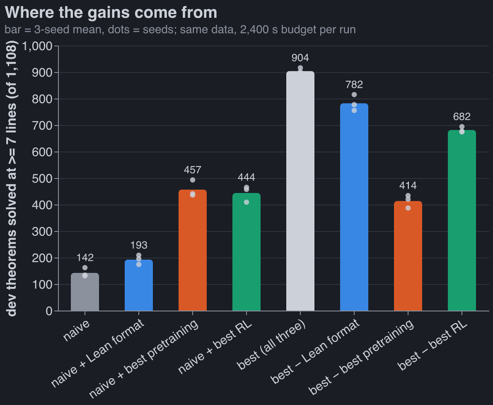
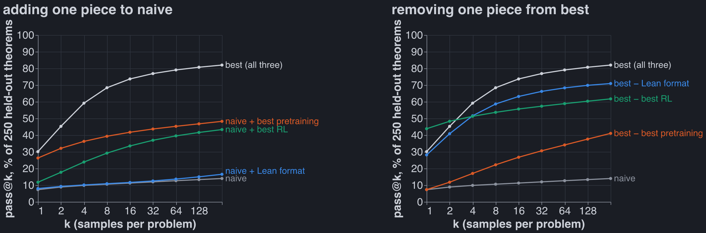
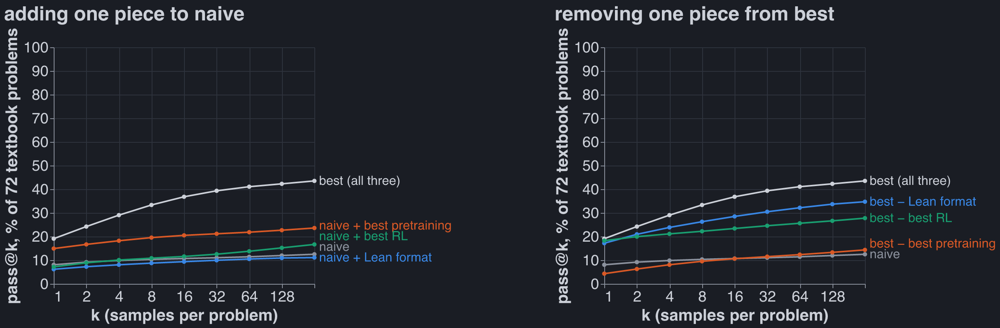
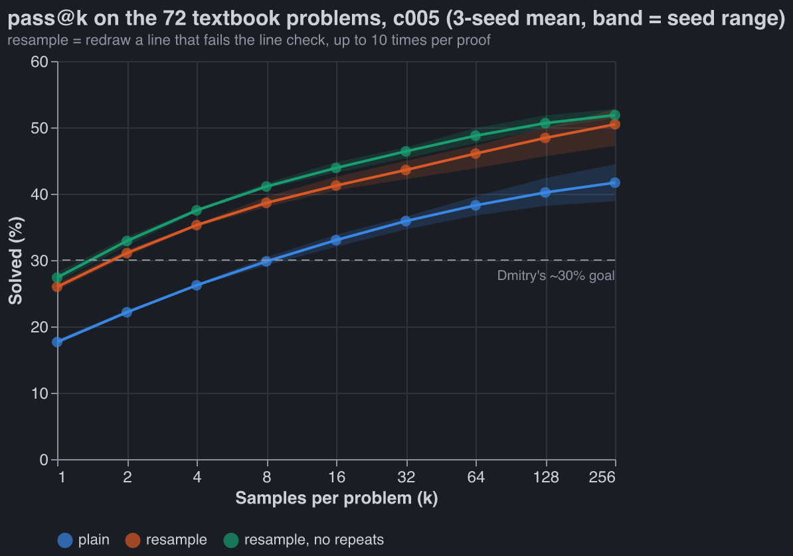
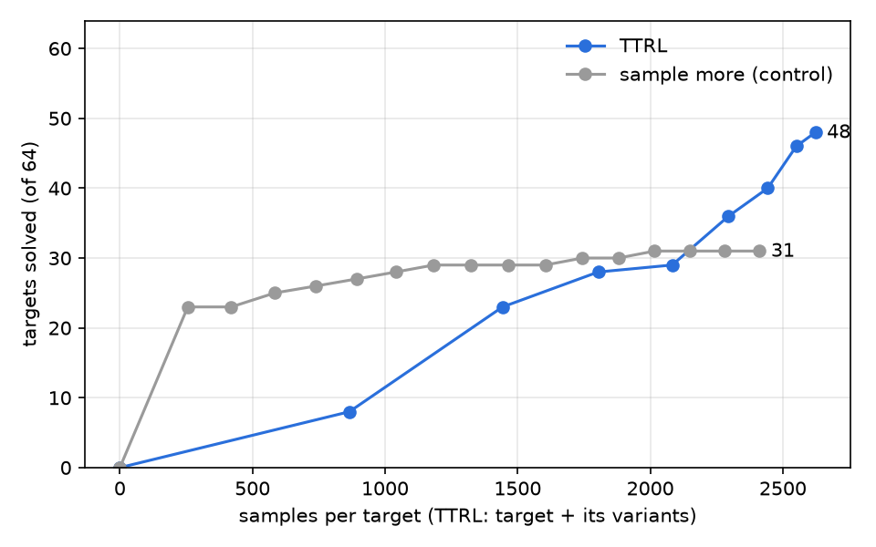
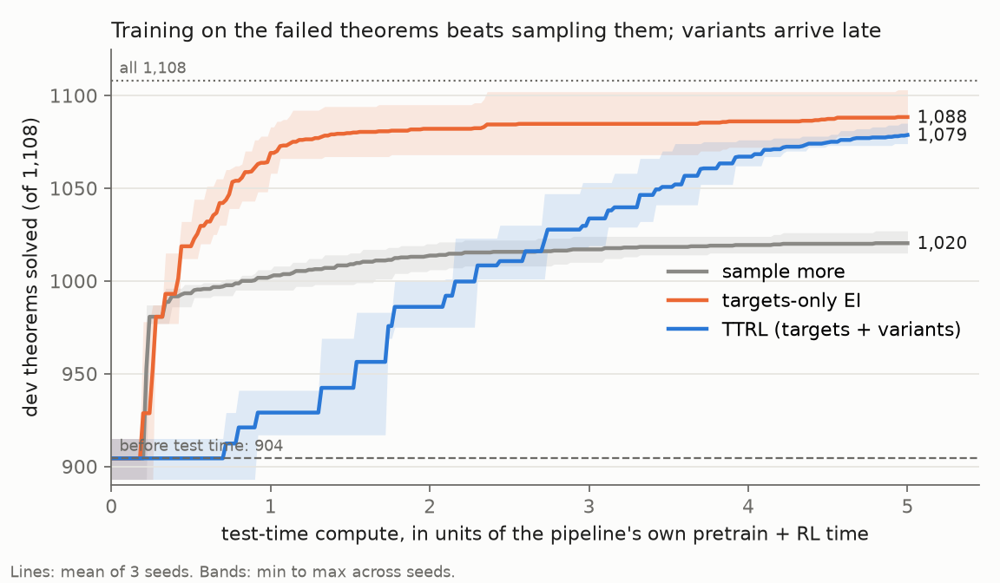
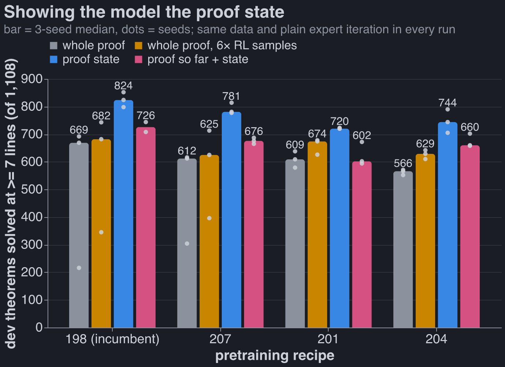

For context, see [last week's post](https://robbiewmthompson.com/blog/pretraining-ablations/).

# The combined model, and where its gains come from



```claude
Where the 762 extra theorems come from, averaging each piece's effect over the other two:

| piece | naive → best | average effect |
| --- | --- | --- |
| pretraining | autoresearch run 012's baseline → the autoresearch incumbent (186) | **+408** |
| RL | the harness's plain expert iteration → Leon's recipe + verifier-guided sampling | **+268** |
| data format | token format → Dan's Lean format | **+92** |

- **Pretraining matters most**, which I did not expect: I predicted the ordering RL > format >
  pretraining. On its own, better pretraining triples the naive pipeline (142 → 457).
- **The Lean format only pays with good pretraining.** With the naive pretraining it adds +50
  (with plain RL) or −30 (with Leon's RL); with the 186 pretraining it adds +225 and +122. This
  is the largest interaction in the table (+82). The 186 recipe was found by searching in the Lean
  format, which is part of why.
- **Pretraining and RL add up**: their interaction is +6.
- **Leon's RL buys coverage, not accuracy.** It lowers pass@1 on held-out theorems (44% → 30%) and
  raises pass@64 (59% → 79%). Our metric is pass@64, which rewards that.
- **The textbook set finally moves.** Last week none of 184 pretraining runs got past ~22 of 72.
  The combined model gets 31; it is the RL step that moves it (best pretraining + plain RL: 20).
```

<details class="aside">
<summary>How the effects are computed</summary>

```claude
A factor's effect is the mean of the four cells at its best level minus the mean of the four at
its naive level. Interactions are the same contrast on products of ±1 codes, divided by 4:
format × pretraining +82, format × RL −46, pretraining × RL +6, all three −6.
```

</details>

## The combined model

```claude
| stage | piece | from |
| --- | --- | --- |
| data | 155k cap-6 proofs, the ladder RL and transfer pools | Dan |
| format | `lean_seq`: Lean 4 tactic proofs, one symbol per token; reward = Lean ∧ nd_verify | Dan |
| pretraining | autoresearch incumbent 186: 6 × 384 Peri-LN, 4 ALiBi + 4 NoPE heads, Muon, MTP, 300 s | autoresearch (last week's post) |
| RL | expert iteration in 15 small rounds (400 targets, ~32 samples each), hardest-first queue, training samples at T 1.0, fresh AdamW per round, GEM loss | Leon (evolved by his GEAR agents) |
| RL sampling | verifier-guided: every `have` the model writes is checked against the rules given the lines before it; a bad line is rolled back in the KV cache and resampled (up to 4 times) | Leon's run-2 sampler, ported to the Lean format this week |

It got there in four steps on the same pretrained weights (details in our private group repo):
Leon's RL recipe +117 (687 → 804), the full RL target pool +4 (noise), guided sampling +101 (905,
but over the time budget), then the same guided run sped up and cut off at 1,800 s so the whole
pipeline fits in 2,400 s (904). Charles's result that plain expert iteration matches GRPO agreed
with Leon's choice, so there was nothing of his to add.
```

<details class="aside">
<summary>Verifier-guided sampling in the Lean format</summary>

```claude
Leon's sampler checked `abs`-format proof lines, which are already natural-deduction lines. In
the Lean format a line is a `have n7 : F := term ;`, possibly inside nested
`( fun ( n3 : A ) => by ... )` boxes. At every `;`, the Lean prefix is parsed with Dan's own
Lean → ND parser (stopped at the cut) and each new ND line goes through Leon's incremental
checker. Checks: 0 false rejects on 23,936 line checks of real proofs, 0 false accepts on 9,000
mutated proofs, and the KV-cache rollback reproduces an un-rolled-back forward to 7e-7 in the
logits. On the pretrained model it accepts ~55% more samples per round. The final proof is still
checked by Lean and nd_verify; guidance only prunes.
```

</details>

## Where the gains come from

```claude
All 8 combinations of {naive, best} × {format, pretraining, RL}, three seeds each, fresh, under
one protocol: same data, same 1,500 RL targets, 300 s of pretraining, at most 2,400 s end to end
(the longest took 2,374 s), one A40 (three runs got an RTX A6000, the same chip).
```



```claude
250 theorems from the held-out half of the transfer pool, all 7-14 lines, never used to pick
anything; 256 samples per theorem. pass@k per theorem is the unbiased estimator
1 − C(n − c, k) / C(n, k) from n = 256 samples with c verified, averaged over theorems and then
over the three seeds.

Without Leon's RL (orange on the right) the curve starts highest and flattens early: plain expert
iteration sharpens the model onto proofs it already finds. Leon's recipe samples its training
proofs at T 1.0 and trains with GEM, a loss built to keep the output distribution spread out, and
the curves show it: lower at k = 1, far higher by k = 8.
```



```claude
Dmitry's textbook set, 72 problems nobody trained on: 58 with reference proofs of 1 to 33 lines
plus 14 without a reference, scored like the held-out set. The best seed solves 32 of 72. On the
naive pretraining the data format adds nothing and RL about 3 problems; only better pretraining
lifts the left panel clearly. On the right, removing the pretraining collapses the model back to
naive.

| pipeline | dev (of 1,108) | held-out pass@1 | pass@64 | pass@256 | textbook pass@256 |
| --- | --- | --- | --- | --- | --- |
| naive | 142 | 7% | 13% | 14% | 13% |
| + Lean format | 193 | 8% | 14% | 17% | 11% |
| + best pretraining | 457 | 26% | 45% | 48% | 24% |
| + best RL | 444 | 12% | 40% | 43% | 17% |
| **best** | **904** | 30% | **79%** | **82%** | **44%** |
| − Lean format | 782 | 28% | 68% | 71% | 35% |
| − best pretraining | 414 | 7% | 34% | 41% | 14% |
| − best RL | 682 | **44%** | 59% | 62% | 28% |
```

## Test-time scaling

```claude
Everything above spends a fixed budget of 64 independent samples per theorem. Here the
combined model's weights are frozen, and the question is what smarter inference buys: no value
function, no extra training.

Setup:

- five inference methods;
- all 1,177 held-out theorems, of which 114 are longer than 10 lines;
- three seeds;
- compute measured as tokens sampled from the model per theorem, rejected attempts included.

Details are in the test-time scaling write-up in our private group repo.


- **Plain sampling** (what the metric uses): 31% at 1 sample, 81% at 64.
- **Resample bad lines.** The model writes a proof one Lean tactic (`have ... ;`) at a time, and
  the checker from Leon's RL sampler can judge each tactic the moment it is written. When one
  fails, throw it away and redraw it, up to 10 times per proof.
  - 57% at 1 sample and 86% at 64.
  - On the 114 long theorems: 54 solved vs plain's 41.
  - It needs fewer tokens than plain for the same result: 84.3% at 11k tokens per theorem, vs
    plain's 80.8% at 14k.
  - With the KV-cache implementation from RL it takes 1.5× plain's wall-clock.
- **Sequential Monte Carlo** is almost as good: 84.4% at 16k tokens, a little worse on long
  proofs. It keeps N partial proofs, drops those that write a bad line, and clones the survivors.
- **Beam search and best-first search** are no better than plain sampling at the same compute.
  Both rank partial proofs by the model's own probability. The model's confidence is a poor guide
  to which half-written proof will finish.

What this says about the model:

- **Most failures are local slips, not bad plans.**
  - 69% of samples write at least one invalid line.
  - 58% of all lines checked are invalid.
  - Nearly half of all successful proofs needed at least one redraw.
  - The usual error is a wrong citation or rule on one line (65% of rejections); another 31% are
    lines outside the Lean grammar.
- **It is confidently wrong.** Half of all redraws reproduce the exact line that was just
  rejected.
- **Banning the repeats helps a little.** A redraw can be made to exclude the lines already
  rejected at that point, which is sampling without replacement. That lifts pass@1 by 2 points
  and pass@64 by 1.
- **The curves still flatten, and the rest looks like missing plans rather than slips.** About
  142 theorems (12%) are solved by no method at 64 samples. At 1,024 resampled attempts only
  about 1 in 10 of them falls, and those that do are hit 1-8 times in 1,024. For the rest, the
  model puts almost no probability on any proof. Search over the same model will not reach them;
  that takes a better model (pretraining, RL or data). Training on these evaluation theorems
  themselves is off the table: they are only ever scored.
- **A learned value does not help either.** I trained a small head on the frozen model to predict,
  from a half-written proof, whether it will finish. It was trained on other theorems and tested
  on validation theorems only. It ranks two partial proofs of the same theorem correctly 69% of
  the time. Steering SMC, beam or best-first search with it changed nothing.
- **The metric scores without this sampler, although the RL trained with it.** Scoring the
  combined model with resampling would add about 26 points at 1 sample and 5 at 64. That was not
  measured for the other seven cells, so it could reorder them.
```



```claude
**The textbook set.** Dmitry wanted to get to about 30% on his 72 textbook problems. The combined
model gets there, at 8 samples with plain sampling and at 2 with resampling. It does not get there
at 1 sample either way.

| k | plain | resample | resample, no repeats |
| --- | --- | --- | --- |
| 1 | 17.6% | 26.0% | 27.4% |
| 2 | 22.1% | 31.1% | 32.9% |
| 8 | 29.8% | 38.6% | 41.1% |
| 64 | 38.3% | 46.1% | 48.7% |
| 256 | 41.7% (30 of 72) | 50.5% (36) | 51.9% (37) |

- These are 3-seed means for c005. c005 is a separate training run of the same recipe as the
  table's "best" cell, which gets 44% at 256 samples.
- Resampling is worth about 8-9 points at every k here, much less than on the held-out theorems at
  k = 1 (+26). The textbook proofs are longer (reference proofs of up to 33 lines), and more of the
  misses are missing plans rather than slips.
- By split, at 256 samples: the 58 with reference proofs go 42.5% → 51.7% → 52.3%; the 14
  without go 38.1% → 45.2% → 50.0%. At 1 sample: 16.8% → 26.2% → 27.8%, and 21.1% → 24.9% →
  25.4%.
- The textbook problems are only ever scored. Nothing trains or tunes on them.
```

## Test-time RL: making up easier problems

Search over a frozen model tops out: at 1,024 attempts the model puts almost no probability on
any proof of ~90% of the theorems it misses. So the weights have to change. AlphaProof (Hubert et
al., 2025) does this with test-time RL: for each hard target it generates many related
problems ("variants") and runs RL on target plus variants until the target falls. RL learns only
from successes, and a variant the model solves *sometimes* gives signal right next to a target
it never solves. On IMO and Putnam this added 15 points over a 12-TPU-hour search, at 50+
TPU-days per problem. This is the simple version on our model.

### Where the variants come from

AlphaProof prompts Gemini for variants. We don't need a language model: a theorem is a sequent
`Γ ⊢ G` over four atoms, and every variant is built from the statement alone (no reference
proof). Each is kept only if a 16-row truth table says it is valid, which for classical logic
means provable.

| kind | move | example: `P>Q, Q>R, R>S ⊢ P>S` |
| --- | --- | --- |
| goal `A > B` | assume A: `Γ, A ⊢ B` | `P>Q, Q>R, R>S, P ⊢ S` |
| goal `~A` | assume A: `Γ, A ⊢ F` | |
| any goal G | reductio: `Γ, ~G ⊢ F` | `…, ~(P>S) ⊢ F` |
| goal `A & B` | each half: `Γ ⊢ A`, `Γ ⊢ B` | |
| goal `A v B` | one side, if still valid: `Γ ⊢ A` or `Γ ⊢ B` | |
| premise `A & B` | split it into A, B | |
| premise `A v B` | the two cases: replace it by A; by B | |
| premise `A > B` | strengthen it to B, or to `~A` | `Q, Q>R, R>S ⊢ P>S` |
| premise `~(A & B)` | strengthen it to `~A`, or to `~B` | |
| lemma (cut) | any subformula ψ of Γ or G with Γ ⊨ ψ gives two variants: `Γ ⊢ ψ` and `Γ, ψ ⊢ G` | none: every subformula that follows from Γ is a premise or the goal |

Moves are applied twice (depth 2), with duplicates and trivial variants dropped. On 64 targets
that gives 3,397 variants (median 42 per target); 78% are cuts.

### The loop

One copy of the model is adapted on all targets at once. Each round:

1. **Sample** 16 proofs of every active target and variant (Leon's guided sampler, T 1.0).
2. **A target with a verified proof is solved** and leaves with its variants.
3. **Variants solved in 13+ of 16 are mastered** and leave.
4. **Train** on variants solved in 1-12 of 16: up to 4 proofs each, weighted up to 8× when
   rarely solved (Leon's weighting), plus 20,000 cap-6 proofs against forgetting. Variants at
   0 stay in the pool; learning their neighbours may unlock them.
5. **Update** with Leon's RL step (GEM, fresh AdamW, 135 steps of 128).

The band (1-12 of 16) follows AlphaProof's matchmaker: problems always or never solved carry no
useful signal.

### First test: 64 hard targets

**Targets:** 64 dev theorems c005 seed 0 fails at 64 samples, 7-14 lines. **Control:** the same
sampler on the targets alone, no training, 256 samples per round, compared at matched samples.

**The stepping stones exist.** Round 1 samples the unadapted model:

| round 1, 16 samples each | items | any proof | in the band (1-12 of 16) | mean solve rate |
| --- | --- | --- | --- | --- |
| targets | 64 | 12% | 12% | 0.01 |
| all variants | 3,397 | 43% | 27% | 0.24 |
| cuts, depth 1 / 2 | 243 / 2,391 | 44% / 39% | 24% / 26% | 0.26 / 0.21 |
| decompositions, depth 1 / 2 | 166 / 425 | 40% / 61% | 33% / 35% | 0.17 / 0.35 |
| specializations, depth 1 / 2 | 26 / 146 | 73% / 58% | 19% / 29% | 0.60 / 0.36 |

Variants are solved 24× more often than their targets, and 63 of 64 targets have a variant in
the band.

**TTRL solves 48 of 64. Sampling more solves 31.**



- **Matched budgets:** 2,623 samples per target for TTRL (29 min, 3 of them training) vs 2,412
  for the control (25 min). TTRL solves everything the control does, plus 17.
- **TTRL barely samples the targets:** 75 samples per target; the rest go to variants.
- **The gain is on long theorems:** at 10 lines, 25 of 25 vs 10.
- **Seed 1 replicates it less cleanly:** 41 vs 31, but its bigger variant pool spent 28% more
  samples, and at matched samples it sat at 29-36.

**Variants of unrelated theorems don't help.** Same loop on seed 0, with the variants of 64
*other* failures in place of the targets' own:

| round | 1 | 2 | 3 | 4 | 5 | 6 | 7 | 8 |
| --- | --- | --- | --- | --- | --- | --- | --- | --- |
| own variants (TTRL) | 8 | 23 | 28 | 29 | 36 | 40 | 46 | 48 |
| unrelated variants | 7 | 11 | 20 | 23 | 25 | 25 | 26 | 28 |

It ends below plain sampling (28 vs 31) after 2.7× TTRL's samples. So the gain comes from
practising on problems built from the targets. As the at-scale run shows, that mostly means the
targets themselves.

**What's left: a composition gap.** Of the 16 unsolved targets, 9 have every variant solved;
la_transfer_1167 has all 19 mastered. The model proves every piece but never writes the whole
proof. AlphaProof's tree search assembles pieces; ours writes left to right. The fix is
mechanical: paste a proof of `Γ ⊢ ψ` into one of `Γ, ψ ⊢ G` and verify. Not tried yet.

### At scale: every dev failure, up to 5× the pipeline's compute

The open question: is it the variants, or just training on the eval theorems at all? Plain
expert iteration (EI) on the failed statements, no variants, might buy most of the gain.

**Setup.** c005 seeds 0-2, exactly as trained (dev baseline 915, 893, 905). Targets: each seed's
dev failures (193, 215, 203), on one shared model per arm. *Solved* = at least one proof of the
target passes Lean ∧ nd_verify in any round; score = baseline + solved.

| arm | samples | trains on |
| --- | --- | --- |
| sample more | targets, 256 per round | nothing |
| targets-only EI | targets, 256 per round | proofs of the targets it has solved |
| TTRL | targets and variants, 16 each per round | solved targets plus variants in the band |

Same sampler and RL step everywhere; TTRL is exactly EI plus variants. **Compute:** x = the
pipeline's own pretrain + RL time (1,641-1,774 s on one A40). Each arm runs to 5x of wall-clock,
sampling and training included; a score at "2x" counts only rounds finished by 2x.

**Plain expert iteration on the eval statements wins. Variants add little.**



Dev theorems solved (of 1,108; baseline 904), mean of three seeds:

| arm | 1x | 2x | 3x | 4x | 5x |
| --- | --- | --- | --- | --- | --- |
| sample more | 1,002 | 1,014 | 1,017 | 1,019 | 1,020 |
| **targets-only EI** | **1,069** | **1,082** | **1,085** | **1,086** | **1,088** |
| TTRL | 929 | 986 | 1,034 | 1,067 | 1,079 |

- **Test-time training is worth a lot, without variants.** At 1x, EI solves 81% of the failures
  (sampling more: 48%). At 5x it reaches 98.2%, and 1,103 of 1,108 on seed 1.
- **TTRL is slower and only about catches up.** It trails EI on average at every budget, 9
  behind at 5x. Seed 2's TTRL ends ahead (1,085 vs 1,078).
- **EI plateaus by 2x; TTRL was still climbing.** They solve partly different theorems: TTRL
  gets 12, 4 and 11 that EI never does. Together they leave 12, 1 and 19 unsolved.

So the 64-target result stands, but its explanation changes: with ~200 targets, the targets
alone do the job.

#### What each arm does, round by round

| | sample more | targets-only EI | TTRL |
| --- | --- | --- | --- |
| round 1 samples | 193 targets × 256 = 49,408 | the same 49,408 | 193 targets + 12,254 variants, × 16 = 199,152 |
| round 1 time | 6.0 min | 7.3 min (23 s of it training) | 22.9 min |
| solved after round 1 | 72 | 72 (same samples, same seed) | 26 (16 samples per target) |
| then | sample the 121 left | train on the 72 solved, resample the 121 left | train on the 26 solved plus 40,663 records from in-band variants |
| solved after round 2 | 81 | 97 | 68 (at 44.5 min) |
| rounds in 5x | 50 | 112 | 16 |
| final | 104 | 169 | 160 |

Seed 0. EI and sample more agree after round 1 on all three seeds, as they must. Round 2 is where
training shows: +25 for EI with no variants.

#### Why TTRL loses to EI

1. **7× fewer updates.** Sampling ~12k variants makes each round ~9 min vs EI's ~1.3. TTRL gets
   16-36 updates in 5x; EI gets 110-166. Seed 2, with the most TTRL rounds, is where it won.
2. **Each update sees a third of its data.** 135 steps × 128 covers most of EI's ~22k-record
   mix but only 28-35% of TTRL's 50-60k.
3. **The targets are already each other's variants.** ~200 failures from one generator share
   schemas, so EI gets the transfer free.

Points 1 and 2 are settings from the 64-target run, kept fixed on purpose. So: TTRL *as
configured* loses to EI. That doesn't show variants can't help.

### On the best checkpoint: TTRL edges past EI

The best post-RL checkpoint is c004 seed 0 (925 of 1,108 dev; the c005 recipe with a later RL
deadline). EI and TTRL ran on its 183 failures in parallel, with the same settings as above.

| minutes of compute | 30 | 60 | 90 | 120 | 150 | end |
| --- | --- | --- | --- | --- | --- | --- |
| EI (H100) | 996 | 1,062 | 1,068 | 1,071 | 1,072 | **1,072** at 127 min |
| TTRL (A40) | 958 | 1,007 | 1,048 | 1,066 | 1,073 | **1,076** at 167 min |

- **Same shape as before.** EI leads for two hours and then flattens: 146-147 of 183 over its
  last ten rounds. TTRL starts slow, keeps climbing, and passes EI at about 150 minutes.
- **They solve different theorems.** TTRL gets 9 that EI misses, and EI gets 5 that TTRL misses.
  Together they reach 1,081 (156 of 183).
- **Caveats.**
  - **Different GPUs.** EI ran on an H100 pod that was CPU-bound: about 37 samples/s against
    about 130 on an A40 pod. Per minute it got about a third of the A40's samples, so this
    table understates EI per minute.
  - **EI was killed early.** Its job was OOM-killed on that pod after 127 minutes, in round 29.
    It had been flat for ten rounds, so more time would probably have added little.
  - **One seed.**

### Caveats

- One run per seed per arm; EI beats TTRL on all seeds only up to 3x.
- Dev-transfer was selected on by the pretraining loop. No proof labels used, no knob tuned on
  these runs; held-out is untouched.
- Two of nine at-scale pods were RTX A6000s (slightly faster), both baseline arms.
- All arms sample at T 1.0, the RL temperature; the eval uses 0.8.

**Next:** EI first, then variants only for what EI leaves. Code: `code/experiments/current/ttrl/`
on branch `robbie-experiments`.

## Showing the model the proof state

Every model above writes a whole proof in one pass and has to track for itself what's in scope
and what it's proving. Dan built an AlphaProof-style interface instead: the model sees only the
current **proof state**, as Lean prints it, and writes one step. An environment applies it and
prints the next state. The steps concatenate into an ordinary Lean proof.

Halfway through `P → Q, Q → R ⊢ P → R`, inside the box that assumes P:

    h1 : P → Q          the premises
    h2 : Q → R
    n1 : P → Q          lines proved so far, still in scope
    n2 : Q → R
    n4 : P              the box's assumption
    n5 : Q
    ⊢ R                 what this box still has to prove

The model writes `have n6 : R := n2 n5 ;` and sees nothing else: no theorem, no history. On
Dan's small model this lifted pretrained transfer ~6× (779 vs 158). Two questions: does it help
my recipes, and does my recipe ranking survive?



**Setup.** Four autoresearch recipes (198, the incumbent, and simplifications 207, 201, 204),
three seeds each, in four formats: whole proof; whole proof with 6× RL samples (to match the
proof state's extra wall-clock); proof state; and proof so far + state (to separate "the state
helps" from "dropping history helps"). Everything else is the frozen autoresearch harness with
plain expert iteration, not Leon's RL. Dev metric, per seed:

| recipe | whole proof | 6× RL samples | **proof state** | proof so far + state |
| --- | --- | --- | --- | --- |
| 198 | 669 / 692 / 216 | 743 / 345 / 682 | **852 / 824 / 798** | 708 / 744 / – |
| 207 | 612 / 304 / 616 | 713 / 625 / 396 | **781 / 777 / 814** | 665 / 676 / 687 |
| 201 | 609 / 638 / 579 | 674 / 678 / 626 | **723 / 720 / 720** | 594 / 672 / 602 |
| 204 | 566 / 552 / 571 | 610 / 642 / 629 | **705 / 744 / 790** | 660 / 702 / 658 |

- **The proof state wins on every recipe:** +111 to +178 over the whole proof (medians).
- **Not just compute:** 6× RL samples buys the whole-proof model only 13-65, and that arm got
  ~¾ of the proof state's RL time.
- **It always takes off.** Whole-proof RL stalled in 4 of 24 runs (the 216-396 seeds); the proof
  state stalled in 0 of 12.
- **The recipe ranking survives:** 198 is best in both formats, with the same ~100 spread.
- **History hurts:** proof so far + state is 84-118 below the state alone, at 2-3× the cost.
- **Plain RL in the proof state nearly matches Leon's RL:** 198 goes 669 → 824; the combined
  model gets 904. The two haven't been combined yet.

**Cost:** ~3× the wall-clock (58 vs 17 min for 198), over the 2,400 s budget. Mostly fixable
engineering: no reuse between steps, an ALiBi bias that forced batch 512, and Python stepping.

From next week the pipeline uses the proof state.

<details class="aside">
<summary>Caveats</summary>

- Plain expert iteration only; proof state + Leon's RL is untested.
- Dev metric and three seeds; no held-out or textbook numbers yet.
- These runs judge with Lean alone (Dan's current fork), not Lean ∧ nd_verify. Whole-proof
  scores match the loop's (198: 669 and 692 vs 681).
- One proof-so-far seed of 198 was lost to a network drop; 7 of 47 runs used an RTX A6000.

Code: `code/experiments/current/state_recipes_20260930/` on `robbie-experiments`; environment:
Dan's `state_env.py` (fork branch `dan_best-state`). Per-run numbers: `charts/state_runs.csv`.

</details>

## Methodology

```claude
| factor | naive | best |
| --- | --- | --- |
| format | the token era's `abs` format; reward nd_verify | Dan's `lean_seq`; reward Lean ∧ nd_verify |
| pretraining | autoresearch 012's `pretrain.py`: fork GPT, 4 × 256, RoPE, AdamW | autoresearch 186's `pretrain.py` |
| RL | frozen harness: 4 rounds × 1,500 targets × 32 samples, 600 fine-tune steps each | Leon's recipe + guided sampling, stopped at 1,800 s |

Everything else is fixed: the same 155k training proofs (in the two formats), 300 s of
pretraining, the same seeded 1,500 RL targets, the same evaluation (64 samples at T 0.8 on 1,108
dev-transfer theorems; the charts' pass@k at T 0.8 too). The two pretraining recipes differ only
in a tokenizer switch from the files the autoresearch loop ran. Code:
`code/experiments/current/factorial_20260929/` and `combined_pipeline_20260928/`, branch
`robbie-experiments`.
```

## Caveats

```claude
- **"Best pretraining" was found in the Lean format**, by the loop that was selecting on this dev
  metric, and "best RL" was evolved by Leon's agents in the token format on his own dev set. Each
  "best" is best where it was searched, so the format interactions partly measure where the search
  happened. The held-out and textbook numbers are free of the dev selection.
- The token format is judged by nd_verify alone, the Lean format by Lean ∧ nd_verify; they agree
  on more than 99.9% of samples.
- Best RL runs until 1,800 s after start (~1,450 s of RL); plain RL stops after its fixed 192k
  samples, 330-1,590 s. Both fit the same total budget, so part of the RL effect is using time the
  plain recipe leaves idle.
- Three seeds per cell; seed spreads are 10-60 theorems, small next to the effects above.
```
