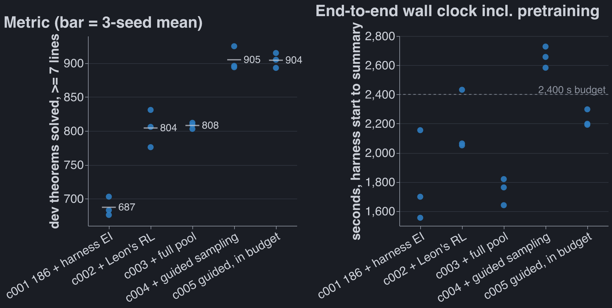

# Combined pipeline: everyone's best piece, four iterations

Status: done (5 runs × 3 seeds, 2026-09-27 20:40 to 2026-09-28 00:25 PDT). Working folder,
code and per-run logs: [combined_pipeline_20260928](../../code/experiments/current/combined_pipeline_20260928/README.md)
(branch `combined-pipeline`, checkout `nd-rl-6`); run table: its `RESULTS.md`.

Question: Robbie (2026-09-27): "combine everyone's best piece of the pipeline and see how it
does", then "do ~4 iterations … your best judgement of 4 versions of a combined pipeline".

## Configuration

Fixed across all runs: Dan's data, tokenizer and reward (fork `51604b3`: cap-6 `train.jsonl`,
`lean_seq`, Lean 4 ∧ nd_verify), the ladder `rl_targets` pool, and the frozen autoresearch eval
(dev half of `transfer.jsonl`, 1,108 theorems, 64 samples at T 0.8; metric = solved at
L_true ≥ 7). Pretraining is the autoresearch incumbent 186-claude (6×384 Peri-LN, ALiBi/NoPE,
Muon, MTP; 3-seed metric 680 under plain harness RL). Seeds 0, 1, 2; one A40 per seed.

| id | pipeline | metric (3-seed mean) | seeds | end-to-end s |
| --- | --- | --- | --- | --- |
| c001 | 186 pretrain + frozen harness expert iteration (replay) | 687.3 | 676 / 703 / 683 | 1,555–2,155 |
| c002 | + Leon's GEAR expert iteration (sample-matched, 192k) | 804.3 | 776 / 831 / 806 | 2,051–2,432 |
| c003 | c002 + full 4,495-target pool + fast RL sampler | 808.0 | 809 / 812 / 803 | 1,641–1,820 |
| c004 | c002 + verifier-guided RL sampling (Leon's, ported to lean_seq) | 905.0 | 925 / 894 / 896 | 2,583–2,728 |
| c005 | c004 with exact-output sampler speedups + an RL deadline | **904.3** | 915 / 893 / 905 | 2,192–2,298 |

c001/c002 loaded 186's saved weights (paired); c003+ pretrained on the pod (186's `pretrain.py`)
because the uplink could not move the checkpoint (see the c003 `relaunch.md`). c001/c002 wall
times above include 186's 300 s pretraining added back.

Pieces and owners: data/tokenizer/reward Dan; pretraining Robbie's autoresearch loop; RL recipe
Leon (`leon/home-rolled-rl` @ `0f749e2`: small rounds, fresh AdamW, T 1.0, hardest-first refill,
knapsack k, GEM loss); the fast sampler's compaction is Dan's efficiency-run idea. Charles's ws3
finding (EI ≥ GRPO) agreed with Leon's choice; nothing of Dmitry's was pluggable.

## Observations

- **Leon's RL recipe is +117 on the same pretrained weights and samples** (c002 vs c001; every
  seed +100 to +128). It solves 1,273–1,308 of 1,500 RL targets vs 1,138–1,181.
- **Verifier-guided sampling is another +101** (c004 vs c002). At each `;` the Lean prefix is parsed
  with the fork's own `inverse()` and each new ND line checked by Leon's `LineChecker`; bad
  segments are rolled back in the KV cache and resampled. CPU tests: 0 false rejects on 23,936
  line checks, 0 false accepts on 9,000 mutants, rollback exact to 7e-7 in logits.
- **The full target pool did nothing measurable** (c003: +3.7, inside pretraining noise), although
  it solved 3,816–3,829 RL targets. The fast sampler in c003 ran RL at 302–362 samples/s vs
  110–217.
- **Guided sampling costs time**: c004 overran the harness's 2,400 s (2,583–2,728 s). c005 keeps its
  score (−0.7) inside the budget with 13–27% fewer RL samples (the 1,800 s deadline stopped
  after 13/11/13 of ~15 rounds).
- Overall, the best legal pipeline (c005) scores **904 vs 680–687** for the same pretraining under
  the harness's RL: +217 to +224 dev theorems at ≥ 7 lines (~+32%).

Interpretation (not tested here): RL-stage gains dwarf what the pretraining loop has been
finding lately (153→186 moved the mean by single digits), so the fixed-RL choice in the pretrain
workstream may be hiding which pretraining choices matter under a stronger RL.

## Limitations and next step

- One protocol change is unmatched: `ND_TOTAL_SECS=3600` for all runs (only c004 needed it).
  c001–c003 and c005 fit 2,400 s; c004 would be a timeout under the frozen harness.
- c003+ are not weight-paired with c002; pretraining noise between same-recipe runs was ~±10 on
  3-seed means (185 vs 186), small next to the +100 effects, not next to c003's +4.
- Dev only; the holdout half of transfer was not scored. Leon's recipe was hand-evolved on its
  own dev set, not on this one, so dev overfitting is unlikely but unchecked.
- Not ported: Dan's Lean-only judge (needs the newer fork, which renders BOTE differently from
  what 186 was trained on) and Leon's CUDA-graph sampler.
- Checkpoints of all 15 runs are on local disk (`nd-rl-6/artifacts/autoresearch/combo-*`), not yet
  on HF: the uplink was saturated by the loops' uploads; push with `pod.py push`.
- Next: score holdout for c002/c004/c005; the c005 deadline was ~100–200 s conservative, so a
  deadline near 1,950 s would fit ~all 192k samples; consider whether the pretrain loop should
  switch its frozen RL stage to c005's recipe (a protocol change for Robbie to decide).
