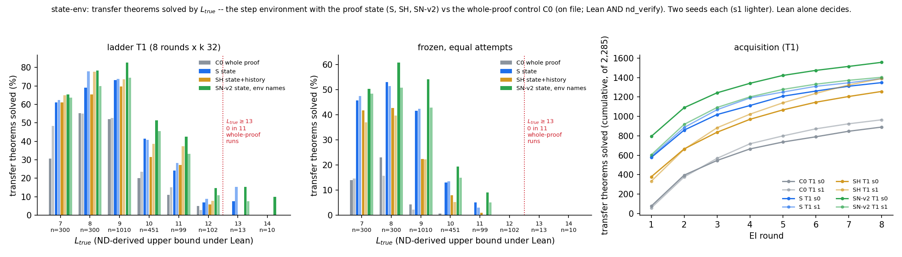

# state-env: does giving the policy the proof state move the length wall? (proposal 13)

Status: **completed and reviewed 2026-09-28. The state moved the wall a little but not decisively, and it clearly raises base reachability below the wall.**
No hard-constraint violation, nothing quarantined. The reviewer's verdict: the numbers reproduce from the raw
artefacts with its own code and a Lean re-check, and **six wordings must change**. Where the reviewer's wording
differs from the executor's, this summary uses the reviewer's. The executor's line "the state is not what limits
length here" is **not supported**, and it is not repeated here.

Question: [proposal 13](../../docs/proposals/2026-09-28-state-conditioned-environment.md) asked whether a policy that
sees the Lean tactic state (hypotheses in scope, the focused goal) and writes one step at a time gets past the
length wall, `L_true` ≥ 13, that every whole-proof model has hit. Brief:
[`docs/proposals/state-env/BRIEF_state-env.md`](../../docs/proposals/state-env/BRIEF_state-env.md).

Review: [`review_state-env.md`](https://github.com/dan-pandori/nd-takehome/blob/b092696/review_state-env.md)
(fork branch `dan_state-env`, commits [`154be64`](https://github.com/dan-pandori/nd-takehome/commit/154be64)
§Recount (blind) and [`b092696`](https://github.com/dan-pandori/nd-takehome/commit/b092696) §Compare/§Verdict;
reviewer code in `review_se/`). Executor write-up:
[`run_state_env.md`](https://github.com/dan-pandori/nd-takehome/blob/add0a68/run_state_env.md), `STATE_ENV.md`,
`numbers.md` § state-env, `log.md`, `artifacts/se/summary.json`. Pre-registration: `preregistration/state-env.md`,
commit `5bb93132` at 04:21:13 UTC, before the first pod (`se-1`, 04:22:57 UTC). Its two SN addenda are labelled
"added after seeing a result".

## Configuration

- **Models.** Each arm has its own Stage-1 checkpoint: 4 layers, d 256, 8 heads, **3,216,384 parameters** (the
  control's 3,214,336 plus embeddings for the 4 new state tokens). All are **from scratch**, 6,000 steps × 128 proofs, on
  `data/p2/train_depth3_f0_a1.jsonl` (155,000 records, cap 6, depth-3 f = 0), seeds 0 and 1.
  - **S** (`ckpts/se/stage1_S_s{0,1}.pt`, `lean_state`): the input is the focused goal's tactic state; the output is
    one `lean_seq` step.
  - **SH** (`stage1_SH_s*`, `lean_stateh`): the input is the actions so far plus the state.
  - **SN-v2** (`stage1_SN_s*`, `lean_staten`; a post-hoc diagnostic arm): the input is the state, and the
    environment assigns the names that a step introduces.
  - **C0** (`ckpts/lf/stage1_a1_seq_s{0,1}.pt`, 3,214,336 params, `lean_seq`, same training set): the whole-proof
    control. It was **not re-run**; its on-file numbers come from `ds-generator` (2026-09-23/24) and are measured
    **under Lean ∧ `nd_verify`**. S, SH and SN numbers are under **Lean alone**. The reviewer adds C0's Lean-only accepts back in:
    +2 / +1 T1, +7 / +2 frozen, 0 at `L_true` ≥ 13, and +0.000 on depth-3. The checker change does not distort
    the comparison.
- **T1**: 8 rounds of expert iteration from each Stage-1 checkpoint (`state_ladder_ei.py`, k = 32, T 0.8).
  **Frozen**: the same loop with `--no_train`. RL-target attempts are equal between T1 and frozen: 1,150,720 in every
  one of the 12 ladders. Evaluation pools: the transfer pool (2,285 theorems, never trained on) and held-out greedy
  (5,000, `data/p2/heldout.jsonl`).
- **Sampler**, identical across arms: fast path, compaction on, environment batch 2,048, `--max_action` 256,
  `--max_steps` 48. The batch probe measured peak 4.53 / 8.58 / 16.37 / 16.31 GB at batch 1,024–8,192 (the peaks are
  in the log only). Peak `max_memory_allocated` in round 8 was 10.2–20.4 GB.
- **Gates** (the environment's state equals Lean's). The executor reports 0 failures on gates 1, 1b, 2, 2b and 3. The reviewer
  re-ran gate 2 in Lean with its own parser: **0 mismatches / 5,600**; a mutation control flagged 594 of 600
  mutated cases. The reviewer did **not** re-derive gates 1 / 1b / 3.
- **Pods**: six, all deleted:
  - `se-1`, `se-3` and `se-6`: RTX 3090 at $0.50/h.
  - `se-2`: RTX PRO 4000 Blackwell at $0.57/h (`podbudget` bills its fallback $0.50).
  - `se-4`: RTX 4090 at $0.74/h.
  - `se-5`: RTX PRO 4500 Blackwell at $0.72/h.

  Total **35.44 pod-hours, $20.20** at the billed rates, against a budget of 60 h / $30.
- **Code**: fork branch `dan_state-env`, results commit `add0a682` (not merged into the fork's `dan`).
- **Bucket**:
  - `hf://buckets/dan-pandori/nd-rl/state-env/ckpts/se/`: six Stage-1 checkpoints and every EI round.
  - `…/artifacts/se/`: round jsons, found files, held-out per-record files, gates.
  - `…/data/`.

## Observations (reviewed)

**Transfer pool, cumulative at round 8** (`L*` = max L with ≥ 5 theorems solved at `L_true` ≥ L; `L_true` is ND-derived
and an upper bound under Lean). Values are seed 0 / seed 1.

| arm | T1 solved | T1 `L*` | T1 at `L_true` ≥ 13 | textbook / 760 | frozen solved | frozen `L*` |
|---|---|---|---|---|---|---|
| S | **1,348 / 1,389** | 12 / 12 | 1 / 2 | 182 / 216 | **779 / 787** | 11 / 10 |
| SH | 1,257 / 1,390 | 12 / 12 | 0 / 0 | 148 / 201 | 516 / 479 | 10 / 10 |
| SN-v2 | 1,557 / 1,403 | 12 / 12 | 3 / 1 | 236 / 197 | 975 / 801 | 11 / 11 |
| C0 (Lean ∧ `nd_verify`) | 890 / 965 | 12 / 11 | 0 / 0 | 37 / 89 | 158 / 114 | 9 / 9 |

What stands, per the reviewer's verdict:

1. **The length wall moved, but not decisively** (the pre-registered reading, which the reviewer
   restores in place of "the state is not what limits length"). **Neither falsifier fires.**
   - "The state is the wall" needed `L*` ≥ 13 and ≥ 5 theorems solved at ≥ 13. S got `L*` 12 and 1 / 2 theorems.
   - "The state is not the wall" needed 0 at ≥ 13 on both seeds. That did not happen.
   - `L*` is 12 in all six T1 runs.
   - The executor's prior was 0.6 on the second falsifier firing. The test cannot tell "barely moved" from "not the
     wall" at n = 2.
2. **Only 3 distinct `L_true` ≥ 13 theorems** were solved by any run: `la_transfer_1126` (all four S / SN runs),
   `1198` and `978`. One theorem carries 4 of the 7 S/SN hits.
   - They are real ND-length proofs (written length ≥ `L_true`), with no Lean-only `n.elim`-on-`¬A` shortcut.
   - No frozen run solves any of them at equal attempts.
   - Term size is 8–13 by `lean_check`'s definition and 11–14 by the reviewer's.
   - C0's four ladders solve 0 at ≥ 13 (0 also with Lean-only accepts added). The executor's "0 in 11 whole-proof
     runs" refers to `ds-generator`'s 11 ladders on several training sets, under Lean ∧ `nd_verify` (reviewer's
     label).
3. **The robust result is base reachability.** With no RL, S solves **779 / 787** transfer theorems against C0's
   **158 / 114**. The mean difference is +647, above `NOISE_FLOOR.md`'s MDD of 397, and the ratio of 5.8× is above the floor's 3.35×. SN also
   clears the floor (975 / 801, +752). Caveat: the floor was measured on C0's configuration, not on these models.
4. **"The state lifts everything below the wall" is supported for S and SN on the frozen readout only.**
   - The T1 gains (+441 S, +553 SN) have no measured T1 noise floor. C0's own T1 re-draw spread on one checkpoint is
     856 / 890 / 923.
   - Per-bin T1 gains at `L_true` 11–12 are small counts (S 24 / 28 and 7 / 9 against C0's 11 / 15 and 5 / 3).
   - SH's frozen gain over C0 (+362) is inside the MDD.
5. **SH vs S.**
   - T1 is indistinguishable (−91 / +1).
   - SH's frozen score is ≈ 285 below S's (516 / 479). That gap is **inside the frozen floor (MDD 397 at n = 2) and is not a
     finding**.
   - The pre-registered "SH ≥ S on held-out by ≤ 2 pp" **missed** (−0.6 pp on s0, +15.4 pp on s1). The executor did
     not report the miss.
6. **Held-out greedy** (Stage-1 checkpoints, in the environment), seed 0 / seed 1:

   | arm | overall | 6-line bin |
   |---|---|---|
   | S | 0.958 / **0.801** | 0.904 / 0.678 |
   | SH | 0.952 / 0.955 | |
   | SN-v2 | 0.970 / 0.958 | |
   | C0 | 0.909 / 0.897 | 0.686 / 0.584 |

   S seed 1 loses **581 / 5,000** attempts to `unbound` (out-of-scope) names. The mechanism, S's random first-name
   offset, is an inference. SN-v2 removes the failure on the same checkpoints, but it is a post-hoc diagnostic
   arm. The noise floor for held-out overall at n = 2 is ±16.3 pp.
7. **Depth-3 slice (reviewer's framing, `NOISE_FLOOR.md` rule 5).** The slice is bimodal, so it is not read as
   mean vs mean.
   - **All 6 state-conditioned Stage-1 checkpoints are in the high mode** (0.860–0.956).
   - The control configuration lands in the high mode with probability 0.462 [0.333, 0.595]. Six of six has
     probability ≈ 0.462⁶ ≈ 0.01 under that rate, which is **suggestive of a real shift**.
   - Two of the six (S s0 0.922, SN s0 0.956) are above the control's whole 52-cell null range (max 0.918).
8. **Lean re-check.** The reviewer re-checked **2,792** counted proofs with its own ND → Lean translator and with the
   `lean_seq` rendering. **0 were rejected** under either. Its negative controls behave as expected: 137 / 150
   single-rule flips are rejected, and the flips that pass are all `X ∧ X` / `X ∨ X` no-ops. The executor's own
   `lean_check` pass rejected 0 of 14,808 shortest proofs.
9. **Term size agrees with line count.** Within each `L_true` bin the arms have the same median size. The
   state-conditioned T1 runs reach proofs of 12–25 inference nodes; C0's T1 reaches at most 11 (reviewer's
   definition).
10. **Environment behaviour** (the run's own counters; the reviewer re-derived the ratios but could not recount the
    raw numbers):
    - 8.3–9.4 actions per attempt.
    - 6–13 % of attempts ended by an environment syntax check.
    - ≤ 0.008 % of actions hit `--max_action` 256.
    - 0 attempts hit the step cap.
11. **Hard constraints hold.**
    - `nd_verify/` is unmodified and judges nothing.
    - `TEST_RUN_DONE` is unchanged.
    - No evaluation file is read in training.
    - Splits are disjoint by renaming class, apart from 21 inherited held-out and 2 RL-target/transfer premise-order
      collisions (both `L_true` 9).

### Pre-registered expectations for arm S (reviewer's scoring)

Hits:
- T1 `L*` 12
- 0–3 theorems at ≥ 13
- 6-line held-out ≥ 0.60
- steps 4–12
- syntax ends < 45 %
- truncation < 0.1 %
- SH ≈ S on T1

Misses:
- **held-out 0.85–0.95**: missed on both seeds, in opposite directions (0.958 / 0.801).
- **T1 solved 700–1,250**: 1,348 / 1,389.
- **textbook 20–120**: 182 / 216.
- **frozen 80–400**: 779 / 787, about 2× the top of the range.
- **frozen `L*` 9 (8–10)**: 11 on s0.
- **SH ≥ S held-out by ≤ 2 pp**: missed, and not reported by the executor.

SN addendum:
- "Gain large on s1, small on s0" **missed in the opposite direction** (+209 on s0, +14 on s1). The executor did not score it.
- The SN-v2 held-out prediction (≥ 0.94, spread < 3 pp) was met. It was measured after the SN-v2 decision, so it
  does not count as confirmation.

## Limitations

- **The literal sampled text was not stored.** `LEAN_GATE_DUMP` was not set, so the found and held-out files hold
  the ND string decoded from the text. The reviewer's 0 / 2,792 is a re-check of alpha-equivalent re-renderings. The
  policy asks for "Lean on the literal text", and only the gate's code path and logs attest to that. Future
  state-env runs should set `LEAN_GATE_DUMP` (≈ 2 MB per 5,000 attempts).
- **n = 2 on the headline quantity.** The IQM equals the mean, and the bootstrap is degenerate, so values are given
  per seed. The pre-registration gives no MDD for its headline quantity. The policy rule that requires one is dated
  the same day and may post-date it.
- **The noise floor is borrowed from C0's configuration**, and no T1 floor exists anywhere.
- **Gates 1 / 1b / 3 were not re-derived.** Gate 2 was checked against the renderer states stored in the case files;
  the reviewer did not re-run `state_env`.
- **Attempt-level truncation** reaches 0.21 % in two frozen runs, above the policy's ≈ 0.1 % line. Action-level
  truncation is ≤ 0.008 %, and no pool formula exceeds 113 tokens, so it is unlikely to have cut a real proof step.
- **Resumed runs.**
  - T1 S s0 and s1 resumed at rounds 3 and 2 after the empty-`have` crash fix. The fix changes only attempts that crashed.
  - T1 SH s0 resumed at round 6 with a micro-batched fine-tune after an OOM.
  - SH's round-1 counts differ between T1 and frozen (378 vs 373). This is a pod re-draw.
- **Inherited-number slips:**
  - The pre-registration's C0 textbook s0 is "38"; the file says 37.
  - The C0 s1 held-out 0.8968 comes from `heldout2_c0_s1.jsonl`. It reproduces, and the reviewer withdrew its own
    erratum.

## Next step

The reviewer's next steps, in order:

1. **Settle the headline question at more than n = 2:**
   - Train a third and fourth Stage-1 seed of S (≈ 13 min each).
   - Re-sample the final T1 checkpoints at k = 128–256 on the 23 `L_true` ≥ 13 transfer theorems, paired against
     C0's final checkpoints at the same k. This separates "the state reaches 13+ at a low rate" from "one lucky
     theorem".
2. **Give the robust result its own floor:** run 4–6 more cheap frozen S cells, so the base-reachability jump is
   judged against a state-model floor rather than C0's.
3. Set `LEAN_GATE_DUMP` in `pod/se/env.sh` for any further state-env run.
