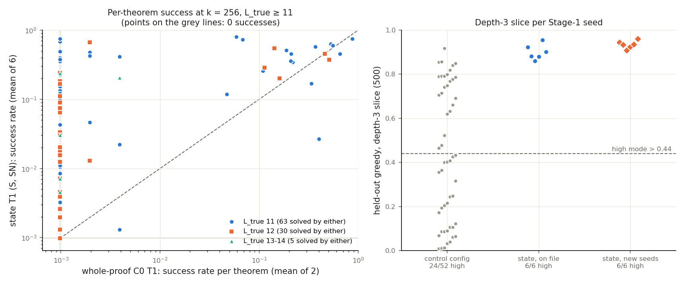

# state-frontier: does the state reach `L_true` ≥ 13 at a real rate, and does it remove the depth-3 lottery?

Status: **completed 2026-09-28 18:19 – 2026-09-29 00:40 UTC (executor) and independently reviewed
00:40–01:01 UTC. Verdict: stands, with four rewordings (W1–W4).** No hard-constraint violation, nothing
quarantined. Where the reviewer's wording differs from the executor's, this summary uses the reviewer's. In
particular, the executor's headline "the state removes the lottery" is reworded (W3), and "state beats C0 at
≥ 13" is not claimed (W1).

Question: [state-env](../2026-09-28-state-env-state-lifts-below-the-wall/README.md) left two things open.
(1) Its state-conditioned T1 ladders solved only 3 distinct theorems at `L_true` ≥ 13, one of which carried 4 of
7 hits. Is that a real low rate or one lucky theorem? (2) All 6 of its state-conditioned Stage-1 checkpoints
landed in the high depth-3 mode, against the whole-proof control's 24 / 52. Does the state remove the depth-3
"lottery", or were 6 seeds lucky? This run follows state-env's reviewer's ranked next step.

This run was on the fork (`dan-pandori/nd-takehome`), branch `dan_state-frontier`, cut from the fork's `dan`
(base `d90da191`). It is not merged into the fork's `dan`.

- Review: [`review_state-frontier.md`](https://github.com/dan-pandori/nd-takehome/blob/e7bb9232/review_state-frontier.md)
  ([`ed0da394`](https://github.com/dan-pandori/nd-takehome/commit/ed0da394) §Recount, blind;
  [`e7bb9232`](https://github.com/dan-pandori/nd-takehome/commit/e7bb9232) §Compare/§Verdict; reviewer code
  in `review_sf/`).
- Executor write-up: [`run_state_frontier.md`](https://github.com/dan-pandori/nd-takehome/blob/683724f1/run_state_frontier.md),
  `numbers.md` § state-frontier, `log.md`, `artifacts/sf2/summary.json` (from `sf_analysis.py --term_size`).
  Results commit `683724f1`.
- Pre-registration: `preregistration/state-frontier.md`, commit `20dfa0f1` at 18:23:14 UTC, before the first pod
  (`sf-1`, created 18:24:36 UTC).

## Configuration

- **Models.** All have 4 layers, d 256, 8 heads, and are trained from scratch. Stage-1 used
  `data/p2/train_depth3_f0_a1.jsonl` (155,000 records, cap 6, depth-3 f = 0), except G1.
  | label | checkpoints | params / format |
  |---|---|---|
  | S (state in, one `lean_seq` step out) | s0/s1 from state-env (`ckpts/se/`); **s2/s3 new** (Stage-1 + 8-round T1) | 3,216,384, `lean_state` |
  | SN (sampled in `Env(assign=True)`, i.e. SN-v2) | s0/s1 Stage-1 + T1 from state-env; **s2–s5 new** (Stage-1 + frozen ladder) | 3,216,384, `lean_staten` |
  | C0 (whole-proof control) | bases `lean-format/ckpts/lf/stage1_a1_seq_s{0,1}.pt`; T1 `ds-generator/ckpts/ladder/la_T1_c0_s{0,1}_r8.pt` | 3,214,336, `lean_seq` |
  | G1 (secondary whole-proof reference; **trained on `train_g1`**, a different set) | `ds-generator/ckpts/ladder/la_T1_g1_s{0,1}_r8.pt` | 3,214,336, `lean_seq` |

  "T1" is the round-8 checkpoint of an 8-round expert-iteration ladder (k 32, T 0.8, batch 2,048, `max_action` 256,
  `max_steps` 48, state-env's unchanged commands); "base" is the Stage-1 checkpoint.
- **Judge: Lean alone** (`lean_judge`: strict `lean_seq` grammar + Lean 4.34.0 core). `LEAN_GATE_DUMP` was set on
  every job, so the literal sampled text of every counted proof is stored. `nd_verify` is on no counting path.
  `L_true` labels are ND-derived upper bounds under Lean.
- **A (Q1): re-sample.** Pool `data/sf2/long.jsonl` = the 224 transfer theorems with `L_true` ≥ 11 (99 / 102 / 13 /
  10 at 11 / 12 / 13 / 14; md5 `77304200…`), never trained on. Every model at **k = 256, T 0.8, sampling seed 0**.
  State models: `state_eval.py`, batch 2,048, `max_action` 256, `max_steps` 48. Whole-proof: `eval_set.py`, batch
  2,048, `max_new` 512 (C0 T1 s1 re-run at 1,024, as pre-registered). Batch 2,048 is not "the largest that fits";
  it was pre-registered for comparability with state-env. Peak `max_memory_allocated` 8.9–11.0 GB (state), 9.4 GB
  (whole-proof, 512) and 16.1 GB (1,024).
- **B: more seeds.** S s2, s3: Stage-1 → held-out greedy → T1 → frozen ladder. SN s2–s5: Stage-1 → held-out greedy
  → frozen ladder. Transfer pool of 2,285 theorems.
- **C (Q2): lottery.** Held-out greedy on the depth-3 slice (`pat.depth3`, 500 theorems) for the 6 new Stage-1
  seeds; high mode iff rate > 0.44.
- **Pods** (all deleted): `sf-1` RTX 4090 $0.74/h 4.92 h $3.64; `sf-2` A40 $0.49/h 6.18 h $3.03; `sf-3` RTX 3090
  $0.50/h 5.56 h $2.78; `sf-4` RTX A5000 $0.27/h 5.51 h $1.49. **22.17 pod-hours, $10.94** of $12 / 24 h. The
  pre-registered stop rule (20 h / $10) fired at 21.4 h — the executor's log says the 20 h line passed unnoticed —
  and frozen SN s5 was stopped at round 5 of 8.
- **Bucket** `hf://buckets/dan-pandori/nd-rl/state-frontier/`: `ckpts/sf2/` (6 new Stage-1, 16 T1 rounds),
  `artifacts/sf2/` (re-samples `rs/`, held-out, ladders, logs, Lean dumps `dumps/*.jsonl.gz`),
  `data/sf2/long.jsonl`.

## Observations (reviewed)

Every number below reproduces on the reviewer's own code. The reviewer's own Lean harness (own statement
translator, literal stored text) accepted every counted proof it re-checked: all 575 distinct accepted texts at
`L_true` ≥ 13 plus 1,768 random others in design A; 859 / 859 from the 8 new ladders; 600 / 600 depth-3 texts from
the new held-out runs. It rejected 201 / 201 negative controls. Splits are disjoint by renaming class (order-
sensitive: no overlap anywhere; order-insensitive: 2 transfer overlaps at L 9 and 21–22 held-out overlaps of 3–6
lines, none in the `long` pool or the depth-3 slice).

*Left: per-theorem success at k = 256, state T1 finals (mean of 6) vs C0 T1 (mean of 2). Right: depth-3 rate per
Stage-1 seed. The "control config" column is inherited from `NOISE_FLOOR.md`: 3.2 M whole-proof `lean_seq` Stage-1
models, measured under Lean ∧ `nd_verify` before 2026-09-27 (W2); state-env's review measured the checker effect on
C0's depth-3 rate as +0.000.*

**1. Q1 — the state gets past 12 at a real, low rate, on a few theorems.**

| model | N13 (of 23) | successes at ≥ 13 (of 5,888) | solved at 11–12 |
|---|---|---|---|
| T1 S s0 / s1 / s2 / s3 | 1 / 3 / 4 / 3 | 7 / 188 / 13 / 143 | 40 / 40 / 57 / 70 |
| T1 SN s0 / s1 | 5 / 1 | 269 / 129 | 67 / 48 |
| T1 C0 s0 / s1 (s1 at `max_new` 1,024) | 1 / 0 | 2 / 0 | 21 / 22 |
| T1 G1 s0 / s1 (other training set) | 0 / 0 | 0 | 19 / 6 |
| base S s0–s3 | 0 each | 0 | 5 / 3 / 6 / 14 |
| base SN s0–s5 | 0 / 0 / 0 / 1 / 0 / 0 | s3: 1 | 10 / 6 / 6 / 10 / 2 / 6 |
| base C0 s0 / s1 | 0 / 0 | 0 | 0 / 0 |

- The pre-registered reading **"a real, low rate"** (≥ 3 distinct ≥ 13 theorems each solved by ≥ 2 of the 6 state
  T1 finals) **holds: 4 theorems qualify.** "One lucky theorem" fails: `la_transfer_1126` carries 317 / 749 = 42 %
  of the state-T1 successes at ≥ 13 (rule: ≥ 80 %).

  | theorem | `L_true` | successes / 256, S s0–s3, SN s0, SN s1 | finals solving it |
  |---|---|---|---|
  | 1126 | 13 | 7 / 127 / 4 / 2 / 48 / 129 | 6 |
  | 1198 | 13 | 0 / 60 / 3 / 139 / 165 / 0 | 4 |
  | 978 | 14 | 0 / 0 / 5 / 2 / 4 / 0 | 3 |
  | 735 | 13 | 0 / 1 / 1 / 0 / 5 / 0 | 3 |

  `1696` (L 14) is solved by T1 SN s0 only (47 / 256).
- **Reviewer's qualifications (W3).** 684 of the 749 successes are on two theorems (1126, 1198). 735 rests on
  single hits (1 / 256 twice, 5 / 256 once).
- **Base reachability.** `978` is base-reachable: base SN s3 samples it (1 / 256, in both the 256 and 512 runs),
  and the frozen SN s3 ladder finds it. **1126, 1198 and 735 were reached by no state base (10 bases × 256) and no
  frozen ladder (S s0–s3, SN s0–s5).** C0 T1 s0 reaches 1126 (2 / 256).
- Pooled state-T1 success rate at ≥ 13: **2.12 %** (749 / 35,328; S alone 1.49 %). C0 T1: 0.017 % (2 / 11,776).
- **State vs C0, paired by theorem (sign test on per-model means, ties excluded).** At 11–12: state better on 86,
  C0 on 7, p = 2 × 10⁻¹⁸. **At ≥ 13: 5 / 0, p = 0.0625 — not significant (W1).** The test is limited by the 5
  theorems that k = 256 happened to solve, not by the effect size.
- **Ladders.** All four S T1 ladders reach `L*` 12 (1 / 2 / 3 / 4 theorems at ≥ 13): the state gets past 12 rarely
  but repeatably, without moving `L*`.
- **Proof length at ≥ 13.** Every accepted proof's ND denotation has at least `L_true` lines, so the labels are not
  beaten under Lean here. Lean lines (`have` + `exact`) are 8–13. Term size: the executor's `lean_check` inference-
  node count on the `nd2lean` re-translation gives minima 8 / 8 / 9 / 11 / 12 (1126 / 735 / 1198 / 978 / 1696); the
  reviewer's token count on the literal text (ascriptions removed) gives 33 / 35 / 36 / 41 / 42. The definitions
  differ; the orderings agree.

**2. Q2 — no low-mode seed in 12 state seeds.**

| seed | S | SH | SN |
|---|---|---|---|
| s0 / s1 (state-env) | 0.922 / 0.882 | 0.860 / 0.880 | 0.956 / 0.902 |
| s2 / s3 (new) | 0.936 / 0.960 | — | 0.944 / 0.934 |
| s4 / s5 (new) | — | — | 0.908 / 0.924 |

- **6 / 6 new seeds are in the high mode; the falsifier (≥ 2 low) did not fire.** Under the control's P(high) =
  0.462, P(6 / 6) = 0.0097.
- **Reviewer's wording (W3):** no low-mode seed in 12 state seeds; P(high) ≥ 0.76 (95 %, Wilson [0.758, 1.00]),
  against the control's 0.46 [0.333, 0.595]. "Removes the lottery" claims a zero that 12 seeds cannot show: the
  one-sided 95 % upper bound on P(low) is ≈ 0.24.
- Depth-3 sd across the 12 state seeds 0.032 (predicted < 0.05). Held-out overall for the new seeds: S s2 0.960,
  S s3 **0.882** (84 `unbound`-name failures; 358 of its 588 failures are Lean rejections), SN s2–s5 0.955–0.971.

**3. Ladders and the base-reachability floor** (cumulative transfer solved of 2,285 after 8 rounds; IQM with a
stratified-bootstrap 95 % interval).

| arm | per seed | IQM [95 %] | `L*` |
|---|---|---|---|
| T1 S (n = 4) | 1,348 / 1,389 / 1,546 / 1,630 | 1,467.5 [1,348, 1,630] | 12 × 4 |
| frozen S (n = 4) | 779 / 787 / 858 / 996 | 822.5 [779, 996] | 11 / 10 / 11 / 11 |
| T1 SN (n = 2, on file) | 1,557 / 1,403 | — | 12 / 12 |
| frozen SN (n = 5) | 975 / 801 / 841 / 1,009 / 723 | 869.2 [746, 999] | 11 / 11 / 11 / 11 / 10 |

- Frozen SN s5 is partial (759 after 5 rounds; stop rule) and excluded.
- Every frozen state seed is far above C0's on-file frozen range, 114–158. **Label (W2):** those C0 values are
  3.2 M whole-proof `lean_seq` frozen ladders from `ds-generator` / `noise-floor`, measured under **Lean ∧
  `nd_verify`** before 2026-09-27; state-env's review (row 18) measured the checker effect on them as +7 / +2.

**4. Expectations vs outcomes** (pre-registered, committed before the run).
- Hits: C0 T1 N13 0–1; G1 0; state bases 0–1; C0 bases 0; `1126` solved by all 6 finals; T1 11–12 counts (state
  40–70, C0 21–22); `L*` 12; all of Q2; frozen SN range, IQM and sd.
- **Misses:**
  - N13 per state T1 final was 1 for S s0 and SN s1 (predicted 2–6; 4 of 6 inside).
  - Pooled rate at ≥ 13: 2.12 % (predicted 0.1–1 %), high.
  - State bases at 11–12: 2–17 including the 512 re-draws (predicted 10–40), low.
  - T1 S s2 / s3: 1,546 / 1,630 (predicted 1,250–1,500), high.
  - Frozen S s2 / s3: 858 / 996 (predicted 700–850), high.
  - Only 5 of the 6 pre-registered frozen SN seeds completed.

**5. Length caps — a deviation from the policy (W4).** The executor's "cut off" column reports overall fractions;
the policy threshold (> 0.1 % → raise the cap) is per stratum. By stratum:
- At ≥ 13: **T1 SN s1 0.170 %** and **base SN s4 0.476 %** (28 of 5,888 samples) — neither was re-run, so T1 SN s1's
  N13 = 1 and base SN s4's N13 = 0 are length-capped.
- At 11–12: base S s0 / S s3 / SN s3 at 0.225 / 0.187 / 0.356 % were re-drawn at `max_action` 512, but the 256 rows
  are the ones reported. The re-draws leave N13 unchanged and move 11–12 by −2 / +3 / +3.
- C0 T1 s1 at `max_new` 512 hit the cap on 0.25 % overall; the 1,024 re-run hit it on 0.07 %, 21 → 22 solved at
  11–12, N13 0 → 0. Whole-proof jobs store only an overall `hit_max_new`, so their per-stratum truncation is not
  derivable.

**Interpretation (reviewer's wording).** The state T1 finals reach `L_true` ≥ 13 at a real, low rate: four
theorems are each solved by ≥ 2 finals, and three of them (1126, 1198, 735) are reached by no state base and no
frozen ladder, so on those RL produced something the base did not show at this sampling depth. The rate is
concentrated (two theorems carry 91 % of the successes), `L*` stays at 12, and the ≥ 13 advantage over the
whole-proof control is not significant at 5 theorems. On the lottery, 12 / 12 state seeds are in the high mode,
which excludes the whole-proof control's P(high) = 0.46 but does not show P(low) = 0.

## Limitations and next step

- The ≥ 13 stratum is 23 theorems; at k = 256 the run can tell "one theorem" from "several" but not measure the
  rate. N13 has no measured noise floor; the pre-registration's stand-in MDD (≈ 3.1 theorems, S n = 4 vs C0 n = 2)
  is larger than the predicted difference, which is why the decision rules are per theorem.
- Controls are inherited and measured under Lean ∧ `nd_verify` (W2); the checker effect measured on them is ≈ 0.
- Two ≥ 13 strata exceed the 0.1 % truncation line and were not re-run (W4).
- Frozen SN is n = 5, not the pre-registered 6.
- **Next (reviewer, ranked):**
  1. Re-run T1 SN s1 and base SN s4 at `max_action` 512 (≈ 10 GPU-minutes each), closing W4 at ≥ 13.
  2. Sample the 23 ≥ 13 theorems at k = 4,096 for the 6 state T1 finals and both C0 T1 finals, and compare state vs
     C0 per theorem with paired per-model rates, not a sign test over whatever k = 256 happened to solve.
  3. For Q2, ≈ 30 state seeds would bound P(low) below 0.1 at 95 % (0 / 30 → 0.095); that is what "removes"
     would require.
  4. Store per-sample `hit_max_new` flags in `eval_set.py` rows so whole-proof truncation is auditable per stratum.
