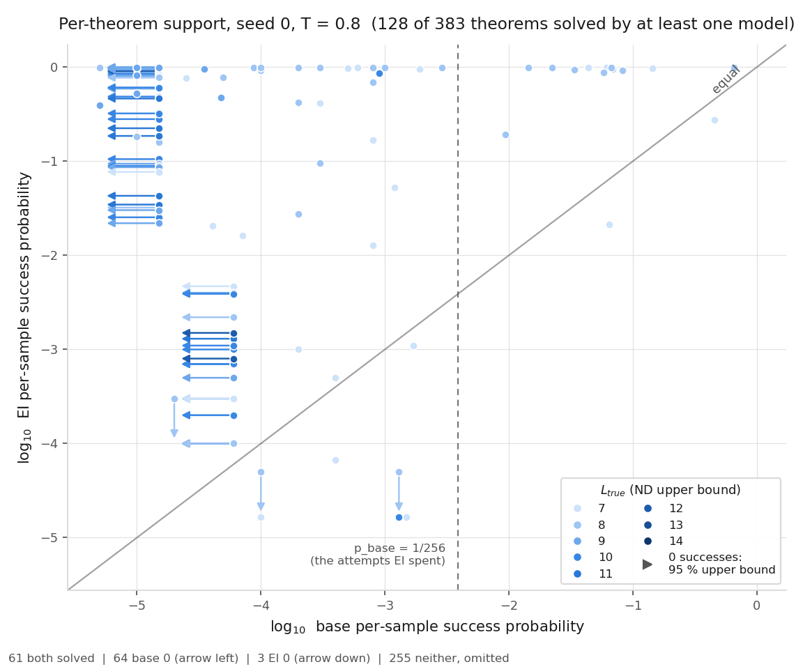
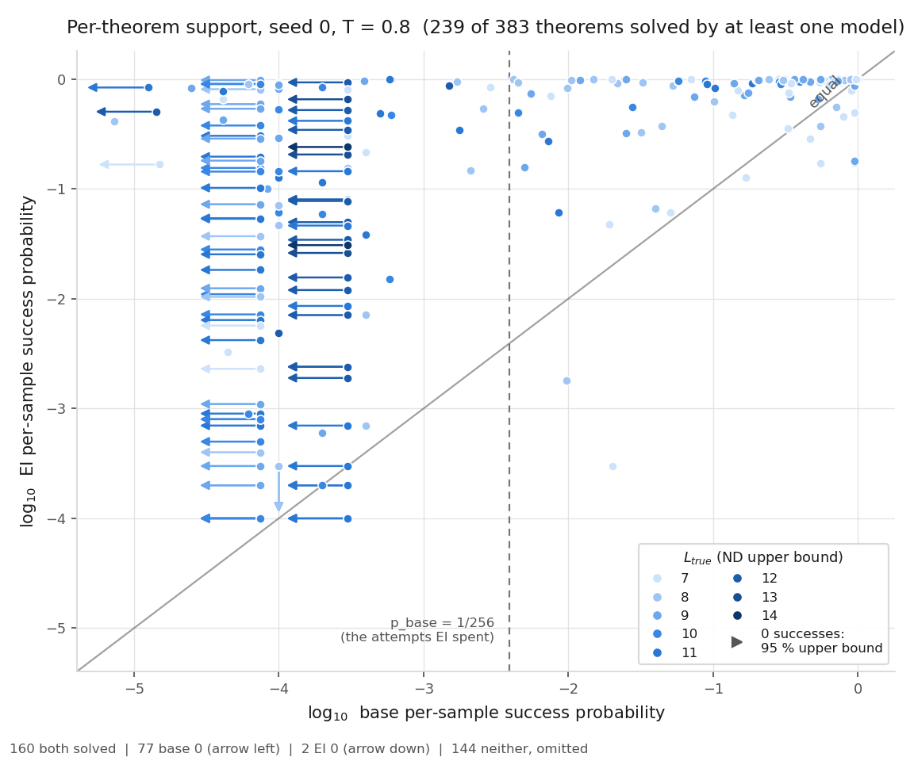

# support-state: is the support expansion about a move, or about the state interface?

Status: **completed 2026-09-28 18:19 – 2026-09-29 00:15 UTC (executor) and independently reviewed
00:20–00:41 UTC. Verdict: stands, with four rewordings and one sentence not supported.** No
hard-constraint violation, nothing quarantined. Where the reviewer's wording differs from the executor's,
this summary uses the reviewer's. The executor's sentence "the state moves the frontier to `L_true` 11–14" is
**not supported**, so it is not repeated here (see observation 4).

Question: [support-curves](../2026-09-27-support-curves-support-expansion-fires/README.md) found 29 transfer
theorems that the whole-proof (WP) base never solves in 400,000 attempts, while its EI descendant solves them at
p̂ 0.022–0.9995. [support-followups](../2026-09-28-support-followups-expansion-not-removed-by-8x-params/README.md)
found that the EI proofs are improbable under the WP base at two or three steps. [state-env](../2026-09-28-state-env-state-lifts-below-the-wall/README.md)
showed that a state-conditioned base reaches 5–6× more transfer theorems with no RL. **Does a base that sees
the proof state already reach the 29?** Brief:
[`BRIEF_support-state.md`](../../docs/proposals/state-env/BRIEF_support-state.md).

This run was on the fork (`dan-pandori/nd-takehome`), branch `dan_support-state`, cut from the fork's `dan`.
It is not merged into the fork's `dan`.

- Review: [`review_support-state.md`](https://github.com/dan-pandori/nd-takehome/blob/2913f0e4/review_support-state.md)
  ([`88ec2534`](https://github.com/dan-pandori/nd-takehome/commit/88ec2534) §Recount, blind;
  [`2913f0e4`](https://github.com/dan-pandori/nd-takehome/commit/2913f0e4) §Compare/§Verdict; reviewer code
  in `review_ss/`).
- Executor write-up: [`run_support_state.md`](https://github.com/dan-pandori/nd-takehome/blob/47907739/run_support_state.md),
  `numbers.md` § support-state (SS1–SS8), `log.md`, `artifacts/ss/summary.json`. Results commit `47907739`.
- Pre-registration: `preregistration/support-state.md`, commit `242c065a` at 18:23:28 UTC, before the first pod
  (`ss1`, created 18:25:08 UTC).

## Configuration

- **Models.** All are from scratch on `data/p2/train_depth3_f0_a1.jsonl` (6,000 steps × 128, cap 6).
  | label | checkpoint | md5 | params / format |
  |---|---|---|---|
  | SN base s0 / s1 | state-env's `ckpts/se/stage1_SN_s{0,1}.pt` | `ec3888d9` / `d8b21e4c` | 3,216,384, `lean_staten` |
  | SN EI s0 | `ckpts/se/ladder/la_T1_SN_s0_r8.pt` (SN base s0 + 8 rounds × k 32 EI at T 0.8 on `rl_targets`) | `fb448247` | same |
  | WP base (inherited) | support-curves' `ckpts/lf/stage1_a1_seq_s0.pt` | `9bde44c0` | 3,214,336, `lean_seq` |
  | WP EI (inherited) | support-curves' `la_T1_sc_s0_r8.pt` | `5cebd7ec` | same |

  WP numbers were **not re-run**. They are support-curves' records, measured under Lean alone on 2026-09-27.
- **Judge: Lean alone** (Lean 4.34.0 core, `lean_gate.gate`, on the literal `lean_seq` text the environment
  assembles). `LEAN_GATE_DUMP` was set on every job. `nd_verify` is on no counting path.
- **Sampling** (`ss_support.py`, `support.py`'s protocol through `state_sample.env_generate`):
  `Env(canon=True, assign=True)`, meaning the environment names what each step introduces. `max_action` 256,
  `max_steps` 48, fast decode path.
  - Batch: H 4,096. S1 4,096, except 7 (base) and 19 (EI) theorems at 1,024 on the first pod (CUDA OOM from
    co-tenancy; disclosed in `log.md`). S2 2,048.
  - Peak `max_memory_allocated` at batch 4,096: 15.9 GB (H), 16.8 GB (S1).
- **H (headline).** The 29 survivors (`data/sc/falsifier_survivors.txt`), SN base s0 and s1. Up to 200,000
  attempts at T 0.8, then up to 200,000 at T 1.0 for rows with fewer than 5 successes; a theorem stops at 5.
- **S1.** All 383 theorems, SN base s0 and SN EI s0, k 10,000, stop at 50, T 0.8. This is support-curves' stage 1.
- **S2.** On the SN forward crux, SN base s0 to 40,000 at each temperature (`stop_at 1`), then deepening on E8
  theorems. On the reverse crux, SN EI s0 gets +20,000 at T 0.8.
- **Pods** (both deleted after every record file was md5-matched):
  - `ss1`: RTX PRO 4500 Blackwell, $0.72/h, 5.75 h, $4.14.
  - `ss2`: RTX 6000 Ada 48 GB, $0.84/h, 4.54 h, $3.82.

  Total **10.30 pod-hours, $7.96** (`podbudget`), against a budget of 20 h / $10.
- **Bucket**:
  - `hf://buckets/dan-pandori/nd-rl/support-state/artifacts/ss/`: records, summary, Lean dumps
    `dump/*.jsonl.gz`, gate logs.
  - `…/data/ss/` and `…/data/sc/`.
  - No new checkpoints. The models are in `hf://buckets/dan-pandori/nd-rl/state-env/ckpts/se/`.

## Observations (reviewed)

Every count below reproduces on the reviewer's own code. Every counted proof it re-checked is accepted by its own
Lean harness: 89 + 75 of H (all), 46 of S2 (all), 240 of S1 (random). The harness rejects all 120 of the negative
controls.

**1. H — the state base reaches the survivors.**

| quantity | SN base s0 | SN base s1 | pre-registered |
|---|---|---|---|
| **reached / 29** | **28** (miss `la_transfer_1893`) | **28** (miss `la_transfer_1110`) | E1 28 (25–29) ✓; E4 ≥ 24 ✓ |
| reached at T 0.8 within first 10,000 | 26 | 23 | E2 24–29 (s0 ✓) |
| median p̂ at T 0.8 (unreached = 0) | 0.188 | 0.0088 | E3 ≥ 3 × 10⁻³ ✓ |
| attempts | 1,041,664 | 2,190,528 | |

- The brief's falsifier (≥ 15 of 29) **fires** on both seeds.
- Each seed's miss is reached by the other seed, so the union of the seeds is 29 / 29 and the intersection 27 / 29.
- Pooling every s0 draw of the run, s0 also reaches `1893`: 1 hit in 470,720 attempts. The pre-registered H count of
  28 stays the headline.
- The two seeds differ ≈ 20× in median p̂. **Per-theorem probabilities must carry a seed label.**

**2. The worst "new move" is not new to the state base (E10, descriptive).**
- Take WP EI's most improbable step, as found in support-followups part D. The executor finds that SN base s0
  takes the same step on 18 of 19 survivors.
- **Denominator:** 19 is the reached survivors whose worst step is a `have`. On the other 9, the worst step is an
  `exact` that closes a box.
- The value depends on the matching rule. The reviewer's own variant gives 15 / 16 (s0) and 15 / 15 (s1).
- E10 predicted 30–80 %, so this is a miss above the range.
- Example: for `la_transfer_1004`, the WP base gives WP EI's proof log p −45.1. SN base s0 writes the same proof, up to
  names, in 122 of 4,096 attempts.

**3. S1 and the SN crux — EI expands the state base's support too (n = 1 seed each).**

| quantity | SN (this run) | WP (support-curves) | pre-registered |
|---|---|---|---|
| base solves / 383 at k 10,000 | **152** | 45 | E5 170–260 — **miss (below)** |
| EI solves / 383 | **237** | 121 | E6 210–300 ✓ |
| forward crux (base 0, EI ≥ 1) | **87** | 82 | E7 15–60 — **miss (above)** |
| reverse crux (EI 0, base ≥ 1) | **2** (base 1 / 10,000 each; EI still 0 after +20,000) | 6 | E9 0–15 ✓ |

- The SN − WP gaps (+107 base, +116 EI) are single-draw differences. Both are above the pre-registered scaled frozen
  MDD of ≈ 67.
- **E8 = 30.** These are forward-crux theorems with 0 SN-base-s0 successes in 40,000 attempts at each temperature
  that SN EI s0 solves at p̂ ≥ 0.01. The pre-registered range was 5–25, so the count is outside it, above. The
  pre-registered reading "EI expands the SN base's support iff ≥ 5" fires.
- After deepening, 22 of the 30 are still at 0 for SN base s0:
  - 7 at 200,000 per temperature: `1108` (SN EI p̂ 0.167), `1185` (0.018), `1352` (0.905), `198` (0.037),
    `2089` (0.012), `394` (0.979), `988` (0.181).
  - 13 at 100,000 per temperature.
  - 2 (`1696`, `978`) only at 40,000.
  The deepening was cut back from the pre-registered 200,000 for budget, and `log.md` discloses this.
- Spearman(p̂_base, p̂_EI) over theorems both solve: SN 0.61 (n = 150), WP 0.16 (n = 39).

| whole-proof (support-curves) | state, SN (this run) |
|---|---|
|  |  |

The figure plots per-theorem log p̂, base (x) vs EI (y), seed 0, T 0.8. S2's `stop_at 1` continuations bias pooled p̂
up on those rows.

**4. Where the EI-only support sits (reviewer's wording).**
- The SN base's pass@10k falls to 0 at `L_true` 13–14.
- But the theorems that SN EI reaches and SN base s0 does not reach at 200,000 per temperature are short:
  `L_true` 7, 8, 9, 9, 9, 10, 11.
- The remaining EI-only support is therefore **not a length frontier**. The 22 zeros span `L_true` 7–14.

**5. Proof length.** Medians over distinct accepted proofs (ND lines / term size):

| set | lines | term size |
|---|---|---|
| SN base s0 on the survivors | 10 | 89 |
| S1 SN base | 9 | 66 |
| S1 SN EI | 13 | 65 |

- Almost no proof is shorter than `L_true`: 0 % in H, 0.5 % in S1 base, 0 % in S1 EI.
- Per reached survivor, compare the minimum term size of SN base s0 with WP EI's: equal on 25, shorter on 2, longer
  on 1. The SN base finds proofs of the same size, not shortcuts.

**6. Length caps.**
- 2,674 of 19,598,608 attempts were capped (0.014 %).
- E11 is a **miss**: 16 of 1,063 per-theorem rows are above 0.1 %.
- The worst zero-success row is `la_transfer_1126` at 0.36 % pooled. Its base attempts fail 99 % on syntax, so no
  zero rests on truncated proofs.

**Interpretation (reviewer's wording).** On these theorems, the whole-proof "support expansion" is about the
**state interface: the state plus environment-assigned names**. This comparison cannot separate *seeing the
state* from *not having to track names*, because the SN arm changes both. At the same time, EI expands the
state base's own support: SN base s0 does not reach 7 theorems at 200,000 attempts per temperature, while SN EI s0
solves them at p̂ 0.012–0.98. This rests on one base seed and one EI seed. On the survivors, the two base seeds
differ ≈ 20× and each misses a theorem that the other reaches. So the elicitation-vs-expansion question moves up a
level; it is not settled.

## Limitations and next step

- H is n = 2 Stage-1 seeds. S1 and S2 are n = 1, with no measured noise floor for these quantities.
- The E8 set has three depths: 7 theorems at 200k, 13 at 100k and 2 at 40k per temperature.
- Batch was not held fixed within S1, and S2 ran at 2,048. That is a sampling re-draw, not a correctness change
  (Lean checked every sample). But the policy asks for a fixed batch, and neither write-up quotes `NOISE_FLOOR.md` for
  it (minor).
- **Next (reviewer):**
  1. Run SN base **s1** and SN EI s1 on the 22 E8 zeros at 200,000 attempts per temperature, with the same seeds in
     both arms (≈ 4–5 pod-hours). A theorem that s1 reaches is a seed effect, not EI-only support.
  2. Deepen `1696`, `978` and the 13 at 100k to 200k per temperature, so that the E8 set has one depth.
  3. To separate state from naming, run state-env's S (no environment naming) and SH arms on the 29 survivors at
     200,000 attempts per temperature.
