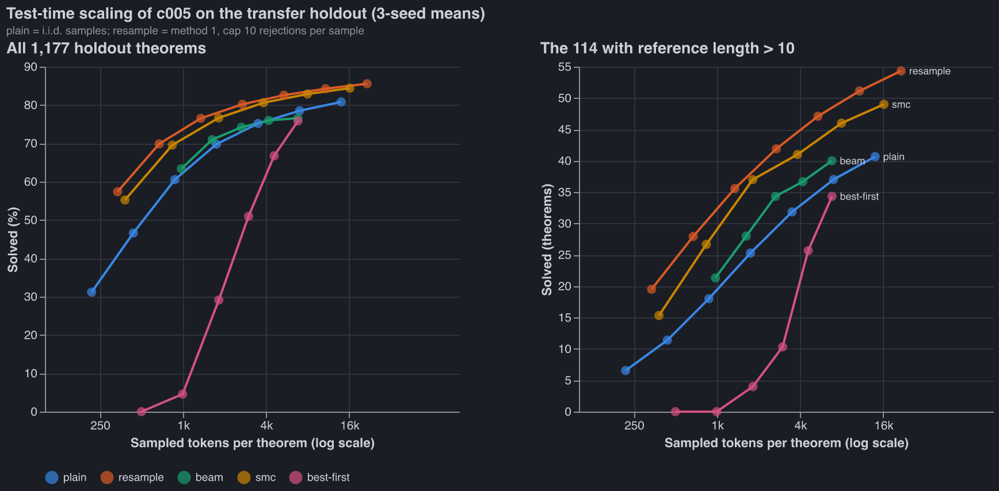

# Test-time scaling: simple methods on c005

Status: done. The holdout was scored once per configuration, on 3 seeds.

- **Working folder:** code, plan and job lists are in
  [test_time_scaling](../../code/experiments/current/test_time_scaling/test_time_scaling_initial_plan.md),
  branch `test-time-scaling` in checkout `nd-rl-8`.
- **Raw results:** `artifacts/test_time_scaling/hold_{a,b}_s{0,1,2}/`, which are not committed.
- **Chart data:** [charts/scaling.csv](charts/scaling.csv).

Question: Robbie (2026-09-29), "get some notion of test time scaling curves on our RL problem",
starting with the simple methods before anything fancy:

- 0: plain sampling;
- 1: resample invalid lines;
- 2: beam search and sequential Monte Carlo (SMC);
- 3: line-level search.

No expert iteration and no learned value head. For each method report pass@k up to 64, inference
time, and the long-proof (> 10 lines) numbers separately.

## Configuration

**Model.** Combined-pipeline run c005: 186-claude pretraining, Leon's GEAR expert iteration and
guided RL sampling, `lean_seq`. Checkpoints `runs/combo-c005_s{0,1,2}/final.pt`. Every number is
a mean over the 3 seeds.

**Pool.** The holdout half of the fork's `data/ladder/transfer.jsonl` (fork `51604b3`):

- 1,177 theorems of reference length 7-14;
- **114 of them longer than 10 lines**.

The dev half was used only for a 300-theorem calibration on seed 0.

**Sampling constants.**

- T = 0.8 and 512 kept tokens per proof, as in the harness eval.
- A proof counts only if Lean 4 and nd_verify both accept it.
- A line is one `;`-terminated Lean tactic segment, checked with the fork's `inverse` parser and
  Leon's `LineChecker` (as `guided.py` does).

**Compute measure.** Sampled tokens per theorem: every token drawn from the model, including
rejected segments. Re-encoding a prefix (prefill) is not counted there; it shows up in wall-clock.
Wall-clock is measured on one A40 and includes the Lean gate.

**Methods** (full definitions in the plan):

| method | what it does | compute knob |
| --- | --- | --- |
| plain | i.i.d. samples: the current eval | k = 1..64 |
| resample | method 1: an invalid segment is redrawn from the same prefix; the sample is abandoned at its 11th rejection (cap 10) | k = 1..64 |
| beam | method 2a: E = 4 segments per beam node; keep the top B valid prefixes by log-prob | B = 1..16 |
| smc | method 2b: N particles; invalid segments get weight 0; survivors resampled back to N | N = 2..64 |
| best-first | method 3: a frontier of every valid prefix, scored by log p / segments^0.5; E = 8 per pop; anytime | budget up to 16k tokens |

**Implementation checks.**

- Plain sampling on the full dev half reproduces c005's recorded metric: 914 vs 915 (seed 0).
- Resample read at cap 0 matches plain sampling, as it must, since every rejected line fails the
  verifier anyway. pass@1 is 31.0 vs 31.2 and pass@64 is 80.5 vs 80.8.
- The combined pipeline's own KV-cache sampler, `guided_kv` (cap 10), reproduces my engine's cap-10
  pass@64 within 0.2 points on every seed.

**Cost.** About $5.70 of A40 time: 6 pods × ~107 min, plus a 50-min calibration pod.

## Results (holdout, 3-seed means)

### pass@k

| k | plain % | resample % | plain, > 10 lines (of 114) | resample, > 10 lines |
| --- | --- | --- | --- | --- |
| 1 | 31.2 | 57.4 | 6.6 | 19.5 |
| 4 | 60.5 | 76.5 | 18.0 | 35.6 |
| 16 | 75.2 | 82.6 | 31.9 | 47.1 |
| 64 | 80.8 | 85.6 | 40.7 | 54.3 |

### Compute-matched comparison

Budget is about 14-16k sampled tokens per theorem, i.e. 64 plain samples.

| method | setting | tokens / theorem | solved % | > 10 lines solved | wall s (all 1,177) |
| --- | --- | --- | --- | --- | --- |
| plain | k = 64 | 13,971 | 80.8 | 40.7 | 407 |
| resample, engine | k = 32 | 10,759 | 84.3 | 51.1 | ~1,220 (half the k = 64 run) |
| resample, engine | k = 64 | 21,518 | 85.6 | 54.3 | 2,445 |
| resample, `guided_kv` | k = 64 | not counted | 85.5 | 53.0 | 610 |
| smc | N = 64 | 16,147 | 84.4 | 49.0 | 1,070 |
| smc | N = 32 | 7,968 | 82.9 | 46.0 | 532 |
| beam | B = 16 | 6,784 | 76.6 | 40.0 | 537 |
| best-first | 16k budget | 6,800 | 75.8 | 34.3 | 450 |

Wall-clock notes:

- Plain's time varies by pod (290-480 s across seeds).
- The engine re-encodes every prefix at every step. For resample that is 122M prefill tokens against
  9.8M sampled on the 300-theorem calibration. That overhead is why the engine runs cost 4× the
  KV-cache implementation for the same method.
- `guided_kv` is the real cost of resampling: **1.5× plain's wall-clock for +4.7 points overall
  and +30% on long proofs.**

### Where resampling's gain comes from

Numbers are with cap 32, which records every rejection, so any smaller cap can be read off the
same run.

- **Rejection rate.** 69% of samples draw at least one invalid segment. 58-61% of all checked
  segments are rejected, about 14 rejections per sample.
- **Causes:**
  - 65% a rule misapplied (the cited lines don't license the formula);
  - 31% outside the Lean grammar;
  - 3% a premature `exact`/end;
  - 1% a segment over 400 tokens.
- **Repeats.** **50-55% of rejections redraw a segment already rejected at the same prefix.** The
  policy is confidently wrong, and resampling from the same distribution returns the same wrong
  line.
- **Salvage.** At cap 10, 45-47% of all successful samples had at least one line rejected and
  redrawn, about 19,900 salvaged samples per seed.
- **Theorem level at k = 64.** Resample solves 1,006-1,009 theorems vs plain's 947-954. It solves
  55-61 that plain misses and misses only 1-2 that plain solves. About 168 theorems per seed are
  solved by neither.
- **Choice of cap** (pass@64): 0 → 80.5, 1 → 82.3, 2 → 83.6, 4 → 84.5, 10 → 85.6, 32 → 86.5.
  Most of the gain arrives by cap 4. At matched tokens, caps 2-32 sit on roughly one curve.

## Observations

1. **Resampling invalid lines is the best method at every budget measured, and the gain is
   largest on long proofs and at small k.**
   - pass@1 goes from 31.2% to 57.4%.
   - At about 11k tokens per theorem it solves 84.3% vs plain's 80.8% at 14k.
   - On proofs longer than 10 lines: 51.1 vs 40.7 theorems.
   - It is also cheaper per sample than plain at cap 0, because failing samples stop at the first
     bad line (158 vs 218 tokens per sample).
2. **SMC is second, just behind resampling.** Both target the same distribution (the policy
   conditioned on valid lines). SMC's correction for resampling's local bias buys nothing measurable
   here, and particle collapse costs it on long proofs (49.0 vs 54.3 solved beyond 10 lines).
3. **Beam and best-first search are no better than plain sampling at matched tokens.**
   - Beam flattens from B = 8: 76.0% → 76.6%.
   - Best-first solves under 5% of theorems within 1k tokens, because it expands short
     high-probability prefixes breadth-first before finishing any proof. It only catches plain near
     its 16k budget.
   - Log-prob is a bad ranking signal for this policy, consistent with the literature on
     log-prob-guided search without a value function.
4. **All curves flatten.** Plain gains 2.3 points from k = 32 to 64, resample 1.3. About 168
   theorems per seed stay unsolved by every method. These curves are not steep enough to predict
   the unsolved set will fall to more compute.

Interpretation, not tested: most plain-sampling failures are *local* errors, a wrong citation or
rule on one line, not dead-end proof plans. A cheap line check fixes those. What remains looks like
theorems where the policy has no working plan, which is where a value function or training (expert
iteration on the failures) would be needed.

## Limitations and next step

- **Seeds are 3 checkpoints of one recipe.** The seed-to-seed spread is small (pass@64 plain
  80.5-81.1, resample 85.5-85.7), but these results say nothing about other pretraining choices.
- **Search methods were tuned lightly** (α and E on 300 dev theorems, seed 0).
  - Beam with a length-normalised score and best-first with state deduplication (canonical ND
    states rather than exact line sequences) were not tried.
  - Neither is expected to fix the ranking problem without a value.
- **Engine wall-clock overstates search cost.** No KV cache is kept across tree nodes. Sampled
  tokens is the fair axis there.
- **Next, cheapest first:**
  1. Resample *without replacement*: forbid a segment already rejected at the same prefix. Half of
     all rejections are repeats.
  2. Temperature sweep for resample. The RL sampler used T 1.0; the eval uses 0.8.
  3. Use `guided_kv` as the harness eval sampler, a protocol decision for Robbie. It would change
     how every pretraining ablation scores.
  4. The fancier options from the lit review: a learned value for SMC/MCTS, and test-time expert
     iteration on the unsolved ~168.
