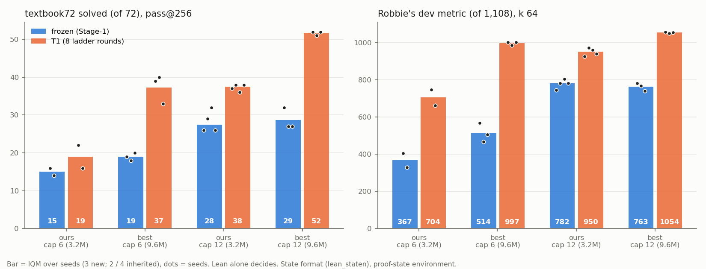

# best-state: after the same T1 ladder, Robbie's 9.56 M recipe beats our 3.2 M recipe at both caps, beyond the MDD; frozen at cap 12 the two are level

Status: **completed 2026-09-30 15:51 – 2026-10-01 05:05 UTC (executor), independently reviewed 05:10–05:45 UTC.
Verdict: the counts and the headline comparison stand, with eight rewordings. The interaction ("cap 12 helps less on
the better network") is not resolved at this n.** No hard-constraint violation, nothing quarantined. Where the
reviewer's wording differs from the executor's, this summary uses the reviewer's.

Brief: [`BRIEF_best-state.md`](../../docs/proposals/state-env/BRIEF_best-state.md).

Question: hold the proof-state interface (`lean_staten`, environment-assigned names, SN-v2) and our state RL (the T1
ladder) fixed. Does Robbie's network and pretraining recipe beat our 3.2 M recipe at cap 6 and at cap 12? And does
the cap-12 advantage survive, grow or shrink on the better network?
([proposal](../../docs/proposals/2026-09-30-best-network-proof-state.md))

The run was on the fork (`dan-pandori/nd-takehome`), branch `dan_best-state`. **The run's commits, up to the DONE
commit `0c492902`, are on the fork's `dan`** (the port `best_model.py`, `state_train_best.py`, `state_train.py
--recipe best`, ALiBi memory fixes in `sample.py`, `tests/test_best_state.py` in CI, and the analysis scripts
`bs_analysis.py`, `bs_compute.py`, `bs_figure.py`). The review commits are on `dan_best-state` only.

- Review: [`review_best-state.md`](https://github.com/dan-pandori/nd-takehome/blob/959d0790/review_best-state.md)
  ([`9eadc355`](https://github.com/dan-pandori/nd-takehome/commit/9eadc355) §Recount, written from a workspace
  without the executor's write-ups; [`89b6a101`](https://github.com/dan-pandori/nd-takehome/commit/89b6a101)
  §Comparison / §Verdict; [`959d0790`](https://github.com/dan-pandori/nd-takehome/commit/959d0790) a count fix in the
  verdict). Reviewer scripts and outputs: `review_bs/`.
- Executor write-up: [`run_best_state.md`](https://github.com/dan-pandori/nd-takehome/blob/0c492902/run_best_state.md),
  `numbers.md` § best-state, `log.md` § best-state, `artifacts/bs/{analysis_stdout.txt,summary.json,compute_stdout.txt}`.
- Pre-registration: `preregistration/best-state.md`, committed `fcf3dedb` at 2026-09-30 15:59 UTC, before the first pod
  (≈ 16:00) and the first Stage-1 log line (16:06:33); never edited.
- Bucket: `hf://buckets/dan-pandori/nd-rl/best-state/{ckpts,artifacts}` (checkpoints, read-out files, literal texts
  of every sample in `artifacts/bs/dump/*.jsonl.gz`, registry rows in `artifacts/best-state/registry/`).

*Bars: mean over seeds (= rliable IQM at n = 3; IQM of the middle two at n = 4); dots: seeds. Lean alone. Figure from
the executor (`bs_figure.py`).*

## Configuration

- **Checker: Lean alone** (the state environment's gate, `lean_judge`). `nd_verify/` is unmodified and not used to
  judge anything; its only import on the path is `parse_formula`, a formula parser.
- **Design: 2 × 2, two cells inherited.**

  | cell | model | Stage-1 data | seeds | checkpoints |
  |---|---|---|---|---|
  | **best-cap6** (new) | `ALiBiGPT` (`cfg.arch = 'best'`), 6 × 384, 8 heads, MLP 1280, Peri-LN, 4 ALiBi + 4 NoPE heads, **9,560,832 params** (+1.88 M MTP head, training only, not saved), `lean_staten`, from scratch; Muon + AdamW, MTP 0.3, token-budget batches 128 × 144; **1,200 s on one A40** (23,974–24,178 steps) | cap-6 control set `data/p2/train_depth3_f0_a1.jsonl` (155,000; md5 29276f24…) | 0, 1, 2 | Fz `ckpts/bs/stage1_best6_s{0,1,2}_b1200.pt`; T1 `ckpts/bs/ladder/la_T1_best6_s{0,1,2}_r8.pt` |
  | **best-cap12** (new) | same, 1,200 s (23,951–24,123 steps) | K12 `data/kh/train_k12.jsonl` (155,000; md5 800b5486…) | 0, 1, 2 | `…/stage1_best12_s*_b1200.pt`; `…/la_T1_best12_s*_r8.pt` |
  | SN-v2 cap-6 ("ours", inherited from `state-env`) | 3,216,384-param GPT, 4 × 256 RoPE, AdamW, 6,000 steps × 128 proofs, `lean_staten`, from scratch | cap-6 control set | 0, 1 | `state-env` |
  | SN-cap12 ("ours", inherited from `state-cap12`) | same | K12 | 0, 1, 2, 3 | `state-cap12` |

  The recipe is a port of Robbie's `pretrain_best.py` (factorial_20260929; his code, credited) to (state, action) pairs,
  with the state trainer's loss mask and held-out validation pairs. The pre-registration said "~10.3 M" parameters; the
  saved state dicts have 9,560,832 (reviewer and write-up agree).
- **Stage-1 budget rule** (pre-registered, decided on held-out greedy only): pilot best-cap6 s0, 300 s → 4,712 / 5,000 =
  0.9424, 1,200 s → 4,813 / 5,000 = 0.9626; +2.0 pp ≥ 1.0 pp → 1,200 s for all six. Reproduced by the reviewer.
- **T1:** `state-cap12`'s protocol unchanged: `state_ladder_ei.py`, 8 rounds, k 32, T 0.8, `rl_targets.jsonl`, replay from
  the cell's own Stage-1 set, `max_steps` 48, `max_action` 256, the ladder's AdamW defaults. Ladder sampling batch
  2,048 (4,096 and the first 2,048 attempt went out of memory in ALiBi's prefill; fixed by building the bias in bf16 in
  place and chunking prefill; every ladder restarted from round 1). Deviation from the pre-registration: each ladder
  started as soon as its Stage-1 finished, not after the frozen read-outs were posted.
- **Read-outs** (all at batch 2,048; inherited reads used 2,048–4,096, a sampling re-draw per `NOISE_FLOOR.md`):
  - textbook72 (`data/eval_only/textbook72`, dev58 + train14): `state_eval.py` k 256, T 0.8, seed 0, `max_action` 512,
    `max_steps` 96. Inherited values from the reviewed [textbook72](../2026-09-30-textbook72-sn-cap12-t1-solves-37-of-72/README.md)
    run (batch 4,096).
  - Robbie's **dev metric**: the 1,108 `transfer.jsonl` records with `int(sha1(key), 16)` even, k 64, solved count (all
    `L_true` ≥ 7). **holdout250** (his `passk.py` pool), k 256. Read here for all inherited and new checkpoints.
  - Long pools: **Q** = `transfer_long_rr600.jsonl` generator theorems at `L_true` 13–16 (/380), and `transfer_long2`
    (/21), `lpool_reread.py` k 256, `max_action` 512, `max_steps` 96. Inherited SN-cap12 Q is at `max_steps` 48.
  - Held-out greedy: `data/p2/heldout.jsonl`, 5,000, k 1, T 0. Peak `max_memory_allocated` 16.4 GB at batch 2,048.
- **Pods:** `bs-p0`–`bs-p5` (Stage-1 + one T1 ladder each), `bs-r0`–`bs-r2` (read-outs), `bs-d0` (cap diagnostic), all
  A40 at $0.49/h, 2026-09-30 16:00 – 2026-10-01 04:05 UTC: **60.74 pod-hours, $29.76** of $55 / 110 h (`podbudget
  best-state`, `~/podhours.log`). Pre-registered plan ≈ 74–98 pod-hours.
- **Compute per arm** (A40 for every new job; executor's `bs_compute.py`, reproduced by the reviewer from logs):

  | arm | Stage-1 GPU-s | T1 ladder GPU-s (8 rounds) | ladder attempts | gen tokens, ladder (M) | ladder train steps | Lean checks, ladder (M) | read-out GPU-s |
  |---|---|---|---|---|---|---|---|
  | best-cap6 s0–s2 | 1,261–1,275 (+ 382 pilot) | 20,057 / 16,881 / 17,885 | 1,794 k clean (+ aborted OOM attempts) | 330–366 | 4,800 | 1.06–1.12 | 5,065–6,300 |
  | best-cap12 s0–s2 | 1,283–1,292 | 25,876 / 30,524 / 28,952 | 1,794 k clean (+ aborted) | 393–419 | 4,800 | 1.28–1.30 | 8,609–10,855 |
  | ours-cap6 s0–s1 (inh.) | 782 / 565 (RTX 3090 / RTX PRO 4000) | 8,297 / 8,761 | — (pre-gate log format) | — | 4,800 | — | — |
  | ours-cap12 s0–s3 (inh.) | 1,852 / 1,835 (3090), 2,244 / 2,250 (A40) | 12,672 / 12,992 (3090), 16,623 / 16,042 (A40) | 1,799 k | — | 4,800 | 0.99–1.13 | — |

  Registry rows: `artifacts/best-state/registry/` (in the bucket).

## Observations (reviewed)

**Per-seed counts** (all reproduced file for file by the reviewer from the stored accepted-proof lists):

| quantity | ours cap 6 Fz | best cap 6 Fz | ours cap 6 T1 | best cap 6 T1 | ours cap 12 Fz | best cap 12 Fz | ours cap 12 T1 | best cap 12 T1 |
|---|---|---|---|---|---|---|---|---|
| textbook72 /72 | 16 / 14 | 19 / 18 / 20 | 22 / 16 | 39 / 40 / 33 | 26 / 29 / 32 / 26 | 32 / 27 / 27 | 37 / 38 / 36 / 38 | **52 / 51 / 52** |
| dev metric /1,108 | 405 / 329 | 569 / 466 / 506 | 746 / 663 | 1,002 / 986 / 1,002 | 745 / 782 / 804 / 781 | 782 / 767 / 741 | 927 / 972 / 961 / 940 | 1,058 / 1,050 / 1,055 |
| holdout250 /250 | 103 / 83 | 149 / 125 / 122 | 169 / 151 | 226 / 229 / 227 | 183 / 188 / 198 / 185 | 184 / 195 / 182 | 217 / 221 / 223 / 219 | 239 / 237 / 237 |
| rr600 Q /380 | 3 / 0 | 8 / 4 / 7 | 102 / 28 | 350 / 346 / 339 | 134 / 212 / 228 / 216 | 271 / 237 / 216 | 233 / 295 / 320 / 317 | 377 / 375 / 376 |
| transfer_long2 /21 | 0 / 0 | 0 / 0 / 0 | 0 / 0 | 18 / 18 / 17 | 3 / 1 / 3 / 5 | 10 / 5 / 4 | 8 / 15 / 17 / 14 | 21 / 21 / 20 |
| held-out greedy | .970 / .958 | .963 / .967 / .955 | .972 / .971 | .992 / .996 / .994 | .969 / .977 / .978 / .974 | .926 / .951 / .903 | .963 / .976 / .973 / .979 | .992 / .990 / .993 |

**best − ours** (rliable IQM, i.e. the mean at n = 3 and the middle-two mean at n = 4; pre-registered MDD from pooled
per-seed SDs, two-sample t, 80 % power):

| pool | cap 6 frozen | cap 6 T1 | cap 12 frozen | cap 12 T1 | MDD (cap 6 / cap 12) |
|---|---|---|---|---|---|
| textbook72 | +4.0 | **+18.3** | +1.2 | **+14.2** | 9.3 / 6.5 |
| dev metric | **+146.7** | **+292.2** | −18.2 | **+103.8** | 88 / 61 |
| holdout250 | +39.0 | +67.3 | +0.5 | +17.7 | — |
| Q | +4.8 | +280.0 | +27.3 | +70.0 | — |
| transfer_long2 | 0 | +17.7 | +3.3 | +6.2 | — |

1. **After the same T1 ladder, Robbie's recipe beats ours at both caps on every pool, beyond the pre-registered MDD on
   textbook72 and the dev metric.** textbook72 margins: cap 6 +18.3 (MDD 9.3), cap 12 +14.2 (MDD 6.5). At each cap every
   best seed is above every ours seed on all six pools. With 3 vs 2 seeds full separation has permutation p = 0.1
   (one-sided), so the cap-6 claim rests on the parametric MDD, as the pre-registration said. best-cap12 T1 solves 51–52
   of the 72 textbook problems.
2. **Pre-registered falsifier: "supported".** best − ours ≥ MDD in five comparisons (textbook72 cap 6 T1 and cap 12 T1;
   dev cap 6 frozen, cap 6 T1, cap 12 T1) and none ≤ −MDD (worst: dev cap 12 frozen −18 against −61).
3. **Frozen (Stage-1 only), the recipe adds little at cap 12 only** (reviewer's wording). At cap 12 the two recipes are
   level: textbook72 +1.2, dev −18, holdout250 +0.5. At cap 6 the frozen best model is ahead on every pool, and on the
   dev metric beyond the MDD (+147 vs 88). The best network's frozen held-out greedy at cap 12 is *lower* (0.927 vs
   0.976 for ours).
4. **best-cap6 T1 matches ours-cap12 T1 on textbook72 (37.3 vs 37.5) and exceeds it on the other pools** (dev 997 vs
   950.5; Q 345 vs 306; long2 17.7 vs 14.5; holdout250 227 vs 220).
5. **Cap-12 advantage on textbook72 T1: +14.3 on the best network vs +18.5 on ours. This is an observation, not a
   finding.** The difference (≈ 4) is inside the interaction MDD (≈ 12) that the pre-registration names. On dev T1 the
   cap-12 gain shrinks much more (+57.7 vs +246), but best-cap6 T1 is already near that pool's ceiling (997 / 1,108).
6. **Not compute-matched.** Ladder attempts are equal by protocol (1,793,960 gate samples per clean ladder), but each best
   ladder used about 2× our GPU-seconds (16.9–20.1 k s vs 8.3–8.8 k s at cap 6; 25.9–30.5 k s vs 12.7–16.6 k s at
   cap 12). This is over the policy's 1.25× flag. The 2× mixes GPU classes: ours-cap6 ran on RTX 3090 / RTX PRO 4000
   and ours-cap12 s0–s1 on 3090. On the same class (A40: SN12 s2–s3 16.0–16.6 k s vs best12 25.5–30.5 k s) the ratio
   is **1.6–1.9×**. best-cap6 Stage-1 (≈ 1,270 A40-s) is also flagged against ours' 565–782 s. best-cap12 Stage-1
   (≈ 1,290 s) is *less* than ours' 1,835–2,250 s. So the RL gain is not separated from compute per sample.
7. **Ladder** (reviewer's recount from `found_<r>.jsonl`, start-index normalised; matches `round_8.json`): cumulative
   targets solved at round 8, best6 4,244 / 4,221 / 4,247 and best12 4,375 / 4,378 / 4,392 of 4,495, `L*` 13 for all six.
   The inherited SN6 T1 s0 ladder ends at 3,693 targets, `L*` 12. Round times grow from ≈ 30 to 48 min (cap 6) and
   from ≈ 47 to 71 min (cap 12) as the replay mix grows.
8. **Proof length.** Median term size of the shortest accepted textbook72 proof per solved problem: 4–5 (best6 Fz /
   T1), 4–7 (best12 Fz / T1); median written lines 6–9. The reviewer's sample has T1 proofs carrying many unused `have`
   lines (longest 121 lines / term size 506 for a theorem labelled `L_true` 17–18). Line counts overstate proof length
   for T1, and term size includes the dead code too.

**Lean re-check (reviewer).** 1,200 / 1,200 sampled counted proofs Lean-accepted (the 30 longest distinct-theorem proofs
+ 120 random, per arm, across the 8 arm-cells). Negative controls: 0 / 60 `LEANREJ` texts, 0 / 60 proofs under a
different theorem, and a bare `sorry` all fail. A flip control had a bug in the reviewer's own control, which was fixed;
after the fix, 5 / 120 pass, all benign `A ∨ A`.

**Robbie's combined model** (context, not a comparison): runs `fact-lean-best-leon_s{0,1,2}`, his whole-proof
`lean_seq` pipeline, solve 32 / 30 / 32 of textbook72 under Lean ∧ `nd_verify` (`review_textbook72.md`). It uses a
different format and a different checker.

## Expected vs outcome (pre-registered, `fcf3dedb`)

- **Frozen hits:** textbook72 best-cap6 19 (predicted 19, range 12–26), best-cap12 28.7 (30, 24–36). Dev metric 514
  (480, 350–650) and 763 (830, 720–920). "Ours" dev guesses ≈ 380 / 700 / 780 / 930 → 367 / 705 / 782 / 951.
- **Every T1 prediction missed high:** textbook72 best-cap6 37.3 (predicted 24, range 16–32), best-cap12 51.7
  (39, 34–44). Dev 997 (780, 650–900) and 1,054 (950, 900–1,000).
- **Sign misses:** "positive at cap 12 frozen" **missed**, ≈ 0 instead (textbook72 +1.2, dev −18, holdout250 +0.5). The
  run's write-up omitted this one and the reviewer added it. "≈ 0 to positive at cap 12 T1, inside the MDD" was
  exceeded (+14.2, beyond the MDD).
- **best-cap12 frozen held-out greedy ≥ 0.96: missed** (0.926 / 0.951 / 0.903).
- **Hits:** Q best-cap12 T1 376 ≥ ours 306 − 20; the cap-12 advantage shrinks (14.3 vs 18.5, inside the MDD); the
  "supported" condition holds.
- Pod-hours: plan ≈ 74–98 → **60.74**.

## Limitations

- **Truncation is above the policy's 0.1 % in most best-arm read-outs.** Action-truncated + step-capped samples: Fz
  best6 0.4–1.5 % on every pool. T1 best12 textbook72 is 0.08 / **2.04** / 1.35 % (s0 / s1 / s2), and its worst stratum
  is **4.09 %**. The SN cells read here are ≤ 0.14 % everywhere. The run's 2× cap diagnostic (`max_action` 1,024,
  `max_steps` 192) covered **4 of the 72 best-arm read-outs**, chosen as the worst by truncation or step cap: T1 best12 s1
  textbook72 51 → 53, T1 best12 s2 52 → 53, T1 best6 s0 long2 18 → 18, Fz best6 s2 rr600 Q 7 → 7, with nothing lost. It
  did not include Fz best6 s2 long2 (1.36 %, third by action truncation; it solves 0 / 21). At 2× the truncation barely
  falls (2.04 → 1.82 %, 1.35 → 1.01 %), so these are mostly non-terminating actions. The caps bias the **best** arm low
  (≤ +2 per checkpoint on textbook72 where tested), so every best > ours conclusion is conservative.
- **Not compute-matched** (Observation 6). "Bigger network" is not separated from "more GPU per sample".
- **Overlap up to premise order** (reviewer, not in the write-up). A premise-permuted copy of 1–2 dev1108 theorems
  (`la_transfer_307` via `rl_targets`, `la_transfer_396` via K12) is in training. So is 1 textbook72 theorem
  (`textbook_3ed45280…`, K12, cap-12 cells only). All are 0 under the project's order-sensitive split key, and they are
  identical for best and ours. Effect ≤ 2 / 1,108 and ≤ 1 / 72.
- **The port's code review** was a code-review subagent launched by the executor (no result-changing bug; nits fixed).
  It was not an independent review. The reviewer re-checked the port's outputs, not its code line by line.
- Inherited numbers carry their settings: textbook72 at batch 4,096, SN-cap12 Q at `max_steps` 48 (96 here).
- The md5 of `transfer.jsonl` against Robbie's fork commit `51604b3` could not be checked (his fork is not on the VPS).
  The dev1108 / holdout250 selection rules were re-derived and reproduce the pools exactly.
- Seeds: 3 new vs 2 (cap 6) and 4 (cap 12) inherited. A 3-vs-2 permutation test cannot go below p = 0.1 one-sided.
- Spend ($29.76) is from `podbudget` / `~/podhours.log` at the known A40 rate. The reviewer could not derive it from the
  pulled files.

## Next step (reviewer)

1. **Compute-matched T1:** run the 3.2 M ladders at ≈ 2× attempts (k 64, or 16 rounds) on A40. This separates "bigger
   network" from "more GPU per sample", which Observation 6 leaves open.
2. **The interaction:** use a hard pool that best6 T1 does not nearly saturate (long2 is 17.7 / 21, dev 997 / 1,108), or
   more seeds, to resolve whether cap 12 helps less on the better network.
3. **Re-read the remaining best-arm files with > 0.5 % truncation** at `max_action` 1,024 / `max_steps` 192. The bias runs
   against the best arm, so this can only widen the gaps.
