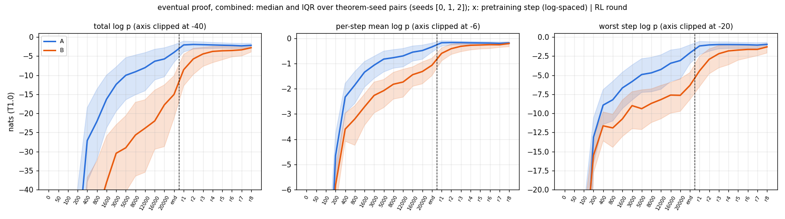
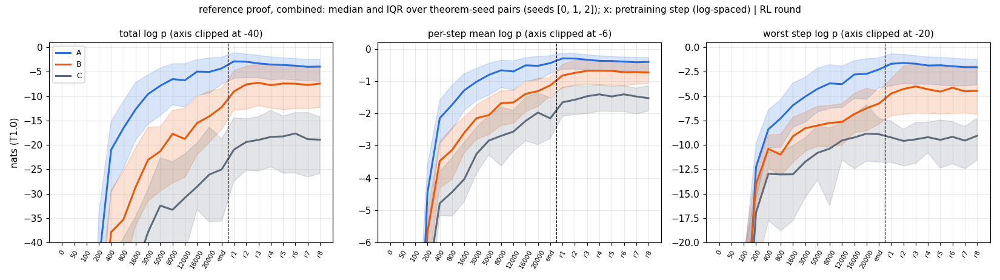
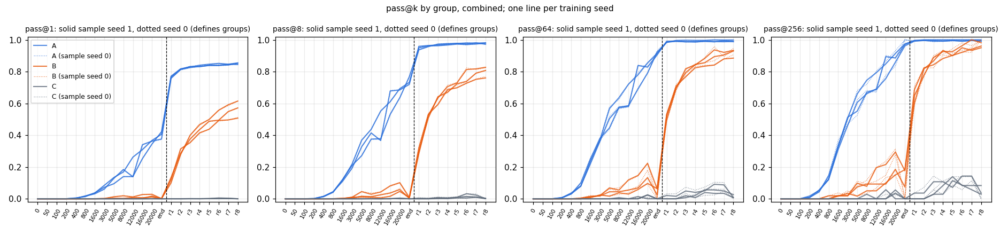
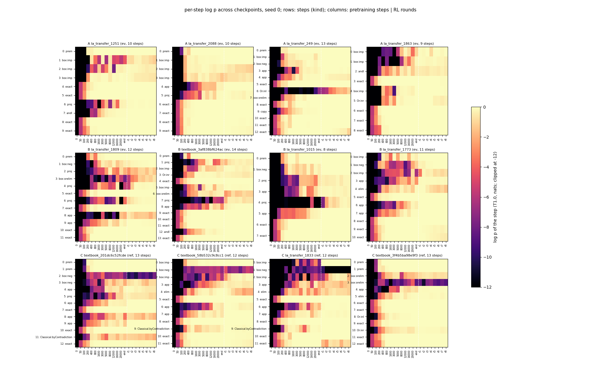

# trajectory: the worst step of an RL-only proof rises about as much in pretraining (after step 1,600) as in RL; RL lifts its own proofs about three times as much as the known proof

Status: **completed 2026-10-01 06:29–18:59 UTC (executor). Independently reviewed 19:00–19:19 UTC.
Verdict: stands, with six rewordings and one claim not supported** ("C stays at one bad step"). The pre-registered
headline ("B's eventual proof becomes likely mainly in RL") is **not resolved at n = 3**. The executor wrote
"falsified", but the pre-registered falsifier fires in only 1 of 3 seeds. No hard-constraint violation, nothing
quarantined. Where the reviewer's wording differs from the executor's, this summary uses the reviewer's.

Brief: [`BRIEF_trajectory.md`](../../docs/proposals/state-env/BRIEF_trajectory.md); proposal:
[Proposal 18](../../docs/proposals/2026-10-01-learning-trajectory.md).

Question: take a proof that best-cap12 eventually finds. When does that proof become likely: during pretraining, during
RL, or only at the end? Do theorems that only RL solves (B) look different along the way from theorems that pretraining
already solves (A)? For theorems that nothing solves (C), is there one step of a known proof that stays improbable
throughout?

The run was on the fork (`dan-pandori/nd-takehome`), branch `dan_trajectory`. **Its commits (DONE `1836f715`) and the
review commits are on `dan_trajectory` only and are not merged into the fork's `dan`.** They include `tj_score.py`,
`tj_targets.py`, `tj_analysis.py`, `tj_compute.py`, `tj_registry.py`, `pod/tj/` and `state_train.py --save_steps`.

- Review: [`review_trajectory.md`](https://github.com/dan-pandori/nd-takehome/blob/958f1842/review_trajectory.md)
  ([`79016ade`](https://github.com/dan-pandori/nd-takehome/commit/79016ade) §Recount, written blind to the executor's
  write-ups; [`958f1842`](https://github.com/dan-pandori/nd-takehome/commit/958f1842) §Compare / §Verdict). Reviewer
  scripts: `review_tj/`.
- Executor write-up: [`run_trajectory.md`](https://github.com/dan-pandori/nd-takehome/blob/1836f715/run_trajectory.md),
  `numbers.md` § trajectory, `log.md` § trajectory, `artifacts/tj/{analysis_stdout.txt,summary.json,compute_stdout.txt}`.
- Pre-registration: `preregistration/trajectory.md`, committed in `68edd09e` at 06:35:22 UTC, before the first pod
  (`tj-p0`, 06:37:01). It was not edited afterwards.
- Bucket: `hf://buckets/dan-pandori/nd-rl/trajectory/{ckpts,artifacts,data}`. It holds all 66 checkpoints, the 264
  sampled reads, per-step scores in `artifacts/tj/score/s<S>/`, references in `data/tj/ref_targets.jsonl`, and 82,324
  registry rows in `artifacts/trajectory/registry/`.






*Figures from the executor (`tj_analysis.py`). Lean alone. Medians over theorem-seed pairs. Checkpoint axis: 14
pretraining checkpoints (step 0 to the end), then the T1 ladder rounds r1–r8.*

## Configuration

- **Model (every number here):** three fresh seeds (0, 1, 2) of `best-state`'s **best-cap12** recipe. The network is
  `best_model.ALiBiGPT`, 6 × 384, **9,560,832 params**. Format `lean_staten` (environment-assigned names). Trained
  from scratch on K12 `data/kh/train_k12.jsonl` (155,000 records, cap 12, md5 `800b5486…`) with
  `state_train.py --recipe best --budget_secs 1200 --save_steps …` on one A40 (24,077 / 24,345 / 24,328 steps). The
  new `--save_steps` pauses the schedule clock while it saves. Held-out greedy: 0.921 / 0.936 / 0.962.
  Checkpoints:
  - Pretraining (14): steps 0, 50, 100, 200, 400, 800, 1,600, 3,000, 5,000, 8,000, 12,000, 16,000, 20,000, and the end.
    The end checkpoint is **r0** ("end PT").
  - T1 ladder: `best-state`'s protocol (`state_ladder_ei.py`, 8 rounds × k 32, T 0.8, `rl_targets.jsonl`, replay
    from K12, `max_steps` 48, `max_action` 256) on RTX A6000s, giving **r1–r8**. Seed 2 went out of memory in round 2
    and resumed from round 2 at ladder batch 1,024. Cumulative targets after round 8: 4,383 / 4,365 / 4,407 of 4,495.
  - 22 checkpoints per seed, 66 in all.
- **Checker: Lean alone** (`lean_judge` / `lean_check`). `nd_verify` judges nothing. `minlen.py` calls it internally
  to filter candidate reference proofs; every reference is then Lean-checked, so no counted result depends on it.
- **Theorems:** textbook72 (72) + holdout250 (250) = 322. Both are evaluation only.
- **Sampled reads:** `state_eval.py` k 256, T 0.8, `max_steps` 96, `max_action` 512 (`best-state`'s read settings),
  batch 2,048. One read (s2 r3 holdout250 x0) ran at batch 1,024 after an OOM; that is a sampling re-draw
  (`NOISE_FLOOR.md`). Sample seeds 0 and 1 were read at all 22 checkpoints × 3 seeds × 2 pools, 264 reads in all.
  Dan's 15:46 budget raise withdrew the brief's "seed 0 only at r0 / r8" option.
  - **Groups** come from sample seed 0 at r0 and r8:
    - A: r0 solves.
    - B: r8 solves and r0 does not.
    - C: neither solves.
  - **pass@k** comes from sample seed 1 (unbiased estimator, n = 256).
- **Targets:**
  - **Eventual proof:** among r8's distinct Lean-accepted seed-0 samples, the one with the highest log p under r8.
  - **Reference proof:** a shortest known ND proof from `minlen.py`.
    - holdout250: 250 / 250, from ladder-A's labels.
    - textbook72: **65 / 72** (57 at bound 14, 8 at bound 22). 6 timed out, and the one 1-line theorem is outside
      minlen's search space.
- **Teacher-forced log p** (`tj_score.py`): T 1.0, natural logs, fp32, marginalised exactly over the sampler's 33 name
  bases.
  - Environment-assigned name tokens are not scored. This is a deviation logged at 09:25, before any group result:
    unmasked, those tokens contributed ln 65 per first `have`.
  - Worst step w1 = the minimum per-action log p.
  - Δ_RL = w1(r8) − w1(r0); Δ_PT = w1(r0) − w1(step 1,600).
- **Pods** (2026-10-01 06:37–18:59 UTC; `~/pods.log`, `~/podhours.log`): 9 pods, **53.92 pod-hours, $28.00**.
  - `tj-p0`: A40, $0.49/h. All three Stage-1 runs in sequence (A40 stock ran out after it), then reads.
  - `tj-p1`–`tj-p3`: RTX A6000, $0.53/h. The ladders.
  - `tj-r0`: RTX A6000. Reads, scoring and minlen.
  - `tj-r1`, `tj-r3` (A40) and `tj-r2`, `tj-r4` (RTX A6000): extra readers after the budget raise.
  - Budget: $30 / 60 h, raised by Dan at 15:46 to $50 / 100 h. The pre-registered plan was ≈ 46 pod-hours ≈ $23.
- **Compute per arm** (executor's `tj_compute.py`, from `record.compute` rows; GPU-seconds are card occupancy):

  | arm (s0 / s1 / s2) | GPU | GPU-s | gen tokens (M) | attempts (k) | train steps | train tokens (M) | Lean checks (k) |
  |---|---|---|---|---|---|---|---|
  | Stage-1 | A40 | 1,350 each | 0 | 0 | 24,077 / 24,345 / 24,328 | 442 / 447 / 447 | 0 |
  | T1 ladder | RTX A6000 | 22,350 / 24,467 / 27,021 | 399 / 415 / 435 | 1,794 / 1,794 / 2,011 (s2 incl. the OOM'd round) | 4,800 | 754 / 783 / 751 | 1,299 / 1,313 / 1,417 |
  | sampled reads (44 each) | A6000 / A40 | 24,257 / 27,007 / 26,196 | 581 / 615 / 630 | 3,792 / 3,627 / 4,157 | 0 | 0 | 682 / 721 / 718 |
  | teacher-forced scoring | A6000 / A40 | ≈ 3,050 / 3,000 / 4,100 (log seconds) | 0 | 0 | 0 | 0 | 0 |

  No seed exceeds 1.25× a sibling seed (ladder GPU-s max / min 1.21, reads 1.11; reviewer). There are no compared
  arms in the policy's sense: the comparisons are within each model's own trajectory.

## Observations (reviewed)

**Sanity against `best-state`** (pre-registered expectation 1, sample seed 0; holds):

| pool | r0 (s0 / s1 / s2) | r8 (s0 / s1 / s2) | `best-state` best-cap12 Fz / T1 |
|---|---|---|---|
| textbook72 / 72 | 32 / 32 / 38 | 48 / 49 / 54 | 32 / 27 / 27; 52 / 51 / 52 |
| holdout250 / 250 | 200 / 204 / 196 | 238 / 237 / 239 | 184 / 195 / 182; 239 / 237 / 237 |

**Groups** (322 theorems, per seed):

| group | s0 | s1 | s2 |
|---|---|---|---|
| A | 232 | 236 | 234 |
| B | 54 | 51 | 60 |
| C | 36 | 35 | 28 |
| A-lost (r0 solves, r8 does not) | 0 | 1 | 1 |

A-lost is the same theorem in s1 and s2.

**Worst step (nats, T 1.0) and pass@k by checkpoint.** Medians over theorem-seed pairs; pass@k is the mean over group
and seeds, from sample seed 1. Every entry reproduced by the reviewer to 0.1 nat / 0.001.

| group | quantity | init | 12k | end PT (r0) | r1 | r4 | r8 |
|---|---|---|---|---|---|---|---|
| A | eventual worst step | −215 | −4.2 | −2.1 | −1.2 | −1.0 | −1.0 |
| B | eventual worst step | −191 | −8.2 | −6.3 | −4.4 | −1.8 | −1.3 |
| B | reference worst step | −187 | −7.6 | −5.8 | −4.7 | −4.3 | −4.5 |
| C | reference worst step | −217 | −9.5 | −8.9 | −9.2 | −9.2 | −9.1 |
| A / B / C | pass@1 | 0 | .18 / .007 / 0 | .40 / .001 / 0 | .77 / .12 / 0 | .83 / .44 / 0 | .85 / .56 / 0 |
| A / B / C | pass@256 | 0 | .72 / .11 / 0 | .97 / .15 / 0 | .99 / .65 / .01 | .99 / .91 / .07 | .99 / .96 / .05 |

**B's eventual proofs, per seed** (group medians; IQM = mean at n = 3, stratified bootstrap 95 % over theorems):

| quantity | s0 | s1 | s2 | IQM [95 %] | pre-registered | verdict |
|---|---|---|---|---|---|---|
| w1 at r0 | −6.58 | −6.53 | −5.50 | −6.21 [−6.80, −5.85] | ≤ −5 (−12 to −3) | holds |
| w1 at r8 | −1.28 | −1.34 | −1.24 | −1.29 | ≥ −1.5 | holds |
| Δ_RL | +5.09 | +4.62 | +4.07 | +4.59 [4.20, 5.30] | ≈ +5 (+3 to +10) | holds |
| Δ_PT (step 1,600 → end) | +3.42 | +4.06 | +4.79 | +4.09 [3.48, 5.01] | ≈ +1 (−1 to +3) | **miss, 3 / 3 above range** |
| median Δ_RL − median Δ_PT | +1.67 | +0.56 | −0.72 | | > 0 | 2 / 3 seeds |
| paired median (Δ_RL − Δ_PT) | +1.86 | −0.22 | −0.84 | +0.27 [−0.70, 1.52] | | interval spans 0 |
| w1 change step 8,000 → end | +1.80 | +2.77 | +3.23 | 2.60 | < 1.5 ("late PT flat") | **miss, 3 / 3** |
| total log p at r0 | −16.9 | −14.2 | −15.0 | −15.3 | ≈ −14 (−25 to −7) | holds |
| total log p, step 1,600 → r0 / r0 → r8 | +22.3 / +14.2 | +21.5 / +12.5 | +23.1 / +11.2 | | | (reviewer) |

1. **"Climbs mainly in RL" is not resolved at n = 3, and Δ_PT is far above its prediction** (reviewer's wording; the
   executor wrote "falsified"). After step 1,600, B's eventual-proof worst step rises about as much in pretraining
   (+4.1 nats IQM) as in RL (+4.6). The pre-registered falsifier compares group medians: median_B Δ_RL ≤ median_B
   Δ_PT holds in **1 / 3** seeds (s2), so it is not triggered. The pre-registered decision rule needs all three seeds
   in one direction, and only 2 / 3 are, so the result is "not resolved". The clean miss is Δ_PT itself: −1 to +3 was
   predicted and +3.4 to +4.8 was observed, in 3 / 3 seeds. Late pretraining is not flat either: from step 8,000 to
   the end, w1 rises +1.8 / +2.8 / +3.2. Measured seed SD of a group median: 0.5–0.7 nats, which gives an MDD of
   ≈ 2 nats at n = 3 against a measured difference of +0.5.
2. **At the end of pretraining, B is within reach but improbable.** Worst step −6.2, total −15 nats, pass@256
   0.07 / 0.18 / 0.18 (s0 / s1 / s2). That pass@256 is biased down by group selection (below).
3. **RL lifts the known proof too, about three times less than its own** (reviewer's wording; the executor wrote "not
   known ones").
   - B's **reference** proofs: Δ_RL +1.79 / +0.96 / +1.89 (IQM 1.55, CI [0.79, 2.31], which excludes 0). Most of it
     comes at r1 (pooled +1.03 of +1.31).
   - B's **eventual** proofs: +5.09 / +4.62 / +4.07 (eventual − reference ≥ 1 in 3 / 3; pre-registered: 2 / 3).
   - **Part of this gap is by construction.** The eventual proof is r8's own most likely sample, which selects its r8
     likelihood upward. Membership in B (r0's seed-0 samples fail) selects its r0 likelihood downward.
   - On the fixed reference proofs, which are not selected by r8, the worst step climbs **more** in pretraining
     (Δ_PT +3.43 / +2.60 / +3.19) than in RL, in all 3 seeds. On the total log p of B's eventual proofs, the climb
     from step 1,600 to r0 also exceeds the RL climb (table).
4. **C's reference proofs do not improve under RL.** The worst step stays near −9 to −10 nats (pooled −8.9 at r0 →
   −9.1 at r8; IQM Δ_RL −0.23).
   - Per seed, Δ_RL is −3.29 / +1.46 / +1.13: in s0, RL makes C's references *less* likely.
   - **"C stays at one bad step" is not supported.** Most C references also have a second step below −4 nats
     (55–86 %). Median second-worst step: −6.0 / −6.9 / −7.9 at r0, −5.7 / −4.2 / −5.0 at r8.
5. **What B's worst step is at the end of pretraining.**
   - Over 165 theorem-seed pairs: a box opener in 82 (imp 30, neg 28, `Or.elim` 24), an ∧E projection in 48, and
     never an `exact`.
   - The pre-registered "≥ 50 % box opener or box-closing `exact`" missed in 2 / 3 seeds (52 / 49 / 48 %), borderline.
   - The worst step averages 4.9–5.9 nats below the mean of the other steps (pre-registered ≤ −4; holds).
6. **pass@k.** B's pass@1 at r8 is 0.51–0.62. That is above the pre-registered 0.15–0.5 in 3 / 3 seeds, and A's
   pass@1 at r8 is 0.85 (predicted ≈ 0.6). B's pass@256 at step 20,000 exceeds r0's by +0.11 / +0.12 in s0 / s1.
   This violates expectation 10 narrowly. The reviewer reads it as selection, not reversal: B is defined by r0's
   seed-0 samples failing, which biases r0's rate on B down even on the independent seed-1 draw.

**Example** (B, seed 0, `la_transfer_1015`, eventual proof; reproduced). The worst step is `have n5 := n1.2`. Its log
p is −14.85 at the end of pretraining, −7.66 at r1, −1.09 at r4 and −0.37 at r8. At those four checkpoints every
other step is above −0.57; earlier in pretraining the other steps reach −3.2 to −106.

```lean
theorem t (P Q R S : Prop) (h1 : (S ∧ (¬((Q → P) → P)))) : (¬(S → ((Q → P) → P))) := by
  have n1 : (S ∧ (¬((Q → P) → P))) := h1
  have n7 : (¬(S → ((Q → P) → P))) := (fun (n2 : (S → ((Q → P) → P))) => by
    have n3 : S := n1.1
    have n4 : ((Q → P) → P) := n2 n3
    have n5 : (¬((Q → P) → P)) := n1.2
    have n6 : False := n5 n4
    exact (n6 : False))
  exact n7
```

**Proof size** (medians; actions / ND lines / Lean term size). Term size uses the reviewer's definition, nodes of the
elaborated theorem value. It differs from `lean_check`'s (Spearman 0.75), so compare only rankings.

| target set | s0 | s1 | s2 |
|---|---|---|---|
| A eventual | 11 / 10 / 29 | 11 / 10 / 29 | 11 / 10 / 29 |
| B eventual | 14 / 13 / 39.5 | 14 / 13 / 43 | 14 / 13 / 42.5 |
| A reference | 10 / 9 / 24 | 10 / 9 / 24 | 10 / 9 / 24 |
| B reference | 11 / 10 / 31 | 11 / 10 / 31 | 11 / 10 / 31 |
| C reference | 12 / 11 / 36 | 12 / 11 / 36 | 12.5 / 11.5 / 47 |

B's eventual proofs are about 3 actions (30–40 % in term size) longer than B's shortest known proofs.

**Re-derivation and Lean re-check (reviewer).**
- An independent CPU re-score of 386 target-checkpoint pairs, on checkpoints fetched from the bucket (md5-matched),
  matches the stored per-step log p to **7e-5 nats** (max |Δw1| 4.7e-5).
- Every eventual proof equals the argmax over r8's accepted seed-0 samples (0 mismatches).
- Lean accepted **1,350 / 1,350** sampled counted proofs (r0, r8 and the pooled intermediate checkpoints, per seed) and
  **896 / 896** eventual and reference targets. Axioms ⊆ {propext, Classical.choice, Quot.sound}.
- Negative controls: 0 / 60 stored Lean rejections, 0 / 60 mismatched-theorem proofs and `sorry` were rejected. The
  `Or.inl` ↔ `Or.inr` flip passed in 3 / 60 cases, all of them benign `A ∨ A`.

## Expected vs outcome (pre-registered, `68edd09e`)

- **Hits:**
  - sanity (1);
  - group C and A-lost (2);
  - B's w1 at r0 and r8, Δ_RL (3);
  - totals at r0 for A and B, and B's total at r8 (4);
  - B's worst step 4–6 nats below its other steps (5);
  - eventual − reference Δ_RL ≥ 1 (8, 3 / 3);
  - B pass@256 at r0 ≈ 0.15, pass@1 ≈ 0.002, and B pass@256 at r8 ≈ 0.9 (9);
  - C pass@256 at r8 ≈ 0.05 (9).
- **Misses:**
  - group A above its range in 2 / 3 seeds and B below its range in 2 / 3;
  - **Δ_PT −1 to +3 → +3.4 to +4.8 (3 / 3)**;
  - late pretraining flat (< 1.5 B, < 1.0 A) → +1.8 to +3.2 (3 / 3);
  - B worst step a box opener ≥ 50 % → 48–52 % (2 / 3, borderline);
  - C reference worst step ≤ −8 at every checkpoint: fails at step 20,000 in s0 (−6.68) and s1 (−7.82). It holds on
    the IQM and at every RL checkpoint. The executor's ✓ was on the IQM only;
  - C reference |Δ_RL| < 2: fails in s0 (−3.29). The executor's ✓ was on the IQM;
  - B pass@1 at r8 0.15–0.5 → 0.51–0.62;
  - A pass@1 at r8 ≈ 0.6 → 0.85;
  - no pretraining checkpoint's B pass@256 above r0's by > 0.10 → +0.11 / +0.12 at step 20,000 in s0 / s1 (selection).
- **Headline:** "mainly in RL" is **not resolved at n = 3**. The falsifier fired in 1 / 3 seeds, so it is not
  triggered.
- Pod-hours: ≈ 46 planned → **53.92**, after the budget raise added both sample seeds at every checkpoint.

## Limitations

- **n = 3.** The measured seed SD (0.5–0.7 nats per group median) gives an MDD of ≈ 2 nats. Δ_RL − Δ_PT (+0.5) is well
  inside it.
- **Selection.** Eventual proofs are chosen as r8's most likely sample, and B is defined by r0 failing. Both inflate
  the eventual proofs' Δ_RL, and the second biases r0's B pass@k down.
- **Name conditioning.** The score conditions the tokens after an introduced name on the canonical name. The sampler
  conditions them on the model's own sampled name, which the environment overwrites only after the action. This is
  not quantified. The base marginalisation matters (a proof's total spreads 2–16 nats over the 33 bases) and is done.
- **Truncation** (`max_action` 512, `max_steps` 96 held at `best-state`'s values, as pre-registered).
  - Overall per checkpoint: 0–9.8 % in pretraining (9.8 % at s1's initialisation) and 0.00–0.15 % in RL. The run
    doc's "0.1–3.5 %" contradicts this.
  - Per stratum (pool × group), the policy's unit, it is up to **18.7 %** in pretraining (s1 step 12,000,
    holdout250-C) and **1.7 %** in RL (s1 r5, holdout250-C).
  - 44 / 144 RL strata and ≈ 50 % of pretraining strata exceed 0.1 %.
  - Truncation can only move theorems from C to B. It is a disclosure issue, not a protocol breach.
- 7 / 72 textbook72 theorems have no reference proof: 6 are C in every seed and 1 is A. C has a reference for
  30 / 36, 29 / 35 and 22 / 28 theorems.
- **Overlap.** One inherited textbook72 ↔ K12 renaming-class overlap (`textbook_3ed45280…`, `P ∨ Q, ¬P ⊢ Q`; also
  found in `best-state`'s review). It is in A in every seed. The ladder's `mix_*.jsonl` files were not pulled, so the
  reviewer could not re-check them directly. No textbook72 / holdout250 path appears in any training code.
- **GPU classes.** Stage-1 ran on an A40 (the wall-clock budget is GPU-dependent), and the ladders and most reads ran
  on RTX A6000s. Reads differ only as sampling re-draws.
- **Spend** ($28.00) is from `podbudget` / `~/podhours.log` at known rates. It was not re-derived from RunPod billing.

## Next step (reviewer)

1. **Separate selection from learning in observation 3.** Pick the eventual proof from an independent r8 draw (seed 1),
   or score r8's argmax under another seed's r8.
2. Define B by a sample draw disjoint from the pass@k draw at both endpoints. This removes the B pass@256 dip at r0.
3. Score a subset with the sampler's own within-action name conditioning (marginalise the model's name token).
4. Re-read the C and pretraining strata at 2× `max_action` to bound truncation's effect on C → B.
5. **5+ seeds** to resolve Δ_RL vs Δ_PT. (Librarian's note: the sibling run `trajectory-cap6`, whose brief is committed
   with the same configuration on the cap-6 organism, could add them.)
