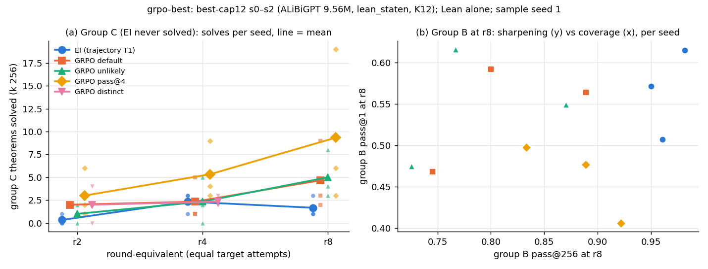

# grpo-best: from the same checkpoints, GRPO-default and -unlikely trade theorems with expert iteration; GRPO-pass@4 is level overall and ahead on group C, mostly through one seed

Status: completed and reviewed 2026-10-02. No hard-constraint violation and nothing quarantined. Every
pre-registered count reproduces on the reviewer's independent code. All 1,811 re-checked counted proofs pass Lean, and
the five negative controls behave. The reviewer asks for seven rewordings, which are applied below. One sentence is
**not supported as worded**: "GRPO reaches theorems that EI does not", as an unqualified headline for all three arms.

Question: does GRPO solve theorems that expert iteration (EI) from the **same starting checkpoint** could not? This
covers both default GRPO and the variants that credit rare correct proofs (unlikeliness and pass@k advantages). The
run-4 finding was that GRPO acquired the depth-3 pattern from zero where EI mostly did not. That was on the token
format, under Lean ∧ `nd_verify`, and its checkpoints are lost. Brief: run brief `grpo-best` (nd-rl literature
shortlist item 3, on Robbie's recipe).

## Configuration

- **Repository.** Fork `dan-pandori/nd-takehome`, branch `dan_grpo-best`.
  - Pre-registration `preregistration/grpo-best.md`, commit `fa5d9b0a` (11:24:52Z), before the first pod (gb-p0
    created 11:32:35Z).
  - Addendum 1 (smoke timings, projection, the optional distinct arm, placement): `864bc4ee` (11:49:11Z). It was
    written after the smoke and before the ladders, and only appends to the pre-registration.
  - DONE `1566634e`; CI run id for the final code `a5e75f9f`.
  - Review [`review_grpo-best.md`](https://github.com/dan-pandori/nd-takehome/blob/09265bf5/review_grpo-best.md):
    [`d542bb46`](https://github.com/dan-pandori/nd-takehome/commit/d542bb46) §Recount (blind),
    [`09265bf5`](https://github.com/dan-pandori/nd-takehome/commit/09265bf5) §Compare / §Verdict. Reviewer scripts are
    in `review_gb/` on the fork.
- **Timeline.** Executor Fri 2026-10-02 11:20–23:04 UTC; reviewer 23:02–23:16.
- **Model for every number** (unless a row says otherwise): `trajectory`'s best-cap12 s0 / s1 / s2. This is Robbie's
  `best_model.ALiBiGPT`, 6 × 384, **9,560,832 params**, `lean_staten` state environment (the environment assigns
  names). It was trained from scratch on K12 (`data/kh/train_k12.jsonl`, 155,000 generator proofs, lengths 2–12) for
  1,200 s on an A40. Checkpoints:
  - Base: `hf://buckets/dan-pandori/nd-rl/trajectory/ckpts/tj/stage1_best12_s<S>_b1200.pt` (md5 2bf801fd / eaff7f4d /
    abca9c63).
  - **EI** (inherited, not re-run): `trajectory`'s T1 ladder `la_T1_best12_s<S>_r<k>.pt`, on an RTX A6000.
    - Each round samples 8 rounds × k 32 on `rl_targets` (4,495) and fine-tunes 600 steps × 128 proofs, AdamW lr
      3e-4 → 3e-5.
    - It replays **20,000 K12 records per round**, which favours EI on retention.
    - Its read-outs are `trajectory`'s files. The reviewer matched them on 4 spot-checked files.
  - **GRPO** (new): `grpo_state.py` from the same base for each seed →
    `hf://buckets/dan-pandori/nd-rl/grpo-best/ckpts/gb/gb_<arm>_s<S>_r<k>.pt`.
    - Settings: G 8, 256 theorems per update, **561 updates** (equal sampled attempts to EI: 1,792,168 against
      1,793,960), AdamW lr 3e-5 constant, β (0.9, 0.95), wd 0, clip 1, no KL, T 0.8, caps 256 / 48.
    - Arms: `default` (A = R − group mean), `unlikely` (β_rank 0.25), `passk` (k 4) and `distinct` (bonus 0.5).
    - The distinct arm was optional. It was stopped at r4 for budget (s2 has a partial r5).
- **Checker: Lean alone.** Reward and evaluation both go through `lean_judge.judge_many`, and no comparison crosses the
  2026-09-27 date. The run-4 finding is cited as "under Lean ∧ `nd_verify`".
- **Read-outs.**
  - Sampled reads: textbook72 + holdout250 (322 theorems), `state_eval.py`, k 256, T 0.8, `max_steps` 96,
    `max_action` 512, sample seeds 0 (x0) and 1 (x1), on r2, r4 and r8.
  - Decode batch 2,048. Twelve reads ran at 1,024 after an OOM, which the pre-registration allows; it only re-draws the
    sample.
  - End reads: dev1108 (k 64, seed 0, solved) and held-out greedy (`data/p2/heldout.jsonl`, 5,000, k 1, T 0) on every
    r8, EI r8 included.
- **Groups.** These are defined on EI's sample seed 0 and reproduce `trajectory`'s split:
  - A = solved at the end of pretraining;
  - B = solved by EI r8 only;
  - C = solved by neither.

  Per seed, A / B / C = 232 / 54 / 36, 236 / 51 / 35 and 234 / 60 / 28.
- **Statistics.** Per-seed values; IQM with a stratified-bootstrap 95 % interval (at n = 3 the IQM equals the mean).
  - MDD from EI's between-seed sd: **3.5** for C solved, 9.3 for all 322 solved.
  - Bias-free companion: an exact two-sided sign test on discordant theorem-seed pairs over all 322 theorems, pooled
    over seeds.
- **Pods** (two ladders per 48 GB card, plus two reader pods):
  - six RTX A6000 at $0.53/h: `gb-p0`–`gb-p3`, `gb-r0` and `gb-r1`;
  - two A40 at $0.49/h: `gb-p4` and `gb-p5`.

  In total **68.10 pod-hours, $35.27** of a $45 / 90 h budget (`podbudget grpo-best`). The pre-registration estimated
  ≈ $41, and Addendum 1 projected ≈ $34. All pods were deleted.
- **Bucket:** `hf://buckets/dan-pandori/nd-rl/grpo-best/` holds:
  - `ckpts/gb/`;
  - `artifacts/gb/` (read summaries, per-theorem rows, round files, `found_8` archives, logs);
  - `artifacts/grpo-best/registry/` (compute rows).
- **Reproduce.** `python3 gb_analysis.py` writes `artifacts/gb/analysis_stdout.txt` and `artifacts/gb/summary.json`.
  The reviewer's recount is `review_gb/recount.py`.



*Figure (executor's).* Panel (a)'s title "EI never solved" is wrong, as the reviewer notes. C is "unsolved by the
base and by EI r8 on sample seed 0": EI r4 solves 3 / 1 / 3 C theorems and EI r8 solves 3 / 1 / 1 on sample seed 1.
Panel (b) is group B at r8, sharpening (pass@1) against coverage (pass@256).

## Observations

These are observed results, using the reviewer's wording where it differs from the executor's. Every number is on the
models above and judged by Lean alone.

**Group C solved at r8** (k 256, sample seed 1, a fresh draw for both sides):

| arm | s0 / s1 / s2 | IQM [95 % CI] | Δ vs EI (MDD 3.5) |
|---|---|---|---|
| EI r8 | 3 / 1 / 1 | 1.67 [1, 3] | — |
| GRPO-default r8 | 2 / 9 / 3 | 4.67 [2, 9] | +3.0, inside the MDD |
| GRPO-unlikely r8 | 3 / 8 / 4 | 5.00 [3, 8] | +3.3, inside the MDD |
| GRPO-pass@4 r8 | **6 / 19 / 3** | 9.33 [3, 19] | +7.7, outside the MDD |
| GRPO-distinct r4 (partial arm) | 2 / 2 / 3 | 2.33 | vs EI r4 3 / 1 / 3 |

- **pass@4's excess on C is mostly one seed.** pass@4 exceeds EI on C in all three seeds, by +3, +18 and +2. The mean
  difference passes the pre-registered MDD, but most of it is seed 1. The reviewer's reasons:
  - the MDD assumed EI's sd (1.15), while pass@4's own sd is 8.5;
  - a Welch t-test on the seeds gives t ≈ 1.55, not significant at n = 3;
  - the bootstrap interval [3, 19] touches EI's maximum.

  The ordering survives a swap of the two sample seeds (C′ on x0: EI 2.0, default 5.7, unlikely 4.7, pass@4 10.7).
- **C solved on either sample seed, pooled.** 17 / 16 / 33 against EI's 5, but the comparison is unequal: EI's sample
  seed 0 cannot solve a C theorem by construction. On sample seed 1 alone the totals are **14 / 15 / 28 against 5**.

**All 322 theorems at r8, the symmetric test.** A pair is "arm-only" when the arm solves the theorem on either sample
seed and EI r8 solves it on neither; "EI-only" is the reverse.

| arm | solved on x1 (s0 / s1 / s2) | arm-only vs EI-only (pooled) | sign test p |
|---|---|---|---|
| EI | 288 / 284 / 290 | — | — |
| GRPO-default | 278 / 278 / 279 | 15 vs **38** | **0.0022**, favours EI |
| GRPO-unlikely | 277 / 277 / 279 | 15 vs **44** | **0.0002**, favours EI |
| GRPO-pass@4 | 286 / 301 / 285 | 33 vs 20 | 0.098, not resolved (s1 20 vs 4; s2 4 vs 10) |

- **GRPO-default and -unlikely solve different theorems, not more.** They solve some C theorems that EI misses, but
  significantly fewer theorems overall. Their dev metric is lower in every seed: means 1,026 / 1,027 against EI's
  1,053, 26–27 lower.
- **pass@4 is level with EI overall.** It is ahead on C by the per-seed margins above, and its dev mean is 1,058.

**Sharpening against support** (sample seed 1, IQM; pass@1 = mean n_ok / 256, pass@256 = fraction solved):

| | EI r8 | default r8 | unlikely r8 | pass@4 r8 | distinct r4 |
|---|---|---|---|---|---|
| A pass@1 / pass@256 | .851 / .994 | .893 / .979 | .892 / .980 | .830 / .996 | .806 / .980 |
| B pass@1 / pass@256 | .564 / .964 | .542 / .811 | .547 / .788 | .460 / .881 | .331 / .710 |
| C pass@1 / pass@256 | .000 / .049 | .057 / .140 | .050 / .152 | .091 / **.272** | .004 / .073 |

- **pass@4 shifts towards coverage.** It keeps ≈ 0.4 of its groups mixed through r8, against default's fall to
  0.04–0.09. It has the highest C pass@256 (0.27 against EI's 0.05) and the lowest A / B pass@1 of the r8 arms.
- Groups A and B are defined by EI's own sample-seed-0 reads, which favours EI on B. The all-322 test is the unbiased
  comparison.

**Retention.**
- Held-out greedy at r8 is **0.98–0.99 for every arm, EI included**, up from the base's 0.921 / 0.936 / 0.962.
- Every GRPO arm rises +2.3 to +7.2 pp, and is already at 0.98–0.99 at round 1.
- EI r8's held-out greedy is at least GRPO-default's in 2 of 3 seeds.

**Mechanics** (`steps.jsonl`, 561 updates):

| arm | groups with reward variance (run mean) | mean reward, step 1 → 561 |
|---|---|---|
| default | 0.16–0.17 (≈ 0.6 → 0.04–0.09) | ≈ 0.5 → 0.95–0.96 |
| unlikely | 0.17–0.22 | → 0.94–0.96 |
| pass@4 | 0.43–0.45 (→ 0.29–0.39) | → 0.90–0.91 |

Targets solved cumulatively at r8, of 4,495: default 4,323–4,344; pass@4 4,371–4,411.

**Peirce's law** (post hoc; not pre-registered).
- pass@4 s0 r8 accepts 230 / 256 samples on both sample seeds. Peirce's law is in C for s0 and s1, but EI s2 solves
  it (245 / 256).
- C solves with an accepted proof that uses both ⊥-elimination and double negation (`gb_peirce.py`, post hoc): 2 of 5
  (EI), 7 / 17 (default), 8 / 16 (unlikely), 13 / 33 (pass@4).
- The executor's "term size 10" does not name its measure. The reviewer's Expr-node count for the 20 shortest proofs
  is 25–44.

The proof (Lean-accepted):

```lean
theorem t (P Q R S : Prop)  : (((P → Q) → P) → P) := by
  have n11 : (((P → Q) → P) → P) := (fun (n1 : ((P → Q) → P)) => by
    have n9 : (¬(¬P)) := (fun (n2 : (¬P)) => by
      have n6 : (P → Q) := (fun (n3 : P) => by
        have n4 : False := n2 n3
        have n5 : Q := n4.elim
        exact n5)
      have n7 : P := n1 n6
      have n8 : False := n2 n7
      exact (n8 : False))
    have n10 : P := Classical.byContradiction (fun hh => n9 hh)
    exact n10)
  exact n11
```

**Lean re-check (reviewer).** The reviewer re-checked 1,811 counted proofs with their own renderer: every distinct C
proof plus a random sample of the others, per arm. **All 1,811 pass.**
- Controls: 0 / 60 recorded rejects pass, 0 / 60 premise swaps pass, 0 / 1 `sorry` passes, and 4 / 60 `Or.inl` ↔
  `Or.inr` flips pass. All four flips are benign `S ∨ S`-type cases.
- Term size, median / max Expr nodes: EI 44.5 / 222; default 37 / 227; unlikely 84 / 156; pass@4 38 / 264; distinct
  45 / 161. These sets are weighted to C, so the medians describe the re-checked sets, not each arm's population.

**Splits.** No group-C theorem is in any training file. K12 shares 1 renaming class with textbook72 (a non-C theorem)
and 22 of 5,000 with held-out p2 (≤ 0.44 pp on held-out greedy). All of these overlaps are inherited from the shared
pools.

**Compute per ladder** (registry `artifacts/grpo-best/registry/`; GRPO GPU-seconds are co-tenant wall-clock, two
ladders per card):

| arm | GPU (s0 / s1 / s2) | GPU-s | train tokens | train steps | gen tokens | Lean checks |
|---|---|---|---|---|---|---|
| EI (inherited) | A6000, alone | 22,350 / 24,467 / 27,021 | 754 / 783 / 751 M | 4,800 | 399 / 415 / 435 M | 1.30 / 1.31 / 1.42 M |
| default | A6000 | 25,250 / 24,571 / 28,861 | 217 / 210 / 225 M | 561 / 561 / 620 | 340 / 336 / 384 M | 1.32 / 1.33 / 1.48 M |
| unlikely | A6000 | 25,460 / 24,825 / 25,061 | 277 / 226 / 222 M | 561 | 344 / 339 / 338 M | ≈ 1.33 M |
| pass@4 | A6000 / A6000 / A40 | 25,392 / 25,271 / 29,360 | 141 / 128 / 132 M | 561 | 355 / 355 / 352 M | ≈ 1.29 M |
| distinct (to r4 / r5) | A40 / A40→A6000 / A40 | 31,713 / 34,112 / 32,392 | 668 / 864 / 800 M | 340 / 420 / 421 | 321 / 358 / 326 M | 0.80–0.94 M |

- The pre-registered GRPO ladders used **1.00–1.13× EI's GPU-seconds** and **0.17–0.37× its train tokens**.
- **Flag: the distinct arm exceeds 1.25× its comparator.** By r4 it had used 1.27–1.42× EI's *full-r8* GPU-seconds,
  ≈ 2–3× EI's at matched r4. Restarts inflate the figure.

**Expected vs outcome** (the pre-registration's E1–E7, scored by the reviewer):

| | prediction | outcome |
|---|---|---|
| E1 | no arm beats EI on C by ≥ MDD; per seed 0–5 | **missed**: pass@4 +7.7. The per-seed band was missed by **all three arms** (default s1 9, unlikely s1 8, pass@4 6 and 19) |
| E2 | pass@4 ≥ default; unlikely within ±2 of default; neither difference > MDD | first two hold (59 vs 31; 29 vs 31); pass@4 − default 4.7 > MDD, a miss |
| E3 | default does not beat EI on the sign test | hit (15 vs 38, favours EI) |
| E4 | B pass@1 below EI, in 0.15–0.55; B pass@256 0.6–0.95; A pass@1 0.55–0.85 | mostly hit; A pass@1 0.89 for default and unlikely, above the band |
| E5 | held-out greedy within 3 pp of base; EI ≥ default in ≥ 2 / 3 seeds | part 1 missed upward (+2.3 to +7.2 pp); part 2 **hit** (s1, s2) |
| E6 | default variance fraction 0.25–0.60; reward rises ≥ 0.15 | variance 0.17, missed; reward rise hit |
| E7 | GPU-s 0.6–1.25× EI; train tokens 0.5–1.25× | GPU-s hit; train tokens missed (0.17–0.37×) |
| story | an arm beats EI on C beyond the MDD *and* on the sign test at p < 0.05 | **not met**: pass@4 meets the IQM condition, all-322 p = 0.098 |

**Interpretation, labelled as such.** At equal sampled attempts and from the same checkpoints, plain GRPO does not
reach more theorems than EI. It reaches different ones, while EI keeps more overall (EI also replays K12). The arm that
keeps groups mixed (pass@4) trades sharpening for coverage, and it is the only candidate for "RL reaching theorems EI
could not". At n = 3, with one outlier seed, that is not resolved.

## Limitations and next step

- **Seeds and groups.**
  - n = 3, and pass@4's C excess rests mostly on s1.
  - C is defined by EI's own sample-seed-0 failures, so any count over both sample seeds is biased towards GRPO.
- **Resumes, crashes and the distinct arm.**
  - Resumes with a **fresh AdamW state** (default s2 at r4, pass@4 s2 at r6, distinct s0 at r2, distinct s1 at r3)
    are not covered by the pre-registration. There were six OOM crashes with two ladders per card.
  - The distinct arm stopped at r4. Its s1 r2 read is tied to the rerun's checkpoint by timing only, not by md5.
- **Truncation is breached per stratum.** It is within 0.1 % overall for the r8 GRPO arms, but not for every
  reference-length stratum:
  - EI r8 2.9–6.6 %, default 0.4–1.7 % and distinct r4 s0 **23.8 %** in their worst strata;
  - distinct is 2.9 % overall.

  Distinct counts are therefore lower bounds, and EI's B / C counts may be slightly understated.
- **Compute is not matched.** GPU-seconds for GRPO are co-tenant wall-clock. EI trains on ≈ 3–6× the tokens, including
  20,000 K12 replay records per round.
- **Next step (reviewer).**
  1. 5–10 base seeds for pass@4 against EI on C, with the same paired per-seed difference and all-322 sign test. Fast
     Stage-1 makes the seeds cheap.
  2. A fresh third sample draw (seed 2) of every r8, which removes the selection effect without new training.
  3. A per-seed log-p trace of Peirce's law's reference proof along both ladders: acquisition, or a near-miss that
     EI's K12 replay suppresses?
