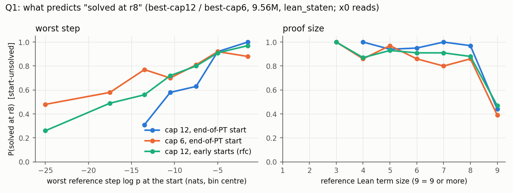
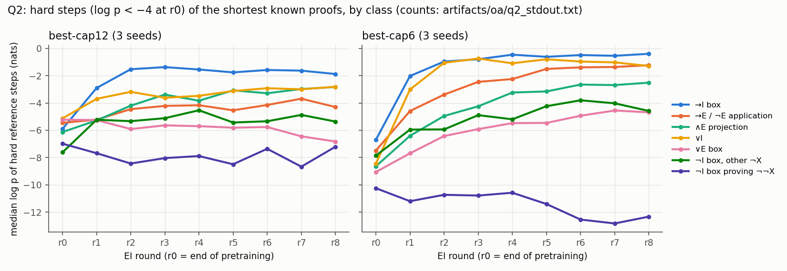
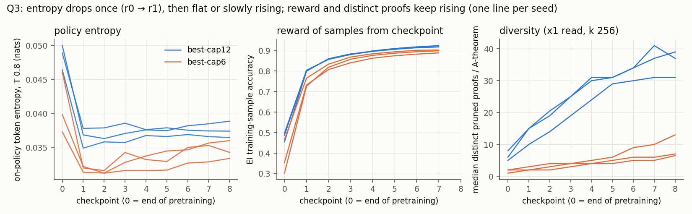

# organism-analysis: reference term size is the best single predictor of RL success; ¬I boxes are the one hard-step class EI does not move; entropy falls once and diversity never collapses

Status: **completed 2026-10-02 16:53 – 18:32 UTC (executor). Independently reviewed 18:34–18:51 UTC.
Verdict: the analysis stands, with seven rewordings.** No hard-constraint violation, nothing quarantined. Nothing is
"not supported" beyond the rewordings. The main correction is the theorem set. The executor's loader read a 307-theorem
target file (`tj/targets/targets_s0.jsonl`) and so left out 8 of the 315 reference proofs. These are large textbook
theorems (term size 11–16), mostly never solved. The write-up said the 8 do not replay in the environment, which is
false: all 315 replay and are Lean-accepted. The reviewer reproduced the executor's numbers exactly on 307 and
re-ran on 315. **This summary quotes the reviewer's 315-theorem values, with the 307 value where they differ, and uses
the reviewer's wording wherever it differs from the executor's.**

Brief: [`BRIEF_organism-analysis.md`](../../docs/proposals/claude-heavy/BRIEF_organism-analysis.md);
[Proposal 21](../../docs/proposals/2026-10-02-claude-heavy-set.md). It uses the data of three earlier runs:
[trajectory](../2026-10-01-trajectory-eventual-proof-worst-step-climbs-in-pretraining-and-rl/README.md),
[trajectory-cap6](../2026-10-02-trajectory-cap6-eventual-proof-worst-step-climbs-mainly-in-rl/README.md) and
[rl-from-ckpt](../2026-10-02-rl-from-ckpt-early-start-ladders-reach-end-arm-from-step-5000/README.md). `grpo-best` was
not DONE when the analysis started, so it is **not included**.

Question: across the ladders already on disk, (Q1) what, measured at the start of RL, predicts which theorems RL
solves by r8, and does that transfer across caps and start checkpoints? (Q2) Which kinds of hard step does RL make
likely, round by round, and does that reach theorems RL never solves? (Q3) How do policy entropy and the diversity of
accepted proofs evolve, and does diversity collapse before the never-solved group stalls?

The run was on the fork (`dan-pandori/nd-takehome`), branch `dan_organism-analysis`. **Its commits (DONE `16e81bef`,
`7c5f9688`) and the review commits are on `dan_organism-analysis` only and are not merged into the fork's `dan`.**
They add `oa/`, `pod/oa/`, `organism/` and `tj_score.py` (copied from `dan_trajectory`). No training code.

- Review: [`review_organism-analysis.md`](https://github.com/dan-pandori/nd-takehome/blob/91430c17/review_organism-analysis.md)
  ([`b3992d1f`](https://github.com/dan-pandori/nd-takehome/commit/b3992d1f) §Recount, written without the executor's
  write-ups; [`91430c17`](https://github.com/dan-pandori/nd-takehome/commit/91430c17) §Comparison and §Verdict).
  Reviewer scripts: `review_oa/` (own classifier, own fold hashing, own ND→Lean renderer; the Lean harness `rlean.py`
  is carried over from `review_rfc`).
- Executor write-up: [`organism/ANALYSIS.md`](https://github.com/dan-pandori/nd-takehome/blob/7c5f9688/organism/ANALYSIS.md),
  gallery [`organism/gallery.md`](https://github.com/dan-pandori/nd-takehome/blob/7c5f9688/organism/gallery.md)
  (15 reference proofs in Lean with per-step log p at r0 and r8),
  [`run_organism_analysis.md`](https://github.com/dan-pandori/nd-takehome/blob/7c5f9688/run_organism_analysis.md),
  `numbers.md` § organism-analysis, `log.md`. The executor's write-ups are labelled UNREVIEWED and use 307 theorems.
- Pre-registration: `preregistration/organism-analysis.md`, committed in `3ac05e64` at 17:03:26 UTC, before the first
  pod (`oa-p0`, 17:09:27). Not edited afterwards.
- Bucket: `hf://buckets/dan-pandori/nd-rl/organism-analysis/{artifacts,data}`. It holds the per-checkpoint entropy
  JSONs (111), the compacted reads, the exposure counts and the registry rows (`artifacts/organism-analysis/registry/`).
  The checkpoints are the inherited runs'; all 111 md5s match.

*Figures from the executor (`oa/`), on the 307-theorem set (see the Status note). The reviewer's 315-theorem values
change the levels a little but not the shapes. Lean alone.*

## Configuration

- **Models (every number names one of these).** All are `best_model.ALiBiGPT` 6 × 384, **9,560,832 params**,
  `lean_staten`, trained from scratch (Stage-1 1,200 s on one A40), then T1 expert-iteration ladders (8 rounds × k 32,
  T 0.8). Seeds 0–2.
  - **c12:** best-cap12, trained on K12 `train_k12.jsonl` (cap 12). Ladders: `trajectory`'s r1–r8. r0 = end of
    pretraining.
  - **c6:** best-cap6, trained on the cap-6 set `train_depth3_f0_a1.jsonl`. Ladders: `trajectory-cap6`'s.
  - **rfc:** c12's seeds with ladders started at pretraining steps 1,600 / 5,000 / 12,000 / 16,000 (`rl-from-ckpt`;
    r0 = the start checkpoint; rounds r2, r4, r8 stored).
- **No training.** The only GPU use is forward passes on the stored checkpoints (Q3's entropies).
- **Checker: Lean alone.** Every solved / unsolved label is inherited from Lean-judged `state_eval` reads (k 256,
  T 0.8, sample seeds x0 and x1), compacted by `oa/oa_compact_read.py`. `nd_verify` is unmodified (tree hash `9437bb72`
  equals `origin/main`'s) and judges nothing.
- **Theorems:** textbook72 + holdout250 (322), evaluation only. The analysis fits *predictors of RL outcomes* on them;
  no policy is trained on them. Reference proofs: the 315 `minlen` proofs (ND-derived; their line counts are upper
  bounds under Lean). Split check by the reviewer: the EI targets `rl_targets.jsonl` and the cap-6 set hit 0 evaluation
  theorems; K12 hits 1 (inherited; 1 of c12's 246 Q1 units).
- **Per-step log p:** inherited from `tj_score` (teacher-forced, T 1.0, natural logs, marginalised over name bases).
  w1 = worst step of the reference proof.
- **Q1.** Unit = (theorem, seed, start) among units the start's x0 read does not solve; target = solved by the x0
  read at r8. Features from the reference under the start checkpoint: w1, w2, w3, steps < −4 / < −8, total log p,
  ND lines, Lean term size (`tj_score`'s `term_size`, which counts inference nodes), number of actions, kind of the
  worst step, slope of w1 over the last pretraining checkpoints. Models: logistic on w1 alone, logistic on all
  features (L2, C = 1), `HistGradientBoostingClassifier` (depth 3, 100 iterations). CV folds: held-out seed × held-out
  theorem fold. Pre-registered rule: one threshold suffices iff logit − w1 < 0.03 and the paired interval includes
  ≤ 0.03.
- **Q2.** Hard step = reference step with log p < −4 at r0. Classes from the action text (box:imp, box:neg,
  box:orelim, and_proj, app, or_intro, and_intro, false_elim, …). "Never solved" = no x0 or x1 read in r1–r8 solves it
  (rfc: r2, r4, r8). Δ = lp(r8) − lp(r0). Matched control: never-solved hard steps of other classes, same seed, same
  1-nat r0 bin.
- **Q3.** On-policy entropy: 4 attempts × 1,024 fixed RL targets (`rl_targets.jsonl`, seed 0) at T 0.8 per checkpoint,
  111 checkpoints, batch 2,048 (peak memory 12.1–22.6 GB), `max_action` 512. Teacher-forced entropy on reference
  proofs at T 1.0. Diversity: distinct Lean-accepted proofs per theorem in the stored reads, raw and after pruning
  unused lines. Cui fit R = −a·e^H + b per ladder.
- **Pods** (`~/pods.log`, `~/podhours.log`): `oa-p0` A40 17:09–18:09 UTC, 1.00 h, $0.49; `oa-p1` A40 from 17:36,
  0.90 h, $0.44. **1.90 pod-hours, $0.93** of an $8 / 16 h budget (registered with `podbudget`). The pre-registration
  planned one RTX-class pod.
- **Compute** (one arm; no training):

  | quantity | value | source |
  |---|---|---|
  | GPU-seconds | 6,991 A40-s by `record.compute` (two jobs shared a card part of the time); 7,165 s by the reviewer's Σ of job `secs_onpol` + `secs_tf` | `artifacts/oa/compute_stdout.txt`; review §Compute |
  | generated tokens | 92.6 M (454,656 attempts = 111 × 4,096) | same |
  | training steps / tokens | 0 / 0 | — |
  | Lean checks | 0 new (all labels inherited) | — |

  The 2.5 % gap between the two GPU-second sums is accounting (teacher-forced passes included or not).

## Observations (reviewed)

### Q1: what predicts "solved at r8"

| | c12 (315; 307) | c6 (315; 307) |
|---|---|---|
| units (per seed) | 246 (84 / 80 / 82); 223 | 501 (147 / 178 / 176); 477 |
| solved at r8 | 165 | 355 |
| CV AUC, w1 only | **0.794** [0.72, 0.86]; 0.757 | **0.651** [0.58, 0.71]; 0.601 |
| CV AUC, full logistic | 0.826 [0.75, 0.89]; 0.767 | 0.787 [0.72, 0.84]; 0.751 |
| CV AUC, GBM | 0.904 [0.85, 0.95]; 0.871 | 0.813 [0.74, 0.87]; 0.791 |
| logit − w1 (paired 95 %) | +0.032 [−0.04, +0.105] | +0.136 [+0.074, +0.196] |
| seed SD of w1 AUC | 0.093 | 0.055 |
| w1 at P(solve) = 0.5 | −9.8 nats; −10.5 | **−19.1**; −21.6 |
| raw single-feature AUC: w1 / term size | .811 / **.840** | .690 / **.797** |
| P(solve at r8), term size ≥ 9 vs < 9 | 0.38 (n 125) vs 0.97 | 0.35 (n 162) vs 0.88 |

rfc (all four starts, executor, 307): w1 0.697, logit 0.831, GBM 0.864; term size ≥ 9 band 0.41 on 315.

- **Term size is the strongest single predictor in both caps** (by standardised coefficient, GBM permutation
  importance, and raw AUC; on 315, on 307 and on the x1 draw). It is *inference-node* term size: the reviewer's
  independent inference count gives the same result (AUC 0.79 / 0.78), but a full expression size, which counts the
  formulas in `have` types, does not (0.63 / 0.67). Name the measure when quoting this.
- **The worst step alone is weak at cap 6** (AUC 0.60–0.65), below the pre-registered 0.75–0.88.
- **Does one worst-step threshold suffice at c12? Not resolved** (reviewer's rewording of the executor's "yes, works
  about as well as any model"). The pre-registered rule passes on 307 (+0.010) and fails on 315 (+0.032). Its 0.03
  margin is far inside the MDD (≈ 0.09–0.15 AUC at n = 3), and GBM is +0.11 over w1 on both sets, also inside the
  MDD. At n = 3 no model beats w1 resolvably at c12.
- **At c6 and at the early starts, the extra features do help:** c6 logit +0.136 (interval excludes 0.03), GBM +0.162;
  rfc logit 0.85–0.87 vs w1 0.69–0.77.
- **Rankings transfer; the worst-step scale does not.** c12 → c6 logit AUC 0.786–0.812, GBM 0.801–0.829
  (fold-disjoint / same theorems), within 0.05 of c6's own. c12 → each rfc start: logit 0.81–0.87. But the 50 % point
  moves by 9–11 nats between caps: cap-6 RL solves theorems whose starting worst step is far lower.
- **Pre-registered "lower AUC at p1600" missed:** p1600 is among the highest by w1 (0.77) and logit.
- *Post hoc (executor, not recounted by the reviewer; a hypothesis):* among references with term size ≥ 9, those that
  need a `Classical.byContradiction` box are solved at P 0.31 (c12) / 0.22 (c6) / 0.26 (rfc), against 0.68 / 0.63 /
  0.74 without one (307).

### Q2: what RL learns, by step class

| | c12 | c6 | rfc |
|---|---|---|---|
| hard steps (315; 307) | 711; 629 | 1,438; 1,282 | 5,093; 4,585 |
| box openers + ∧-projections | 64.7 % | **59.5 %** (60 % on 307) | 58.9 % |
| never-solved hard steps; median Δ per step (per seed) | 169; +2.55 (1.36, 3.06, 3.09) | 441; +4.39 (5.38, 4.24, 3.91) | 1,511; +3.14 |
| partial R² of class in Δ ~ lp0 + class: never-solved; all | 0.25; 0.11 | 0.38; 0.23 | 0.34; 0.16 |
| classes beating their matched control by ≥ 0.5 nats | 6 / 8 | 9 / 12 | 7 / 11 |

- **¬I boxes do not move.** Median log p of ¬I-box hard steps r0 → r8: c12 −7.33 → −6.88, c6 −9.36 → −9.25, rfc
  −7.58 → −8.28. In never-solved theorems they trail their matched controls by −3.6 (c12), −6.4 (c6) and −4.8 (rfc)
  nats, and they are the largest never-solved class in every run (80 / 169, 127 / 441, 452 / 1,511). It is the one
  class that does not move under EI in any run.
- **Other classes rise, at cap 6 mostly by r2:** class medians r0 → r8 at c6: →I −6.8 → −0.5, application
  −7.2 → −1.1, ∧E −8.7 → −2.9, ∨I −8.9 → −1.3. Gains at c12 are smaller. **∨E boxes fall at c12** (−5.34 → −7.05);
  the executor's gallery example 1 shows an r8 proof that routes around the reference's `Or.elim`.
- **Hard steps in theorems RL never solved still gain,** and class explains part of the gain (partial R² above). The
  c12 s0 value is small (+1.36).
- **Matched controls: the signs reproduce; the c12 sizes do not** (reviewer's rewording). On 315: application +2.1 /
  +2.8 (c12 / c6), →I +2.5 / +3.1, ∨I +3.0 / +4.8, ¬I −3.6 / −6.4 nats. The executor's c12 values on 307 (application
  +7.2, →I +6.5, ¬I −6.8) are 2–3× larger, and its c12 application / →I cells rest on 6–7 steps.
- **Cross-class Spearman (never-solved vs solved gain): not resolved** (reviewer's rewording of the executor's c12
  "hit"). The executor's ρ 0.80 at c12 is over 4 classes (p ≈ 0.2) under an "RL-solved only" definition; on 315 that
  definition gives 0.90 over 5 classes, and with group A included in "solved" it is 0.09 (c12) / 0.50 (c6, p 0.17).
- *Post hoc (labelled; a hypothesis for a pre-registered test):* the stuck ¬I boxes are those proving a double
  negation ¬¬X. On 315, by the reviewer's own parse: c6 median Δ −1.50 (per seed −0.39 / −1.66 / −1.75, negative in
  3 / 3 seeds on both theorem sets), c12 +0.15 (−3.05 / +0.97 / +1.38); other ¬I boxes +4.3 / +2.7. The executor
  counts ¬¬X boxes as 48.3 % (c12) / 36.1 % (c6) of the negation boxes in RL's own training proofs; the arithmetic is
  consistent, the pod counts were not re-derived. So the stuck class is not rare in RL's training data.
- Exposure (executor): a class's share of RL training steps correlates weakly with its gain (ρ 0.29 c12, 0.09 c6).

### Q3: entropy and diversity

| ladder | on-policy H (T 0.8) r0 | r1 | r8 | r0 → r8 drop |
|---|---|---|---|---|
| c12 s0 / s1 / s2 | .0464 / .0500 / .0489 | .0349 / .0369 / .0378 | .0365 / .0389 / .0374 | 21 / 22 / 23 % |
| c6 s0 / s1 / s2 | .0373 / .0460 / .0398 | .0314 / .0320 / .0322 | .0360 / .0343 / .0334 | 3 / 25 / 16 % |

- **Entropy falls once, at r0 → r1 (16–30 %), then is flat or rises slowly** (5 / 6 ladders rise after r1). None of
  the six is monotone and none drops ≥ 30 % (pre-registered: monotone in ≥ 5 / 6, ≥ 30 %). rfc ladders drop 20–59 %
  (largest from p1600), all of it by r2.
- **Caveat on the size of the r0 → r1 drop** (reviewer's rewording of "truncation ≤ 0.67 %"): 0.67 % is per action.
  Per attempt, truncation exceeds 0.1 % in 42 / 111 checkpoints, up to 3.5 % (c12 s0 p1600, c6 s1 pend, c12 s1
  p5000), concentrated at r0. Truncated actions (up to 512 tokens) enter the token-mean entropy, so the r0 levels and
  the drop may be overstated.
- **Hard reference steps lose far more teacher-forced entropy than easy steps** (c12 s0 hard 0.113 → 0.045, easy
  0.042 → 0.036; c6 s1 hard 0.139 → 0.041). Holds as pre-registered.
- **Cui fit (R = −a·e^H + b): degenerate.** Pairing checkpoint r's entropy with the accuracy it sampled in round r + 1,
  R² is 0.82 / 0.86 / 0.93 (c12) and 0.18 / 0.74 / 0.85 (c6): **4 / 6 ≥ 0.8, so the pre-registered expectation is met
  by the letter** (reviewer's correction; the executor counted 3 / 6 from its own numbers). Under the literal pairing
  (round r) it is 0 / 6. The predicted ceiling b − a is 1.8–2.7, an accuracy above 1, never within 0.1 of r8. The fit
  rides on the single r0 → r1 point: after r1 entropy varies by ≈ 0.003 nats, and restricted to r1–r8 the fitted a is
  negative in 5 / 6 ladders (reward rises while entropy rises).
- **Diversity does not collapse.** Median distinct accepted proofs per group-A theorem rise every round in every
  ladder and peak at r7–r8 (raw x0: c12 7 / 12 / 9 → 66 / 70.5 / 70; c6 2 / 2 / 2 → 21 / 15 / 12; also after pruning
  unused lines). No ladder falls below 50 % of its peak, so "collapse before group C stalls" cannot happen (0 / 6).
  Group C's cumulative solves stall at rounds 5 / 7 / 8 (c12) and 5 / 8 / 6 (c6), with 10 / 36, 8 / 35, 9 / 28 and
  7 / 52, 7 / 52, 13 / 60 C theorems solved by r8. As in `trajectory`, the stall is not a diversity collapse.

### Lean re-check (reviewer)

915 / 915 checked proofs accepted by `lean` (axioms ⊆ {propext, Classical.choice, Quot.sound}): 150 each of c12 r8,
c6 r8 and rfc r8 counted proofs, 150 eventual proofs, and all 315 reference proofs. Controls behaved: 60 / 60
untouched pass, 5 / 60 one-line flips pass (benign `A ∨ A` no-ops), 0 / 60 pass with a different statement, bare
`sorry` fails. Median Lean expression size (the reviewer's full-node count) 79 / 44.5 / 62 for c12 / c6 / rfc r8
proofs against 26 for the references; median ND lines 20.5 / 17 / 18 against 9.

## Expectations (pre-registered) vs outcome, on 315

- **Held:** c12 w1 AUC in 0.75–0.88 (0.794); c12 50 % point in −16…−9 (−9.8); c12 → c6 AUC drop ≤ 0.05 and 50 % point
  shift ≥ 1.5 nats (9.3); c12 → rfc AUC ≥ 0.70 at p5000–p16000 (full models); box + ∧E ≥ 60 % at c12 (64.7 %);
  matched-control rule (≥ half the classes); partial R² ≥ 0.05; hard-step entropy falls more than easy-step; Cui
  R² ≥ 0.8 in ≥ 4 / 6 (4 / 6, under pairing A).
- **Missed:** c6 w1 AUC (0.651); "full model adds ≤ 0.04" at c6 (+0.136); "GBM within ±0.03 of logit"; "w1 is the top
  feature" (term size is); "worst-step kind adds < 0.02"; c6 50 % point (−19.1); "lower AUC at p1600"; box + ∧E ≥ 60 %
  at c6 (59.5 %, by 0.5 pp; a hit on 307); "every class with ≥ 20 hard steps gains > +2 / +4 in solved theorems"
  (c12 box:neg, app, or_intro, false_elim, box:orelim; c6 box:neg); "never-solved gain < +1.5 at c12" (+2.55);
  entropy monotone and ≥ 30 % (0 / 6); Cui b − a within 0.1 of r8 (0 / 6); diversity peaks at r1–r2 and falls ≥ 30 %
  (rises every round); collapse before stall (0 / 6).
- **Not resolved:** "one threshold suffices at c12" (the rule's verdict flips with 8 theorems, inside the MDD);
  cross-class ρ > 0.4 (depends on the definition and rests on 4–9 classes).

## Limitations and next step

- **n = 3 seeds per arm**, all inherited. At n = 3 the AUC MDD (≈ 0.09–0.15) exceeds any plausible gain over w1 at c12.
  c12's never-solved set is 16–22 theorems per seed on 315.
- **Q1 features come from one fixed reference proof.** The policy may succeed by another route (∨E falls at c12).
  Group labels come from single k-256 reads; B / C flip 5–10 % on a re-draw (`trajectory-cap6`).
- **Term size** here is the inference-node count; the result does not hold for full expression size.
- **The reductio and ¬¬X splits were found after looking.** They are hypotheses.
- **On-policy entropy** is measured on 4,096 rollouts per checkpoint on RL targets, not the evaluation pools; it
  includes name tokens the environment overwrites, and truncated actions inflate r0.
- **Gallery picks:** the executor takes each theorem's *worst* hard step of the class and then the lower median; a
  per-theorem mean gives different picks for 7 / 15. A reasonable reading of the pre-registered rule, not stated in
  `gallery.md`.
- **Executor files are on 307 theorems.** The fork branch was not rerun after the review.

**Next (from the review):**
1. Rerun `oa_q1_models.py` / `oa_q2.py` with the scorer's 315-target `targets.jsonl` instead of
   `tj/targets/targets_s0.jsonl` (minutes on the VPS, no GPU), so the executor's files match this summary.
2. For "does anything beat w1 at c12?": more seeds, or pool c12 with rfc p16000 as a within-model replicate.
3. A pre-registered test of the ¬¬X hypothesis: a held-out set of ¬¬-introduction theorems scored across a fresh EI
   ladder, or a ladder with ¬¬X boxes up-weighted.
