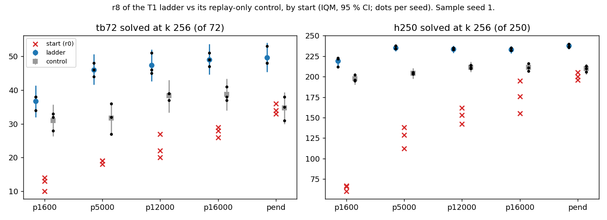
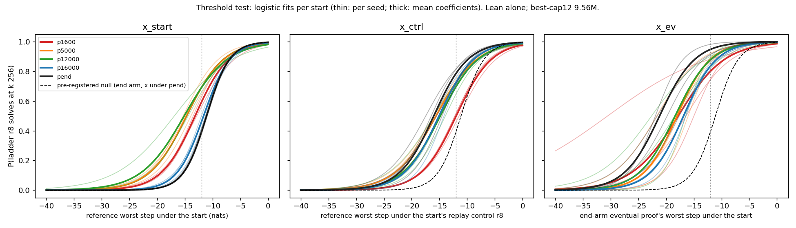
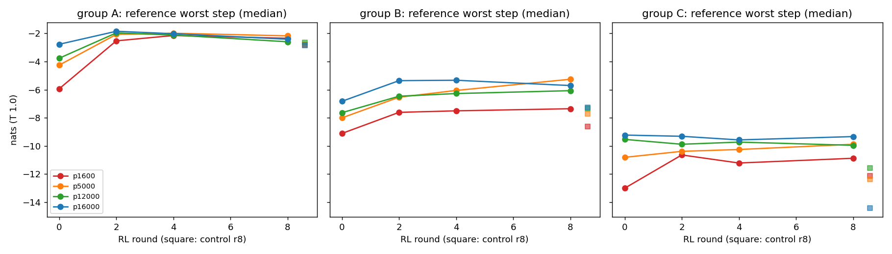

# rl-from-ckpt: RL from step 5,000 onward ends level with RL from the end of pretraining; from step 1,600 it ends 13 textbook theorems short; no selection-free measure shows an early start reaching beyond the end arm

Status: **completed 2026-10-02 01:38 – 10:55 UTC (executor). Independently reviewed 10:56–11:14 UTC.
Verdict: stands, with three rewordings; nothing contradicted.** No hard-constraint violation, nothing quarantined.
Where the reviewer's wording differs from the executor's, this summary uses the reviewer's. The pre-registered
"elicitation vs creation" test is **not settled by a pre-registered test**:
- the literal falsifier (x under the start) fires, as predicted;
- the pre-registered decisive form (x under the replay-only control) also fires, but it fires equally on the end arm,
  which is the null by construction, so it cannot discriminate;
- a post hoc calibrated form does not fire, and a selection-free reach comparison favours the end arm at every start.

The reading "consistent with elicitation, once the ladder's replay counts as pretraining" rests on those post hoc
measures and is worded as "consistent with".

Brief: [`BRIEF_rl-from-ckpt.md`](../../docs/proposals/state-env/BRIEF_rl-from-ckpt.md); proposal:
[Proposal 19](../../docs/proposals/2026-10-02-rl-from-pretraining-checkpoints.md). The start checkpoints and the end arm
come from [trajectory](../2026-10-01-trajectory-eventual-proof-worst-step-climbs-in-pretraining-and-rl/README.md).

Question: if RL starts from a *less*-pretrained checkpoint, does it solve theorems whose hardest step is far below the
threshold that RL from the end of pretraining needs (creation)? Or does one threshold curve, in the start's per-step
log p, fit every start (elicitation)?

The run was on the fork (`dan-pandori/nd-takehome`), branch `dan_rl-from-ckpt`. **Its commits (DONE `6ad3d746`) and the
review commits are on `dan_rl-from-ckpt` only and are not merged into the fork's `dan`.** New code: `rfc_replay.py`
(replay-only control), `rfc_analysis.py`, `rfc_compute.py`, `pod/rfc/`. `tj_*.py` and `pod/tj/` were taken from
`dan_trajectory`; `tj_targets.py` gained path flags (defaults unchanged). Training code is unchanged:
`state_ladder_ei.py` is byte-identical to `dan_trajectory`'s.

- Review: [`review_rl-from-ckpt.md`](https://github.com/dan-pandori/nd-takehome/blob/a07cf511/review_rl-from-ckpt.md)
  ([`0b2c2728`](https://github.com/dan-pandori/nd-takehome/commit/0b2c2728) §Recount, written blind to the executor's
  write-ups and analysis output; [`a07cf511`](https://github.com/dan-pandori/nd-takehome/commit/a07cf511) phase 2
  compare and §Verdict). Reviewer code: `review_rfc/`, plus earlier reviewers' `rlean.py`, `splits.py`, `score.py`.
  Nothing is imported from `rfc_*.py` or `tj_*.py`.
- Executor write-up: [`run_rl_from_ckpt.md`](https://github.com/dan-pandori/nd-takehome/blob/6ad3d746/run_rl_from_ckpt.md),
  `numbers.md` § rl-from-ckpt, `log.md` § rl-from-ckpt,
  `artifacts/rfc/{analysis_stdout.txt,summary.json,compute_stdout.txt}`.
- Pre-registration: `preregistration/rl-from-ckpt.md`, committed in `224cd387` at 01:47:18 UTC. That was before the
  first pod (`rfc-p1`, 01:47:27) and the first ladder (01:48:31). It was not edited afterwards.
- Bucket: `hf://buckets/dan-pandori/nd-rl/rl-from-ckpt/{ckpts/rfc/{ladder,control},artifacts/rfc,artifacts/rl-from-ckpt/registry,data/rfc}`.
  It holds:
  - 216 checkpoints (96 ladder, 120 control);
  - the reads (`artifacts/rfc/eval/*.jsonl`);
  - the scores (`artifacts/rfc/score/`, checkpoint md5s in `score/ckpts_*.md5`);
  - the ladders' `found_*.jsonl` (≈ 0.9 GB per ladder; bucket only);
  - registry and compute rows.





*Figures from the executor (`rfc_analysis.py`). Lean alone. The third figure was not separately checked by the
reviewer. Its control-r8 squares agree with the reviewer's finding that replay raises the reference worst step from
p1600 and lowers it from p16000.*

## Configuration

- **Model (every number here):** `trajectory`'s **best-cap12 s0 / s1 / s2**. That is `best_model.ALiBiGPT`, 6 × 384,
  **9,560,832 params** (read from the checkpoints by the reviewer), format `lean_staten`, trained from scratch on K12
  (`data/kh/train_k12.jsonl`, 155,000 records, cap 12, md5 `800b5486…`, the same on all 17 pods). Stage-1 ran for
  1,200 s on an A40 (≈ 24,100 steps).
- **Starts:** Stage-1 checkpoints `stage1_best12_s<S>_b1200_step{0,1600,5000,12000,16000}.pt`, labelled p0 … p16000,
  and the end checkpoint, pend.
  - **Ladders:** `la_T1_best12_s<S>_<start>`, from `state_ladder_ei.py` with its defaults (8 rounds × k 32, T 0.8,
    replay from K12). 15 are new: 5 starts × 3 seeds.
  - **End arm:** the pend ladders are `trajectory`'s, inherited and re-counted by the reviewer from `trajectory`'s raw
    reads.
- **Replay-only controls (a deviation from the brief, pre-registered with its reason).** Each ladder round that accepts
  at least one proof also fine-tunes on 20,000 random K12 records. Over 8 rounds the replay alone is ≈ 476 M training
  tokens, more than Stage-1's ≈ 445 M, so an early-start ladder also pretrains. With the RL records, a ladder trains
  on 634–783 M tokens. `rfc_replay.py` (`rc_best12_s<S>_<start>`) runs the
  same 8 rounds × 600 steps on K12 replay alone. It is matched on steps and replay records, **not on tokens**.
  There is no p0 control, because the p0 ladder never trained.
- **Checker: Lean alone.** `nd_verify` judges nothing. Its tree is identical to `origin/main`, and only its formula
  parser is imported by `state_env.py`.
- **Theorems:** textbook72 (72) + holdout250 (250) = 322, evaluation only. The ladder samples
  `data/ladder/transfer.jsonl` (holdout250 ⊂ it), but trains only on RL-target finds and K12.
- **Reads:** `state_eval.py`, k 256, T 0.8, `max_steps` 96, `max_action` 512, batch 2,048, held fixed in every arm.
  Two ladders resumed at batch 1,024 after a CUDA OOM: s2 p1600 rounds 3–8 and s1 p12000 rounds 4–8. That is a
  sampling re-draw (`NOISE_FLOOR.md`).
  - Ladders were read at r2, r4 and r8, and controls at r8, with sample seeds 0 (x0) and 1 (x1). **y = solved at r8,
    x1** (pre-registered).
- **Threshold test:**
  - x = the worst step: the minimum per-action teacher-forced log p (T 1.0, natural logs, base-marginalised;
    `tj_score.py`, unchanged) of `trajectory`'s 315 reference proofs, clipped at −40.
  - x_start is x under the start, the brief's form. x_ctrl is x under that start's replay-only control, the
    pre-registered decisive form.
  - The null curve is the end arm's logistic fit (pend ladder r8 vs x_start at pend).
  - Excess = solved pairs minus the null's expectation, over (theorem, seed) pairs with x < −12 at p1600–p16000.
    Falsifier: excess ≥ 64, and ≥ 3 in 3 / 3 seeds.
- **Pods** (2026-10-02 01:47 – 10:49 UTC; `~/pods.log`, `~/podhours.log`): 17 pods, **120.87 pod-hours, $63.72**
  (`podbudget`).
  - `rfc-p1`–`rfc-p15`: one ladder each. All are RTX A6000 at $0.53/h except `rfc-p14`, an A40 at $0.49/h (A6000 stock
    ran out). `rfc-p1`–`rfc-p3` ran the p0 ladders, then the controls, two per card, then reads.
  - `rfc-r1`, `rfc-r2`: RTX A6000, control and r2 reads.
  - Budget $90 / 180 h, registered before the first pod. Pre-registered plan ≈ 140 pod-hours ≈ $72.
- **Compute per arm** (executor's `rfc_compute.py`, from `record.compute` rows). The reviewer re-derived wall-seconds
  from `round_*.json` and got some per-seed values lower (e.g. s2 p1600 21,094 vs 22,943), consistent with the
  executor counting OOM'd round attempts that the resumed rounds overwrite.

  | arm | GPU | GPU-s per seed | gen tokens (M) | attempts (k) | train steps | train tokens (M) | Lean checks (k) |
  |---|---|---|---|---|---|---|---|
  | ladder p0 (stopped) | A6000 | 362 / 504 / 409 | 50–76 | 448 | 0 | 0 | 0 |
  | ladder p1600 | A6000 | 21,745 / 19,015 / 22,943 | 346–401 | 1,794–2,011 | 4,800 | 634–669 | 915–1,037 |
  | ladder p5000 | A6000 | 24,714 / 24,629 / 20,896 | 374–400 | 1,794–1,938 | 4,800 | 693–742 | 1,101–1,124 |
  | ladder p12000 | A6000 | 23,804 / 26,427 / 23,972 | 394–450 | 1,794–2,011 | 4,800 | 720–779 | 1,174–1,291 |
  | ladder p16000 | A6000 (s1 A40) | 26,365 / 26,961 / 25,829 | 394–409 | 1,794–1,938 | 4,800 | 729–758 | 1,229–1,268 |
  | ladder pend (`trajectory`, inherited) | A6000 | 22,350 / 24,467 / 27,021 | 399–435 | 1,794–2,011 | 4,800 | 751–783 | 1,299–1,417 |
  | control, p1600–p16000 | A6000, two per card | ≈ 6,150 each | 0 | 0 | 4,800 | 476–477 | 0 |
  | control, pend | A6000 | ≈ 3,170 each | 0 | 0 | 4,800 | 476–477 | 0 |
  | Stage-1 (`trajectory`) | A40 | 1,350 | 0 | 0 | ≈ 24,100 | ≈ 445 | 0 |

  - **Flag: every ladder trains on 1.33–1.63× its control's tokens.** The ladder's mixes also hold 0.41–0.52 M RL
    records; the controls hold none.
  - No early-start ladder exceeds 1.25× the end-arm ladder on any measure. The largest ratio is 1.10×, wall-s,
    p16000 s1.
  - The pend controls ran in half the wall time of the others. The executor attributes this to running alone on the
    card rather than two per card; the reviewer has not established the cause.

## Observations (reviewed)

**p0 (initialisation).** Rounds 1–2 accepted **0 of 287,680 target samples** in each of the three seeds. Every attempt
was a `lean_seq` parse failure. Nothing was trained, and the stop rule fired as pre-registered.

**Solved at k 256, r8, sample seed 1** (s0 / s1 / s2; r0 = the start, from `trajectory`'s reads; c8 = control r8). Every
ladder and control cell is inside its pre-registered range.

| start | r0 tb72 | r8 tb72 | c8 tb72 | r0 h250 | r8 h250 | c8 h250 |
|---|---|---|---|---|---|---|
| p1600 | 10 / 14 / 13 | 38 / 34 / 38 | 32 / 28 / 33 | 67 / 60 / 66 | 223 / 212 / 222 | 202 / 196 / 195 |
| p5000 | 19 / 19 / 18 | 48 / 44 / 46 | 32 / 27 / 36 | 138 / 129 / 112 | 234 / 234 / 238 | 205 / 203 / 204 |
| p12000 | 27 / 20 / 22 | 45 / 51 / 46 | 39 / 37 / 39 | 162 / 153 / 142 | 233 / 235 / 233 | 214 / 210 / 211 |
| p16000 | 26 / 29 / 28 | 49 / 47 / 51 | 41 / 37 / 38 | 176 / 195 / 155 | 235 / 232 / 232 | 211 / 216 / 207 |
| pend (end arm, inherited) | 34 / 33 / 36 | 48 / 48 / 53 | 38 / 31 / 35 | 196 / 205 / 200 | 240 / 236 / 237 | 206 / 210 / 213 |

| start | ladder tb72 (mean, n = 3) | ladder − control tb72 | ladder h250 | ladder − control h250 |
|---|---|---|---|---|
| p1600 | 36.7 | +5.7 [2.7, 9.0] | 219.0 | +21.3 |
| p5000 | 46.0 | +14.3 | 235.3 | +31.3 |
| p12000 | 47.3 | +9.0 | 233.7 | +22.0 |
| p16000 | 49.0 | +10.3 | 233.0 | +21.7 |
| pend | 49.7 | +15.0 [11.0, 19.3] | 237.7 | +28.0 |

(The ladder − control columns are paired by seed. The intervals are the executor's 95 % stratified bootstrap over
theorems. The MDD at n = 3 is ≈ 7 textbook72 and ≈ 5 holdout250, 14 for holdout250 at p1600.)

1. **From step 5,000 on, the ladders end level with the end arm. From step 1,600 they end below it.** pend − p1600 =
   **+13.0 textbook72** (pre-registered ≈ +8, range 0–20) and +18.7 holdout250. p5000–p16000 are within 4 textbook72 and
   5 holdout250 of pend, inside the MDD. The rank order on textbook72 holds (36.7 ≤ 46.0 ≤ 47.3 ≤ 49.0 ≤ 49.7). The x0
   reads give the same picture: every cell is within ±4 of x1.
2. **Replay alone recovers most of what pretraining had not yet done.** The control from p1600 reaches 28–33 / 72 and
   195–202 / 250, against the pend start's 33–36 and 196–205.
3. **RL adds to replay at every start, in every seed, on both pools:** +5.7 to +15.0 textbook72, +21 to +31 holdout250.
   *Caveat:* the ladders train on 1.3–1.6× the control's tokens, so this increment is partly confounded with training
   length.

**Threshold test** (y = ladder r8 solves, x1; logistic fits; x50 = the x at which P(solve) = ½, mean of per-seed fits;
"count" = pairs with x < −12 solved at p1600–p16000 × 3 seeds):

| x | null | x50 p1600 / p5000 / p12000 / p16000 / pend | count | null E | excess | falsifier |
|---|---|---|---|---|---|---|
| x_start (pre-registered, brief's form) | end arm on x_start (x50 −11.1) | −13.1 / −14.7 / −15.3 / −11.6 / −11.1 | 131 | 48.7 | **+82.3** (+30.4 / +30.0 / +21.9) | fires, as predicted |
| x_ctrl (pre-registered decisive form) | same | −11.9 / −15.6 / −14.9 / −15.2 / −16.1 | 187 | 60.2 | **+126.8** | fires, **and also on pend itself (+42.4)** |
| x_ctrl_cal (post hoc) | pend ladder on x under the pend control (x50 −16.1) | as above | 187 | 196.2 | **−9.1** (−5.6 / +0.8 / −4.3) | does not fire |
| x_ev (`trajectory`'s eventual proof; executor only) | end arm on x_ev (x50 −23.4) | | 201 | 245.4 | −44.4 | does not fire (not recomputed by the reviewer) |

4. **On x under the start, the curves do not coincide.** p5000 and p12000 sit 3.6 and 4.2 nats below the end arm's
   x50, and p16000 is inside the 2.5-nat MDD of pend. The pre-registered shifts (p1600 ≈ −22, p5000 ≈ −18,
   p12000 ≈ −16, p16000 ≈ −14) did **not** occur in the predicted order or size: p1600 moved least of p1600–p12000.
   131 solves against ≈ 110 [70, 170] predicted.
5. **The pre-registered decisive form cannot discriminate.** It fires (+127), but it fires on the end arm too (+42),
   which is the null by construction.
   - The cause is scale (reviewer's wording, replacing the executor's "the controls put lower log p on the reference
     proofs"). x means something different under a replay-fine-tuned model than under a Stage-1 checkpoint, and the
     end arm's curve on that scale is shifted and flatter (b1 0.32 vs 0.48).
   - Replay does not generally *lower* the references' worst step. Median x_ctrl − x_start per seed is +1.7 to +2.2
     at p1600, +0.4 to +1.0 at p5000, +0.4 to +0.6 at p12000, −0.1 to −0.4 at p16000 and **−0.9 at pend**.
   - The executor found the problem at 08:50 on partial data, before the last 7 ladders finished. It reports both
     forms, and labels the pre-registered one miscalibrated rather than dropping it.
6. **On the calibrated scale (post hoc) there is no excess at any start.** p1600 is −5.0 / −3.6 / −5.9 per seed, below
   the null, and p5000–p16000 are each within ±4 per seed. The negative control, pend, is −0.2 / −0.6 / +2.5. At
   x_ctrl < −16 the excess is −0.6.
7. **Selection-free reach favours the end arm at every start.** Over the union of both sample seeds at r8, the table
   counts theorems only this start's ladder solves / only the pend ladder solves, per seed:

   | start | s0 | s1 | s2 |
   |---|---|---|---|
   | p1600 | 1 / 24 | 1 / 38 | 2 / 35 |
   | p5000 | 5 / 7 | 6 / 11 | 5 / 11 |
   | p12000 | 4 / 10 | 5 / 4 | 4 / 17 |
   | p16000 | 7 / 8 | 5 / 10 | 2 / 10 |

   An early-start ladder solves 1–7 theorems per seed that the end-arm ladder solves **in neither sample seed at r8**
   (reviewer's wording; the executor wrote "never solves"). The end arm solves 4–38 that the early start misses. The
   reviewer's stricter symmetric count (solved in both draws by one arm, in neither by the other, summed over seeds)
   gives 1 vs 86 at p1600, 11 vs 21 at p5000, 7 vs 24 at p12000 and 9 vs 20 at p16000. (This comparison was added
   after seeing the data, and is labelled as such.)
8. **Group C** (`trajectory`'s per-seed hard set, which the end arm fails at r0 and r8 in x0: 36 / 35 / 28 theorems),
   solved at ladder r8 x1:
   - p1600 1 / 1 / 2 (sum 4), p5000 5 / 5 / 3 (13), p12000 3 / 5 / 4 (12), p16000 6 / 6 / 2 (14); the end arm
     3 / 1 / 1 (5).
   - No start reaches the pre-registered +10 creation threshold.
   - "C ≤ 4 per seed" is exceeded in 5 seed-cells (5–6). The reviewer's §Recount said 4 and corrected it in phase 2.
   - C is defined by the end arm's own failures, so its count is biased down for pend. Measure 7 avoids that bias.
9. **RL-only solves from x_start < −12** (ladder r8 x1 solves; neither the start nor the control solves in either sample
   seed): p1600 15, p5000 16, p12000 12, p16000 8 theorem-seed pairs, pend 3. Of the 51, 44 are `trajectory` group B
   (the end arm's RL also solves them) and 4 are group C. The lowest is `la_transfer_1809`, p12000 s0: x_start −26.05,
   x_ctrl −17.35, 102 / 256 at r8. All 54 stored distinct proofs of it pass the reviewer's Lean re-check. Its eventual
   proof has 8 actions and `lean_check` term size 5, the same size as the reference:

   ```lean
   theorem t (P Q R S : Prop) (h1 : ((Q ∨ (¬P)) ∧ (¬(¬(P ∨ Q))))) : (¬((Q ∨ (¬P)) → (¬(P ∨ Q)))) := by
     have n1 : ((Q ∨ (¬P)) ∧ (¬(¬(P ∨ Q)))) := h1
     have n7 : (¬((Q ∨ (¬P)) → (¬(P ∨ Q)))) := (fun (n2 : ((Q ∨ (¬P)) → (¬(P ∨ Q)))) => by
       have n3 : (¬(¬(P ∨ Q))) := n1.2
       have n4 : (Q ∨ (¬P)) := n1.1
       have n5 : (¬(P ∨ Q)) := n2 n4
       have n6 : False := n3 n5
       exact (n6 : False))
     exact n7
   ```

10. **Cost relative to pretraining.** A ladder costs 19,000–27,000 GPU-s (RTX A6000), which is 14–20× all of Stage-1.
    *Label (reviewer):* that ratio divides A6000-seconds by A40-seconds (Stage-1 is 1,350 A40-s).

**Proof size** (reviewer's Lean re-check sample; sampled proofs, often padded with detours, not minimal; term size is the
reviewer's whole-expression count): ladder r8 term size median 45–54, max 388–490 (ND lines median 15–17, max 61–88);
control r8 median 36–48, max 150–182 (ND lines 12–14, max 32–47). **Ladder proofs are longer than control proofs.**

**Re-derivation and Lean re-check (reviewer).**
- All 320 expected reads are present: 144 ladder, 60 control, 8 seed-0 re-reads and 108 of `trajectory`'s. 0
  inconsistencies.
- The seed-0 re-reads of p1600–p16000 match `trajectory`'s reads of the same checkpoints theorem for theorem (0 flips).
- The r0 scores equal `trajectory`'s exactly (3,780 values). The reviewer's own CPU scorer reproduces x_ctrl to ≤ 5.4e-5
  nats on 24 references.
- **1,950 / 1,950** counted sampled proofs pass Lean: 150 per arm over 13 arms, including the 30 longest per arm.
  Negative controls fail: 0 / 60 stored Lean rejections, 0 / 60 theorem-mismatched proofs, and `sorry`. 7 / 60
  `Or`-intro flips pass, all benign `A ∨ A`.
  - Caveat: the reads store the environment's ND rendering, not the raw sampled token text. The re-check is of an
    alpha-equivalent Lean re-rendering.
- Splits are disjoint by renaming class, except one inherited textbook72 ↔ K12 premise permutation
  (`P ∨ Q, ¬P ⊢ Q`), worth at most 1 textbook72 theorem per read. holdout250 vs K12 and RL targets: 0.
- Not recomputed by the reviewer: the x_ev excess (−44.4), the executor's 7,086 / 7,086 Lean-accepted scored targets,
  training tokens and pod-hours.

## Expected vs outcome (pre-registered, `224cd387`)

- **Hits:**
  - the p0 stop rule;
  - every ladder and control r8 cell inside its range;
  - the rank order;
  - pend − p1600 +13.0 (≈ +8, 0–20);
  - the literal x_start falsifier fires (131 solves, ≈ 110 [70, 170] predicted);
  - seed-0 re-reads within ±3 (0 flips);
  - start truncation ≤ ≈ 20 % (max 10.6 % at s1 p0).
- **Misses:**
  - **x50 shifts:** p1600 predicted ≈ −22, observed −13.1; the order is not as predicted.
  - **The replay-corrected test was predicted not to fire.** It fired, through a scale mismatch, and also on the
    negative control.
  - **Group C ≤ 4 per seed** was exceeded in 5 seed-cells.
  - **Truncation ≤ 2 % per RL stratum** was missed. Per read the maximum is 0.99 % (0 reads over 2 %), and 0.086 % of
    RL / control samples are cut off overall. But 6 of 486 read × length-bin strata exceed 2 %. The worst is 12.1 %
    (one 14-line theorem, s0 p12000 holdout250), then 6.0 % (control pend s2, holdout250 8-line bin). On the
    executor's read × pool × group strata the worst is 4.27 %.
- Pod-hours: ≈ 140 planned → **120.87**.

## Limitations

- **n = 3** on one recipe (best-cap12). Only p1600 is resolvably below the end arm.
- **The decisive comparison is post hoc.** The pre-registered x_ctrl test is miscalibrated. The calibrated null and the
  reach comparison were built after it fired.
- **The control is not token-matched.** The ladders train on 1.33–1.63× the control's tokens. The RL-over-replay
  increment (+6 to +15 textbook72) is partly training length.
- **The "start" is not only pretraining.** Every ladder also trains on ≈ 476 M tokens of K12 replay, more than
  Stage-1's ≈ 445 M. So an early-start ladder is "early checkpoint + more pretraining + RL"; the replay-only controls
  measure the middle term.
- **Truncation** above 0.1 % in 74 of 486 strata at r8. It biases long-theorem counts low, slightly.
- **Two ladders resumed at batch 1,024** after OOM: a sampling re-draw, disclosed.
- **Spend** ($63.72) is from `podbudget` / `~/podhours.log` at known rates, not re-derived from RunPod billing.

## Next step (reviewer)

1. **Pre-register the calibrated form and run it on a fresh draw.** Use new sample seeds (x2, x3) for the ladder and
   control r8 reads. Fit the null on the pend ladder vs x under the pend control, and fix the threshold in advance.
2. **Token-matched control:** either match the control's training tokens to its ladder, or train on the ladder's own
   mix minus its RL records. This separates RL's increment from training length.
3. **At p1600,** where RL's increment is smallest (+5.7) and replay's shift of x is largest (+2 nats), 5 seeds would
   bring the MDD below the observed increment.
