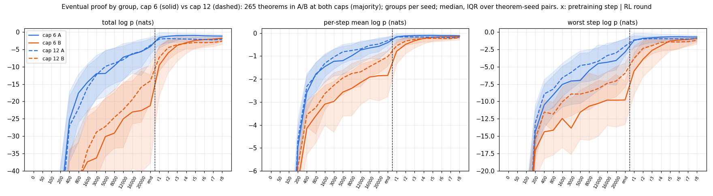
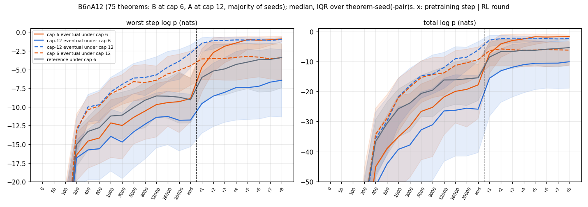
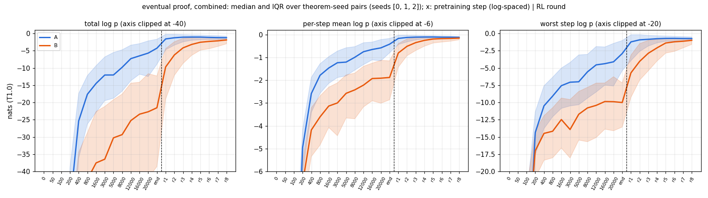
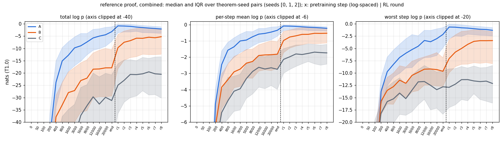
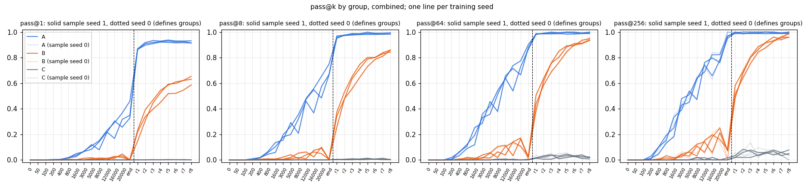
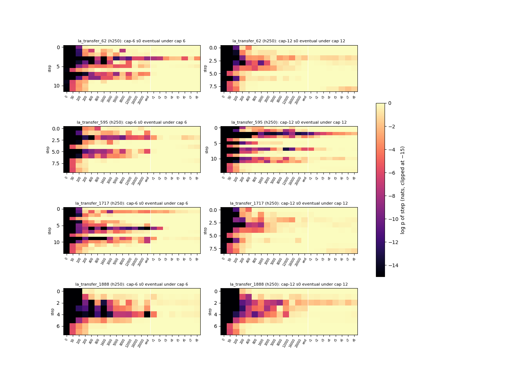

# trajectory-cap6: at cap 6, the worst step of an RL-only proof climbs mainly in RL, also on proofs RL did not select; at cap 12 the two were about equal

Status: **completed 2026-10-01 19:30 – 2026-10-02 03:08 UTC (executor). Independently reviewed 03:10–03:31 UTC.
Verdict: stands, with six rewordings and two claims not supported** (a mechanism in which cap 6's bad step lies past
the trained length; F2's title read as an explanation rather than a description). The pre-registered headline ("at
cap 6, B's eventual-proof worst step climbs more in RL than in pretraining") **is met under the pre-registered decision
rule** (3 / 3 seeds, IQM difference ≥ the 2-nat MDD), on the model's own proofs and on both selection-free targets.
No hard-constraint violation, nothing quarantined. Where the reviewer's wording differs from the executor's, this
summary uses the reviewer's.

Brief: [`BRIEF_trajectory-cap6.md`](../../docs/proposals/state-env/BRIEF_trajectory-cap6.md), which applies
[`BRIEF_trajectory.md`](../../docs/proposals/state-env/BRIEF_trajectory.md) to the cap-6 organism; proposal:
[Proposal 18](../../docs/proposals/2026-10-01-learning-trajectory.md). Sibling run (cap 12):
[trajectory](../2026-10-01-trajectory-eventual-proof-worst-step-climbs-in-pretraining-and-rl/README.md).

Question: the same as `trajectory`, on a model pretrained on short proofs (cap 6). When does the proof a model
eventually finds become likely: in pretraining or in RL? And for theorems that are **B at cap 6** (only RL solves them)
but **A at cap 12** (pretraining alone solves them), what does RL do at cap 6 that longer training proofs do at cap 12?

The run was on the fork (`dan-pandori/nd-takehome`), branch `dan_trajectory-cap6`. **Its commits (DONE `dffaafdb`) and
the review commits are on `dan_trajectory-cap6` only and are not merged into the fork's `dan`.** They include
`tj6_targets.py`, `tj6_analysis.py`, `tj6_compare.py`, `tj6_compute.py`, `tj6_registry.py` and `pod/tj6/` (sed copies
of `trajectory`'s, plus cross-seed scoring and a 2× cap diagnostic); `tj_score.py` is used unchanged.

- Review: [`review_trajectory-cap6.md`](https://github.com/dan-pandori/nd-takehome/blob/35a812ba/review_trajectory-cap6.md)
  ([`9843c962`](https://github.com/dan-pandori/nd-takehome/commit/9843c962) §Recount, written blind to the executor's
  write-ups; [`35a812ba`](https://github.com/dan-pandori/nd-takehome/commit/35a812ba) phase 2 compare and §Verdict).
  Reviewer scripts: `review_tj6/` (adapted from `review_tj/`; nothing imported from `tj_*.py` / `tj6_*.py`).
- Executor write-up: [`run_trajectory_cap6.md`](https://github.com/dan-pandori/nd-takehome/blob/dffaafdb/run_trajectory_cap6.md),
  `numbers.md` § trajectory-cap6, `log.md` § trajectory-cap6,
  `artifacts/tj6/{analysis_stdout.txt,compare_stdout.txt,compare.json,compute_stdout.txt}`.
- Pre-registration: `preregistration/trajectory-cap6.md`, committed in `f6e9ff57` at 19:33:46 UTC, before the first
  pod (`tj6-p0`, 19:34:15) and the first ladder (≥ 19:59). Not edited afterwards. Its header says "~20:00"; that was an
  estimate, disclosed in `log.md`.
- Bucket: `hf://buckets/dan-pandori/nd-rl/trajectory-cap6/{ckpts,artifacts,data}`. It holds all 66 checkpoints (md5s
  in `artifacts/tj6/score/ckpts_s<S>.md5`), the 264 sampled reads (`artifacts/tj6/eval/`), per-step scores
  (`artifacts/tj6/score/`), targets (`data/tj6/`), and 80,872 per-theorem registry rows plus compute rows in
  `artifacts/trajectory-cap6/registry/`.








*Figures from the executor (`tj6_analysis.py`, `tj6_compare.py`). Lean alone. Medians over theorem-seed pairs.
Checkpoint axis: 14 pretraining checkpoints (step 0 to the end), then T1 ladder rounds r1–r8.*

## Configuration

- **Model (every cap-6 number here):** three fresh seeds (0, 1, 2) of `best-state`'s **best-cap6** recipe:
  `best_model.ALiBiGPT`, 6 × 384, **9,560,832 params** (read from the checkpoint by the reviewer), format `lean_staten`,
  trained from scratch on the cap-6 set `state-env/data/p2/train_depth3_f0_a1.jsonl` (155,000 records, md5 `29276f24…`,
  same on the pods) with `state_train.py --recipe best --budget_secs 1200 --save_steps …` on one A40 (24,511 / 24,120 /
  24,113 steps). Held-out greedy 0.973 / 0.953 / 0.956.
  - Pretraining checkpoints (14): steps 0, 50, 100, 200, 400, 800, 1,600, 3,000, 5,000, 8,000, 12,000, 16,000, 20,000
    and the end (`pend` = **r0**).
  - T1 ladder (`state_ladder_ei.py` defaults: 8 rounds × k 32, T 0.8, replay from the cap-6 set) on the same A40,
    giving **r1–r8**. Cumulative ladder targets solved after r8: 4,257 / 4,235 / 4,204.
- **Comparison model (labelled "cap-12"):** `trajectory`'s **best-cap12 s0–s2** (same recipe on K12), read from the
  `trajectory` bucket. Its ladders ran on RTX A6000s.
- **Checker: Lean alone.** `nd_verify` judges nothing (the reviewer found no reference in the run code; its tree is
  identical to `origin/main`).
- **Theorems:** textbook72 (72) + holdout250 (250) = 322, evaluation only. The ladder samples `data/ladder/transfer.jsonl`
  (holdout250 ⊂ it) each round but trains only on RL-target proofs and the cap-6 set.
- **Sampled reads:** `state_eval.py` k 256, T 0.8, `max_steps` 96, `max_action` 512, batch 2,048 (two reads at 1,024
  after OOM). Sample seeds 0 (x0) and 1 (x1) at all 22 checkpoints × 3 seeds × 2 pools: 264 reads.
  - **Groups** from x0 at r0 and r8. A: r0 solves. B: r8 solves, r0 does not. C: neither.
  - **pass@k** from x1 (unbiased estimator, n = 256).
- **Targets** (all Lean-accepted):
  - **Eventual proof:** r8's highest-log-p distinct Lean-accepted x0 sample (268 / 269 / 262 theorems, from 8,859 /
    6,472 / 4,579 candidates).
  - **Reference proof:** `trajectory`'s 315 minlen proofs, byte-identical (65 / 72 textbook72 + 250 / 250 holdout250).
  - **Added for this run:** cross-seed eventual proofs (each cap-6 seed's eventual proofs scored under the other two
    seeds' checkpoints) and cap-12 eventual proofs (`trajectory`'s) scored under the cap-6 checkpoints. Not
    pre-registered: cap-6 eventual proofs scored under the cap-12 checkpoints (`score_rev.sh`).
- **Teacher-forced log p** (`tj_score.py`, unchanged): T 1.0, natural logs, fp32, marginalised over the 33 name bases;
  environment-assigned name tokens not scored. w1 = worst step (minimum per-action log p). Δ_RL = w1(r8) − w1(r0);
  Δ_PT = w1(r0) − w1(step 1,600).
- **Cap-6 vs cap-12 theorem sets** (majority of 3 seeds): A6, B6, C6; A12, B12, C12. **B6∩A12 = 75** theorems is the
  comparison set.
- **Pods** (2026-10-01 19:34 – 2026-10-02 03:05 UTC; `~/pods.log`, `~/podhours.log`): 7 pods, **45.19 pod-hours,
  $22.62** (`podbudget`).
  - `tj6-p0`, `tj6-p1`, `tj6-p2`: A40, $0.49/h. One seed each: Stage-1, held-out greedy, ladder, then reads.
  - `tj6-r0`, `tj6-r1`: A40. Reads and scoring.
  - `tj6-r2`, `tj6-r3`: RTX A6000, $0.53/h (A40 stock ran out). `tj6-r2`'s GPU failed at ≈ 00:23 ("CUDA unknown error");
    its remaining items moved to `tj6-p2`.
  - Budget $40 / 80 h (registered before the first pod). Pre-registered plan ≈ 55 pod-hours ≈ $28.
- **Compute per arm** (executor's `tj6_compute.py`, from `record.compute` rows; reviewer re-derived the ladder GPU-s
  from `round_*.json` to within 3 s):

  | arm (s0 / s1 / s2) | GPU | GPU-s | gen tokens (M) | attempts (k) | train steps | train tokens (M) | Lean checks (k) |
  |---|---|---|---|---|---|---|---|
  | Stage-1 | A40 | 1,325 / 1,327 / 1,289 | 0 | 0 | 24,511 / 24,120 / 24,113 | 451 / 443 / 443 | 0 |
  | T1 ladder | A40 | 17,990 / 17,730 / 16,763 | 340 / 327 / 332 | 1,794 each | 4,800 | 522 / 497 / 493 | 1,130 / 1,070 / 1,029 |
  | sampled reads (44 each, incl. the 2× diagnostic) | A40 / RTX A6000 | 19,632 / 20,644 / 19,889 | 499 / 538 / 529 | 3,666 / 3,994 / 3,756 | 0 | 0 | 414 / 355 / 330 |
  | held-out greedy | A40 | 23 / 28 / 23 | 0.5 | 5 | 0 | 0 | 5 |
  | teacher-forced scoring | A40 / RTX A6000 | ≈ 35–80 s per checkpoint (not in the registry) | 0 | 0 | 0 | 0 | 0 |

  - The read rows for s1 and s2 **include retries** after the dead GPU and the OOMs (reviewer): s0's 3,666 k attempts
    reproduce exactly; s1 has +320 k and s2 +82 k extra attempts. They are real spend.
  - No seed exceeds 1.25× a sibling. **Against cap 12:** `trajectory`'s ladders used 22,350–27,021 GPU-s on RTX A6000
    (≈ 1.4×, partly the GPU class) and 751–783 M train tokens (≈ 1.5×, longer proofs): **cap 12 used > 1.25× cap 6's
    ladder compute** on both. Attempts and steps are equal.

## Observations (reviewed)

**Sanity against `best-state` best-cap6** (expectation 1, x0; all in range):

| pool | r0 (s0 / s1 / s2) | r8 (s0 / s1 / s2) | `best-state` best-cap6 Fz; T1 |
|---|---|---|---|
| textbook72 / 72 | 17 / 14 / 15 | 43 / 41 / 38 | 19 / 18 / 20; 39 / 40 / 33 |
| holdout250 / 250 | 152 / 124 / 125 | 225 / 228 / 224 | 149 / 125 / 122; 226 / 229 / 227 |

**Groups** (322 theorems; all in the pre-registered ranges; B larger than cap 12's 54 / 51 / 60 in 3 / 3):

| group | s0 | s1 | s2 | cap-12 (`trajectory`) |
|---|---|---|---|---|
| A | 169 | 138 | 140 | 232 / 236 / 234 |
| B | 101 | 132 | 122 | 54 / 51 / 60 |
| C | 52 | 52 | 60 | 36 / 35 / 28 |
| A-lost | 2 | 1 | 0 | 0 / 1 / 1 |

**Worst step (nats, T 1.0) and pass@k by checkpoint** (pooled medians over theorem-seed pairs; pass@k mean over group
and seeds, x1; reproduced by the reviewer to the second decimal):

| group | quantity | init | 12k | end PT (r0) | r1 | r4 | r8 |
|---|---|---|---|---|---|---|---|
| A | eventual worst step | −233 | −4.5 | −2.9 | −1.2 | −0.75 | −0.73 |
| B | eventual worst step | −195 | −10.4 | −10.0 | −5.7 | −2.1 | −0.98 |
| B | eventual total | −909 | −25.2 | −21.5 | −9.7 | −3.2 | −1.9 |
| B | reference worst step | −197 | −9.2 | −9.7 | −7.1 | −4.2 | −3.4 |
| C | reference worst step | −166 | −11.7 | −12.8 | −12.9 | −11.3 | −12.1 |
| A / B / C | pass@1 | 0 | .22 / .008 / 0 | .38 / .000 / 0 | .87 / .20 / 0 | .93 / .51 / .001 | .92 / .62 / 0 |
| A / B / C | pass@256 | 0 | .73 / .12 / .006 | .96 / .075 / .006 | .99 / .53 / .02 | .99 / .86 / .04 | .99 / .97 / .055 |

**Headline (expectation 3): B's worst step, per seed** (medians within seed; IQM = mean at n = 3; reviewer's
theorem-within-seed bootstrap 95 %):

| target | seed | n | w1 step 1,600 | w1 r0 | w1 r8 | Δ_RL | Δ_PT |
|---|---|---|---|---|---|---|---|
| own eventual | s0 | 101 | −14.21 | −10.70 | −0.92 | 9.32 | 3.59 |
| | s1 | 132 | −11.54 | −10.03 | −0.97 | 8.58 | 1.11 |
| | s2 | 122 | −11.81 | −9.69 | −1.04 | 8.51 | 1.84 |
| reference | s0 | 101 | −13.13 | −10.46 | −3.52 | 5.93 | 1.72 |
| | s1 | 132 | −10.69 | −9.93 | −2.98 | 4.98 | 1.48 |
| | s2 | 122 | −11.09 | −8.54 | −3.99 | 4.45 | 1.22 |

| target | Δ_RL IQM [95 %] | Δ_PT IQM [95 %] | med Δ_RL − med Δ_PT, per seed → IQM [95 %] | Δ_RL > Δ_PT |
|---|---|---|---|---|
| own eventual (pre-registered) | 8.81 [8.24, 9.47] | 2.18 [1.55, 2.70] | 5.73 / 7.47 / 6.68 → **6.63 [5.82, 7.65]** | 3 / 3 |
| reference | 5.12 [4.51, 5.62] | 1.47 [0.87, 2.14] | 4.20 / 3.50 / 3.22 → **3.64 [2.50, 4.62]** | 3 / 3 |
| cross-seed eventual (other cap-6 seeds' proofs) | 5.97 [5.52, 6.51] | 2.17 [1.37, 2.69] | 3.03 / 4.98 / 4.43 → **4.15 [3.40, 4.81]** | 3 / 3 |
| cap-12 eventual (`trajectory`'s proofs, under cap 6) | 4.57 [4.19, 5.21] | 1.50 [0.92, 2.28] | paired IQM 3.07 [2.01, 4.14] | 3 / 3 |

(The cross-seed and cap-12 rows average a theorem's several proofs before the median, as the executor did; with the
median over (theorem, proof) pairs instead, the reviewer gets Δ_RL 6.09 vs Δ_PT 1.95 and 4.93 vs 1.74. Conclusions are
the same.)

1. **At cap 6, B's worst step climbs mainly in RL** (on best-cap6): −10.0 at the end of pretraining → −0.98 at r8. Δ_RL
   +8.8 vs Δ_PT +2.2 nats, Δ_RL > Δ_PT in 3 / 3 seeds, IQM difference 6.6 ≥ the 2-nat MDD. The pre-registered decision
   rule's "RL-dominated" is met; the falsifier is not triggered.
   - **It holds on targets RL did not select:** B's reference proofs (+5.1 vs +1.5), another cap-6 seed's eventual
     proof (+6.0 vs +2.2) and cap 12's eventual proof (+4.6 vs +1.5), each 3 / 3 with paired IQM ≥ 3.
   - **Robustness (reviewer):** with the groups defined from the independent x1 draw, or with B = "r0 fails in both
     draws", own Δ_RL − Δ_PT is 6.71 / 7.17 and references 3.70 / 3.86, 3 / 3 in each. The headline does not depend on
     the single-draw group label.
   - After step 8,000, B's eventual worst step changes **+0.6 on average (−1.4 / +2.2 / +0.9 by seed)** (reviewer's
     wording; the executor wrote "flat"). A: +2.5.
   - **Contrast within cap 6:** in group A the sign reverses: Δ_RL 2.1 / 2.1 / 2.5 vs Δ_PT 4.8 / 3.5 / 4.3.
   - **Contrast with cap 12** (best-cap12, `trajectory`, reviewed): there **Δ_RL +4.6 vs Δ_PT +4.1** ("not resolved
     at n = 3"), and references gained only +1.5 in RL. This is a between-run comparison: different GPU classes
     (A6000 vs A40) and > 1.25× ladder compute at cap 12, as flagged.
2. **B6∩A12 (75 theorems): longer training proofs do in pretraining what RL does at cap 6, as a description of
   where the climb happens** (reviewer). Pooled (theorem, seed) medians:

   | item | prediction | value | verdict |
   |---|---|---|---|
   | 4a actions of the cap-6 eventual proof, B6∩A12 vs A6∩A12 | difference ≥ 2 | 12 vs 10 | met, at the boundary |
   | 4b cap-12 eventual proof, w1 under cap-6 r0 / under cap-12 r0 | ≤ −4 / ≥ −3 | −11.76 / −2.81 | met |
   | 4c cap-6 r0 worst step of its own eventual proof at action ≥ 7 | ≥ 50 % of pairs | **34 %** (75 / 219; median index 5) | **missed** |
   | 4d cap-12 eventual proof under cap 6, w1(r8) − w1(r0) | ≥ 2 | −11.76 → −6.44: +5.3 (paired +4.4) | met |
   | 4e cap-12 own eventual proof on B6∩A12, w1(r0) − w1(step 1,600) (cap-12 model) | ≥ 3 | +4.72 (paired) | met |

   - **RL raises cap 12's proof too (+4–5 nats), but cap-6-style proofs from other seeds end ≈ 3 nats higher
     (−3.3 vs −6.4 at r8): RL favours the cap-6 model's kind of proof** (reviewer's wording; the executor wrote "RL at
     cap 6 finds its own route, not cap 12's"). The cap-6 model's *own* eventual proof reaches −0.9 at r8, but that is
     r8's argmax and is selected upward by construction; the like-for-like comparison is the selection-free −3.3 of
     another cap-6 seed's eventual proof (−10.0 at r0).
   - **4c's miss means the gap is not mainly a too-long proof:** only 34 % of the cap-6 model's bad steps on these
     theorems sit past action 7, the length the cap-6 set trains.
   - Not pre-registered: the cap-6 eventual proof scores −4.5 under the cap-12 end-of-pretraining model. References on
     B6∩A12: −9.0 under cap-6 r0, −3.7 under cap-12 r0.
   - Cross-tab of majority sets (rows cap 6, columns cap 12): A→A 152, B→A 75, B→B 37, C→A 9, C→B 13, C→C 31, A→B 1,
     mixed 4.
3. **C's references stay put:** pooled worst step −12.8 at r0 … −12.1 at r8; per seed the median is ≤ −9.9 at every
   checkpoint r0–r8. Per-seed Δ_RL +2.16 / −0.93 / −0.16 (pre-registered |Δ_RL| < 2 misses in s0, by 0.16).
   **At 2× caps, C at r8 is solved no more often than by a fresh draw** (4 / 52, 1 / 52, 3 / 60 vs ≈ 4 / 2 / 3 expected
   from x1 pass@256). The caps are not what keeps C unsolved **at up to 2× caps**: 2× still cuts off ≈ 6 % of C's r8
   samples (1–10 % by seed × pool).
4. **B at r0 means "r0 pass@256 ≲ 0.07", not "r0 cannot"** (reviewer). At 2× caps B at r0 is solved 5 / 101, 8 / 132,
   10 / 122, and for s0 and s2 the 1× cut-off was ≈ 0 %, so these are re-draws: a fresh draw moves 5–10 % of B to A.
5. **Totals** (expectation 5; means of per-seed medians): r0 A −4.16, B −21.8; r8 A −1.21, B −1.91. All in range; B's
   r0 total is below its point value (−17) in 3 / 3.
6. **What B's worst step is at r0:** a box opener in 160 / 355 theorem-seed pairs (`Or.elim` 84, imp 54, neg 22), an ∧E
   projection in 71.

**Example** (B6∩A12, seed 0, `la_transfer_1888`, cap-6 eventual proof; reproduced, Lean-accepted with no axioms). The
bad step `have n5 := n1.2` is at −14.85 (end of pretraining), −4.26 (r1), −0.40 (r4), −0.43 (r8).

```lean
theorem t (P Q R S : Prop) (h1 : ((Q ∨ (Q → R)) ∧ (¬(R ∧ S)))) : (¬((Q ∨ (Q → R)) → (R ∧ S))) := by
  have n1 : ((Q ∨ (Q → R)) ∧ (¬(R ∧ S))) := h1
  have n7 : (¬((Q ∨ (Q → R)) → (R ∧ S))) := (fun (n2 : ((Q ∨ (Q → R)) → (R ∧ S))) => by
    have n3 : (Q ∨ (Q → R)) := n1.1
    have n4 : (R ∧ S) := n2 n3
    have n5 : (¬(R ∧ S)) := n1.2
    have n6 : False := n5 n4
    exact (n6 : False))
  exact n7
```

**pass@k** (expectation 7, x1, per seed):

| seed | B r0 pass@256 | B r8 pass@1 | B r8 pass@256 | A r0 pass@1 | A r8 pass@1 | C r8 pass@256 |
|---|---|---|---|---|---|---|
| s0 | 0.069 | 0.653 | 0.960 | 0.459 | 0.914 | 0.077 |
| s1 | 0.083 | 0.630 | 0.985 | 0.327 | 0.915 | 0.038 |
| s2 | 0.074 | 0.586 | 0.959 | 0.349 | 0.931 | 0.050 |

**Proof size** (reviewer's medians: Lean term size / ND lines / environment actions; term size = app + lam + proj +
bvar + const nodes of the elaborated theorem value, which differs from the executor's `term_size` field, Spearman 0.71,
so compare orderings only):

| target set | s0 | s1 | s2 |
|---|---|---|---|
| A eventual | 24 / 9 / 10 | 24 / 9 / 10 | 23 / 9 / 10 |
| B eventual | 33 / 11 / 12 | 32 / 10 / 11 | 31 / 11 / 12 |
| A reference | 23 / 9 / 10 | 23 / 9 / 10 | 22 / 9 / 10 |
| B reference | 29 / 9 / 10 | 28 / 9 / 10 | 28 / 9 / 10 |
| C reference | 36.5 / 10.5 / 11.5 | 36 / 10.5 / 11.5 | 33.5 / 10 / 11 |

B's eventual proofs are larger than B's references in 3 / 3 seeds (+3 to +4 term nodes, +1 to +2 lines or actions). On
B6∩A12, cap-6 eventual vs cap-12 eventual: term size 32 vs 34, ND lines 11 vs 11.5. Reference lengths are minlen labels
(ND-derived upper bounds under Lean).

**Re-derivation and Lean re-check (reviewer).**
- Every read is complete (264; every record `n_tried` 256). Groups, sanity, pass@k and the eventual selection
  (argmax over all distinct accepted r8 x0 proofs, 0 replay failures) reproduce exactly.
- Scores: 612 base-0 sums against the executor's, max |diff| 1.7e-4; 12 full 33-base marginals, max |Δ total| 2.4e-5.
  The cap-12 eventual proofs re-scored under the cap-12 checkpoints are bit-identical to `trajectory`'s stored values
  (reviewer: 2,595 pairs; executor: 19,030).
- Lean (reviewer's own ND → Lean renderer; axioms ⊆ {propext, Classical.choice, Quot.sound}) accepted **every counted
  proof at r0 and r8 x0** (s0 391 / 391 and 8,859 / 8,859; s1 324 / 324 and 6,472 / 6,472; s2 311 / 311 and
  4,579 / 4,579), 150 / 150 in each of 9 sampled arms, and **all 1,291 distinct scored targets**.
- Negative controls: 0 / 60 stored Lean rejections, 0 / 60 theorem-mismatched proofs and `sorry` pass. The
  `Or.inl` ↔ `Or.inr` flip passed 8 / 60, all benign `A ∨ A`; 0 / 400 on the first 400 `Or`-intro proofs of s0 r8.
- Splits disjoint by renaming class: textbook72 and holdout250 vs the cap-6 train set and the ladder RL targets, 0.

## Expected vs outcome (pre-registered, `f6e9ff57`)

- **Hits:**
  - sanity (1), group sizes and B > cap 12's B (2);
  - **the headline and its decision rule (3)**: w1(r0) −10.7 / −10.0 / −9.7 in −12 to −4 (more negative than the point
    value −7); w1(r8) ≥ −1.5; Δ_RL in +3 to +10; Δ_PT in 0 to +5; cross-seed Δ_RL between reference and own and ≥ +2;
  - B6∩A12 size 75 (45–100); 4a (at the boundary), 4b, 4d, 4e;
  - totals (5);
  - C reference ≤ −8 at every RL checkpoint (6);
  - B r0 pass@256 (below its point value 0.12 in 3 / 3), B r8 pass@256, C r8 pass@256 (7).
- **Misses:**
  - **"reference Δ_PT ≥ Δ_RL (as at cap 12)"**: at cap 6 Δ_RL > Δ_PT on the references in 3 / 3, by 3.6 nats IQM;
  - **4c**: 34 % of bad steps at action ≥ 7, not ≥ 50 %;
  - C reference |Δ_RL| < 2: 2.16 in s0;
  - B r8 pass@1 0.25–0.65: s0 0.653 (trivial, by 0.003; the executor marked it "at the edge").
- **Off a point value with no range:** A r8 pass@1 ≈ 0.92 vs ≈ 0.8; A r8 total −1.21 vs ≈ −2.
- Pod-hours: ≈ 55 planned → **45.19**.

## Limitations

- **n = 3** on one recipe per cap. The cap-6 vs cap-12 contrast is between runs, on different GPU classes, with
  > 1.25× ladder compute at cap 12.
- **Selection.** The eventual proof is r8's argmax (biased up at r8) and B is defined by r0's x0 draw failing (biased
  down at r0). The cross-seed, reference and x1-group rows remove each of these and the headline survives, but the
  F2 gap between the cap-6 own proof and cap 12's must be read against the selection-free −3.3, not −0.9.
- **B at r0 is a single-draw label:** r0 pass@256 ≲ 0.07, and 5–10 % of B flips to A on a re-draw.
- **Δ_PT starts at step 1,600**, where B's w1 is already −12 to −14.
- **Truncation** (caps held at `max_action` 512 / `max_steps` 96, as pre-registered): **494 of 792 strata exceed
  0.1 %**, 200 / 288 RL strata; max 14.2 % in RL (s0 r6 x1, holdout250 C) and 11.7 % in pretraining (s1 init). B at r8
  on textbook72 is 3.9–4.5 % cut off, so **B's r8 pass@k is biased low by up to ≈ 4 %**. C at r8 is still 1–10 % cut off
  at 2× caps.
- **Mechanism not shown.** F2 describes where the climb happens (cap-12 pretraining vs cap-6 RL). It does not show
  why: 4c missed and 4a met only at the boundary (12 vs 10 actions).
- **Literal-text dumps lost** (x0 at r0 and r8; they lived only on the pods; disclosed in `log.md`). Every count comes
  from the `state_eval` rows, and the reviewer's Lean re-check re-renders those ND proofs to Lean; the literal sampled
  text itself cannot be re-checked. Same as `trajectory`; the reviewer asks for `up()` to keep `dump/`.
- **Name conditioning** is as in `trajectory` (score conditions on the canonical name, the sampler on its own sampled
  name); not quantified.
- **Spend** ($22.62) is from `podbudget` / `~/podhours.log` at known rates, not re-derived from RunPod billing.

## Next step (reviewer)

1. **Selection vs preference within one seed:** score r8 on its highest-likelihood x1 proof that differs from the x0
   argmax. This separates selection from preference without a cross-seed model difference.
2. **Settle F2's "own route":** on B6∩A12, give the cap-6 ladder cap 12's eventual proofs as injected targets (or score
   them after one more round), to see whether the ≈ 3-nat gap is a preference or only that RL never sampled them.
3. Re-read C at r8 at 4× caps on a pod (≈ 1 GPU-hour) to close the residual truncation question.
4. Keep the x0 literal-text dumps (`up()` must not exclude `dump/`).
