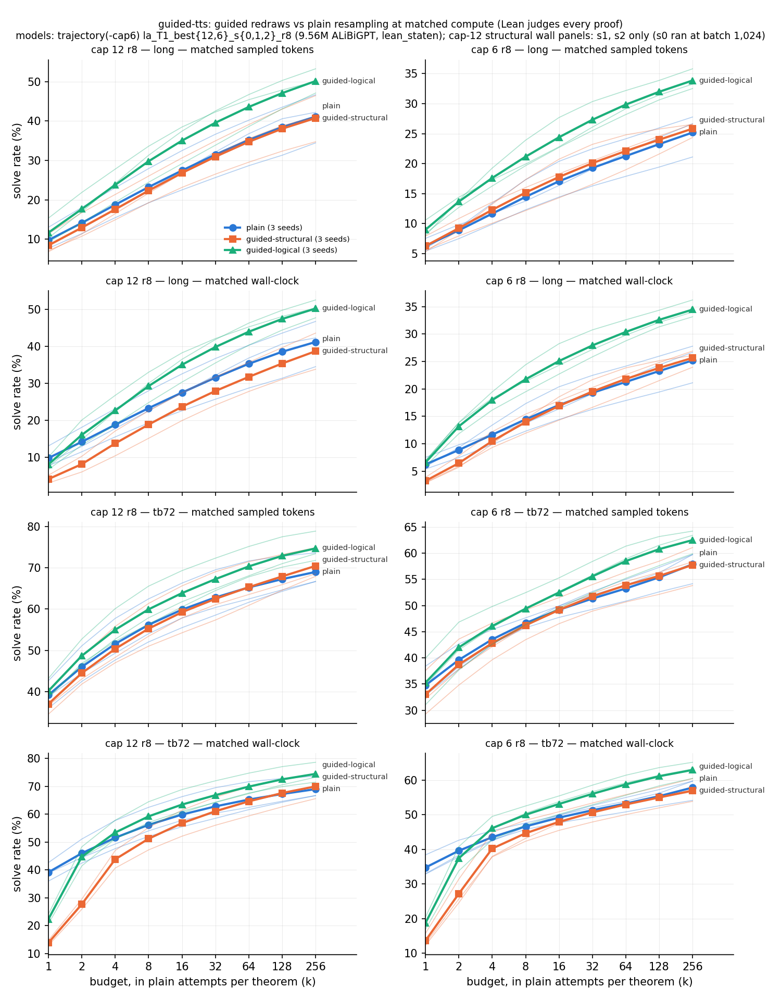

# guided-tts: at matched sampled tokens, redrawing logically wrong steps beats plain resampling on long textbook theorems in 6 / 6 models; redrawing only structural rejections does not

Status: completed and reviewed 2026-10-03. Verdict **stands**. No hard-constraint violation, nothing quarantined. Every
solve count and headline difference reproduces on the reviewer's independent code. The reviewer re-checked 5,211
counted proof texts in Lean and all were accepted; the negative controls fail as they should. The reviewer asks for
five rewordings, applied below. One statement is **not supported as worded**: the whole-proof "agreement" between
the step checker and Lean (Reword 1 below).

Question: at test time, does guided sampling beat plain resampling at **matched compute**? Guided sampling redraws a
rejected step, without replacement. Plain resampling ends the attempt at a rejected step and starts a new one. The run
compares the two on textbook problems with the existing best models. This is a narrowed replication of Robbie's
test-time-scaling result. Brief:
[`proposals/state-env/BRIEF_guided-tts.md`](../../docs/proposals/state-env/BRIEF_guided-tts.md), proposal 24 Part A
([`2026-10-03-guided-sampling.md`](../../docs/proposals/2026-10-03-guided-sampling.md)). No training.

## Configuration

- **Repository.** Fork `dan-pandori/nd-takehome`, branch `dan_guided-tts`. The reviewer notes that the run's commits
  were already on the fork's `origin/dan` before review.
  - Pre-registration `preregistration/guided-tts.md`, commit `8ec7c0a6` (18:10:36Z). It was written before the first
    pod (`gt-p0` created 18:14:47Z) and never edited afterwards.
  - DONE `4dcd0e4f` (21:48Z). Write-up `run_guided_tts.md`, `numbers.md` § guided-tts, `log.md`.
  - Review [`review_guided-tts.md`](https://github.com/dan-pandori/nd-takehome/blob/f88e200f/review_guided-tts.md):
    [`17bf7ada`](https://github.com/dan-pandori/nd-takehome/commit/17bf7ada) §Recount (blind),
    [`f88e200f`](https://github.com/dan-pandori/nd-takehome/commit/f88e200f) §Compare / §Verdict. The reviewer's
    scripts are in `review_gt/` on the fork.
- **Timeline.** Executor Sat 2026-10-03 18:05–21:50 UTC; reviewer 21:50–22:01.
- **Models for every number** (unless a row says otherwise). All are Robbie's `best_model.ALiBiGPT`, 6 × 384,
  **9,560,832 params**, `lean_staten` (environment-assigned names). Each was trained from scratch with Robbie's recipe
  and then given the 8-round T1 expert-iteration ladder. Seeds 0–2.
  - **cap 12** = `trajectory`'s `la_T1_best12_s{0,1,2}_r8.pt`, with Stage 1 on K12 `data/kh/train_k12.jsonl`
    (155,000 rows).
  - **cap 6** = `trajectory-cap6`'s `la_T1_best6_s{0,1,2}_r8.pt`, with Stage 1 on `train_depth3_f0_a1.jsonl`
    (155,000 rows).
- **Problems.** There are 259 theorems; the sha256 of all six files was checked against the pre-registration.
  - textbook72 (dev58 + train14).
  - Charles's release (187): `candidate_v0` 87, `candidate_v1` 72, `batch3` 14, `hand_proved_14` 14.
  - **long** = the release rows with `min_lines` > 10 (90). Other groups: Roy (78), Pelletier (8), batch3 (14),
    ≤ 10 lines (97), 11–20 (67), > 20 (23).
- **Arms, all on one sampler.**
  - *plain*: a rejected action ends the attempt.
  - *guided-structural*: actions the environment rejects are redrawn.
  - *guided-logical*: actions the per-step checker rejects are also redrawn. The checker is `step_check.py`, which
    applies `lean_prefilter`'s rules to each step.
  - Redraws are exact sampling without replacement (Robbie's `_swor_shift`), at most 10 per attempt.
- **Settings, all arms.** k 256 attempts per theorem, T 0.8, `max_steps` 96 accepted actions, `max_action` 512 tokens,
  sample seed 1, batch 2,048 on A40. One exception: best12 s0 structural ran at batch 1,024 after an OOM. The run
  disclosed it and excluded that cell from the wall-clock comparisons.
- **Checker: Lean 4.34.1 core alone** (post-2026-09-27). Every finished proof's literal text goes through `lean_gate`
  with `LEAN_PREFILTER=on`; `nd_verify` is not called. There is no cross-date comparison in this run.
- **Headline curve (pre-registered).** Matched sampled tokens: k' = k · c_plain(t) / c_arm(t) per theorem, unbiased
  pass@k', linear interpolation, capped at 256. The run reports per-seed differences and an IQM over 3 seeds with a
  stratified bootstrap.
- **Pods and cost.** Four A40s at $0.49/h: `gt-p0` 2.70 h, `gt-p1` 2.73 h, `gt-p2` 2.79 h, `gt-p3` 0.85 h. That is
  **9.07 pod-hours, $4.45** of a $10 / 20 h budget (`podbudget`, `~/podhours.log`). The pre-registration estimated
  ≈ 8 GPU-h ≈ $4 plus checker validation and setup.
- **Bucket.** `hf://buckets/dan-pandori/nd-rl/guided-tts/{artifacts/gt,artifacts/guided-tts,data/gt}`. Compute rows
  are in `artifacts/guided-tts/registry/`.

*Figure (executor's): solve rate against budget in plain-equivalent attempts. Columns are cap 12 and cap 6; panels
show long and textbook72, each at matched sampled tokens and at matched wall-clock. Bold lines are the 3-seed mean,
thin lines individual seeds. The cap-12 structural wall-clock panels use s1 and s2 only.*

## Observations

All numbers below were measured on the six models above, judged by Lean alone. The reviewer reproduced them unless
noted.

**Headline: long (90), matched sampled tokens, guided-logical − plain** (pp; per seed s0 / s1 / s2):

| cap | plain at k 64 | logical − plain, k 64 | logical − plain, k 256 | structural − plain, k 64 |
|---|---|---|---|---|
| 12 | 36.8 / 28.7 / 40.2 | +10.0 / +9.9 / +5.2, IQM **+9.1** | +11.1 / +12.7 / +3.4, IQM +10.0 | −1.2 / +0.9 / −1.1, IQM −0.8 |
| 6 | 21.8 / 24.1 / 17.9 | +7.4 / +8.1 / +10.3, IQM **+8.3** | +6.6 / +8.0 / +11.4, IQM +8.4 | +0.8 / +0.7 / +1.1, IQM +0.8 |

- **Guided-logical beats plain on long in 6 / 6 models**: +5.2 to +10.3 pp at 64 plain-equivalent attempts, +3.4 to
  +12.7 at 256.
  - The IQM 95 % intervals differ by method. The executor's bootstrap also resamples attempts and gives
    [+3.7, +13.5] (cap 12) and [+4.1, +14.0] (cap 6). The reviewer's theorem-within-seed bootstrap gives
    [+5.9, +11.7] and [+5.8, +11.6].
  - Every per-seed difference except c12 s2 (+5.2, CI [1.9, 9.0]) clears even the reviewer's wider per-seed band of
    ≈ 4–5 pp. The executor's stated MDD of ≈ 2.7 pp was not independently derived.
  - The falsifier (logical ≤ plain at every k on long) is not met in any of the 6 models.
- **Guided-structural is indistinguishable from plain on long**: |Δ| ≤ 1.2 pp per seed.
- **Other groups, logical − plain at k 64, IQM, cap 12 / cap 6.** Roy (78) +5.2 [+1.0, +9.1] / +7.5 [+2.5, +12.4].
  ≤ 10 lines (97) +2.6 / **+9.7**. 11–20 lines (67) +10.3 / +10.4. textbook72 +5.4 / +4.8. All 259 +5.6 / +7.9. The
  Roy gains and the cap-6 gain on ≤ 10 lines also stand.
  - *Reword 3:* batch3 (n = 14; +11.8 / +13.7) and Pelletier (n = 8; +10.7 / +2.7) are **consistent with** a gain, not
    confirmed. The batch3 IQM intervals reach down to +0.3 and +1.2, and per-seed intervals touch 0 in 4 / 6 models.
- **Matched wall-clock** agrees to within ≈ 0.5 pp on long at k 64: logical +9.1 (cap 12), +8.8 (cap 6); structural
  −3.4 / +0.7. The reviewer's per-seed values are logical +9.4 / +11.5 / +4.9 and +8.0 / +8.4 / +10.8.
  - *Reword 2:* at k = 1, structural loses on wall-clock in 6 / 6 models. Logical loses at cap 12 and is about even at
    cap 6, where s1 and s2 are slightly positive under job seconds that include env and checker time. The executor
    said "every guided arm loses at k = 1"; that holds for 4 / 6 logical cells, not all.
- **Solved@256 attempts** (not compute-matched; all 259; plain / structural / logical): c12 178/185/200, 172/176/190,
  188/193/199; c6 152/158/171, 148/151/173, 134/147/163. Plain on textbook72 is 48 / 48 / 53 (cap 12) and 43 / 43 / 39
  (cap 6). Both are within ±3 of the inherited `trajectory*` x0 numbers, 48 / 49 / 54 and 43 / 41 / 38.
- **Lean re-check (reviewer).** 5,211 distinct accepted texts were re-checked: at least one per solved (model, arm,
  theorem), plus random samples. **0 were rejected.** The negative controls behaved: goal → `False` was rejected
  195 / 200 times (the 5 accepted are theorems whose goal is already `F`), `.1`↔`.2` 100 / 100, `Or.inl`↔`Or.inr`
  96 / 105 (the rest are symmetric disjunctions). Guided-logical produced 0 Lean-rejected finished proofs in 6 / 6
  reads.
- **Step checker vs Lean.** The executor's gate tested 314,541 distinct (state, step) pairs from the plain reads and
  found 0 false rejects and 0 misses. The reviewer's sample agrees: 900 / 900 checker rejects were Lean-rejected and
  180 / 180 passes were Lean-accepted. Scope: atomic `have` steps only, with passes sampled at 25 %.
  - **Not supported as worded (Reword 1).** The write-up says "every Lean-rejected plain/structural proof was flagged;
    no flagged proof was Lean-accepted". That reads as a whole-proof check against Lean, and it is not one. Correct
    statement: **every finished proof the gate rejected was rejected by the prefilter, whose rules the step checker
    shares; Lean itself rejected none. The checker's soundness evidence is the step-level agreement test.** Under
    `LEAN_PREFILTER=on` the whole-proof comparison is circular: e.g. best12 s0 structural logs "rej 20661 (filter
    20661)".
- **Why structural rescues attempts but not solves.** Rescued structural attempts often still carry a logically wrong
  step. Structural reads produce 20,525–30,613 Lean-rejected finished proofs each, against plain's 9,346–17,303.
- **Sampler statistics.**
  - Per-attempt acceptance, plain / structural / logical: cap 12 32.3–38.1 % / 34.8–40.2 % / 42.2–47.6 %; cap 6
    29.7–33.5 % / 33.6–38.0 % / 41.2–44.6 %.
  - 52–59 % of logical attempts end at the 10-rejection cap.
  - Guided-logical rejects 13.8–21.7 % of draws structurally and 10.0–15.8 % logically.
  - A with-replacement redraw would have repeated an already-rejected action with mean probability 0.32–0.40 (cap 12
    logical), 0.51–0.54 (cap 6 logical), and 0.21–0.26 / 0.42–0.46 (structural).
- **Proof length.** On theorems all three arms solve, the shortest accepted guided proof is no longer than plain's, in
  lines or term size. The difference is ≤ 0.5 term atoms on the reviewer's counter. Executor's lines, plain vs logical:
  cap 12 10.93–11.04 vs 10.60–10.89; cap 6 9.90–10.28 vs 9.56–9.99. Executor's term size (`lean_check` inference
  nodes): cap 12 7.31–7.47 vs 7.01–7.33; cap 6 6.32–6.64 vs 6.04–6.43.
- **Compute per arm** (mean over 3 seeds; A40; 0 training steps / tokens). Every guided arm used > 1.25× plain's GPU-s
  and tokens at equal attempts, which is why the comparisons above are at matched budget.

| cap, arm | GPU s (sampling) | sampled tokens | actions | Lean checks | vs plain (GPU s, tokens) |
|---|---|---|---|---|---|
| 12 plain | 792 | 14.7 M | 1.01 M | 17,054 | 1 |
| 12 structural | 2,507 | 27.7 M | 1.82 M | 18,492 | 3.17×, 1.88× |
| 12 logical | 1,729 | 26.2 M | 1.57 M | 22,724 | 2.18×, 1.78× |
| 6 plain | 714 | 11.4 M | 0.73 M | 9,154 | 1 |
| 6 structural | 2,076 | 30.2 M | 1.38 M | 10,606 | 2.91×, 2.65× |
| 6 logical | 1,672 | 30.7 M | 1.30 M | 13,553 | 2.34×, 2.68× |

Peak memory at batch 2,048 was 20.8–42.3 GB per read.

**Expectations against outcomes** (pre-registration `8ec7c0a6`). *Reword 4* moves the misses that only `log.md`
scored into this list.

- Met:
  - Plain textbook72 within ±3 of the inherited numbers.
  - Logical − plain on long ≥ +3 pp in ≥ 2/3 seeds at both caps: 6 / 6, +5.2 to +10.3.
  - Structural close to plain.
  - With-replacement repeat probability 0.2–0.6: 0.21–0.54.
  - The falsifier is not triggered.
- **Missed:**
  - "Little gain on ≤ 10 lines (< +3 pp)" at cap 6: +7.7 / +10.5 / +10.0. Cap 12 met this in 2 / 3 seeds; s0 was
    +3.7.
  - "Structural captures ≥ ½ of logical's gain on long": structural ≈ 0 in 6 / 6. Falsified.
  - "Matched-wall gain < matched-token gain": logical's wall gain was larger in 4 / 6.
  - Plain long k 64 predicted at 0.35–0.6 (cap 12): c12 s1 is 0.287.
  - c_logical / c_plain on long predicted at 1.3–2.5: cap 6 is 2.8–3.3 (cap 12, 1.97–2.33, is in range).
  - Logical gain at k 256 predicted at +2 to +8: 3 / 6 models are above, at up to +12.7.
  - Logical rejection rate of plain steps predicted at 0.5–4 % of draws: measured 3.1–4.8 %.
- Final Lean rejections predicted to fall by ≥ 80 % under guided-logical: they fell by 100 %.

## Limitations and next step

- **Truncation at cap 6.** `max_action` 512 truncates 0.16–0.28 % of plain cap-6 draws, and 1.7–3.2 % of plain cap-6
  attempts end by truncation. That is above the policy's 0.1 % line; the run disclosed this but did not raise the
  cap. Part of the cap-6 gain on ≤ 10 lines (+9.7 vs +2.6 at cap 12) may be recovery from truncation rather than the
  logical check. The reviewer's mitigating check: structural also redraws truncations and gains ≈ 0 on long, so
  truncation recovery does not drive the logical gain there. At cap 6 on ≤ 10 lines, structural gains +1.6, which
  bounds that share as small. Whether a 512-token action is ever a legitimate step is not shown.
- **Checker evidence is step-level only** (Reword 1). The whole-proof check is circular under the prefilter. Rejected
  whole texts are not stored, so the reviewer could not close it.
- **Split overlap (Reword 5).** Two evaluation theorems share a renaming class with the cap-12 Stage-1 set
  `train_k12.jsonl`. They are `tb72_textbook_dev/textbook_3ed45280…` (`P v Q, ~P ⊢ Q`, premise order swapped) and
  `candidate_v0/textbook_9d21fccc…` (`~(P v Q) ⊢ R > ~P`, renamed); both are 7 lines, so both fall in ≤ 10 lines.
  This affects the cap-12 textbook72 and ≤ 10 numbers. It does not affect long or any arm difference, because every
  arm sees the same theorems. Cap-6 Stage-1 and the ladder target and transfer sets have 0 overlaps.
- **Batch.** One cell (best12 s0 structural) ran at batch 1,024. It is excluded from wall-clock comparisons, which the
  reviewer judges adequate.
- **Small groups.** batch3 and Pelletier are too small to call per seed. `hand_proved_14` is solved by no arm.
- **Next measurements (reviewer).**
  1. One plain read with `LEAN_PREFILTER=off` (or `shadow`) on one model, ≈ 15 A40-min, so Lean itself judges the
     flagged whole proofs.
  2. A plain and logical pair at cap 6 with `max_action` ≈ 1,024 on one seed. It would measure how much of the cap-6
     ≤ 10-line gain is truncation recovery.
  3. An arm that redraws structural rejections but stops an attempt at its first flagged logical step. It would show
     whether logical redraws are needed, or whether early termination alone helps.
