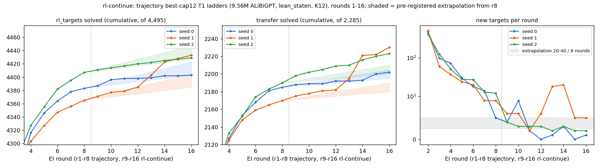

# rl-continue: eight more EI rounds on the cap-12 ladders raise group C on 3 / 3 seeds ("saturated" falsified); the target-count jump is one seed picking up excluded middle

Status: completed and reviewed 2026-10-04. Verdict **stands**. No hard-constraint violation, nothing quarantined. The
reviewer reproduced every pre-registered count from the pulled files with independent code (`review_rc/`). They
re-checked 1,669 counted proofs in Lean and all were accepted; four negative controls behaved. Four rewordings, all
applied below. Two statements are **not supported as worded**: "s0 solves 1 of [the 34 excluded-middle targets] at r16,
s2 9" (it is 0 and 8; Reword 1) and "its new group C solves are classical too" (13 of 16; Reword 2).

Question: is the cap-12 RL saturated? `trajectory`'s three cap-12 T1 ladders added few new targets in r6–r8
(+18 / +14 / +5, +20 / +9 / +9, +27 / +13 / +12). Do eight more rounds on the same targets add only a few targets and
leave group C where it is, or does the ladder keep finding new things? Brief:
[`BRIEF_rl-continue.md`](../../docs/proposals/state-env/BRIEF_rl-continue.md). Its cap-6 companion is
[rl-continue-cap6](../2026-10-03-rl-continue-cap6-group-c-rises-on-3-of-3-seeds-saturation-falsified-cap-6-still-below-cap-12/README.md),
which used this run's r9–r16 as its (then unreviewed) comparator; those cap-12 numbers are now reviewed and unchanged.

## Configuration

- **Repository.** Fork `dan-pandori/nd-takehome`, branch `dan_rl-continue`.
  - Pre-registration `preregistration/rl-continue.md`, commit `8cf9ccfe` (Sat 2026-10-03 17:23:14Z). The first pod was
    created at 17:25:05Z (`~/pods.log`); the first ladder line is at 17:26:30Z. The file was not edited afterwards.
  - DONE `4c306721`. Write-up `run_rl_continue.md`, `numbers.md` § rl-continue, `log.md`, figure
    `figures/rc_rounds.png`. Analysis `rc_analysis.py`, `rc_compute.py`; pod scripts `pod/rc/`.
  - Review [`review_rl-continue.md`](https://github.com/dan-pandori/nd-takehome/blob/41814898/review_rl-continue.md):
    [`450aa793`](https://github.com/dan-pandori/nd-takehome/commit/450aa793) §Recount (blind, plus reviewer kit
    `review_rc/`), [`41814898`](https://github.com/dan-pandori/nd-takehome/commit/41814898) §Compare / §Verdict.
- **Timeline.** Executor Sat 2026-10-03 17:19 – Sun 03:37 UTC; pods 17:25–03:33; reviewer Sun 03:38–03:56.
- **Models for every number.** `trajectory`'s best-cap12 T1 ladders `la_T1_best12_s{0,1,2}`: Robbie's `ALiBiGPT`,
  **9,560,832 params** (`best-state` recipe), `lean_staten`, trained from scratch on K12 (`data/kh/train_k12.jsonl`,
  cap 12; Stage 1 1,200 s on an A40). Each then got EI r1–r8 in `trajectory` (RTX A6000) and **r9–r16 here** (A40).
  "r8" = `trajectory`'s `la_T1_best12_s*_r8.pt`; "pend" = its end-of-pretraining checkpoint.
- **Ladder.** `state_ladder_ei.py --resume --start_round 9` (and `--start_round 13` after the r12 reads), with
  `trajectory`'s flags: k 32, T 0.8, 600 fine-tune steps per round at lr 3e-4, replay 20,000 K12 records, 4,495
  `rl_targets`, 2,285 `transfer` (sampled, never trained). Batch 2,048 on s0 / s1, 1,024 on s2 (as each ran r8); no
  OOM retries. Sampling seeds `1000·s + r`; the replay RNG restarts at r9 and r13 (pre-registered).
- **Seamlessness (reproduced by the reviewer).** r9 sampled from checkpoints with md5 `f9afd386…` / `c85481f9…` /
  `3b62784b…`, equal to `trajectory`'s r8. The resumed proof counts (229,482 / 271,490 / 250,560) equal the `found_8`
  line counts. Every r8 proof is still in `found_16`; no r8-solved target or transfer theorem is lost. r13 started
  from r12 checkpoints whose md5s equal the registry's `ckpt_saved` rows.
- **Read-outs.** Plain only (the guided-by-default policy is dated 2026-10-04, after these reads): k 256, T 0.8,
  `max_action` 512, `max_steps` 96 (`trajectory`'s settings, held fixed against its r8 reads).
  - textbook72 and holdout250 at r12 and r16, sample seed 1 (`x1`). r8 values are `trajectory`'s files.
  - rr600 rows with `L_true_lb` 13–16 (400 theorems, `data/rc/rr600_13_16.jsonl`, **k 64**) and `transfer_long2` (21,
    k 256), sample seed 0, batch 512, read here at r8 and r16 at identical settings.
  - Group C is `trajectory`'s per-seed set (seed-0 samples unsolved at pend and at r8, tb72 + h250): 36 / 35 / 28
    theorems (tb72 24 / 22 / 17, h250 12 / 13 / 11).
  - Budget cuts against the brief: r12 and r16 sample-seed-0 tb72 / h250 reads dropped; rr600 13–16 at k 64 (not
    comparable with `best-state`'s k 256); rr600 / long2 at batch 512; s2's r16 holdout250 retried at batch 1,024
    after an OOM (a re-draw).
- **Checker: Lean alone** on both sides (the ladder judges through `lean_judge.verify_text`; reads through
  `state_eval.py` / `lpool_reread.py`). `nd_verify` is unmodified and unused as a judge. No comparison crosses the
  2026-09-27 change.
- **Splits** (renaming class: atom permutations, F = falsum, premise order ignored). textbook72 has 1 class overlap
  with replay (`textbook_3ed45…`, in no group C); holdout250, long2 and rr600 13–16 have none. The transfer pool has
  2 class overlaps with replay and 2 with `rl_targets`, inherited; none is among any seed's new transfer solves. 0 exact
  prompt overlaps anywhere.
- **Pods and cost.** Three NVIDIA A40s at $0.49/h: `rc-s0` 10.15 h ($4.97), `rc-s1` 10.13 h ($4.96), `rc-s2` 9.69 h
  ($4.75). That is **29.96 pod-hours, $14.68** of a $15 / 30 h budget (`podbudget`, `~/podhours.log`); the ceiling
  was extended to 30.4 h within $15 to finish two holdout250 reads. Pre-registration estimate ≈ $15.5 (3 × ≈ 10.5 h).
- **Bucket.** `hf://buckets/dan-pandori/nd-rl/rl-continue/{ckpts,artifacts}`. r9–r16 checkpoints are in
  `ckpts/rc/ladder/` (r16 is the control arm for proposal 23); found sets and mixes in
  `artifacts/rc/la_T1_best12_s*/`.



*Figure (executor's): cumulative targets and transfer theorems by round, r1–r8 from `trajectory`, r9–r16 from this
run. The left and middle panels zoom to r4+ (r1–r3 lie below the axis).*

## Observations

All numbers are on the cap-12 ladders above, under Lean alone, and the reviewer reproduced them unless noted.

**Ladder, r8 → r16:**

| quantity | s0 | s1 | s2 | pre-registered | scored |
|---|---|---|---|---|---|
| `targets_cum` (of 4,495) | 4,383 → 4,403 | 4,365 → 4,433 | 4,407 → 4,429 | ≈ 4,405–4,445 | — |
| **new targets r9–r16** | **+20** | **+68** | **+22** | +20 to +40 | s0, s2 hit (bottom edge); s1 **miss** |
| new transfer (of 2,285) | +17 | +60 | +33 | +10 to +20 | s0 hit; s1, s2 **miss** (above) |
| new targets per round r9…r16 | 4 9 2 0 1 3 0 1 | 6 6 2 6 18 20 5 5 | 4 3 3 3 2 3 2 2 | mostly ≤ 8 by r13–r16 | s0, s2 hit; s1 **miss** |
| target sample accuracy | 0.918 → 0.937 | 0.918 → 0.944 | 0.924 → 0.942 | 0.92–0.95 | hit |

- **Falsifier 1** (≥ 60 new targets on ≥ 2 / 3 seeds) **does not fire**: only s1 reaches it. On target counts, s0 and
  s2 look saturated (≤ 3 per round after r11 on s0, ≤ 4 after r10 on s2).
- **s1's burst is the `excluded_middle` schema.** Of s1's 48 new targets in r13–r16, 35 have `L_true` 9 and 34 of
  those are A ∨ ¬A instances (the textbook `excluded_middle` schema in `rl_targets.jsonl`). Of the pool's 40
  `excluded_middle` targets, s1 holds 1 at r8 and 38 at r16; s2 goes 2 → 11; s0 stays at 1. **Reword 1:** of the 34
  excluded-middle targets, s0 solves **0** and s2 **8** at r16. (The executor's "1 / 9" counts the 35 `L_true`-9
  targets; the extra one, `la_rl_targets_329`, is not an excluded-middle instance and both seeds solve it.)
- 36 of s1's 68 new targets have an `X ∨ ¬X` line in their first proof (r13 11 / 18, r14 16 / 20); s0 0 / 20, s2
  8 / 22. Across all accepted rows the share of such proofs stays flat (s1 2.2–2.6 %), so the new-target solutions,
  not the bulk, carry it. The other ≈ 30 of s1's +68 are spread over other schemas. The 96 new targets (union over
  seeds) share no theorem across all three seeds.
- Proof length of the first proof of each new target (reviewer): lines median 20.5 / 17 / 17 against `L_true` median
  9.5 / 9 / 9 (no proof shorter than `L_true`); **term size** (Expr nodes) median 72.5 / 70 / 96.5, range 19–396. The
  executor reported no term sizes, which the policy requires; these are the reviewer's.
- Ladder in-loop truncation + step cap: 0.19–0.47 % per round.

**Group C, plain read** (pass@256 at sample seed 1, mean over each seed's C theorems):

| | s0 | s1 | s2 | mean |
|---|---|---|---|---|
| C solved, r8 → r12 → r16 | 3 → 5 → 6 of 36 | 1 → 8 → 17 of 35 | 1 → 5 → 4 of 28 | |
| C pass@256 r8 → r12 → r16 | 0.083 → 0.139 → **0.167** | 0.029 → 0.229 → **0.486** | 0.036 → 0.179 → **0.143** | 0.049 → 0.265 |
| Δ r16 − r8 | +0.083 | +0.457 | +0.107 | **+0.216** |
| r16 C pass@8 / pass@1 | 0.081 / 0.035 | 0.257 / 0.144 | 0.081 / 0.044 | |

- **Falsifier 2 fires, and "saturated" as pre-registered is falsified.** The seed-mean rise, +0.216, exceeds the r8
  seed spread 0.055, 3 / 3 seeds rise, and s0's and s2's rises each exceed 0.055 on their own.
- **Reword 4:** the large gain is s1's. On s0 and s2 the C gain is 3 theorems each at k 256 (s2 also lost one 1 / 256
  r8 solve, `textbook_920bfc…`). What makes it more than a re-draw is pass@8, which rises from 0.003 to 0.081 and from
  0.001 to 0.081 (≈ 25–75×). So: not saturated on group C at k 256 on any seed; large on one seed.
- Base reachability (reviewer): pend's independent `x1` draw solves 0 / 99 C theorems. Of s1's 17 r16 C solves, 7 (six
  h250 A ∨ ¬A instances — `la_transfer_1424, 1453, 1572, 478, 795, 956` — and `textbook_a104fab…`) were solved by no
  pend or r8 read of any seed on either draw; s2 also solves `la_transfer_956` and `textbook_a104fab…`. Most other C
  solves were within another seed's r8 reach (C is per-seed).
- s1's 16 new C solves include 7 A ∨ ¬A instances, Peirce's law and (P → Q) ∨ (Q → P), plus two Peirce-shaped h250
  instances. **Reword 2:** 13 of the 16 are classical; three are intuitionistically valid (`textbook_48e308…` ⊢ F,
  `textbook_94b2fb…` the S combinator, `la_transfer_205` distribution).
- An s1 r16 proof of a holdout250 excluded-middle instance (Lean-accepted; the reviewer re-ran it: axioms `propext`,
  `Classical.choice`, `Quot.sound`):

  ```lean
  theorem t (P Q R S : Prop) : ((R ∧ S) ∨ (¬(R ∧ S))) := by
    have n8 : (¬(¬((R ∧ S) ∨ (¬(R ∧ S))))) := (fun (n1 : (¬((R ∧ S) ∨ (¬(R ∧ S))))) => by
      have n5 : (¬(R ∧ S)) := (fun (n2 : (R ∧ S)) => by
        have n3 : ((R ∧ S) ∨ (¬(R ∧ S))) := Or.inl n2
        have n4 : False := n1 n3
        exact (n4 : False))
      have n6 : ((R ∧ S) ∨ (¬(R ∧ S))) := Or.inr n5
      have n7 : False := n1 n6
      exact (n7 : False))
    have n9 : ((R ∧ S) ∨ (¬(R ∧ S))) := Classical.byContradiction (fun hh => n8 hh)
    exact n9
  ```

  The shortest r16 proofs of s1's six never-before-solved h250 C theorems are 9 lines, term size 25–67.

**Other read-outs** (solved / n):

| seed | textbook72 x1 r8 / r12 / r16 | holdout250 x1 r8 / r12 / r16 | rr600 13–16 (k 64, x0) r8 / r16 | long2 (x0) r8 / r16 |
|---|---|---|---|---|
| s0 | 48 / 51 / 51 | 240 / 239 / 240 | 377 / 382 | 21 / 21 |
| s1 | 48 / 52 / **57** | 236 / 241 / **246** | 362 / 370 | 20 / 21 |
| s2 | 53 / 58 / 56 | 237 / 239 / 239 | 367 / 376 | 20 / 20 |

- textbook72 within ±3 of r8: hit on s0, s2 (+3 each), **miss** on s1 (+9). holdout250 within ±3: hit on s0, s2,
  **miss** on s1 (+10). rr600 13–16 within ±10 and long2 within ±1: hit on all seeds. rr600 union over seeds 390 → 389.

**Truncation (Reword 3; policy limit ≈ 0.1 % per reported stratum).** The executor's "0–0.54 %" is the largest
*whole-read* fraction, and the inherited `best-state` diagnostic ("≤ 2 textbook problems") does not hold here: at
r16 the cut samples spread over 18 / 23 / 9 tb72 rows. Per stratum ("action truncated" + step cap):

| stratum (r16) | cut-off s0 / s1 / s2 |
|---|---|
| textbook72 | 0.39 / 0.54 / 0.13 % |
| tb72 group C | 0.52 / **1.03** / 0.16 % |
| h250 group C | 0.75 / 0.69 / 0.04 % |
| single tb72 rows | up to 6.6 % |
| rr600 13–16 | up to 0.73 % (L 13, s2) |
| long2 | up to 0.33 % |

Most reported strata exceed the policy limit, at r8 as well as r16 (settings inherited from `trajectory`). The cap
biases C solve counts down at both endpoints, so the falsifier-2 verdict is not at risk, but the absolute levels are
lower bounds.

**Lean re-check (reviewer's renderer + `#print axioms`).** 1,669 / 1,669 accepted: the first proof of every new target
plus 100 random r9–r16 target rows per seed (120 / 168 / 122); every new transfer first proof plus 30 random
(47 / 90 / 63); every proof of every C theorem solved at r16 plus 100 tb72 and 50 rr600 / long2 proofs
(412 / 457 / 190). Controls: 60 / 60 untouched counted proofs pass; 0 / 200 run-recorded Lean rejections pass; 0 / 60
proofs paired with another theorem pass; `sorry` fails; 1 / 60 `Or.inl` ↔ `Or.inr` flips pass (benign).

**Compute** (per seed, registry rows, reviewer's sums; A40):

| seed | ladder r9–r16 GPU-s | gen tokens | attempts | Lean checks | train steps / tokens |
|---|---|---|---|---|---|
| s0 | 33,248 | 478.5 M | 1,793,960 | 1,564,866 | 4,800 / 905.5 M |
| s1 | 32,830 | 481.7 M | 1,793,960 | 1,560,787 | 4,800 / 904.9 M |
| s2 | 31,457 | 469.8 M | 1,793,960 | 1,569,404 | 4,800 / 883.3 M |

- Reads: 18,984 GPU-s over all seeds (5.28 GPU-h). The executor's per-seed figures (33,261 / 32,844 / 31,471 ladder;
  reads 6,074 / 6,826 / 6,084) include 13–14 s of job-level rows. Read rows carry the *sample* seed in `seed`, so
  per-training-seed read compute has to be split by `ckpt`.
- Round time grows 3,660 → 4,635 s. Seeds are within 1.06× of each other on every metric; seeds are not arms, so the
  1.25× flag does not apply.

## Rewordings applied (from the review)

1. "34 new targets are excluded-middle instances (s0 solves 1 of them at r16, s2 9)" → s0 solves **0** and s2 **8** of
   the 34; the 1 / 9 are of the 35 `L_true`-9 targets. **Not supported as worded** (`numbers.md` has it right).
2. "Its new group C solves are classical too" → 13 of the 16; three are intuitionistic. **Overstated.**
3. Cut-offs are reported per stratum, up to 1.03 % in group C and 6.6 % on single rows, above the policy's ≈ 0.1 %;
   the bias is downward on C at both endpoints.
4. "Not saturated on the hard theorems" → not saturated on group C at k 256 on any seed; on s0 and s2 the gain is 3
   theorems each (pass@8 ≈ 25–75× higher); the large gain is s1's.

Minor: `numbers.md` lists the r12 seed-1-only cut but not the dropped r16 x0 reads (`log.md` does). Pod-hours and
dollars come from `podbudget`, not from pulled files.

## Interpretation (not a finding)

The cap-12 ladder at r8 was not saturated on the pre-registered quantity: eight more rounds made a few previously
unreached group-C theorems reachable on every seed. On target counts two of three seeds look flat, and the third
escaped by discovering one classical schema (excluded middle via double-negation elimination) at r13–r14, which then
carried into held-out A ∨ ¬A instances no base or r8 read had solved. With n = 3 one cannot say how often such an
escape happens, or whether s0 / s2 would find it with more rounds. Together with
[rl-continue-cap6](../2026-10-03-rl-continue-cap6-group-c-rises-on-3-of-3-seeds-saturation-falsified-cap-6-still-below-cap-12/README.md),
both caps keep gaining on group C past r8; cap 6's gap to cap 12's r16 (77 / 116 / 102 targets) now rests on a
reviewed comparator.

## Limitations and next step

- n = 3 training seeds, one continuation each, each compared with its own r8. The burst is on one seed.
- Plain reads only, at one sample seed for tb72 / h250; rr600 13–16 at k 64.
- Truncation above policy in most reported strata (inherited settings).
- Next (reviewer):
  1. Is excluded middle reachable for s0 / s2 with more rounds, or a seed-specific discovery? Continue s0 and s2 from
     r16 for 8 rounds, or seed-swap (inject s1's r14 accepted LEM proofs into s0's mix as a replay-only control), with
     the 40-instance `excluded_middle` count as the pre-registered read-out.
  2. Re-read r8 and r16 group C at `max_action` / `max_steps` doubled to bound the cap bias.
  3. A guided read-out of the r16 checkpoints (policy 2026-10-04).
  4. More seeds: the target-count verdict rests on one seed escaping.
