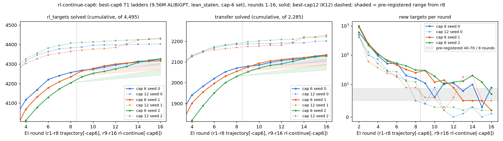

# rl-continue-cap6: eight more EI rounds on the cap-6 ladders raise group C on 3 / 3 seeds ("saturating" falsified); cap 6 has not yet reached cap 12, but the gap narrowed on every seed

Status: completed and reviewed 2026-10-04. Verdict **stands**. No hard-constraint violation, nothing quarantined. The
reviewer reproduced every count in the write-up from the raw files with independent code. They re-checked 1,864
proofs in Lean and all were accepted; every negative control was rejected. The reviewer asks for five rewordings, all
applied below. One statement is **not supported as worded**: "17 theorems never solved at r8 by any seed" (Reword 1).

Question: does cap-6 RL converge towards cap 12's ceiling, or stop below it? `trajectory-cap6`'s three T1 ladders were
still adding targets at r6–r8. This run continues them for rounds 9–16 on the same 4,495 `rl_targets` and reads group C
at r16. It is the cap-6 companion to `rl-continue`, which runs the same protocol on cap 12. Brief:
[`BRIEF_rl-continue-cap6.md`](../../docs/proposals/state-env/BRIEF_rl-continue-cap6.md) (with
[`BRIEF_rl-continue.md`](../../docs/proposals/state-env/BRIEF_rl-continue.md)).

## Configuration

- **Repository.** Fork `dan-pandori/nd-takehome`, branch `dan_rl-continue-cap6`.
  - Pre-registration `preregistration/rl-continue-cap6.md`, commit `3889cde0` (Sat 2026-10-03 17:45:00Z). The first
    pod was created at 17:45:39Z (`~/pods.log`), and the budget was registered at 17:45.
  - DONE `d21e9f5f`. Write-up `run_rl_continue_cap6.md`, `numbers.md` § rl-continue-cap6, `log.md`, figure
    `figures/rc6_rounds.png`.
  - Review [`review_rl-continue-cap6.md`](https://github.com/dan-pandori/nd-takehome/blob/04bcf7a1/review_rl-continue-cap6.md):
    [`ffae6969`](https://github.com/dan-pandori/nd-takehome/commit/ffae6969) §Recount (blind),
    [`b475c624`](https://github.com/dan-pandori/nd-takehome/commit/b475c624) §Compare / §Verdict,
    [`04bcf7a1`](https://github.com/dan-pandori/nd-takehome/commit/04bcf7a1) corrects the rounds-to-close estimate. The
    reviewer's scripts are in `review_rc6/` on the fork.
- **Timeline.** Executor Sat 2026-10-03 17:45 – Sun 03:10 UTC; pods 17:45–03:06; reviewer Sun 03:12–03:26.
- **Models for every number.** `trajectory-cap6`'s T1 ladders, seeds 0–2. Each is Robbie's `ALiBiGPT`, 6 × 384,
  **9,560,832 params**, `lean_staten`, trained from scratch on the cap-6 set (`data/p2/train_depth3_f0_a1.jsonl`,
  155,000 records, md5 `29276f24…`) with a 1,200 s A40 Stage 1. Each then got EI r1–r8 in `trajectory-cap6` and
  **r9–r16 here**.
  - Checkpoints: `ckpts/rc6/ladder/la_T1_best6_s{0,1,2}_r{9..16}.pt`. The r8 baselines are `trajectory-cap6`'s
    `la_T1_best6_s*_r8.pt`.
  - **Cap-12 comparator** (dashed in the figure): `trajectory` / `rl-continue`'s `la_T1_best12_s*`, with the same
    architecture and format on K12. Its r9–r16 round JSONs come from `rl-continue`, which **has not been reviewed**.
    They are copied into `artifacts/rc6/cap12_rounds/`, and the reviewer did not recount them.
- **Ladder.** `state_ladder_ei.py --resume --start_round 9`, with `trajectory-cap6`'s flags:
  - k 32, T 0.8, 600 fine-tune steps per round;
  - replay of 20,000 cap-6 records;
  - batch 2,048 on every seed and round (no OOM retry).

  Sampling seeds `1000·s + r` continue the run; the replay RNG restarts at r9 (pre-registered).
- **Seamlessness (reproduced by the reviewer).**
  - The checkpoints r9 samples from have md5s `586baf0b…` / `a8dfc589…` / `1b1843d5…`, equal to `trajectory-cap6`'s
    r8 uploads.
  - The resumed proof counts (72,175 / 48,085 / 36,334) equal the `found_8.jsonl` line counts.
  - Every r8 proof is still in `found_16`. No r8-solved target or transfer theorem is lost.
- **Read-outs.** Plain only (see Reword 4): k 256, T 0.8, sample seed 1, batch 2,048, `max_action` 512, `max_steps` 96.
  These are `trajectory-cap6`'s settings, held fixed against its r8 reads.
  - Pools: textbook72 in full, and holdout250 **restricted to each seed's group-C theorems** (24 / 21 / 26). The
    restriction was a budget fallback, the default in `QUESTIONS.md`.
  - Group C is `trajectory-cap6`'s per-seed set: seed-0 samples unsolved at `pend` and at r8, tb72 + h250. It has
    52 / 52 / 60 theorems, recomputed by both executor and reviewer.
- **Checker: Lean 4.34.1 core alone** on both sides (state-env Lean gate; `trajectory-cap6`'s r1–r8 are Lean-alone
  too). `nd_verify` is unmodified and unused as a judge. There is no comparison across the 2026-09-27 change.
- **Splits.** The r16 fine-tune mixes contain 0 textbook72 or holdout250 renaming classes. textbook72, holdout250 and
  h250-C overlap neither replay nor `rl_targets`. The transfer pool has 2 inherited class overlaps with `rl_targets`
  (`la_transfer_307`, `_842`). Both were solved in r1–r3, so neither counts among the new transfer theorems.
- **Pods and cost.** Three NVIDIA A40s at $0.49/h: `rc6-s0` 9.35 h ($4.58), `rc6-s1` 7.18 h ($3.52), `rc6-s2` 7.40 h
  ($3.63). That is **23.93 pod-hours, $11.73** of a $12 budget (`podbudget`, `~/podhours.log`). The pre-registration
  estimated ≈ $11.2. The ceiling was extended from 24 h to 24.45 h, still within $12.
- **Bucket.** `hf://buckets/dan-pandori/nd-rl/rl-continue-cap6/{ckpts,artifacts,data}`. Compute rows are in
  `artifacts/rl-continue-cap6/registry/`.

*Figure (executor's): cumulative targets and transfer theorems by round. The cap-6 ladders are solid: r1–r8 from
`trajectory-cap6`, r9–r16 from this run. The best-cap12 ladders are dashed (unreviewed for r9–r16).*

## Observations

All numbers are on the cap-6 ladders above, under Lean alone, and the reviewer reproduced them unless noted.

**Ladder, r8 → r16** (s0 / s1 / s2):

| quantity | s0 | s1 | s2 | pre-registered | scored |
|---|---|---|---|---|---|
| `targets_cum` (of 4,495) | 4,257 → 4,326 | 4,235 → 4,317 | 4,204 → 4,327 | ≈ 4,275–4,325 | — |
| **new targets r9–r16** | **+69** | **+82** | **+123** | +40 to +70 | **miss** on s1, s2 (above) |
| new transfer (of 2,285) | +60 | +80 | +98 | +30 to +60 | **miss** on s1, s2 (above); s0 at the edge |
| new targets per round r9…r16 | 11 6 11 11 8 10 3 9 | 30 12 14 9 5 5 5 2 | 30 19 10 12 13 20 12 7 | ≤ +8 / round on most seeds by r14–r16 | **miss**: met on s1, mixed on s0, not met on s2 |
| target sample accuracy | 0.902 → 0.918 | 0.899 → 0.918 | 0.889 → 0.903 | 0.90–0.93 | met |
| r16 below cap 12's r8 (4,383 / 4,365 / 4,407) | yes | yes | yes | below on all three | met |

- **Falsifier 1** (≥ 100 new targets on ≥ 2 / 3 seeds) **does not fire**: only s2 reaches 100. The mean is +91.3 new
  targets (range 69–123).
- The new targets are mostly `L_true` 8–10. Distinct proofs at r16 are 295,168 / 202,492 / 168,090. 169 / 178 / 168
  targets remain unsolved, 12 of them `L_true` 14 on every seed.
- Proof length of the first proofs of the new targets: median `L_true` 10 / 10 / 9, median lines 14 / 12 / 14. No
  proof is shorter than `L_true`. Term size (Expr nodes of the elaborated value, reviewer's measure) has median
  78 / 48.5 / 49, range 18–489.

**Group C at r16, plain read** (sample seed 1, k 256):

| | s0 | s1 | s2 | mean |
|---|---|---|---|---|
| C solved r8 → r16 | 4 → 10 of 52 | 2 → 8 of 52 | 3 → 11 of 60 | |
| C pass@256 r8 → r16 | 0.077 → **0.192** | 0.038 → **0.154** | 0.050 → **0.183** | Δ **+0.121** |
| C pass@8 r8 → r16 | 0.003 → 0.102 | 0.002 → 0.105 | 0.002 → 0.110 | |
| C pass@1 r8 → r16 | 0.0004 → 0.048 | 0.0002 → 0.036 | 0.0003 → 0.060 | |
| summed successes over C (of 256 per theorem) | 5 → 637 | 3 → 472 | 4 → 920 | |
| textbook72 solved r8 → r16 | 43 → 45 | 43 → 41 | 39 → 40 | within ±3 (met) |

- **Falsifier 2 fires, and "saturating" is refuted** by the run's own pre-registered test. The seed-mean rise, +0.121, is
  3.2× the r8 seed spread (0.038), and 3 / 3 seeds rise. Per seed the net gain is +6 / +6 / +8 theorems (gained
  6 / 7 / 11, lost 0 / 1 / 3). That is above the 2–4 C theorems the r8 re-draw itself "solved". The pre-registered
  "group C unchanged" is a **miss**.
- **Corroboration from an independent sample stream** (reviewer). The ladders' own per-round transfer sampling (k 32,
  never trained on) had solved 2 / 0 / 3 of the h250-C theorems by r8 and 6 / 6 / 10 by r16. The first solves are
  spread over r10–r16.
- **Base reachability** (reviewer). None of the 29 seed–theorem pairs solved at r16 was solved at `pend` on a second
  base draw (x1) by the same seed. Only 2 of the 23 theorems were solved at `pend` x1 by any seed. At k = 256 × 2 base
  draws, the gain is not a base-model re-draw.
- Across seeds, 23 distinct C theorems are solved at r16: 29 seed–theorem pairs, 24 of them at 0 / 256 at r8. Two are
  solved by all three seeds (`la_transfer_1802`, `la_transfer_205`). **Reword 1:** 17 of the 23 were never solved at
  r8 *by a seed whose group C contains them*. Against all three r8 models' sample-seed-1 reads, **9 of 23** were solved
  by none. The other 8 were in another r8 model's reach, where they sit in groups A / B.
- The shortest r16 C proofs are 6–24 lines. Their size is 4–20 by `lean_check`'s inference-node count (executor) and
  20–181 Expr nodes (reviewer); these are different measures (Reword 4).

**Cap 6 against cap 12.** The cap-12 r9–r16 numbers are inherited from `rl-continue`, are **unreviewed**, and were
not recounted.
- Cap 12 went from r8 4,383 / 4,365 / 4,407 to r16 4,403 / 4,433 / 4,429.
- Cap 6's r16 is 77 / 116 / 102 targets below cap 12's r16. At r8 the gap was 126 / 130 / 203, so it **narrowed on
  every seed**.
- Over r13–r16, cap 6 still added 2–20 targets per round. Cap 12 added 0–5 per round, except s1 (18, 20).
- **Reword 5:** cap 6 "has not yet reached" cap 12. "Stops below it" is not shown.
- At the r13–r16 rates (cap 6 +30 / +17 / +52 over four rounds, cap 12 +5 / +48 / +9), s0 and s2 would close the gap
  in ≈ 12 and ≈ 10 more rounds if cap 12 kept its pace. s1 would not close it.
- Transfer: cap 6's r16 (2,131 / 2,135 / 2,129) is still below cap 12's r8 (2,185 / 2,170 / 2,190).

**Truncation (Reword 3; policy limit ≤ 0.1 % per reported stratum).** The read settings were held fixed against the r8
baseline, so the comparison is fair. The cut-off fraction ("action truncated" + step cap) is far above the policy
limit:

| stratum | cut-off |
|---|---|
| C, s0 (r8 → r16) | 5.9 → 10.9 % |
| C, s1 | 4.6 → 3.4 % |
| C, s2 | 5.7 → 2.5 % |
| h250-C alone, s0 r16 | **18.7 %** |
| textbook72 | 1.0–3.7 % |
| ladder in-loop sampling | 0.4–1.1 % per round |

The cap biases pass@k down on both sides. On s0 the cut-off rose at r16, so it works against falsifier 2. **The
absolute group-C levels are lower bounds.** `best-state`'s cap diagnostic suggests that a larger action budget barely
moves truncation, which points to non-terminating actions.

**Lean re-check (reviewer, Lean 4.34.1, axioms ⊆ {propext, Classical.choice, Quot.sound}).** 1,864 / 1,864 accepted,
with no render failures. They comprise:
- the first proof of every new target, plus 100 random r9–r16 target proofs per seed;
- the first proof of every new transfer theorem, plus 30 random per seed;
- every proof of every C theorem solved at r16 (662), plus 100 random tb72 proofs per seed.

Controls were all rejected: 0 / 77 run-recorded `LEANREJ` samples, 0 / 60 `Or.inl` ↔ `Or.inr` flips, 0 / 60 proofs
mismatched with another theorem, and a bare `sorry`.

**Compute** (per seed, from registry rows, A40; reviewer's sums include the r16 reads):

| seed | GPU-s | gen tokens | attempts | Lean checks | train steps | train tokens |
|---|---|---|---|---|---|---|
| s0 | 33,464 | 431.0 M | 1,818,536 | 1,477,672 | 4,800 | 714 M |
| s1 | 25,666 | 399.7 M | 1,817,768 | 1,441,307 | 4,800 | 656 M |
| s2 | 26,517 | 418.5 M | 1,819,048 | 1,391,675 | 4,800 | 682 M |

- s0 used 1.30× s1's GPU-seconds on an identical protocol, so the difference is pod speed. Seeds are not arms, so the
  1.25× flag does not apply.
- Round time grows from r9 to r16 on every seed (s0 3,542 → 4,535 s).
- The registry double-counts ≈ 2 s per fine-tune (a parent-phase row), which inflates the totals by ≈ 0.1 %.

## Rewordings applied (from the review)

1. "17 theorems never solved at r8 by any seed" → "17 never solved at r8 by a seed whose group C contains them; 9 of 23
   solved by none of the three r8 models (sample seed 1)". **Not supported as worded.**
2. The misses are called misses: new targets and new transfer above range on s1 / s2; the per-round decline missed on
   s2; group C not unchanged. The holdout250 "±5 of r8" expectation was **not evaluated**, because only the C subset
   was read.
3. Truncation is reported per stratum, and the group-C levels are lower bounds under a 3–19 % cut-off.
4. The read-outs are labelled "plain". The guided read-out policy (2026-10-04) landed the day these reads ran, and no
   guided number exists. The term-size measure is named.
5. "Cap 6 stays below cap 12" is accurate at r16, but the gap narrowed on every seed while cap 6 was still adding
   2–20 targets per round. "Has not yet reached", not "stops below".

## Interpretation (not a finding)

Eight more rounds of EI on cap 6 made previously unreached theorems reachable: group C pass@1 rose by about two
orders of magnitude, and a second base draw does not reach them. This cuts against reading the cap-6 ladder at r8 as
saturated. Whether cap 6 converges to cap 12's ceiling is still open. The cap-12 continuation is unreviewed, and at
these rates closing the gap would take about 10–12 more rounds on two of three seeds.

## Limitations and next step

- n = 3 training seeds, each compared with its own r8. The cap-12 comparator is unreviewed.
- Only a plain read was run, on one sample seed, and holdout250 was read only on group C.
- Truncation far exceeds policy in the C strata.
- Next (reviewer):
  1. An r16 group-C read on sample seed 0 (x0), plus the full holdout250 at r16 (guided as well as plain under the
     current policy).
  2. A cap diagnostic on s0's h250-C read (`max_action` 1,024 / `max_steps` 192) to bound how much reach the cap
     hides.
  3. Rounds 17–24 on the cap-6 ladders, set beside a reviewed `rl-continue` cap-12 r16. Only that separates
     "converges to cap 12's ceiling" from "stops below it".
