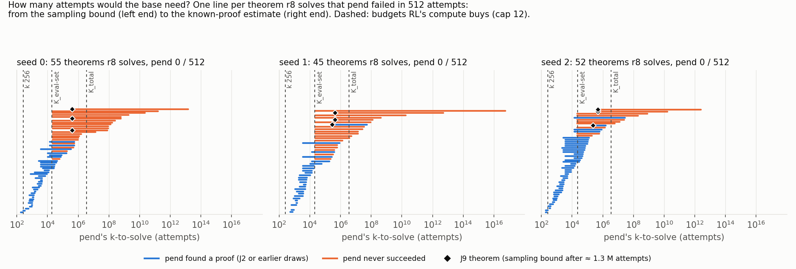
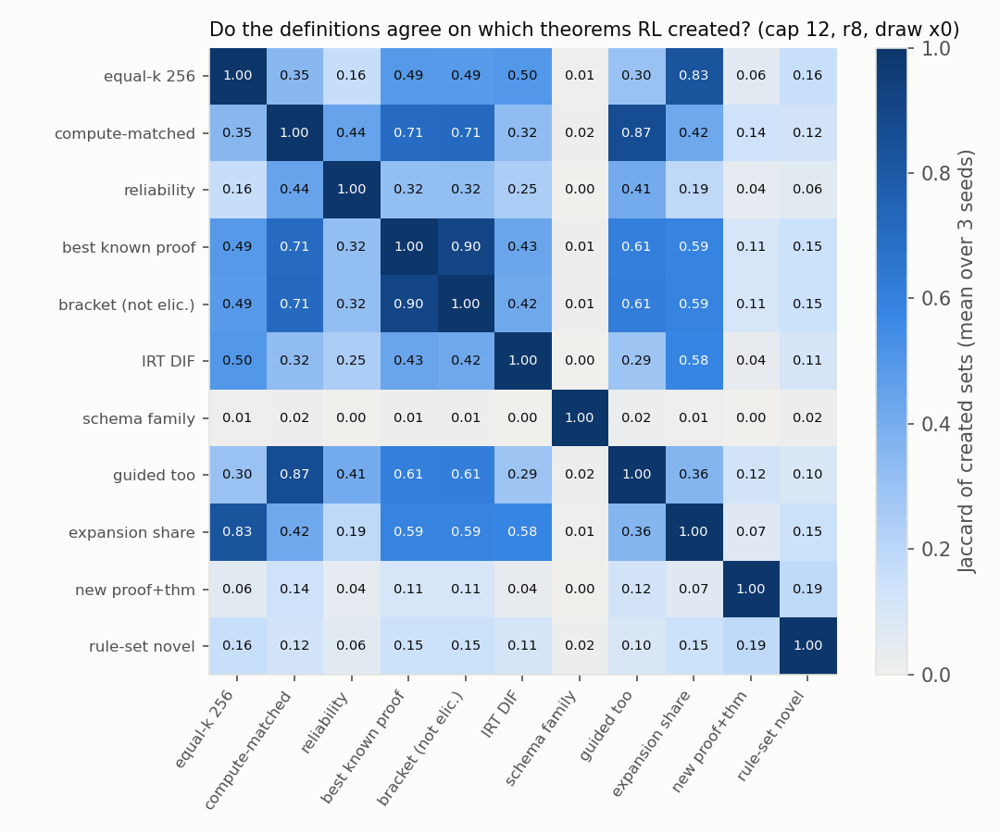
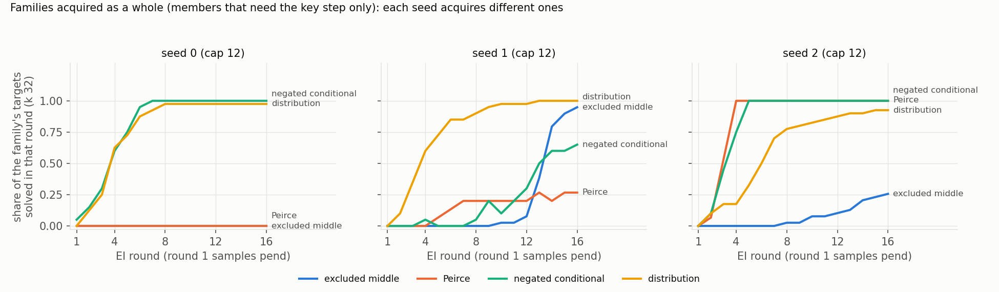

# capability-defs: what "capability" should mean here. At RL's own compute spent as base attempts, the 51–60 theorems per seed that RL "creates" at equal k shrink to 14–22 (4–5 that no seed's base ever solved); RL stays ahead at set level; excluded middle is teachable, not latent

Status: completed and reviewed 2026-10-05. **No hard-constraint violation, nothing quarantined.** The reviewer recounted
every pre-registered quantity from the raw files with independent code (`review_cd/`) before reading the write-up.
Lean accepted all **3,710 / 3,710** counted proofs re-checked across 15 arms, and the negative controls behaved. The
central measurement, the known-proof estimate, the J9 certification and the recommendation **stand**. Eleven
corrections, all applied in the nd-rl reading copy and below. **Not supported as written:** Q16's "beta-binomial hit";
"the read caps decide `textbook_6997…`'s verdict"; "`la_transfer_1077` and `la_transfer_1648` are in two seeds'
strictest sets"; the "≈ 20 passes over K12" mechanism for J7; "35 of 120" padded RL proofs (it is 26).

Question (proposal 26, Dan 2026-10-04): the project asks whether RL against a verifier **creates** a capability or
**elicits** one the pretrained model already had. "Capability" was never defined precisely enough to answer that, and
at some k even random weights solve every theorem. The run (1) surveys how other fields define a capability and tell a
new one from better access to an old one, (2) writes ≥ 15 definitions as cards, each attacked by a critic, (3) computes
≥ 6 of them on the same model comparisons with noise floors and an agreement matrix, and (4) recommends 2–4 as the
project standard. Proposal: [`2026-10-04-capability-definitions.md`](../../docs/proposals/2026-10-04-capability-definitions.md);
brief: [`BRIEF_capability-defs.md`](../../docs/proposals/claude-heavy/BRIEF_capability-defs.md).

**Reading copies in nd-rl** (reviewer's corrections marked *[review]*):
- the report: [`docs/project_strategy/capabilities/REPORT.md`](../../docs/project_strategy/capabilities/REPORT.md);
- the 20 definition cards: [`docs/project_strategy/capabilities/cards/`](../../docs/project_strategy/capabilities/cards/);
- the literature review: [`docs/literature/2026-10-04-capabilities/REVIEW.md`](../../docs/literature/2026-10-04-capabilities/REVIEW.md),
  with 57 paper notes, the screened table and the claim ledgers.

## Configuration

- **Repository.** Fork `dan-pandori/nd-takehome`, branch `dan_capability-defs`, from the fork's `origin/dan` at
  `4dcd0e4f`. Ran on the second VPS (agent2), every role at `--effort max`.
  - The pre-registration `preregistration/capability-defs.md` was committed at `3e6f9865` (05:43:47Z), before the
    first pod (`cd-a`, 06:02:38Z). Every later job's expectations were committed to `log.md` before its first log
    line; the reviewer's R0 table lists all eleven.
  - DONE `645aa4f0`. Deliverables are under `capability_defs/`: `REPORT.md`, `cards/`, `lit/`, and `analysis/`
    (scripts, `out/`, figures). Also `run_capability_defs.md`, `numbers.md` § capability-defs and `log.md`.
  - Review [`review_capability-defs.md`](https://github.com/dan-pandori/nd-takehome/blob/da11be78/review_capability-defs.md):
    [`323258b0`](https://github.com/dan-pandori/nd-takehome/commit/323258b0) §Recount (blind, plus reviewer kit
    `review_cd/`), [`da11be78`](https://github.com/dan-pandori/nd-takehome/commit/da11be78) §Compare / §Verdict.
- **Timeline.** Executor Mon 2026-10-05 04:56–17:34 UTC; pods 06:02–17:27; reviewer 17:36–18:42.
- **Models for every number** (Lean alone; cap 12 unless stated). **best-cap12**: `best_model.ALiBiGPT` 6 × 384,
  **9,560,832 params**, `lean_staten`, trained from scratch on K12 (`data/kh/train_k12.jsonl`, 155,000 records,
  md5 `800b5486`), Stage 1 for 1,200 s, seeds s0–s2.
  - The checkpoints are init (p0), pretraining checkpoints p50 … p20000, and **pend** (end of pretraining), all
    `trajectory`'s.
  - **r8** is after 8 EI rounds: `trajectory`'s T1 ladder, which ran on **RTX A6000**. **r16** is `rl-continue`'s.
  - Checkpoint md5s are in the review's header and match the run's registry rows.
  - **best-cap6** is the same recipe on `data/p2/train_depth3_f0_a1.jsonl` (`trajectory-cap6`, `rl-continue-cap6`).
  - The **replay-only control** is `rl-from-ckpt`'s `c<S>_pend_r8`: the same 8 fine-tune rounds on K12 replay, with no
    RL proofs.
  - Models trained here: the J4 / J6b excluded-middle fine-tunes; J6's **no-DN knockout**, a best-recipe Stage 1 on
    `k12_nodn.jsonl` (133,726 records with no double-negation line, 1,201 s); and J7's **compute-matched
    continuation** of pend.
- **Theorems.** textbook72 (scoring only; never trained or tuned on) + holdout250 = **322**. Other sets:
  - **hard set H**: pend 0 / 512 on draws x0 + x1, 86 / 77 / 77 theorems;
  - **B**, the equal-k created set: pend 0 / 256 and r8 ≥ 1 / 256 on draw x0;
  - **lem40**: 40 held-out A ∨ ¬A instances. One of them, `la_transfer_882`, is intuitionistically provable, so the
    decisions use the other 39 (**lem39**);
  - `transfer_long2` (21) for J10.
- **Reads.** Plain: T 0.8, `max_steps` 96, `max_action` 512, k 256 per draw (x0, x1), batch 2,048 (peak 18.8–25.3 GB in
  J2, up to 38.0 GB in J9). Guided: `guided_eval.py --arm logical`, k 256, sample seed 1, `max_rej` 10.
- **Checker: Lean alone** (`lean_gate`; Lean on the literal text, the pre-filter only rejects). `nd_verify` is
  unmodified (tree `9437bb72`) and unused; `artifacts/TEST_RUN_DONE` is unchanged.
- **Budgets** (base attempts per theorem):
  - **K_eval-set** = ladder GPU-s / (322 × 3.6 ms per pend attempt) = **19,281 / 21,107 / 23,310** at r8 and ≈ 4.8–5.0 ×
    10⁴ at r16. It is RL's GPU time spent instead on base attempts over the 322 theorems.
  - K_per = 777 / 731 / 954 per training target; K_total = 3.3–4.3 × 10⁶, all of RL's compute on one theorem.
  - **The ladder seconds are RTX A6000 seconds and 3.6 ms is an A40 cost, so K_eval-set mixes GPU classes** (reviewer;
    not stated in the report). In ladder attempts it would be ≈ 5.6–6.2 × 10³ per theorem.
- **Pod jobs** (each pre-registered in `log.md` before launch; NVIDIA A40):

  | job | what | A40-hours |
  |---|---|---|
  | J1 | teacher-forced scores, under init / pend / r8 / r16, of every known Lean-accepted proof of the H ∪ calibration theorems (385,641 proofs at one name base, 13,566 exact at 33) | 2.1 |
  | J2 | pend at 16,384 more attempts per J2 theorem (stage A; calibration at 4,096); A′ on H − J2; stage B, 49,152 more on stage-A zeros; doubled-cap re-reads | 4.0 + 6.6 |
  | J3 | guided reads of pend / r8 / r16, cap 12 and cap 6 | 9.1 |
  | J4, J6, J6b | excluded-middle demonstration fine-tunes of pend and of the no-DN knockout | 2.2 + 2.4 + 3.0 |
  | J5 | missing plain draws (cap-12 r16 x0; cap-6 r16 on holdout250) | 1.9 |
  | J7 | continuation of pend on K12, sized to the r8 ladder's GPU time | 17.9 |
  | J8 | J1 scores under `rl-from-ckpt`'s earlier starts (≈ 2 M proofs) | 4.5 |
  | J9 | certification sampling: 1.0–1.4 M more pend attempts on 3 theorems per seed | 21.3 |
  | J10 | 16,384 more pend attempts on the long-pool theorems RL solves and pend fails | 1.9 |
  | **total** | process-level GPU time, registry rows (`gpu_seconds`, `gen_tokens`, `attempts`, `lean_checks`; `train_steps` / `train_tokens` for J4, J6, J6b, J7) | **77.0** |

  Totals: 24.4 M attempts, 4.43 B generated tokens, 13.1 B training tokens, 1,110,393 Lean checks.
- **Pods and cost.** 11 A40 pods (`cd-a` … `cd-k`) at $0.49/h: **77.21 pod-hours, $37.84** of the $50 / 100 h budget
  (`podbudget`, `~/podhours.log`), under the pre-registered $40 stop. At 05:42 the balance ($122.55) left only ≈ $20
  above the $100 floor. The executor asked in `QUESTIONS.md`, and Dan answered at 06:18 through the executor's inbox:
  ignore the floor for this run and spend up to the brief's $50. The balance was topped up to $322.21 by 06:28, so the
  floor never bound. The inbox answer itself is not recorded in the run's `QUESTIONS.md` or `log.md`; their 06:28
  entries record only the top-up.
- **Bucket.** `hf://buckets/dan-pandori/nd-rl/capability-defs/`:
  - `artifacts/cd/`: pod outputs (J1 / J8 compact scores; J2 / J9 / J10 sampling rows; J3 guided rows; J4–J7 reads;
    logs);
  - `artifacts/cd_targets_gz/`: the J1 / J8 scorer inputs;
  - `data/cd/`: job inputs (chunk files, J4 / J6b mixes and demonstrations, `k12_nodn.jsonl`);
  - `ckpts/cd/{j4,j6,j6b,j7}/`: the models trained here.

  Registry rows are in `hf://buckets/dan-pandori/nd-rl/registry/capability-defs/`. The librarian checked that the
  top-level paths exist.



*Figure F1 (executor's): for every hard theorem r8 solves, pend's k-to-solve interval. The left end is the sampling
bound; the right end is the known-proof estimate. Dashed lines are the budgets RL's compute buys; diamonds are J9's
theorems. Cap 12, per seed.*

## Observations

All numbers are on best-cap12 under Lean alone unless labelled, and reproduce in the reviewer's recount unless noted.
s0 / s1 / s2 order throughout.

**1. The central measurement: how much of "RL created it" survives a budget.**

| r8, draw x0 (of 322) | s0 | s1 | s2 |
|---|---|---|---|
| equal-k "created" (B: pend 0 / 256, r8 ≥ 1 / 256) | 54 | 51 | 60 |
| … not within the base's reach at K_eval-set (compute-matched, `cm`) | **22** | **21** | **14** |
| … net of the replay-only control | 20 | 14 | 8 |
| … never solved by any seed's base | **4** | **5** | **5** |
| set level: r8 solves at k 256 / base within reach at K_eval-set | 286 / 265 | 286 / 270 | 293 / 281 |
| **Δ_cov** (r16 in brackets) | **+21** (+24) | **+16** (+32) | **+12** (+14) |
| RL-free controls at k 256: replay-only r8 / J7 continuation | 239 / 220 | 244 / 215 | 249 / 219 |

- **At set level RL is ahead at matched compute on every seed**, and neither RL-free control closes the gap. All the
  created sets, redraw floors, seed floors and threshold-sensitivity cells reproduce.
- **The budget is the dominant free parameter.** At 0.1 / 0.3 / 1 / 3 × K_eval-set the compute-matched set is
  38 / 36 / 36 → 33 / 28 / 28 → 22 / 21 / 14 → 21 / 20 / 3 (s2: 6 undetermined, n < 3 K).
- **"Created at k" is a fact about n.** 512 or ≥ 768 base attempts instead of 256 remove **4–17** equal-k theorems
  (512: 4 / 9 / 11; all reads: 7 / 11 / 17).
- Bracket verdicts at K_eval-set for the r8-solved hard theorems (55 / 45 / 52):
  - elicited by sampling 17 / 17 / 21, or by the known-proof estimate 5 / 1 / 3;
  - found by the base but not certifiable 12 / 9 / 18;
  - not reached (0 base successes in ≥ K attempts) 21 / 18 / 10;
  - certified created 3 / 2 / 2.

  Their median estimated k-to-solve is 10^4.6 / 10^5.3 / 10^4.5, which is right at K_eval-set (range 10^2.3–10^16.8).

**2. The known-proof estimate** (Dan's "probability of a specific proof", summed over every Lean-accepted proof of t
that any model found).
- It recovers a median **0.98 / 0.94 / 0.93** of the measured p on 30 calibration theorems per seed (T 0.8; IQR within
  0.85–1.02; 0.79 / 0.65 / 0.65 at T 1.0).
- It is **not a strict bound**: the known-proof sum exceeds the sampling UB95 on 2 / 1 / 1 calibration theorems, so the
  factor-2 margin is justified.
- J1 is sound. F(t) equals the union of every Lean-accepted read plus the 315 references. The exact scores reproduce
  `trajectory`'s to < 5 × 10⁻⁵ nats on 783 theorem–checkpoint pairs. The one-base stage-1 bound never exceeds the
  exact score (0 of 94,544).
- **One proof carries a median 50–62 % of the sum on the calibration theorems, and 73–86 % on the hard theorems**,
  where the creation question lives (reviewer's wording).
- Random weights need **e^290 to e^3,200** attempts here (init's known-proof sum on the hard theorems: −289 to −3,228
  nats).

**3. Certification (J9).** Pend, standard caps, chunks of 131,072. The theorems were chosen as the most reliable r8
solves in each seed's strictest set.

| seed | theorem | own base: successes / attempts | certified at K_eval-set? |
|---|---|---|---|
| s0 | `la_transfer_2060` | 0 / 1,245,952 | yes |
| s0 | `la_transfer_205` | 0 / 1,245,952 | yes |
| s0 | `la_transfer_1077` | 0 / 1,245,952 | yes |
| s1 | `la_transfer_1648` | 0 / 1,377,024 | yes |
| s1 | `la_transfer_1077` | **1** / 1,377,024 | no |
| s1 | `la_transfer_2060` | 0 / 1,377,024 | yes |
| s2 | `la_transfer_1648` | **1** / 1,114,880 (stopped) | no |
| s2 | `la_transfer_1833` | 0 / 1,508,096 | yes |
| s2 | `la_transfer_2060` | 0 / 1,508,096 | yes |

- **7 of 9 (theorem, seed) pairs are certified relative to their own seed's base** (pre-registered ≥ 6: hit). Their
  UB95 is 2.4 / 2.2 / 2.0 × 10⁻⁶, below 0.05 / K_eval-set.
- Both base successes are proofs already in F. Their known-proof sums predicted 0.026 and 0.70 expected successes.
- **Four pairs on three theorems survive every RL-free control:** `la_transfer_205` (s0), `la_transfer_2060` (s1, s2)
  and `la_transfer_1833` (s2). The controls are the replay-only ladder, the J7 continuation (which solves `2060` on s0,
  7 / 512) and the other seeds' bases.
  - They are held-out members of families RL trained on: distribution, De Morgan with a double negation, Peirce.
  - Their known-proof estimates put pend's k-to-solve at 10^10.2–10^13.2.
- `la_transfer_2060`, ¬((S ∨ P) ∧ (R ∧ P)) ∧ ¬¬(Q → S) ⊢ ¬(((S ∨ P) ∧ (R ∧ P)) ∨ ¬(Q → S)), is in all three seeds'
  strictest sets. On s0, pend's known-proof estimate is e^−18.2 over 1,803 known proofs (0 / 66,304 sampled), and r8
  solves it 734 / 768. Below is RL's proof
  (REPORT §3.3, example 4; pend's most probable known proof is a longer detour, term size 13):

  ```lean
  theorem t (P Q R S : Prop) (h1 : ((¬((S ∨ P) ∧ (R ∧ P))) ∧ (¬(¬(Q → S))))) : (¬(((S ∨ P) ∧ (R ∧ P)) ∨ (¬(Q → S)))) := by
    have n1 : ((¬((S ∨ P) ∧ (R ∧ P))) ∧ (¬(¬(Q → S)))) := h1
    have n2 : (¬((S ∨ P) ∧ (R ∧ P))) := n1.1
    have n10 : (¬(((S ∨ P) ∧ (R ∧ P)) ∨ (¬(Q → S)))) := (fun (n3 : (((S ∨ P) ∧ (R ∧ P)) ∨ (¬(Q → S)))) => by
      have n4 : (¬(¬(Q → S))) := n1.2
      have n9 : False := Or.elim n3 (fun (n5 : ((S ∨ P) ∧ (R ∧ P))) => by
        have n6 : False := n2 n5
        exact n6) (fun (n7 : (¬(Q → S))) => by
        have n8 : False := n4 n7
        exact n8)
      exact (n9 : False))
    exact n10
  ```
- Caveats (reviewer):
  - `1833` has 0.49 % of its J9 attempts cut off (a lower bound).
  - The other seeds' bases had only 66,560 / 17,408 attempts on `205` and 17,408 each on `1833`.
  - s1 and s2 both chose `la_transfer_1648`, which s0's pend had solved 5 / 49,152 in J2 stage B. On the final data it
    fails the "no seed's base ever solved t" rule; the rule's next picks were `textbook_03549…` (s1) and
    `textbook_48e30…` (s2).

**4. The catalogue and the recommendation.**
- Twenty cards (`docs/project_strategy/capabilities/cards/`). **Every critic landed a failure the executor accepted**
  (L3: 20 / 20; one "in substance"). Six definitions were dropped as decision rules, two kept as descriptions, one
  folded into another, and the rest revised.
- Recommended standard (REPORT §4), unchanged by the review:
  - **A. Compute-matched reach, with each theorem's k-to-solve interval.** The base gets K_eval-set attempts, plus the
    known-proof estimate. A theorem is certified created only at UB95 < 0.05 / K, which takes ≈ 60 K zero-success
    attempts, bought only for headline theorems. The result is reported net of both RL-free controls and of other
    seeds' bases.
  - **B. Capability vs propensity.** Plain pass@1 against the best *per-theorem* method within the budget: more
    samples, or guided redraws.
  - **C. Key-step family acquisition with a teachability test.** The test compares the base with a knockout
    pretrained without the key step.
  - **D. IRT ability with an ability-matched placebo**, as a diagnostic.

**5. Do the definitions agree?** No.
- Mean off-diagonal Jaccard over the 12 final definitions is **0.29** (r8 x0) and **0.34** (r16 x1); pre-registered
  ≤ 0.4. The least-agreeing pairs involve `schema` (0.00–0.06).
- Redraw Jaccard is high for the budgeted definitions (0.67–1.00; equal-k 0.68–0.78). Seed Jaccard is low (0.06–0.44)
  for all but rule-set novelty (0.55–0.62): each seed's RL "creates" different theorems.
- `la_transfer_2060` is in all three seeds' strictest sets (`cm_recipe`). The theorems in two seeds' strictest sets are
  `la_transfer_2110`, `1802`, `textbook_48e30…` and `textbook_f918…`.



*Figure F3 (executor's): Jaccard of the created sets, mean over 3 seeds, cap 12, r8, draw x0. The `schema family`
row is the least-agreeing.*

**6. Plain vs guided (J3; solved@256 of 322, guided with plain x1 in brackets).**

| | pend | r8 | r16 |
|---|---|---|---|
| cap 12 s0 / s1 / s2 | 260 (230) / 266 (238) / 270 (236) | 293 (288) / 289 (284) / 297 (290) | 295 (291) / 303 (303) / 303 (295) |
| cap 6 s0 / s1 / s2 | 212 (171) / 188 (144) / 202 (143) | 274 (268) / 277 (269) / 274 (260) | 284 (277) / 281 (274) / 284 (272) |

- Guided ≥ plain at **18 / 18** checkpoints (s1 r16 cap 12 a tie). On holdout250 guided reading adds +18 to +22
  theorems for cap-12 pend and −1 to +4 for RL.
- **Q13:** pend's guided read solves **27 / 54, 28 / 51, 36 / 60** of B (0.50 / 0.55 / 0.60).
- It rescues only **3 / 4 / 1** of the compute-matched 22 / 21 / 14.
- Guided is not compute-matched: ≈ 1.8× the tokens and 2.2× the GPU time per attempt, measured in `guided-tts` on the
  cap-12 / cap-6 T1 r8 models.
- **Only pend / r8 / r16 were read guided.** The J4 / J6 / J6b fine-tunes and the J7 continuation are plain-only,
  which departs from the guided-by-default policy.

**7. Excluded middle: acquired by RL on one seed in full, and teachable, not latent** (lem39 solved@256, mean pass@1 in
brackets; plain reads).

| model (cap 12) | s0 | s1 | s2 |
|---|---|---|---|
| pend | 0 | 0 | 0 |
| r16 | 0 | **36 (0.70)** | 13 (0.13) |
| pend + replay only (A0) / + 16 non-LEM controls (C16) | 0 / 0 | 0 / 0 | 0 / 0 |
| pend + 4 LEM demonstrations (A4) | 36 (0.66) | 33 (0.35) | 36 (0.64) |
| pend + 16 LEM demonstrations (A16) | 37 (0.79) | 34 (0.68) | 37 (0.83) |
| no-DN knockout / + A0 / + A16 | 0 / 0 / 35 | 0 / 0 / 37 | 0 / 0 / 37 |
| J6b: gain over matched controls, pend minus knockout (2 fine-tune seeds) | +0.051 | −0.013 | −0.013 |

- The pre-registered J6b rule calls a skill latent if the gap is ≥ 0.3 on ≥ 2 / 3 seeds, and teachable if it is within
  0.2. **Verdict: teachable.** Four demonstrations, which are s1's RL proofs of *other* instances, install the schema
  in every seed's base, including s0's, whose RL never found it.
- Acquisition is **full on s1 and partial on s2**. The executor's "one seed" is reworded: s2's r16 reaches 13 / 39, and
  1 / 6 of the six holdout250 A ∨ ¬A members. On those six, pend is 0 / 6 and s1 r16 is 6 / 6.
- **J6 knockout.**
  - Held-out greedy accuracy 0.862 / 0.848 / 0.862 against pend's 0.921 / 0.936 / 0.962.
  - holdout250 solved@256 is 0.878 / 0.800 / 0.850 × pend's.
  - It solves lem40 1 / 0 / 1, the one being the intuitionistic `la_transfer_882`.
  - Splits: A16n's 64 DN records are the 16 demonstrations × 4, so the knockout's replay itself has none.
- **J4 holdout250 solved@64**, A16 against A0: +5.9 / +7.2 / +2.4 %. The pre-registered "within ±3 %" holds on 1 / 3.



*Figure F4 (executor's): share of each key-step family's trained-on targets solved per EI round (k 32), cap 12. The
reviewer notes the denominators are the members that need the key step, not all 40.*

**8. Is RL "more of the same"?**
- **IRT at matched ability** (2PL calibrated on pretraining checkpoints through p5000; the reviewer's own fit agrees
  within 0.03 in Δθ and ±2 in counts):
  - EI r2 creates 48 / 41 / 48 DIF+ items at Δθ 2.33 / 2.05 / 2.69;
  - the replay-only r8 creates 50 / 49 / 54 at Δθ 2.12 / 2.09 / 2.14.
  - In the reviewer's fit EI's rate is below replay's on 3 / 3 seeds. **At matched ability gain, EI creates no more
    DIF+ items than RL-free training.** The matching is approximate: s2's EI r2 sits 0.5 θ above its placebo.
- **The unmatched contrast is not like for like.** Items created through pend are 26 / 26 / 30 for r8 against 4 / 7 / 7
  for the replay-only control, but that compares Δθ ≈ 2.0 with ≈ 0.6.
- Q8a, the pretraining-only IRT model's rank correlation with r8's successes: Spearman 0.57 / 0.59 / 0.56 (miss;
  pre-registered ≥ 0.7).
- **Update size** (relative Frobenius norm, s0): RL r8 0.28, replay-only 0.30, late pretraining 0.81, two seeds' bases
  1.43; RL and replay-only updates have cosine 0.45.
- **J7, compute-matched continuation:**
  - 28,054 / 31,462 / 33,535 steps in 18,308 / 20,494 / 21,824 A40-s. That is 82 / 84 / 81 % of the r8 ladders'
    GPU-seconds, which are **RTX A6000** seconds, so the match is across GPU classes.
  - Solved@256 (x0) 220 / 215 / 219, against pend's 232 / 236 / 234 and r8's 286 / 286 / 293. A **lateral move**: it
    gains 19 / 19 / 16 theorems pend misses and loses 31 / 40 / 31.
  - It solves 19 / 54, 18 / 51, 16 / 60 of B and 4 / 22, 4 / 21, 0 / 14 of the compute-matched set.
  - θ gain over pend +0.51 / +0.62 / +0.48 (reviewer's fit; borderline against the pre-registered +0.5).
  - The executor's mechanism, "pend had seen each K12 proof ≈ 20 times", is **not supported**: `trajectory`'s
    Stage-1 logs give ≈ 3.7 epochs of pairs.
- **J8, start dependence** (`rl-from-ckpt` ladders; share of new solves certified elicited at K_total):

  | start | p1600 | p5000 | p12000 | p16000 | pend |
  |---|---|---|---|---|---|
  | s0 | 0.21 | 0.29 | 0.41 | 0.32 | 0.77 |
  | s1 | 0.33 | 0.24 | 0.34 | 0.42 | 0.70 |
  | s2 | 0.25 | 0.22 | 0.34 | 0.34 | 0.86 |

  The share is not monotone on any seed. Replay-only from the same start solves most of the new solves at early
  starts (s0: 151 / 182 at p1600).
- **J10, long pool:** given 16,384 more attempts, pend finds **29 / 45 (0.64)** of the long-pool (theorem, seed) pairs
  RL "creates" at equal k (9 / 13, 10 / 16, 10 / 16).

**9. More base attempts (J2)** (pend, standard caps):
- Stage A: 16,384 attempts on the J2 theorems (the hard theorems an RL read solves) find a proof for 27 / 57 (0.47),
  22 / 59 (0.37) and 34 / 55 (0.62). `numbers.md`'s "87 / 89 / 85" also counts the 30 calibration theorems per seed,
  which were read at 4,096.
- A′ (hard theorems no RL read solved): 0 / 29, 1 / 18, 0 / 22. Five of A′'s pairs were solved by r8 in mcts-a's
  C-only reads; the wider J2 set gives 0.45 / 0.37 / 0.60.
- Stage B: 23 / 30, 31 / 37 and 14 / 21 of the stage-A zeros stay at 0 / 65,536.
- Doubled caps: 1 success in 6 re-reads (`textbook_6997…` s2, 2 / 16,384). That theorem is also **3 / 49,152 at
  standard caps** in stage B, so the caps do not decide its verdict.

**10. Pre-registered expectations** (the reviewer's scorecard, which the executor's §3.9 matches except where noted).
- **Hit:**
  - Q1 (equal-k 54 / 51 / 60; r16 61 / 65 / 61) and Q3 (on B 0.74 / 0.59 / 0.73 at K_total; 0 created).
  - Q4 (0.06 / 0.00 / 0.13) and Q6 (0.41 / 0.29 / 0.37).
  - Q10, Q11 (A16 37 / 34 / 37 of 39; C16 0), Q12 (r8 worth 4.7–15.6× the pretraining length), Q13 and Q15.
  - J1 stage 1 (bound / p̂ 0.025–0.027) and J3 guided ≥ plain. The executor did not score these two.
  - J2 A′, J2 B and the doubled-cap expectation; J5; J6 (i) and (iv); J6b; J7 (iii); J9 (7 / 9).
  - Q8b and Q8c (3–5 of 6, depending on the residual); Q14's first clause (0.29 / 0.34 ≤ 0.4).
  - L1, L2 and L3.
- **Miss:**
  - Q2 (0.47 / 0.37 / 0.62 against 60–95 %; only s2 hits).
  - Q5 (0.33 / 0.45 / 0.44 nats against ≥ 1; predicted by the executor before stage 2).
  - Q7 (82–88 % of B below a 2 % share against ≥ 95 %).
  - Q8a (Spearman 0.56–0.59 against ≥ 0.7).
  - J10 (64 % against ≤ 40 %).
  - J8 monotone (on 0 / 3 seeds).
  - **Q16** (reviewer): the pre-registered support-curves test was feasible from counts. On it the beta-binomial is
    within ±25 % on both 3.2 M `lean_seq` EI models but −29 / −28 % on both base models. The zero-inflated variant is
    not uniformly at least as good. In the executor's adaptation (pend's ≈ 768 attempts → J2's 16,384), on the J2
    theorems alone, the beta-binomial is off by −1 / +31 / −13 % and the zero-inflated variant by −68 / −55 / −61 %.
- **Partial:**
  - Q9 (1.31 / 1.22 / 1.00 × B; s2 misses).
  - J4 ±3 % (1 / 3).
  - J6 (ii) (0 / 40 on s1 only; 0 / 39 everywhere) and J6 (iii) (0.88 / 0.80 / 0.85, inside 0.85–0.97 on 2 / 3).
  - J7 (i) (2 / 3, borderline) and J7 (ii) (35 / 35 / 27 %).
  - J8 p1600 ≤ 25 % (1 / 3; s2 is 25.15 %).
  - Q14's second clause (moot: the K_total bracket is not among the final definitions).
- The run summary's own miss list (Q2, Q5, Q7, Q8a, J8, J10) **omits the partial misses and Q16**.

**11. Checks.**
- **Lean re-check** (reviewer's renderer, Lean 4.34.1 core, `#print axioms` allowlist): **3,710 / 3,710** counted
  proofs are accepted. They include every J2 distinct proof of a B theorem (362), J3's 1,370 guided literal texts,
  every r8 x0 proof of a B pair (165) and the 315 references.
  - Controls: 60 / 60 untouched proofs pass; 0 / 150 of the run's own Lean rejections pass; 0 / 60 proofs paired with
    another theorem pass; 0 / 40 literal texts paired with another theorem pass; `sorry` is rejected.
  - 2 / 60 `Or.inl` ↔ `Or.inr` flips pass, both benign.
- **Proof size.** In 155 of the 165 B pairs a random r8 x0 proof is larger in term size than the reference, equal in
  8 and smaller in 2. The median is 54 against 31 nodes.
- **Splits** (renaming class): no training file shares a class with textbook72, holdout250 or lem40. The exception is
  the pre-existing K12 twin of `textbook_3ed45280…` (P ∨ Q, ¬P ⊢ Q with its premises reordered;
  `gen.canon_key` is order-sensitive). It is in s0's B (pend 0 / 512, r8 235 / 256), and every best-cap12 model was
  pretrained on it.
- **Literature (L1–L2)**, from the reviewer's own sub-audit:
  - **185** papers new to the two earlier reviews were screened (184 without one unread journal duplicate);
  - **57** were read in depth (41 at section depth, 16 in full);
  - the ledgers hold 1,183 claims, **99.75 %** verified against the source text;
  - the executor's re-check is 32 / 32, and the reviewer's re-verification 48 / 48 verbatim.
  - Three REVIEW.md phrases printed as quotations were not verbatim. These are marked in the reading copy.
- **Cut-offs per stratum** (action or step cap, attempt-weighted). Neither the report nor `numbers.md` gives them, and
  several exceed the policy's ≈ 0.1 %:
  - J2 calibration 1.856 / 1.159 / 0.230 %;
  - J2 A′ s2 0.410 %, and B s0 0.474 %;
  - J5 cap-6 r16 2.1 % (s0); J6b up to 2.5 %; J7 up to 1.1 %;
  - J9 `la_transfer_1833` (s2) 0.49 % (lower bounds).

  A cut-off can only hide a base success, so the bias is toward "not reached / created".

## Rewordings applied (from the review)

All are marked *[review]* in the nd-rl reading copy of the report and cards.

1. **Agreement:** the mean off-diagonal Jaccard is 0.29 / 0.34, not 0.31 / 0.36 (the executor's own final
   `out/part3.txt` says 0.291 / 0.342). The least-agreeing pairs involve `schema`, not `npnt`. "No seed's base" has a
   seed floor of 0.29 / 0.29 / 0.43, not 0.38–0.50, so it is not an exception.
2. "`la_transfer_1077` and `la_transfer_1648` in two seeds' strictest sets" described the J9 candidate lists. With the
   final data both are in **none**. **Not supported as written.**
3. "35 of 120" padded RL proofs → **26 of 120**; the executor's own `detour()` also gives 26. **Not supported as written.**
4. "pend had already seen each K12 proof ≈ 20 times" → ≈ 3.7 epochs of pairs. The J7 result stands; the stated mechanism
   does not. **Not supported as written.**
5. **Q16:** score it a miss (or 2 / 3 for the adapted beta-binomial), drop "support-curves data lack per-attempt
   sequences", and replace §4's "within −7 to +13 %" with −1 / +31 / −13 %. **The "BB hit" is not supported as
   written.**
6. `numbers.md`'s J2 line: the stage-A rate on the J2 theorems is 27 / 57, 22 / 59, 34 / 55. The "87 / 89 / 85" include
   30 calibration theorems per seed at 4,096. That file is on the fork; this summary uses the corrected numbers.
7. **J2 truncation:** `textbook_6997…` (s2) is 3 / 49,152 at standard caps, so the read caps do not decide its verdict.
   **Not supported as written.**
8. **GPU classes:** the r8 ladders ran on RTX A6000. K_eval-set and J7's "82 % of the ladders' A40-seconds" compare
   A6000 seconds with A40 costs.
9. "Every proof-state model is read both ways" → only pend / r8 / r16. The fine-tunes and J7 were read plain only.
10. Cut-off fractions per stratum are now reported (Observation 11 above; REPORT §3.0 in the reading copy).
11. Smaller fixes:
    - the run summary's miss list (Observation 10);
    - "acquired by one seed's RL" → full on s1, partial on s2;
    - "one proof carries 50–62 %" is on the calibration theorems (73–86 % on the hard ones);
    - "redraw floors 0.80–1.00" → 0.67–1.00;
    - "512 or ≥ 768 attempts remove 7–17" → 4–17;
    - "agree at 0.6–0.9": chain depth is 0.47 with two of them;
    - Q3's denominator is the r8-solved hard theorems, not B (on B: 0.74 / 0.59 / 0.73, still a hit);
    - the families table's training shares are over key-step members;
    - the cards' `support-curves` / `support-state` numbers now carry their 3.2 M model labels;
    - the guided-tts cost ratio now names its models;
    - J1 stage 1 and J3 are scored (both hit).

Also not in the report: the pre-registration states no minimum detectable difference, which AGENT_POLICY asks for. Per-seed
values are given throughout; at n = 3 an IQM is the mean.

## Interpretation (not a finding)

This is the executor's reading, which the review leaves standing. On these models, equal-k "creation" mostly measures how
few base attempts were made. Spend RL's own GPU time on base attempts instead, and 59–77 % of the equal-k set is
reached. Net of the replay-only control 8–20 theorems per seed remain, and only 4–5 that no seed's base ever solved;
four (theorem, seed) pairs are certified out of reach and survive every RL-free control. Yet at set level RL is ahead at
matched compute on every seed, and neither RL-free control closes the gap. At matched ability gain, though, its
item-level gains look like RL-free training's (IRT). The clearest family-level acquisition, s1's excluded middle, is
cheap to teach once one proof exists, even to a model pretrained without a double-negation step: what RL contributed
there was finding an instance. Whether any of this counts as "creation" depends on the budget convention Dan adopts
(decision items 1–2 in the [week-41 digest](../../docs/digests/2026-41.md)). That convention's GPU-class mismatch (A6000 ladder
seconds over an A40 attempt cost) is still open.

## Limitations and next step

- The models are one architecture (9.56 M best-recipe, proof-state) at two caps with 3 training seeds. Seed floors are
  low, so theorem-level sets do not transfer across seeds.
- J9 covers 9 (theorem, seed) pairs. The "no seed's base" survivors rest on unequal base effort across seeds, and
  `1833` has 0.49 % of its attempts cut off.
- K_eval-set divides A6000 seconds by an A40 attempt cost.
- Guided read-outs are missing for the fine-tunes and J7, and cut-offs exceed the policy in several strata.
- **Next (reviewer), in order:**
  1. Re-read `la_transfer_205` (s0), `2060` (s1, s2) and `1833` (s2) with pend at doubled caps (1,024 / 192) for
     ≥ 2 × 10⁵ attempts each, ≈ 1 A40-hour each. This removes the only open caveat on the four "survives everything"
     pairs.
  2. Give the other two seeds' pend the same ≈ 1.2 M attempts on the three survivors.
  3. Use a same-GPU-class budget: measure pend's per-attempt cost on an RTX A6000, or express K_eval-set in ladder
     attempts (≈ 5.6–6.2 × 10³). Restate the compute-matched set under both; at 0.3 × K it is 33 / 28 / 28.
  4. Read the J4 / J6b / J7 models guided, so Q11 and J7 also have best-system numbers.
- **Next (executor, REPORT §6.8):** ablate a *composition* rather than a primitive: DN applied to a negation-introduction
  line (16,703 K12 records). Pretrain three seeds without it, run 16 EI rounds, and read the key-step excluded-middle
  family on held-out members (≈ $26).
- The executor's nine questions for Dan, each with a recommendation, are in REPORT §6 and the
  [week-41 digest](../../docs/digests/2026-41.md).
