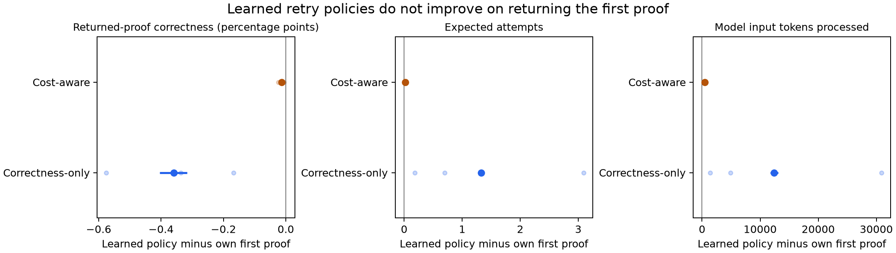
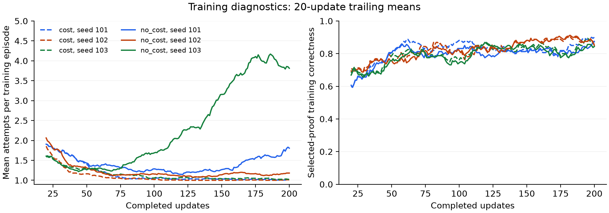
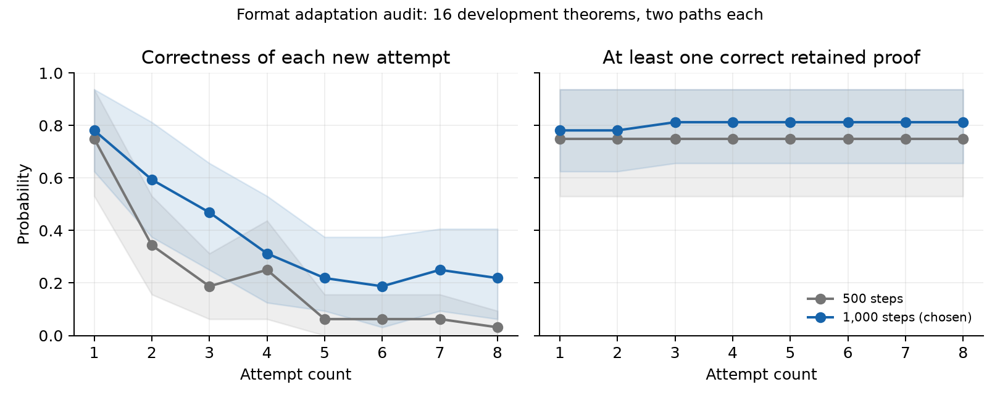
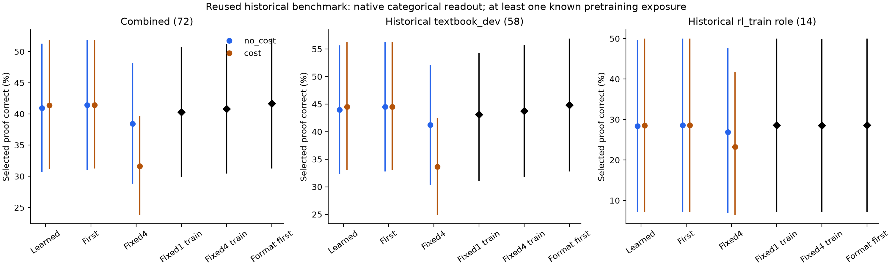

# Learning when to stop requesting proof attempts

Experiments 2 and 3 train independently from Dan's same round-16 ALiBiGPT proof
checkpoint. Experiment 2 receives selected-proof correctness minus a cost for each
additional attempt. Experiment 3 receives selected-proof correctness alone. Neither
uses supervised correctness-to-stop targets or inherits the selection experiment's
trained weights.

The first pilot uses frozen independent proof pools to test the learned acceptance and
selection interface. This reduction isolates allocation and selection; it does not test
joint proof generation or the hypothesis that accumulated context harms generation.
The live implementation now generates new attempts from the same trainable model
while conditioning on effective previous proof histories. Protocol smoke updates
verify the joint generation and decision likelihoods; they do not establish learning.

Fresh MAIN evaluation is complete: 400 structurally held-out theorems, two
prespecified contextual paths per theorem, and three independently trained RL seeds
per arm. The cost-aware policy returns 85.319% correct proofs with 1.021 expected
attempts; its own first proof is 85.333% correct. The correctness-only policy returns
83.974% with 2.325 attempts; its own first proof is 84.333% correct. Additional
allocation therefore does not improve returned correctness against the same
checkpoint's first proof. Tiny positive differences against count-only stopping and
a positive cost-aware comparison against a DEV-selected work mixture remain
visible in the dedicated [cost](cost/README.md) and [no-cost](no_cost/README.md)
reports. The latter policy loses accuracy against its work mixture despite more
measured TEST work. The [independent result audit](../../../code/experiments/current/learned_compute_allocation_20261006/reviews/joint_live_main_review.md) accepts the aggregate after reconstructing all policy rows, verifying source bindings, and checking 36 transcripts with Lean. Historical reused-benchmark evaluation and its [independent audit](../../../code/experiments/current/learned_compute_allocation_20261006/reviews/joint_live_historical_review.md) are complete.

These saved paired 95% intervals bootstrap whole theorems within family and are
conditional on the trained models. Faint points show the three training seeds.
Forward-input tokens are charged expected policy work, excluding the expense of
collecting forced-eight-attempt paths. They are a compute proxy, not exact FLOPs.

Joint outcome-only training substantially improves first-proof generation relative
to the shared format-only initialization (72.75%). Finite-path oracle availability
reaches approximately 90% in both primary arms, while native selection at eight
attempts is much worse. Generation improvement and useful allocation are separate
findings. Greedy index readouts match first-proof accuracy within numerical
precision; this does not establish a content-blind or always-first mechanism.

The main method and evaluation rules are frozen in the working folder's
[method note](../../../code/experiments/current/learned_compute_allocation_20261006/allocation/main_method.md).
The [registered aggregate](../../../artifacts/learned_compute_allocation_20261006/allocation/final_main_summary_fp32_v2.json)
and [figure provenance](figures/live_main_v3/provenance.json) retain exact source,
model, inference, and analysis bindings. Cost 0 and 0.03 were trained for 200 updates
of eight episodes. The optimizer performs one on-policy REINFORCE update per batch,
not PPO. No selector checkpoint or correctness-to-stop labels were inherited.

Development audits revealed severe generation failure from the new history
interface. Outcome-blind format initialization restored much of history-conditioned
generation, but later-attempt quality still declines. Adaptation used zero, one, or
four frozen prior attempts, whereas live deployment can contain up to seven student
attempts. This remains an interface confound. Forced and voluntary termination are
recorded separately; correctness-only native termination is forced in approximately
5.735% of episodes. The independently audited identical-state continuation
experiment finds a negative policy-relative marginal value while oracle availability
increases; it does not show destruction of retained correct proofs.

Training arms match episode counts rather than generation work: stopping policies
can sample different numbers of attempts during the same 200 × 8 episodes. [Training metadata](../../../artifacts/learned_compute_allocation_20261006/allocation/training_theorem_coverage.json) confirms replacement sampling during joint RL: the three seeds cover 1,002, 987, and 1,013 distinct training theorems, with exactly matched cost/no-cost schedules. The selected fixed-one control uses only its first 100 updates (800 episodes, 622 unique theorems), while the other selected models use 200 updates. The final comparison reports inference work, individual training seeds, and paired theorem intervals conditional on the trained models.

These are 20-update trailing means of sampled training episodes, not held-out
estimates. Cost-aware runs converge toward one attempt; no-cost runs differ
substantially in attempt count despite broadly similar training correctness.

A separately registered historical textbook72 retention/transfer evaluation is
planned after the fresh test, using the same selected models, development-fitted
policies, and bounded inference limits. Report the historical 58/14 source-role
split separately. There is one known canonical pretraining match; the 14 historical
`rl_train` role labels do not establish that those problems trained this r16.
This benchmark cannot support a fresh-generalization claim.

This development-only audit uses 16 theorems and two paths each. Bands bootstrap
whole theorems. New-attempt quality falls with accumulated histories, while correct
proofs already produced remain available. This measures an initialization interface
problem; it does not establish beneficial learned stopping.

Retained-answer availability cannot fall when another candidate is added. A
negative value of continuation can instead reflect weaker new generation,
selection dilution, or downstream policy behavior. The planned identical-state
branch diagnostics distinguish these possibilities; early stopping alone is
insufficient evidence that additional reasoning destroys an available answer.

Working implementation and audit: [allocation](../../../code/experiments/current/learned_compute_allocation_20261006/allocation/).
Separate reader summaries: [Experiment 2, attempt cost](cost/README.md) and
[Experiment 3, no attempt cost](no_cost/README.md).
Reusable protocol tests: [test_learned_allocation.py](../../../code/tests/test_learned_allocation.py)
and [likelihood tests](../../../code/tests/test_learned_allocation_controller.py).

Two explicit addenda preserve the original registrations and raw generation: a development-reproduced FP32 probability-domain tolerance admits small rounding excursions without clipping or changing estimates; an operational launcher permits foreign GPU workloads when at least 64 GiB remains free. Co-located wall times are not isolated performance measurements. Their exact sources, approvals, and immutable bindings are recorded in the working research log.

Generation uses the upstream cached sampler; stored token likelihoods are recomputed by full-sequence replay. A zero training replay discrepancy checks consistency between that stored replay and the gradient replay, rather than independently checking cached sampler probabilities. A separate [eight-action original-r16 FP32 development diagnostic](../../../artifacts/learned_compute_allocation_20261006/selectors/cached_confidence_fp32_dev8_v1/summary.json) finds normalized cached/full errors around 1.6e-7; it does not validate accumulated live-format histories or every training action.

The separately registered historical benchmark returns 41.403% correct proofs with
1.039 attempts for the cost-aware policy and 40.951% with 2.372 attempts for the
correctness-only policy. Both own first-proof baselines return 41.435%. The shared
format-only first proof returns 41.667%, so the fresh-task generation improvement
does not establish historical transfer. Results preserve the original 58 textbook
development and 14 `rl_train` source roles: native correctness is 44.504%/43.994%
on the former and 28.553%/28.344% on the latter. At least one benchmark theorem has
known pretraining exposure. These are descriptive reused-benchmark results, not a
fresh-generalization test or reproduction of upstream larger sampling budgets.

The [historical aggregate](../../../artifacts/learned_compute_allocation_20261006/allocation/final_historical_summary_fp32_v2.json)
and [figure provenance](figures/historical_live_results.provenance.json) bind unchanged
MAIN-DEV-selected models and policies. No historical fitting occurred.

The [allocation-owned resource ledger](../../../artifacts/learned_compute_allocation_20261006/allocation/resource_summary_final.json)
records a measured device-phase wall lower bound of 14.24 device-hours, including
development and all nine live evaluations on each benchmark. Root-owned jobs are
counted separately; three early debug jobs lack timing. CPU-only waits and analysis
are excluded. Shared-device phase wall time is not isolated CUDA kernel time.
